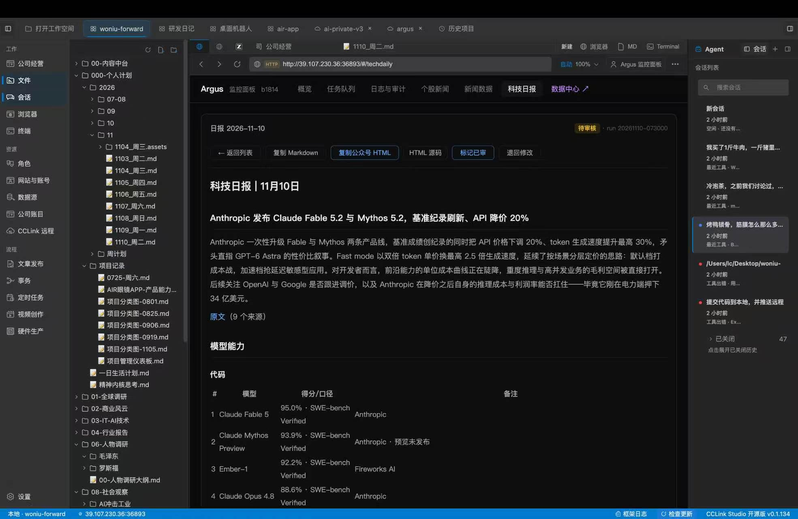
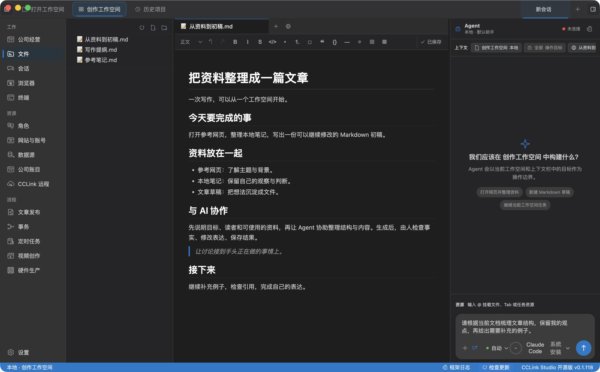
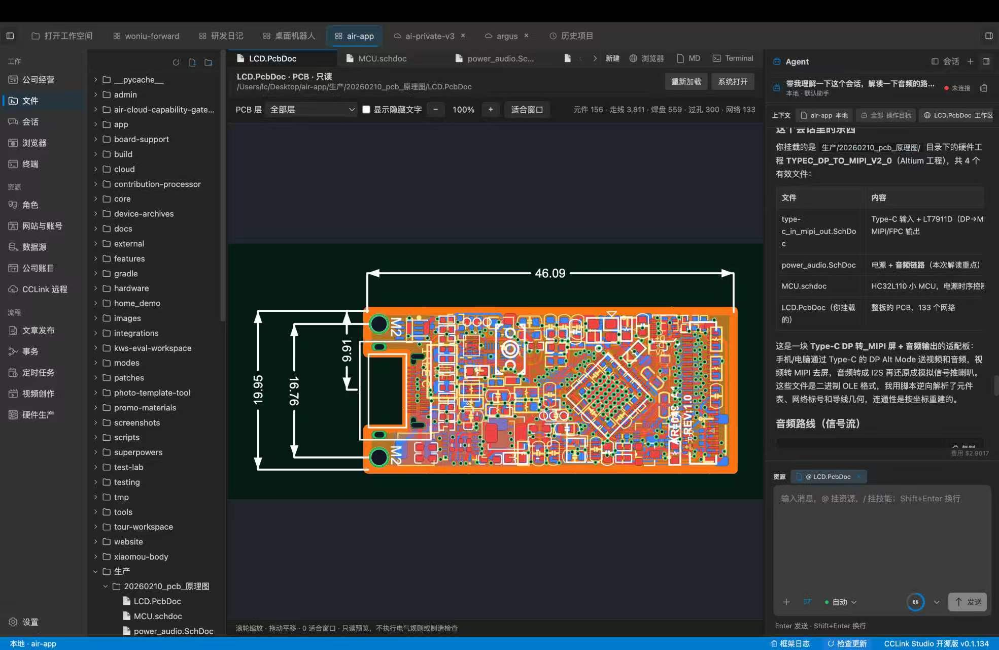

# CCLink Studio

**把文件、网页、文档和 Agent 放在同一个桌面工作空间。**

[](LICENSE)
[](https://github.com/AwsomeName/cclink-studio)
[](https://www.electronjs.org/)

[下载 macOS Apple Silicon 版](https://github.com/AwsomeName/cclink-studio/releases/latest) · [从源码启动](#快速开始) · [功能文档](#文档)

打开本地目录，边看资料、边写文档，与 Agent 协作处理手头的工作。本地工作台免费，免 CCLink 登录；模型使用你自己的账号或 API，远程服务按需登录。



*真实工作台（v0.1.134）：顶部切换项目，左侧管理文件，中央阅读网页，右侧保留会话。点击图片可查看完整界面。*

## 在一个工作空间里完成工作

### 文档就在手边，Agent 共享工作上下文

从本地文件树打开 Markdown，直接编辑并保存。把当前文档、文件或任务资源提供给 Agent，让讨论围绕实际材料展开。新建本地会话默认使用 Codex，也可选择 Claude Code；文件访问与工具操作沿用 Studio 的授权边界。



*文档演示截图（v0.1.118）：本地 Markdown 与待发送的 Agent 指令。*

[文档编辑](docs/features/document-editor.md) · [Agent 系统](docs/features/agent-system.md)

### 查资料与写作，不必离开工作台

浏览器与文档作为标签页并排管理。打开参考网页、切回草稿，或把网页作为 Agent 的操作目标；需要自动化时，在用户监视与权限约束下使用 Playwright。

[浏览器自动化](docs/features/browser-automation.md)

### 打开 PCB，图纸与讨论并排看

直接查看 Altium 原理图、PCB 与工程引用，无需离开工作空间。支持缩放、平移和 PCB 图层切换；在同一界面里对照图纸与 Agent 的分析，梳理元件、连接和项目资料。



*真实工作台（v0.1.134）：PCB 预览与 Agent 解读并排展示。图纸只读，不包含电路编辑、规则检查或制造校验。*

[Altium 图纸预览](docs/features/altium-readonly-preview.md)

### 还可以做什么

| 场景 | 你可以做的事 |
| --- | --- |
| 运行命令 | 使用工作空间内的 Terminal，或从支持的本地 Agent 会话代码块运行命令；沿用现有权限确认。[会话命令](docs/features/conversation-command-run.md) |
| 连接自己的设备与数据 | 连接 USB / Wi-Fi ADB Android 真机，或只读查询用户配置的数据源。[Android](docs/features/agent-device.md) · [数据源](docs/features/data-sources.md) |
| 继续远程工作 | 按需登录 CCLink，连接已配对的远程 Agent，使用远程文件、会话和 Terminal；本地工作台独立可用。 |

<details>
<summary>项目定位与完整能力边界</summary>

CCLink Studio 是 CCLink 唯一桌面 App。这个仓库承载可以从源码直接运行的本地工作台，以及可选的 CCLink 远程客户端配套。本地工作空间、Agent、浏览器、Markdown 编辑、Terminal、数据源和 Android 始终免费且不要求登录。

CCLink 云服务和远程 Agent runtime 仍由各自既有部署与 NPM 发布链路承接；本仓库不内置服务秘密、支付、签名、公证或发布凭证。

## 能力边界

| 能力                                   | Studio 状态  | 说明                                                                        |
| -------------------------------------- | ------------ | --------------------------------------------------------------------------- |
| 内嵌浏览器 + Playwright 自动化         | 保留         | Electron 内嵌 Chromium，Agent 可在用户监视下操作网页。                      |
| Markdown 编辑器                        | 保留         | Tiptap/ProseMirror，本地文件读写。                                          |
| 本地 Agent 面板                        | 保留         | 新本地会话默认 Codex；Claude Code 作为用户自配 API 的备选。                 |
| 本地文件和工作空间                     | 保留         | 本地目录浏览、文件读写、workspace state 恢复。                              |
| 统一上下文操作                         | 保留         | 右键、键盘和命令入口复用同一命令事实源，按对象贡献操作并提供脱敏诊断。      |
| Terminal                               | 本地与远程   | 本地 shell 免登录；远程 PTY 只通过绑定工作空间的 CCLink adapter 接入。      |
| 数据源只读查询                         | 保留         | 本地配置用户自有数据源，不内置官方云。                                      |
| Android 真机连接                       | 保留本地能力 | 通过用户自有 USB 或 Wi-Fi ADB 真机运行。                                    |
| CCLink Account / Device / Message 网络 | 可选内置域   | 只在用户打开远程入口后登录、连接；失败不影响本地能力。                      |
| 远程工作空间、文件和 Agent 会话        | 可选内置域   | 支持文件读写与远程 Agent；复用统一 Workspace、Tab 和 Terminal 生命周期。    |
| 订阅、配额和付费安全边界               | 云服务负责   | 客户端只能显示提示；当前付费门禁尚未经服务端闭环验证。                      |
| 桌面支付、WebDAV、托管设备服务         | 不迁移       | 云端部署与远程 Agent NPM 独立；签名、公证只在受保护的 Release runner 执行。 |

</details>

## 快速开始

```bash
git clone https://github.com/AwsomeName/cclink-studio.git
cd cclink-studio
pnpm install
pnpm dev
```

也可以使用项目脚本独立启动/重启后台开发进程：

```bash
pnpm studio:start
pnpm studio:status
pnpm studio:logs
pnpm studio:stop
```

`pnpm studio:start` 是本地实测入口，会在缺少 `node_modules` 时先安装依赖，然后重启后台开发进程并输出状态。等价脚本入口是 `bash scripts/studio.sh start`。

本地打包入口：

```bash
pnpm package:local
```

Studio 本地打包只生成 `dist/` 下的 Apple Silicon arm64 验收产物，产品名固定为
`CCLink Studio 开源版`。本地包使用 ad-hoc 签封，不包含 Developer ID
签名、公证、上传或生产 API 注入，也不会修改版本号。打包前后的目标校验见
[`docs/ops/package-target-check.md`](docs/ops/package-target-check.md)。

本仓库默认启动不依赖 `cclink-dev`、`chat-cc/deploy` 或 `chat-cc/Agent`。缺少 CCLink 服务配置时，远程入口明确降级，但本地功能仍完整可用。

验证本地桌面壳是否可独立使用：

```bash
pnpm smoke:local
pnpm smoke:ui
pnpm smoke:workflow
pnpm smoke:restore
pnpm smoke:standalone
```

冒烟检查会启动 Electron、连接真实 renderer，并验证无登录状态下的本地身份、设置、文件系统、浏览器、Agent 状态、Terminal、Android 降级路径、统一上下文操作、本地工作区、Markdown 保存、Terminal cwd 闭环，以及 `lastWorkspacePath` 启动自动恢复。`pnpm smoke:standalone` 会串联全部本地桌面壳冒烟。

### 系统要求

- macOS 13+
- Node.js 20+
- pnpm 9+

### Android

Android 能力只面向用户自有 USB 或 Wi-Fi ADB 真机。CCLink Studio 不下载 Android SDK、不创建 AVD、不启动模拟器，也不依赖托管设备服务。

本地没有 `adb` 时，应用仍应正常启动；设备能力会降级为不可用，并提示连接本机已有 Android SDK/adb 或设置 `ANDROID_HOME` / `ANDROID_SDK_ROOT`。

### Agent

CCLink Studio 不提供模型服务。新建本地会话默认连接本机 Codex，使用 Codex 自己的
ChatGPT 文件登录与账号额度；需要本机已安装兼容版本并完成登录。缺少 CLI 或不支持的
认证方式会明确报错，不自动切换到其他后端。已有 Claude 会话保留原绑定。

Claude Code 作为备选，在首条消息前从 Agent 选择器切换。需要在 `设置 > Agent` 配置
模型提供商、API 地址和 API Key；Studio 的 Claude 子进程不复用本机 Claude 订阅登录。
可以选择 `system`、`custom` 或 `managed` Claude Runtime 来源。
API Key 由主进程 `CredentialService` 保存到
Electron `userData/credentials/credentials.json`，不会写入工作空间、普通设置或
诊断日志。

构建链目前会把固定版本 Runtime 放入本地安装包，但新安装默认仍使用 `system`。
bundled Runtime 的公开再分发尚未批准，公开发布前必须完成
[`ADR 0002`](docs/decisions/0002-bundled-claude-code-runtime.md) 的许可门禁。

当前默认后端与认证边界见 [ADR 0022](docs/decisions/0022-codex-default-local-runtime.md)；
实测范围见 [Codex 验收](docs/testing/codex-default-local-agent.md) 与
[Claude 认证隔离](docs/testing/claude-auth-isolation.md)。

## 仓库结构

```text
cclink-studio/
├── docs/                  # 当前架构、开发和功能文档
├── scripts/               # 本地开发和本地打包脚本
├── src/
│   ├── main/              # Electron 主进程与本地服务
│   ├── preload/           # contextBridge 白名单 API
│   ├── renderer/          # React 工作台 UI
│   └── shared/            # 跨进程共享 contract
├── electron-builder.yml   # Studio 本地打包配置，不包含生产发布凭证
└── package.json
```

## 相关实现位置

当前不存在额外拆分出的云端或 Agent 独立项目。

- `cclink-dev`：迁移期只读参考与云端/发布运维工作区，不拥有第二套桌面源码或发布入口。
- `/Users/apple/Desktop/chat-cc/deploy`：CCLink 云函数和账号体系。
- `/Users/apple/Desktop/chat-cc/Agent`：CCLink Agent runtime。

## 文档

- [架构设计与架构宪法](docs/architecture.md)
- [已关闭的稳定化阶段](docs/stabilization.md)
- [开发指南](docs/development.md)
- [本地冒烟检查](docs/ops/local-smoke-check.md)
- [浏览器自动化](docs/features/browser-automation.md)
- [Agent 系统](docs/features/agent-system.md)
- [文档编辑器](docs/features/document-editor.md)
- [统一上下文操作系统](docs/features/context-action-system.md)
- [数据源](docs/features/data-sources.md)
- [Android agent-device](docs/features/agent-device.md)
- [Runtime 组件与能力插件方案（尚未实现）](docs/features/runtime-components-and-capability-plugins.md)
- [Runtime 组件与能力插件开发方案](docs/features/runtime-components-and-capability-plugins-development-plan.md)

## 许可证

CCLink Studio 开源桌面壳使用 [GPL v3](LICENSE) 许可证。
