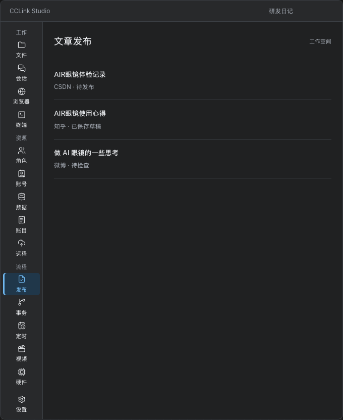
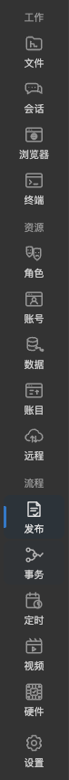
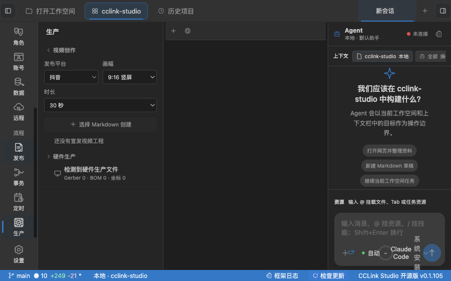

# Activity Bar · 图标下加短标签

> 旧窄导航实现的历史证据；源码目标已于 2026-10-15 更新为[文字横排产品方案](../../features/activity-bar-text-navigation-product-design.md)，
> 对应[开发方案](../../features/activity-bar-text-navigation-development-plan.md)已实施并通过真实 Electron 自动化，详见[新版验收记录](../activity-bar-text-navigation/README.md)。本轮未发版。

下文记录 2026-10-09 已实现的窄导航基线：在每个图标下常驻显示短名称，视频创作与硬件生产使用独立入口。
这些旧截图和验证结果不代表新的文字横排已通过验收。

## 保存的设计

[交互效果图](./navigation-preview.html)默认打开已实现的窄导航；其中的文字导航是当时对照稿，
新一轮实施以 2026-10-15 产品文档为准，不能直接照搬旧对照稿。
可编辑来源为 `navigation.fragment.html`。这是设计示意，不是实际应用截图。

## 实现范围与验收动作

1. 启动源码版 Studio，无需悬停即可读到「工作 / 资源 / 流程」以及全部入口名称。
2. 点击「账号」进入原「网站与账号」，点击「发布」进入原「文章发布」；选中状态清晰。
3. 点击「视频」只看到视频工程，点击「硬件」只看到硬件生产检查。
4. 将工作区缩至约 900 × 560，在导航区域滚轮滚动后仍能点到「视频」和「硬件」，底部「设置」常驻。
5. 点击「设置」正常打开设置页；两个新入口的右键和 Shift+F10 继续使用统一上下文菜单。
6. 切换浅色/深色均能阅读；打开内嵌网页，浏览器原生视图不覆盖导航或顶部工具栏。

导航宽 76px，按钮高 48px，图标 22px，标签 11px。长名称继续保留完整 tooltip 与无障碍名称，
Terminal 保留兼容名称，视觉标签显示「终端」。定时任务计数移至右上角，避免压住标签。

这是纯 renderer 呈现调整：仍由现有 UI/Tab store 拥有导航状态，不新增 IPC、权限、持久化或菜单 owner。
短窗口降级为导航滚动；设置在滚动区外。浏览器 bounds 与缩放继续由现有 BrowserManager 拥有。

## 验证证据

真实 Electron 开发实例通过 `pnpm smoke:ui --activity-bar-only`：14 个独立 Activity 入口和设置、
分组与文字、`490501cf` 初版格式视频工程打开、硬件扫描/检查/报告、滚轮滚动、右键/键盘菜单、浅深色截图，
并逐项比对真实原生浏览器 View 的 x、y、width、height 和顶部保护线。
测试使用隔离的本地工作区设置与本地网页，不涉及真实账号登录、模型调用或公开发布。

工程门禁：相关单元测试、web 类型检查、相关文件 ESLint、脚本语法检查与 diff 空白检查通过。
不声称完整全量回归或正式版本已发布；本轮未覆盖非零定时任务计数的真实运行状态。

## 查看当前源码

隔离数据预览入口：`pnpm smoke:ui --activity-bar-only --keep-running`。该命令现在输出新版文字横排导航，
不是本目录的历史窄导航；测试实例与截图不代表已安装版本发生改变。
普通 `pnpm dev` 与安装版共用单实例保护；要使用正式工作区数据查看源码版，先自行退出安装版再启动。
