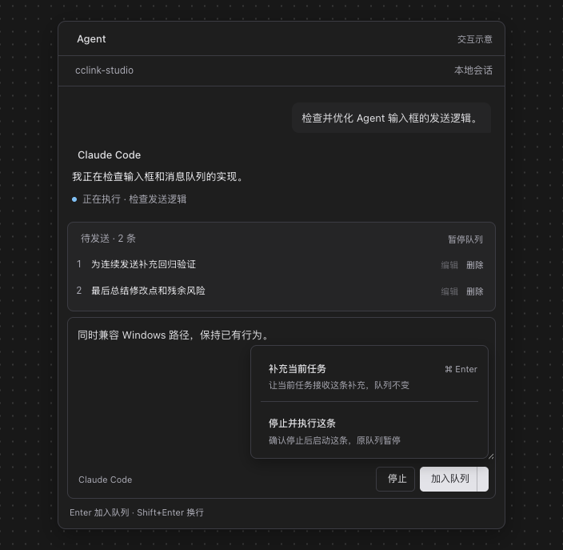
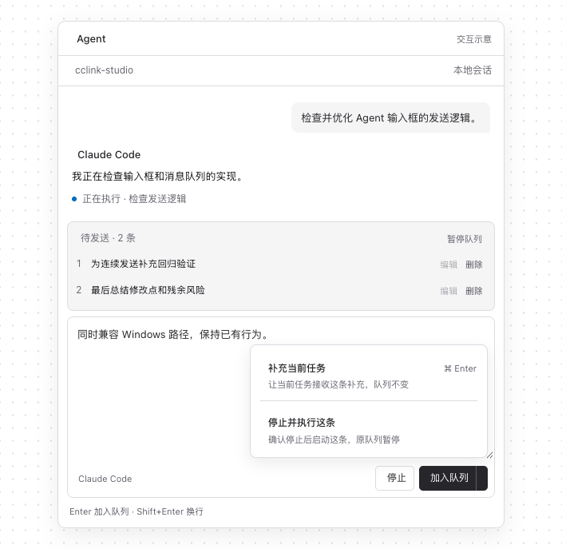
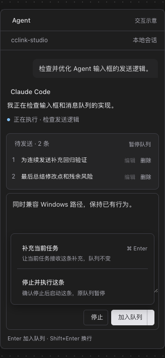
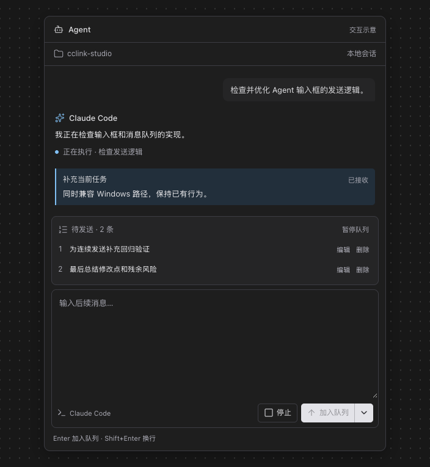
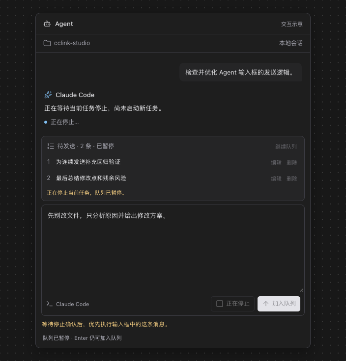
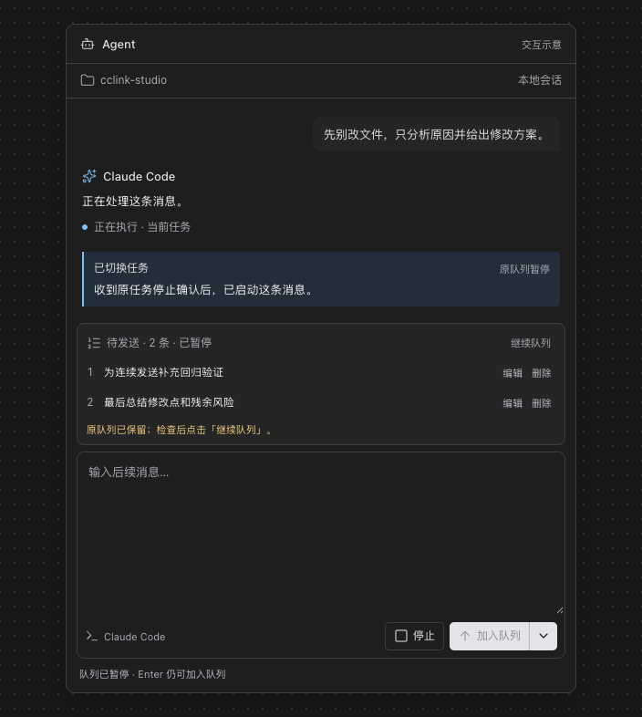
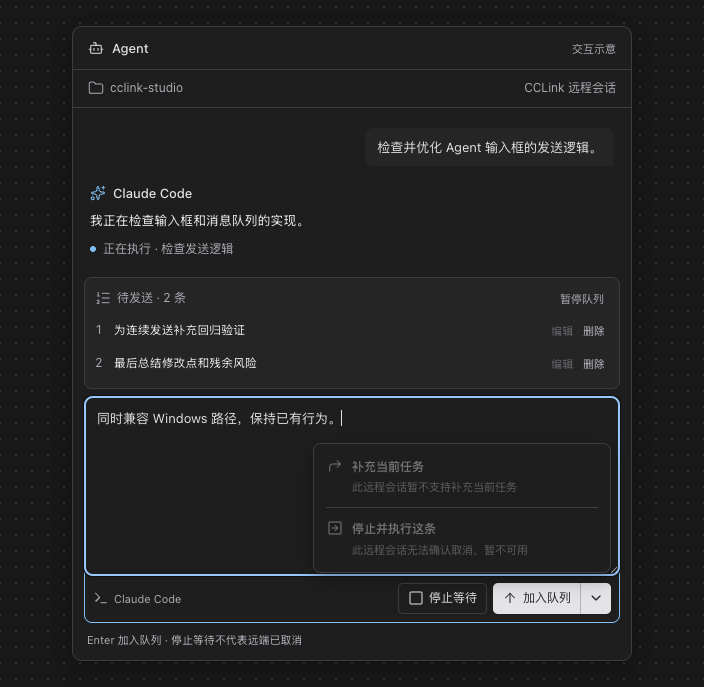

# Agent 后续消息操作效果图

2026-11-06 保存用户已确认的输入框方案。配套[产品设计与实现边界](../../features/agent-follow-up-actions.md)定义行为、能力边界和真实应用验收；以下均为产品示意，不是实际应用运行证据。

## 查看与编辑

- [交互预览](preview.html)：可在浏览器打开，体验入队、补充、停止、停止后执行及队列暂停。
- [可编辑来源](input-actions.fragment.html)：与会话中已确认的示意图一致。
- 默认 Enter 加入队列，其他两种操作从发送按钮右侧下拉菜单选择。
- 原型用模拟延时演示“待接收 → 已接收”和“正在停止 → 新任务启动”。真实实现不得用这些延时推断成功。
- 原型停止阶段暂时锁住输入以展示等待状态；正式实现应分离已受理消息和后写草稿，并按产品文档保留继续输入、入队能力。
- 预览使用受隔离的展示页面；图标和预览样式需要网络加载。PNG 可直接离线查看。预览内状态保存只用于演示，与 Studio 数据无关。

## 输入框

## 操作后的状态

补充关联当前任务，原队列保持不变。

停止尚未确认时，新消息等待，不启动下一任务。

确认停止后，优先执行新消息，原队列保持暂停。

## 远程能力边界

当前远程入口只支持排队和停止等待。缺少真实补充与取消能力时，菜单说明原因；不能把停止跟踪当作已取消。

## 原型检查

保存时用浏览器检查浅色/深色、360px 窄宽度、补充不改队列、等待停止后启动、原队列暂停、Enter 入队及远程禁用状态，无脚本异常，窄宽度无横向溢出。此检查仅覆盖设计原型；实现后的真实应用证据另见[后续消息操作验收记录](../../testing/agent-follow-up-actions.md)，不与本目录原型混用。
