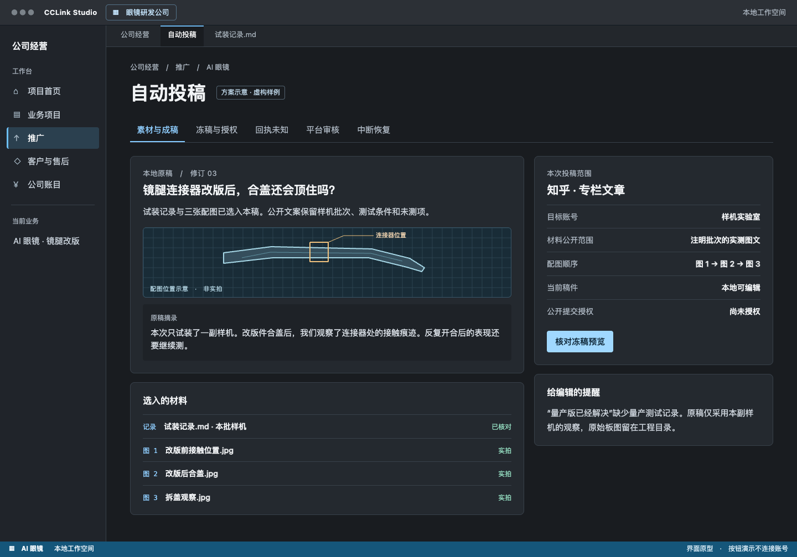
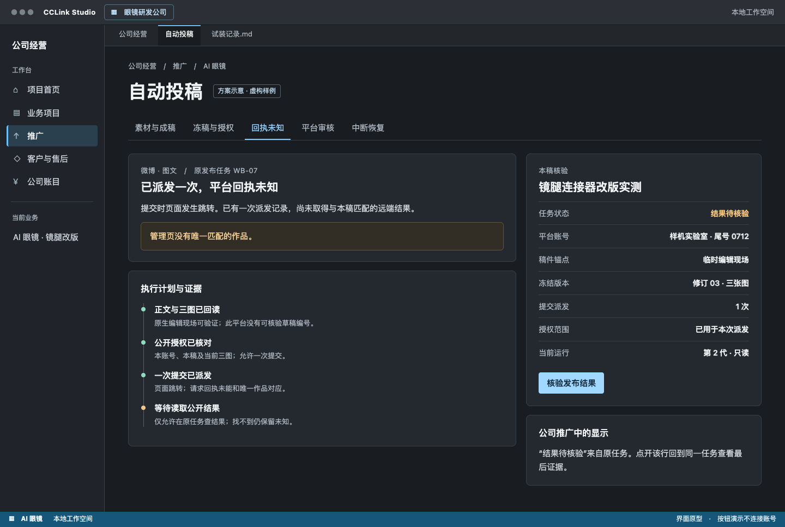

# 自动投稿 · 从镜腿试装记录到一篇可核验的图文

今天，运营人员可以在 Studio 的「公司经营 → 推广 → 新建文章发布」选择写好的 Markdown，进入指定平台的发布任务；还不能在这个入口完成从一批试装素材选稿、核对每条产品主张、冻结渠道稿到安全投稿的完整操作。**建议先交付一篇知乎专栏文章**：一份真实试装记录、三张获准公开的图片、一个已确认的公司账号、一个独立草稿。负责人从公司推广就能回到原任务，看到实际公开的文章，或者知道它卡在哪一步、还能做什么。[现有推广入口](../../../../src/renderer/src/features/company-workspace/CompanyPromote.tsx) · [知乎历史验收](../../../testing/article-day197-2026-09-28.md)

**先验收这个动作。** 编辑选择本批镜腿改版资料，在本地得到可继续编辑的图文。负责人从冻稿核对全文、配图顺序、账号、可见范围，再授权一次。Studio 在该账号保存草稿、提交并打开同篇公开页，用户逐段、逐图复核。从页面关闭或重启恢复时，稿件不会串到同名文章。未批准公开时，验收可止于同一真实平台草稿，记录为“平台草稿已核验”；公开验收单独留待有具体授权的批次。

[打开交互原型](preview.html) · [冻稿与授权](authorize.png) · [回执未知](unknown.png) · [平台审核](review.png) · [中断恢复](recover.png) · [官方接口、工具与本地模型比对](research.md)

## 为什么从知乎开始

知乎已有多轮“原账号、独立草稿、正文内图片位置、公开全文与三图”实测，适合说明眼镜改版前后的因果关系。首站困难也清楚：历史上正式任务之前常需独立 Agent 会话准备占位稿、取得草稿链接和账号标识。第一轮允许负责人从创作中心准备独立草稿并选择它，记录人工耗时；自动化准备入口是下一批可独立验收的改进。先用团队已能登录的真实账号跑通。缺知乎账号或本篇公开授权时仍可做本地原稿，不能自行换站发送。

### 六平台成绩应怎样读

下表是仓库历史记录的末态，**本次没有重发或在线复验这些作品**。第 190 天与第 196、197 天的“六平台”成员不同；小红书只出现在前者，B站只出现在后两轮。即刻有代码适配器，不列入历史六站成绩。

| 体裁 | 第 190 天（六站含小红书） | 第 196 天（六站含 B 站） | 第 197 天（同第 196 天） |
| --- | --- | --- | --- |
| 知乎专栏 | 公开全文与三图已核验 | 已核验，建稿有协助 | 正式任务首代核验通过 |
| 掘金文章 | 公开全文与三图已核验；有窗口显示旧计划的记录 | 已核验，准备过程有协助 | 正式任务首代核验通过 |
| 微博图文 | 公开正文与三图已核验 | 原任务只读找回后已核验 | 单次派发有结果链接，自动回读失败，留人工 |
| 头条微头条 | 原任务只读恢复后已核验 | 经恢复和诊断后已核验 | 管理页同稿三图审核中，持久化公开结果仍未知 |
| CSDN 博客 | 提交后审核中 | 原 Attempt 另行授权续发，旧未知派发仍在；审核通过再核验 | 跨日受控续发后审核中 |
| B 站动态 | 本轮排除 | 公开全文、作者、范围与三图已核验 | 从原 Attempt 第四代恢复后已核验 |
| 小红书图文 | 平台本地草稿已核，提交后无匹配回执，管理页未见本篇 | 本轮禁止 | 本轮禁止 |

第 196 天在开发协助下最终六站公开核验通过。第 197 天六站均有提交动作，只有三站自动取得完整公开证据。两轮都不能给出今天“六站全自动成功”的承诺。小红书第 188 天另有作品公开并由人在轮播中看过三图的记录，平台转换图片 ID 后主进程尚缺可信映射；这是人工观察和自动核验差异的实例。[第 190 天](../../../testing/article-day190-six-platforms-2026-09-15.md) · [第 196 天末次更新](../../../testing/article-day196-2026-09-28.md) · [第 197 天](../../../testing/article-day197-2026-09-28.md) · [固定版本稳定性记录](../../../testing/article-publishing-stability-2026-09-28.md) · [小红书第 188 天](../../../testing/article-publishing-xiaohongshu-2026-09-11.md)

## 用户从素材走到投稿

1. **选择本次业务和公开材料。** 从「AI 眼镜 → 推广」选择「从实测素材写稿」，已有成稿继续用原入口。仅选工作空间中的试装记录、已去敏照片、可披露的测量摘要。板壳工程通过现有「关联已有工程」定位，用户主动选入公开副本；不扫描整个研发目录。先标注批次、板壳版次、拍摄者或使用权、条件、实拍/效果图、对外范围。画面有路人、屏幕通知、客户资料或工程机序列号时，选已遮盖版本或移除。原始测试日志、精确位置与私有板图不进入成稿。
2. **把观察写成文章。** 模板给出“改了什么 → 如何试 → 观察到什么 → 还没测什么”。例如试装一副眼镜有图可查，只能写“这副样机合盖后观察到……”。“续航提升 30%”须有前后同条件实测、单位与数据出处；缺证据则移除、改为待测或退回作者。编辑在句子旁打开相应源段或图片。可选本地模型填初稿、提图注，编辑逐条接受。发布正文只导出批准的文字和图，内部的批注和来源定位留在工作空间。
3. **预览具体渠道版。** 长文保留图前图后段落与图注，短图文预览纯文本与图集排序；按该站经核实的字段约束提示超限。删节、换图、改顺序或改可见范围都展示差异并重冻。媒体已经变成签名 URL 时只显示脱敏身份。编辑能回到 Markdown 修改，也能只保存新本地稿。工作空间中的“本地稿”、App 中的“本地任务”、网站上的“平台草稿”三个名称写全。
4. **选账号并授权。** 显示站点、内容类型、业务账号标签与实际身份、草稿锚点、平台可见范围、全文、逐图和字段。选择“仅准备平台草稿”授权该账号该稿的填写、上传、保存；选择“授权本稿并执行一次”允许上述动作及一次常规公开提交。这次授权范围完全一致时直接运行；点击前已授权的单篇无需在末尾重复确认。验证码、换账号、原创或版权承诺等回到可见页面由人处理。两个按钮互斥；默认选项不会自动授权。
5. **跟着真实执行计划验收。** 编辑在原任务看每个动作的执行者、前置条件、实际值、证据和允许的下一步。还没进入的行显示“未开始”。回到公司推广，按业务找到同一篇稿的每个站点任务，各自显示公开核验、平台审核、待人处理或结果未知。多站只提供多个渠道版本和任务链接，各任务各自选账号和授权。

### 谁负责哪些数据

| 对象 | 唯一归属及最小数据 | 生命周期、边界和增量 |
| --- | --- | --- |
| 工程原件、实测记录、公开图、本地原稿 | 本地工作空间文件与现有文件服务。建议原稿沿用「运营/原稿」，源卡记录工作空间内相对路径、版次、句段或图号、公开用途。 | 原件保留。资料卡可作为原稿旁本地编辑资料，按需要创建，不含发布进度。引用失效提示重选，不能自动选择近似文件。手工模板不要求 CCLink 登录或模型。 |
| 公司业务关联 | CompanyWorkspace 的业务 ID 与既有 `CompanyResourceLink` 关联文件、发布任务；公司发布列表取 WebAffair 的投影。 | 关联失败只影响公司索引，可从文章发布页找回原任务再补关联。投影重建不会执行副作用。切换工作空间丢弃旧视图和订阅。 |
| 平台账号、Profile 与登录状态 | WebResourceService 持有网站和账号，BrowserManager 管受限 Profile/可见页。事务保存账号引用和核验后的平台身份。 | 显示“已登录”仍需在本次页面核验真实 UID/账号标识与作者。验证码、扫码由用户完成。凭证不进入画面、原稿、Agent 提示或诊断。 |
| 冻结渠道稿、授权和效果 | WebAffair 的 `articlePublishing` 持有 source、assets、fields、account、draft、sideEffects，以及本次授权范围。**拟增**内容指纹和可核对版本，主进程绑定批准的原稿、资产有序出现位置、字段、账号、体裁和可见范围。 | 现有 source/本地图主要核路径、mtime、size，不宣称已有逐字节冻结。建议创建只含批准内容的不可覆写版本，按确切字节算摘要，重开按快照回读；源文件后来编辑仅产生待选新版本。获准字节与实际派发输入不一致立即停；旧任务缺指纹只读其原证据，继续旧写入前重新核对。 |
| 进度、平台草稿、发布结果 | 唯一 owner 为 WebAffairService；Attempt、executionGeneration、current operation、有限 transitions、checkpoint.details、逐图上传记录、sideEffects、publication。网站是远端事实来源。 | Agent Run、BrowserTask 只拥有本次运行与页面绑定。UI、模型、公司列表只展示。审核证据建议折叠入原检查点的结构化观察（平台状态、稿件 ID、来源、时间），供公司投影读取，沿用 publication 的保守语义。 |
| 诊断与手工核验 | 本任务内记录脱敏任务/Attempt、代次、操作、耗时、原因码、期望与观察值差异、图片序号和证据来源。 | 只显示“平台回读 / 用户确认 / 尚待复核”的确切来源。人工选图或认领候选后仍由 main 复核；若只有人工目视，则保留“人工已核对、自动证据不足”。日志不记原文、cookie、签名参数或全屏隐私。 |

[架构宪法](../../../architecture.md#架构宪法) · [业务投影契约](../../../../src/shared/company-workspace/company-workspace-types.ts) · [WebResourceService](../../../../src/main/web-resources/web-resource-service.ts) · [现有文件入口](../../../../src/renderer/src/features/article-publishing/create-operations-draft.ts) · [发布状态契约](../../../../src/shared/article-publishing/article-publishing-types.ts) · [原稿与边界检查](../../../../src/main/article-publishing/article-publishing-service.ts)

## 执行计划如何判断每一步

每一行均采用“待开始 → 执行中/核验中 → 有证据完成”或对应的等待、失败、未知分支；实际状态来自 WebAffair 的本轮观察。有多图/字段时为每一项展开对应行。下表把动作写在真实链路上，已有细项继续使用原 ID 和检查点；素材编辑在正式事务之前完成。

| 执行者与动作 | 进入条件 | 完成证据 | 等待/失败时的状态与下一步 |
| --- | --- | --- | --- |
| 用户审稿，Studio 固定原稿与授权范围 | 资料可披露、正文有来源、工作空间可读、账号与站点已选 | 读回固定版本的全文、有序图片和字段；用户所选执行范围可复看 | 缺图、外链未收为批准副本、改稿、超限，标出具体项，回编辑；未授权公开可止于准备 |
| Studio 准备 Runtime 并核验账号 | 原任务有效，当前工作空间与 Profile 正确 | BrowserTask/Agent Run 与本代绑定，main 从站点读到 UID、页面类型和正确来源 | 登录失效待人；选错账号、多个页面不能唯一对应时阻断写入，重选后重核 |
| Studio/Agent 从管理页定位独立原稿 | 账号通过，具体草稿 ID 已给出或受保护创建 | 同账号、作者、ID、标题均匹配；新页/新代下发当前写许可 | 空草稿箱不自动覆盖别篇；找不到或同名多条，保留原 ID，让人选择并复核 |
| Agent 按图上传，Studio 逐图读回 | 本图证明确实缺失，唯一正文/图集文件控件，许可有效 | 预写单图效果、一次派发、平台图身份、实际加载与图序；同文件重复引用分别保留出现位置 | 掉线变为该图未知；先读原草稿，人可在同稿明确选存在/缺失。确认缺失才允许补此图 |
| Agent 填正文，Studio 对照冻稿 | 当前编辑器和图片绑定仍有效 | 全文回读；内文图逐个核前文/次数/顺序/加载，平台保留时核 alt，图集核原序和加载 | 平台截断、压缩、图位偏移或自动保存未落地，标出差异；改文需重新审稿、冻稿 |
| Agent 填平台字段，Studio 逐项核验 | 已读出可写字段且原稿未漂移 | 标题、摘要、分类、标签、封面按平台复读；头条提交前再核配乐；可见范围和声明有实际值 | 字段不适用按适配器列原因；受限、超长或涉及人工声明时停在该字段，不能自动扩权 |
| Agent/Studio 保存并复核 | 正文、图和字段一致；无未决保存效果 | 独立草稿重开后同账号/ID/正文/图序；小红书核同 Profile 本地 image-draft；微博/B站复核当前现场并明示无可靠草稿 | 保存未知先对账；临时现场消失时停止自动续写，不虚构 ID。只准备任务在此收尾 |
| Studio 预检，Agent 执行一次单篇提交 | 有对应授权、目标没变、字段保存通过或现场可核、当前代有效 | 主进程原子预写并消耗 publish 效果；仅该控件的一次派发。适配器分辨打开面板、规范弹窗和真正提交 | 按钮遮挡且未派发可纠正后重查；派发后断线、超时、崩溃均转只读。双击、两窗、旧代迟到不得第二次发出 |
| Studio 读回回执、审核、公开结果 | 已派发或存在结果未知 | 同账号回执/内容 ID → 管理页状态 → 抽取唯一公开作品，核作者、正文、图数/顺序/位置/加载。只核到哪一步就显示哪一步 | 回执不匹配保留未知；审核中留平台证据与时间；明确拒绝展示原因；多候选交人认领。同稿只读复核，关闭等待不清空派发 |

[已有逐步计划](../../../../src/shared/article-publishing/article-publishing-plan.ts) · [可观测执行协议](../../../features/article-publishing-observable-execution-protocol.md) · [WebAffair 检查点规则](../../../../src/main/web-affairs/article-publishing-checkpoint-rules.ts) · [浏览器发布策略](../../../../src/main/article-publishing/article-publishing-browser-policy.ts)

### 回执未知、平台审核和恢复

| 看到的情况 | Studio 允许的处理 |
| --- | --- |
| 审核中、仅自己可见、公开页暂时 404 | 在原任务只读查管理页与公开页。记录身份、最近一次观察时间和确切平台原文。在管理页看见“审核中”才显示这个标签；曾审核、现在失联则显示上次事实及时间。拒审保留原回执和原因，改稿另行确认。 |
| 已派发，收不到回执，或模型被限额 | 派发数显示 1，允许核验、暂停、交人查看；查询无命中不能证明未送达。用户看到作品链接却无法确认全文/图，分别展示“有结果链接”和缺哪项。 |
| 窗口重建、系统锁屏、Agent Run 中断 | 在同一 Affair/Attempt 生成新运行代次，执行 Runtime handshake，失效旧许可。先确认当前 Profile、UID、草稿与已有图，再继续下一个有证据可做的步骤。提交之后始终走只读核验。 |
| 手动操作与 Studio 同时发生 | 用户接管时先暂停写入，撤销旧 Runtime 绑定，重新读网页。用户已手工点过提交则登记该观察并转只读。两份同名稿或另一标签页改了内容，各自保留，不自动选最近一篇。 |
| 有人希望重试一次 | 通用入口只读。仓库已有 CSDN/B 站特定条件、带“接受可能重复”与上次效果键的独立特例；保留在原任务及其既有保护内，绝不从公司推广、跨站复制或普通恢复触发。一份新稿的授权也不能消耗旧稿的未知派发。 |
| 公司列表过期或来源不可用 | 显示最近核验时间或来源错误，进入原 WebAffair 刷新；空列表不判作全部完成。任务过期修订不回写，后台到前台、切换任务和重启分别验收视图一致性。 |

[审核示意图](review.png) · [恢复示意图](recover.png) · [原任务恢复策略](../../../features/article-publishing-restart-recovery.md) · [已有限定续发入口](../../../../src/renderer/src/features/article-publishing/ArticlePublishingTab.tsx)

## 分期实施与真人验收

**第一批可独立开工。** 业务负责人提供一份可以披露的镜腿改版记录、三张已处理的实拍和一个有专栏文章能力的知乎账号。编辑和负责人可由同一人兼任。先用现有 Studio 手动走已写好 Markdown 的路径，记下取草稿链接、核账号、找图、等审核各花多少时间。随后只为这篇稿补齐断点；其它四个专题、模型、云部署和多站队列都不在依赖链上。

| 次序及用户得到什么 | 实施与直接复用点 | 真人通过条件和失败处理 |
| --- | --- | --- |
| 1 · 从本批记录得到可编辑稿，并能发到一个知乎账号 | 在 CompanyPromote 的现有新建入口增加“已有稿/从素材写”。复用 `createOperationsDraft`、文件服务、Tiptap、`inspectSource`、现有任务 Tab/服务。用户选三图及记录，模板成稿，勾选来源并保存。首站继续输入独立草稿锚点；在现有 contract/主进程补可验证冻稿、准备或公开单次授权，把工作空间、业务和 affair 引回公司页。 | 编辑重开本地稿能看到来源，选择“只准备”后登录平台重开同稿可看到确切图位且 publish=0。另用获准公开的一篇，或在同稿获明确授权后执行，核对真实链接、全文和三图、一次派发；从业务列表回到原任务。公开条件不足时只签收前半段。 |
| 2 · 窗口或网络中断后能决定下一步 | 复用现有 Runtime handshake、generation、原稿写入许可、asset reconciliation、`verifyPublishedResult`。在已有结果详情补结构化审核事实、证据时间和来源，投影给公司页。为首站实测过的准备阻塞接入可见导航；仍找不到锚点则让人选择。 | 用只准备的稿在图 2 已派发时中断，重开复核原图才续；用获授权稿提交后断开观察，重开只读找同篇，派发次数不增加。真站如出现审核，记录其实际状态并等结果；没有经历审核时该分支标“未实测”，另以已有头条/CSDN 原任务验收只读显示。 |
| 3 · 同批素材为第二体裁准备独立图文 | 按真实运营需求先选微博图集，验证短文删节与图序；再按优先级接原有掘金/CSDN、头条、B站。各站复用独立 adapter 和 WebAffair，无“全部发送”。小红书只有本批明确指选才进入验证。 | 每个目标逐站测试实际账号、平台字段、草稿语义、用户授权、公开结果、未知回执及恢复。前一站的成功不解锁后一站。记录人工介入位置、重复提交数、逐图匹配及当天站点版本表现。 |
| 4 · 编辑自愿用本地模型缩短初稿时间 | 优先评测 Qwen3-VL-4B-Instruct 配匹配的视觉投影；对照 Qwen3.5、Gemma 4 与模板，OCR 只在测试表录入有返工时接入。采用本地已有推理服务或按需启动、结束释放；平台权限不授给推理进程。 | 负责人用相同三组资料对照选型实验，人工修稿缩短、批次与否定结论完整；断开模型仍能完成第 1 批。没有实测数据就不把此项写作成稿质量提升。 |

**工程准备度。** 以共享 contract + schema 校验主进程 sender、workspaceRef、冻结版本和作用域，renderer 不直连文件或网页。复用原任务原子写入及执行互斥；创建版本时先写临时副本并校验，再提交引用，崩溃后只清无引用临时件，旧稿继续可打开。关闭/切换时解除本次订阅和页面监听，旧代回报丢弃。失败归类为资料、Studio、Runtime、网页、人工或未决副作用；受影响 smoke、类型检查和现有门禁单列，不增加 operation 账本、跨站调度、第二套 IPC 或第二个发布服务。[事务服务](../../../../src/main/web-affairs/web-affair-service.ts) · [执行协议](../../../features/article-publishing-observable-execution-protocol.md)

**用户功能进度。** 交付物为设计和可操作的界面原型；当前实现的能力以首段和历史逐站表为准。上述四批新能力的真人验收均待实施。实施时给每一站分开记录三份结果：执行计划能否随真实事件更新、一次提交是否取得远端公开证据、全过程是否有开发者救场。结论附版本、日期、脱敏任务 ID、图数、派发次数、介入说明和可复看的页面。无新能力超过 60 分钟，或同一阻塞连续两次，暂停扩张，保留现场并回到可验收的最窄一步。

### 设计审查后的取舍

- **所有站都有“草稿”，是否能统一保存？** 微博和 B站的本流程只有临时现场，小红书有 Profile 本地草稿，知乎有独立服务端草稿。统一动作会伪造可恢复性。UI 直接命名“本地原稿 / 平台草稿 / 临时编辑现场”，按站启用保存与恢复。
- **改版图尺寸和文件名没变，授权是否仍有效？** mtime/size 是现状，拟增的内容摘要和只读版本补上同尺寸替换。提交前用本稿固定的字节和平台回读。平台重编码后用可信上传映射及人工对照，不以两个不同阶段的文件 hash 强行比对。
- **能否靠“自动写得像实测”节省时间？** 一副样机不能支持量产、疗效、所有用户或续航保证。批次冲突、没有对照、图为渲染时在编辑阶段拦下对应断言，允许保留真实观察与未测项。此处人工审的是内容事实；平台的提交权由单篇授权另外决定。
- **能否一次性买或接一个发布器？** 中文站名覆盖较广的工具以草稿同步、不同体裁或扩展登录态为主。官方 B 站专栏是合格的后续接口候选；它不解决本轮动态发布。优先投时间给“成稿、核准、拥有可复核结果”这条旧链路。[按体裁复核记录](research.md)
- **何时值得再做自动化？** 同一编辑以同批资料手工和使用 Studio 各走一次，记录从素材到获批稿的编辑分钟数、跨应用找稿次数、逐图返工、用户介入处及重复投稿数。外部审核等待单列；下一批只解决真实出现且能减少返工的阻塞。

## 原型核验

五张 PNG 均来自同目录离线 HTML，均在标题区标明“方案示意 · 虚构样例”。素材与授权页演示同一份样稿；三个异常页演示不同平台、不同原任务的独立现场。可在浏览器点击页签、打开冻稿、选择授权或仅准备、只读核验结果。示例按钮不会操纵真实站点。各图含真实浏览器排版的中文文字；图位以线描示意，不冒充样机实拍。

核验记录：Chrome 158 对五个场景逐一渲染，在 1440、1024、768、375 像素宽度检查切换与横向溢出。20 个场景与宽度组合通过，页面无脚本错误、无外部网络请求；分别点选两种授权模式验证互斥反馈。五张 PNG 已逐张打开检查中文、状态文字、配图标注和按钮；两份文档中的 33 处本地链接均可定位。

本次研究、方案审查与最终界面核验从 **2026-11-26 10:15:16 至 10:28:20，Asia/Shanghai（UTC+8），共 13 分 04 秒**。仓库基线为 `dfaf4499`。业务代码与 Git 记录未修改。
