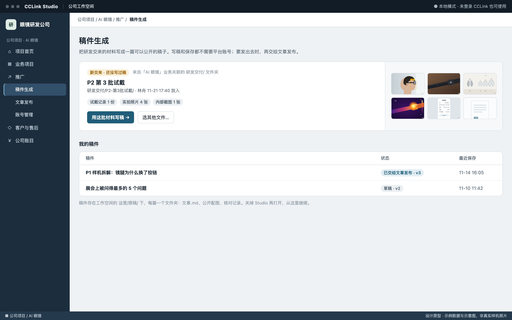
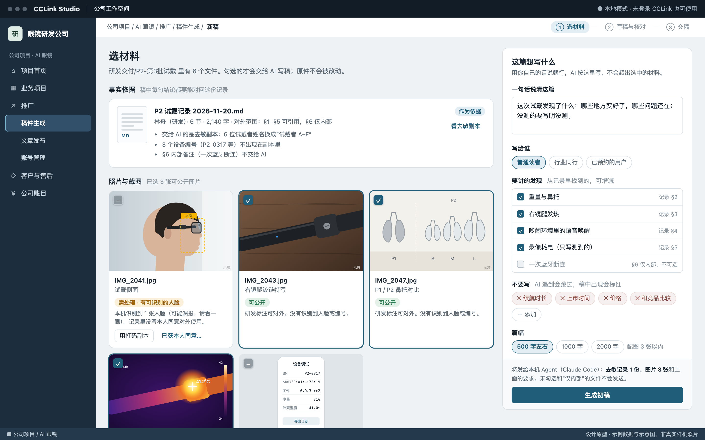
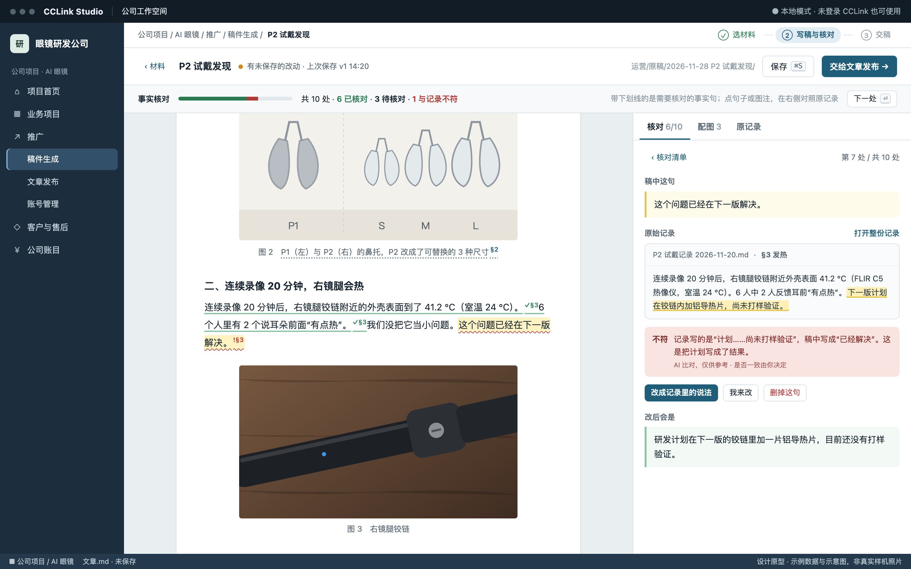
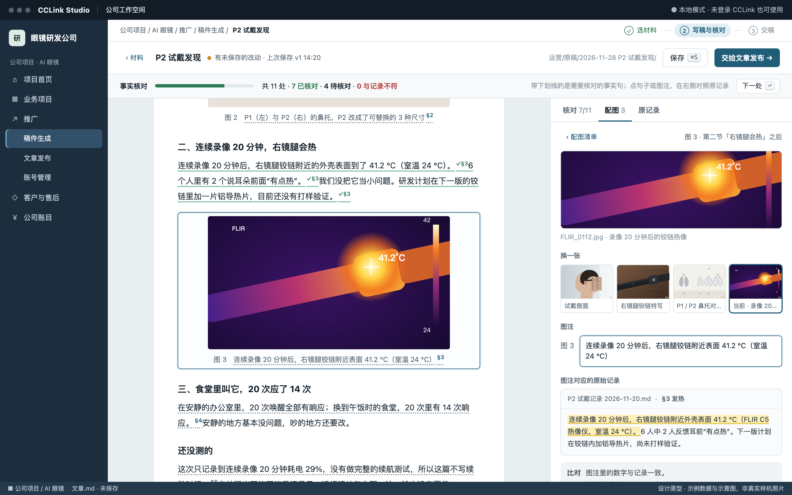
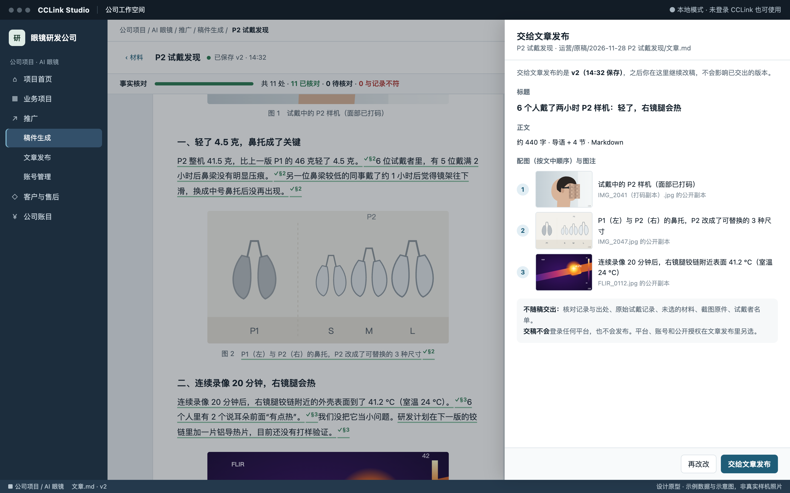
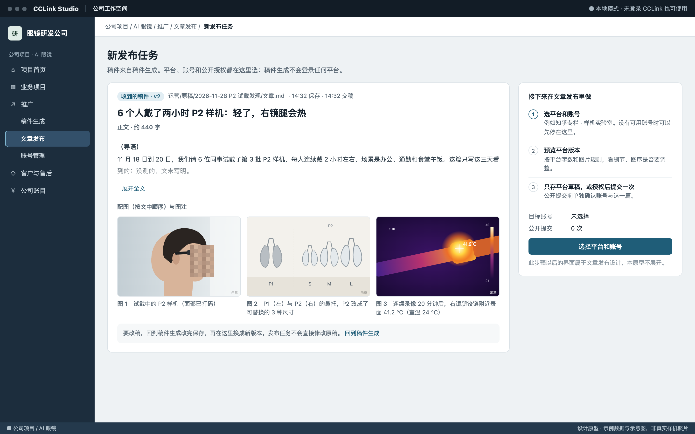

# 稿件生成 · 从试戴材料到可交出的稿子

2026-11-28 · 公司项目 → AI 眼镜 → 推广 → 稿件生成 · 推荐设计

[打开可点击原型](prototype.html) · 直达画面：[入口](prototype.html#entry) · [选材料](prototype.html#select) · [核对一句](prototype.html#verify) · [换图改图注](prototype.html#image) · [交稿](prototype.html#handoff) · [文章发布收稿](prototype.html#received) · [交稿后又改了稿](prototype.html#newer)

本稿取代 [旧稿件生成设计](../README.md#一稿件生成) 的布局和交互，数据归属与文章发布的边界沿用旧稿。图中照片均为 SVG 示意图，不是真实样机照片；人名、编号、数值都是虚构样例。

## 场景

研发林舟 11-21 把一批材料放进「AI 眼镜」业务关联的 `研发交付/P2-第3批试戴/`：

| 文件 | 内容 | 能不能公开 |
| --- | --- | --- |
| `P2 试戴记录 2026-11-20.md` | 6 位同事试戴 2 小时：重量、鼻托、发热、语音唤醒、电量，§6 是内部备注 | 作为事实依据；§1–§5 可引用，§6 仅内部；有试戴者姓名和设备编号 |
| `IMG_2041.jpg` 试戴侧面 | 能认出试戴同事的脸 | 需处理：打码，或者确认本人同意 |
| `IMG_2043.jpg` 铰链特写、`IMG_2047.jpg` 鼻托对比 | 产品细节 | 可公开 |
| `FLIR_0112.jpg` 铰链热像 | 录像 20 分钟后 41.2 °C | 可公开 |
| `调试页截图_P2-0317.png` | App 调试页，带 SN、MAC、固件版本 | 仅内部 |

运营同事想写一篇「这次试戴发现了什么」。样稿标题是《6 个人戴了两小时 P2 样机：轻了，右镜腿会热》。

## 推荐设计一句话

**“选材料 → 写稿与核对 → 交稿”三步。每一句带数字或结论的话都要对回原始记录，由人点确认；保存随时可以，交稿前必须全部核对完。交出去的只是某个已保存版本的标题、正文、配图顺序和图注。**

## 画面 0 · 点进来第一眼

- 最上面是**研发新交来、还没写过稿的那批材料**：文件夹名、谁什么时候放进来、记录、照片、截图各几份，加上缩略图。主按钮是「用这批材料写稿」。
- 下面是「我的稿件」，写到一半的稿可以直接接着写，已交出的稿显示交出的版本号。
- 页面上没有平台、账号或登录这类内容。写稿用不到它们。
- “新交来”的判断方式：业务关联文件夹下的子文件夹，按修改时间排序，还没有对应原稿的标成“新”。Studio 不扫描整个研发目录。

## 画面 1 · 选材料，并告诉 AI 这篇想写什么

左边是材料，右边是写作要求。

**材料分三种状态，每张卡片都写明原因：**

| 状态 | 判断依据 | 用户能做什么 |
| --- | --- | --- |
| 可公开 | 研发在文件夹里标了可对外，本机识别也没发现人脸或编号 | 直接勾选 |
| 需处理 | 本机识别到人脸，记录里没写本人同意 | 「用打码副本」：另存一份打码图，原图不动；或者「已获本人同意…」并写下是谁同意的 |
| 仅内部 | 研发标了内部，或者画面里有 SN、MAC 等编号 | 不能勾选，不发给 AI。确实要用时，「生成遮盖副本」后再选 |

本机识别只作提示，可能漏报，卡片上会写明，最终以人看过为准。

**试戴记录是“事实依据”，不是配图。** 卡片上写明交给 AI 的是去敏副本：6 个姓名换成“试戴者 A–F”，3 个设备编号去掉，§6 内部备注不给。原记录只在本机给人核对时显示。

**写作要求（右栏）：**
- 一句话说清这篇写什么，用运营自己的话写。
- 写给谁：普通读者、行业同行、已预约的用户。
- 要讲的发现：从记录各节里找出来，供勾选，每条标出来源，例如“记录 §3”。§6 的蓝牙断连会列出来，但不能勾选，这样运营知道它被排除了。
- 不要写：续航时长、上市时间、价格、和竞品比较。稿中出现时会标红。
- 篇幅和配图上限。
- 「生成初稿」按钮上方写明这次发给本机 Agent 的内容：去敏记录 1 份、图片 3 张。未勾选和仅内部的文件不会发出。

## 画面 2 · 写稿与核对（本次设计的重点）

### 2a 对照原始记录核实一句结论

- 顶栏是**事实核对进度**：共几处、已核对几处、待核对几处、与记录不符几处。右侧「下一处 ⏎」可以只靠键盘一路核对下去。
- 正文里带数字或结论的句子都有下划线：虚线表示待核对，绿色实线表示已核对，红色波浪线表示与记录不符。句末的小标记写着它对应记录的哪一节，例如 `§3`。
- 点一句话，右栏会依次显示：**稿中这句 → 原始记录那一段（对应文字高亮）→ AI 比对提示 → 操作按钮**。
- 样例里 AI 把“下一版计划加导热片，尚未打样验证”写成了“这个问题已经在下一版解决”。右栏标出“不符：把计划写成了结果”，并给出三个选择：
  - 「改成记录里的说法」：先预览改后的句子，改完仍需本人确认；
  - 「我来改」；
  - 「删掉这句」。
- 数字由计算得出时，右栏会写明算法，例如“4.5 克 = 46.0 − 41.5，记录没有直接写”。姓名被换掉、“M 号”写成“中号”这类改写，也会注明。
- **AI 比对只作提示。只有人点了「确认一致」才算核对过。** 每次确认都记录时间。

### 2b 换掉一张图、改图注

- 点正文里的图，右栏切到这张图：
  - 大图；
  - 「换一张」：只列出已选、可公开的图，仅内部的截图不会出现；
  - 图注输入框；
  - 图注对应的记录段落。
- 样例里 AI 在“右镜腿会热”一节下面放了铰链特写。运营换成热像图，把图注改成“连续录像 20 分钟后，右镜腿铰链附近表面 41.2 °C（室温 24 °C）”。
- **图注里出现数字或结论，就当作一处事实，和正文一样核对。** 改完图注后，核对总数从 10 变成 11，这一处回到待核对，直到本人确认。
- 图号按在文中的位置自动编排。「配图」页签里可以上下移动图片，移动时图注跟着图一起走。
- 换图不删除原图。稿子用的是 `运营/原稿/…/images/` 下的公开副本。

### 2c 保存

- `⌘S` 或「保存」写入 `运营/原稿/2026-11-28 P2 试戴发现/`。目录里有 `文章.md`、`images/`（公开副本）和核对记录（每处对应哪段原文、谁在什么时候确认）。
- 每次保存生成一个版本号，例如 v1、v2。顶栏显示“已保存 v2 · 14:32”，有改动时显示“有未保存的改动 · 上次保存 v1 14:20”。
- **保存不受核对进度限制。** 核对到一半也能存，关掉以后从入口的「我的稿件」继续。

## 画面 3 · 交给文章发布

点「交给文章发布」后，右侧抽屉列出**这次交出的具体内容**：

- 交出哪个版本：v2（14:32 保存）。交出后继续在这里改稿，不会影响已交出的版本。
- 标题、正文字数和结构。
- 配图按文中顺序排列，每张显示缩略图、图注和公开副本来源。
- **不随稿交出：** 核对记录与出处、原始试戴记录、未选的材料、截图原件、试戴者名单。
- 交稿不会登录任何平台，也不会发布。

两种拦截情况：
- **还有待核对或不符的地方：** 抽屉里列出这几处，按钮变成「去核对下一处」，不能交稿。理由是交出去的稿会被拿去公开。
- **编辑器里有未保存的改动：** 抽屉说明“会先保存为 v3，再把 v3 交出去”，按钮变成「保存为 v3 并交稿」。交出去的永远是一个保存过的版本。

交稿后切到「文章发布 / 新发布任务」，显示收到的 v2：来源路径、保存时间、交稿时间、标题、正文（可展开）、三张图及图注。下一步是选平台和账号，属于文章发布的设计，本稿不展开，只显示“目标账号未选择、公开提交 0 次”。

交稿后又改了稿：如果在稿件生成里另存了 v3，发布任务上方出现提示“稿件生成里有更新的 v3。这个任务仍使用 v2”，可以选「换成 v3」或保持 v2。发布任务不会直接改原稿。见 [原型 #newer](prototype.html#newer)。

## 规则汇总

| 事项 | 规则 |
| --- | --- |
| 什么算“事实” | 正文里带数字、比较或结论的句子，以及含数字或结论的图注。纯描述画面的图注、作者的看法句不算 |
| 谁判定一致 | 人。AI 负责找出处、比对并给出提示；确认按钮只有人能点 |
| 保存 | 随时可以，不受核对进度影响 |
| 交稿 | 所有事实都已核对，或者被删掉；交出的是一个已保存的版本 |
| 交出的内容 | 标题、正文 Markdown、按文中顺序排的配图公开副本及图注、版本号与保存时间 |
| 不交出的内容 | 核对记录、原始记录、未选材料、原图原件、去敏映射表（姓名对照） |
| 发给模型的内容 | 去敏记录、已勾选的可公开图片（含打码或遮盖副本）、写作要求。仅内部和未勾选的文件不发 |
| 原件 | 只读。打码、遮盖、裁切都另存副本 |

## 数据归属与边界

- **原稿和核对记录**由工作空间文件服务保存，路径为 `运营/原稿/<日期 标题>/`。每个版本是一份不可覆写的快照，交稿时引用的是快照本身，不是“当前文件”。
- **材料公开状态**由研发在交付文件夹里的标注加本机识别提示得出，结果只用于选材界面，不写回研发的原件。
- **生成**复用本机 Agent，属于一次性运行，不保存发布进度。断开模型时，仍可以手写或套模板写稿，核对与保存照常可用。
- **交稿之后**，发布任务、平台账号、授权、提交与核验全部归 WebAffair 和文章发布所有。稿件生成只登记“v2 已交给哪个任务”，在入口列表里显示。
- **失败与降级**：
  - 原记录被移动或删除时，已核对的事实保留确认记录，并提示“出处已不可读”，不会自动匹配到相似文件；
  - 模型失败时，稿子停在已有内容，不会清空；
  - 打码副本生成失败时，这张图仍是“需处理”，不能勾选。
- 写稿全程不需要 CCLink 登录，也不需要平台账号。

## 真人验收（实现后）

1. 在没有配置任何平台账号的工作空间里，放入一份试戴记录、4 张照片和 1 张带编号的截图。打开稿件生成，第一眼看到这批材料。
2. 带人脸的照片要先打码才能勾选；截图不能勾选。查看本次发给模型的内容，确认里面没有姓名、编号或 §6。
3. 生成初稿后逐句核对。至少遇到并修正一处“与记录不符”；用数字算出来的句子会显示算法。
4. 换掉一张图并改图注，图注变成待核对；确认以后保存。关掉 Studio 再打开，改动、图序和核对状态都还在。
5. 留一处未核对，点交稿，应该被拦住。全部核对后带着未保存的改动点交稿，应该先保存为新版本再交出。
6. 在文章发布里看到的标题、正文、图序和图注，与交出的版本逐项一致；原始记录和核对记录不在其中。
7. 回到稿件生成另存新版本，发布任务出现“有更新版本”的提示，并且仍然使用旧版本。

## 拷问与待定

- **逐句核对会不会太累？** 样稿 800 字以内，有 11 处事实，用 ⏎ 连续确认大约两三分钟。长文按节折叠核对。这一步省不掉：一副样机的试戴结果被写成“已解决”或“续航提升”，对小公司的伤害比多花三分钟大得多。实现后应该记录每篇的核对耗时和“不符”被抓到的次数，用来判断这一步是否值得。
- **“事实句”靠 AI 圈出来，漏圈怎么办？** 用户可以选中任意一句，标成“需要核对”。是否允许取消某句的事实标记，取消时是否要写理由，**待定**。建议允许取消，但要记录下来。
- **本机人脸和编号识别能不能做到？** 需要验证。识别不了时退回为“未标注 → 请确认”，不能默认可公开。
- **“已获本人同意”记录在哪？** 建议记在原稿的核对记录里，写明谁、什么时候同意的，不回写研发文件夹。是否需要上传同意书，**待定**。
- **文章发布能不能改稿？** 本设计不允许。发布侧要按平台删节，作为该平台的渠道版本另存，原稿不变。这需要与文章发布的设计对齐。
- 本轮只交付设计稿和原型，没有改业务代码。上面的验收步骤都还没执行。
