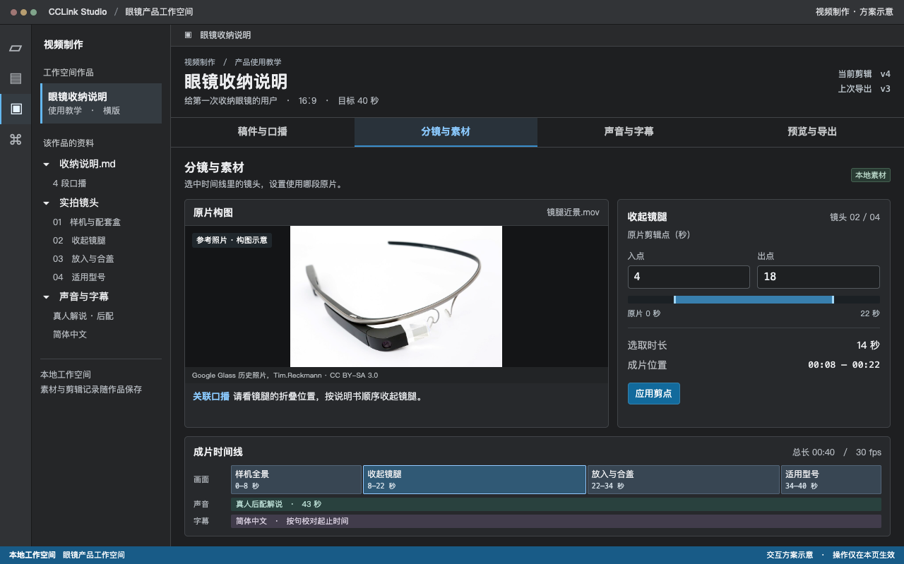

# CCLink Studio 视频制作方案

**给 AI 眼镜小公司的第一版做一件事：让拍产品的人自己完成一条可交付的 30–60 秒中文短片。** 他从一份已核对的产品说明开始，把每句话连到对应的实拍动作，剪出需要的几秒，配上解说与字幕。收工时同事能打开一个普通 MP4，隔天制作人能重开工程，只改有问题的那一句。

**第一条真人验收动作**　从 Studio 的「视频」侧栏选 Markdown，新建作品，导入本次样机的实拍和真人解说，完成一条使用说明。导出后用系统播放器从头看到尾，再断网重开 Studio，找回同一版并改一句。原交付文件仍能播放，新的剪辑版会指出要复核的声音和字幕。此项是后续开发的产品门槛。

## 一、功能设计

首个场景选售后同事反复要解释的「这款眼镜如何放回配套盒」。它有可拍的完整动作、有对应说明书，一人即可拍摄和核对。第二种用途是销售演示，例如经确认支持拍摄的型号如何启动一次拍摄，此时要补上设备原始输出或可核实的反馈。第三种用途是版本更新说明，绑定固件及适用机型，一次重做变化的段落即可。三种用途共用同一个制作流程。

| 区域 | 制作人实际操作 | Studio 的响应与完成条件 |
|---|---|---|
| 作品列表 | 从当前工作空间选择原稿，填写片名、面向谁、演示型号、横竖画幅与目标时长。下次可从同一列表重开 | 保存不可变原稿快照、可独立修改的口播及工程 ID。列表显示最近编辑时间、继续制作位置和最近成功导出的版本。缺型号可先剪，定稿时定位提醒 |
| 稿件与口播 | 把说明拆成开场、动作、结果、适用范围；可增删、排序、手写或采纳 Agent 的某一版建议 | 每段有稳定 ID。保存与「确认口播」是两个动作；稿件中的事实和说法由人核对。调用 Agent 前显示发送内容及用量，全手工也可走完 |
| 分镜与素材 | 先选一句，再绑定一个或多个镜头；导入公司实拍、设备原片或录屏，填来源；点入点、出点，排列镜头 | 同屏显示源片长、使用范围、成片落点。完整入画为默认，可逐镜做竖屏裁切。素材过短给出缺几秒，提供缩短、换镜头、明确停帧三种处理 |
| 声音与字幕 | 导入真人录音，选择保留哪些镜头原声；逐句循环试听、拆并字幕、调起止点，核对产品名和中英文缩写 | 字幕与声音共用成片时间尺。举例：画面 40 秒、解说 43 秒，标出末句多出的 3 秒；可重录末句或延长有余量的镜头。带音乐时分别调音量，审阅时可单听人声 |
| 预览与交付 | 生成当前版低清整片，拖到剪点检查指尖、镜腿、设备屏幕、字幕与声音；确认后选画幅，导出或查看历史成片 | 横版默认 1920×1080，竖版 1080×1920，30 fps。每次导出生成独立的 H.264/AAC MP4、UTF-8 SRT、含逐镜源范围的来源清单，可选目录交付同事。页面列出导出的输入版本、文件位置和校验结果 |
| 次日接续 | 重开同一作品，定位上次版本，修正某个型号、声音或镜头；再次导出 | 完整文件即时可播，编辑进度与历史成片并列。替换相同内容的素材可重链；换成另一条实拍须重看受影响的段落 |

一个人可兼任产品负责人和制作人。交给同事复核时，负责人看说法是否符合这款实物，制作人看剪点、声音和字幕。源文件有客户画面、通知、路人声音或第三方图片时，登记可用范围，必要时改用已取得授权或已脱敏的素材。来源清单能定位到镜头。眼镜录屏、外部相机拍摄、手机界面、后配提示音各自标明，生成的示意画面仅用于解释概念。

## 二、产品逻辑

**作品按「产品事实 → 分段口播 → 实拍源范围 → 声音/字幕 → 某一版成片」保存。** 成片只引用已采用的资料。脚本建议、机器听写、合成配音和生成画面都是候选；人明确采用后才进入剪辑。工程可以有空槽并随时保存。导出前，缺失的必要素材、未解决的时间冲突或未核对的来源都要能跳回对应镜头。

以 40 秒的收纳说明为例。0–8 秒让观众认清眼镜与盒子，8–22 秒完整展示折叠，22–34 秒展示放入与合盖，34–40 秒显示适用型号。第 2 镜从 22 秒原片里取第 4–18 秒，时长是 14 秒，成片位置是 8–22 秒。若将出点改成第 17 秒，后两镜的成片起点各前移 1 秒。整轨真人录音依然留在原来的录制时间，系统提示复听，避免把下一句话错配到前一个动作。

| 用户遇到的变化 | 系统保留什么 | 下一次可执行动作 |
|---|---|---|
| 改了第 2 段口播 | 保留原录音、旧字幕、已导出的文件。只标该段的文字关联待复核；若用整轨真人录音，指出关联区间 | 改字幕、试听旧录音决定沿用或重录；按段合成时只需要重做该段 |
| 改画幅、换镜头、重排 | 口播文字仍可用；同一剪辑参数生成的代理才算当前预览。切画幅需重新检查每镜构图和字幕换行 | 查看受影响镜头，重生成本版预览。横竖两个交付版本分别保存 |
| 导出 v4 时继续编辑到 v5 | 任务固定读取 v4 的素材、范围、声音、字幕及参数，完成后挂到 v4；上次导出继续可用 | 继续等 v4 或取消。要交 v5 就按当前剪辑新建导出；两次各自有文件名和 ID |
| 断电、磁盘满、模型未装、素材失联 | 已成功导出的版本完整保留；半成品写入临时目录。模型缺失只影响其对应的辅助操作 | 重开显示具体失败步骤，可释放空间、重链同内容文件、换源、手写字幕或重新渲染原快照 |
| 同一工程在两处编辑 | 主进程按预期版本拒绝过期覆盖，保留本地未保存草稿 | 比较变化、重新应用本次修改后保存；切旧版或关闭前给保存/放弃/取消三种选择 |
| 想发到平台 | 制作域交出人工选择的成片 ID、文件摘要及来源 | 投稿域另选账号、授权上传、获取回执；制作页到本地文件交付为止 |

**新旧版怎样接。** 当前新版第一步已经能改、保存、确认分段口播，其余三页仍是操作骨架。旧工作台已有场景、素材、旁白、字幕、成片任务和历史播放。继续使用原「视频」侧栏和同一类 Tab，在新版后三页接现有服务。旧渲染会循环过短的实拍、去掉镜头原声、按视觉时长补齐或截断整轨解说；这些行为要在新剪辑计划中改成可见选择。[现有首步实施与验收](../../../features/video-creation-step-one-plan.md) · [旧渲染服务](../../../../src/main/media-production/media-render-service.ts)

旧工程继续按旧格式打开。首次使用新剪辑时提供「另存为新版工程」，先对照新版独立口播与旧分镜旁白，再由人选择文字、字幕、整轨录音和已有导出要沿用哪些。原样保留旧工程；新工程写独立 ID 和同级格式目录。原因是旧版会严格扫描整个工程根目录，混入新格式可能使作品列表整体报错。转换完成前可取消，重试沿用同一次转换结果；存量工程兼容验收通过后再调整默认入口。[完整对象归属、迁移事务与恢复规则](./integration.md)

| 对象 | 唯一所有者 | 应存的事实 |
|---|---|---|
| 工作空间、Tab、显示位置 | Studio 基础层 | 工作空间与作品引用。时间线的选中项是视图状态 |
| 作品、口播、镜头、字幕 | MediaProjectService | 工程版本、来源快照、段 ID、素材 ID、源范围、成片帧位置、裁切、声音策略、字幕及人工复核记录 |
| 实拍、录音、采用的配音与来源 | MediaAssetService | 作品内文件、摘要、媒体规格、拍摄/录音类型、权利记录。多个镜头可引用同一份原件 |
| 预览、导出与中断恢复 | MediaRenderService | 输入快照、任务尝试、阶段、输出组和验证记录。预览与高清导出使用同一组剪辑决定 |
| 外部生成与发布 | 已有生成服务管理候选；投稿域管理发布 | 云任务编号和候选的采用状态属于生成服务；平台账号、提交和平台回执属于投稿域 |

## 三、界面效果图

沿用 Studio 的活动栏、视频侧栏、作品 Tab、深色工作区和蓝色选中状态。图中的照片只占位说明构图，实际界面显示用户所选原片。下面四页均为**方案示意**。

| 页面 | 看图时可以核对什么 |
|---|---|
| [稿件与口播 PNG](./script-ui.png) | 原稿与独立口播的关系，某一句修改后如何确认 |
| [分镜与素材 PNG](./creation-flow.png) | 左边选作品，中间看原片，右边设入点和出点，底部选取成片时间线的镜头 |
| [声音与字幕 PNG](./sound-ui.png) | 字幕断句、真人解说超长、替换录音的入口 |
| [预览与导出 PNG](./export-ui.png) | 本次剪辑的审阅状态、可导出的格式、上次已归档的版本 |

[打开可操作的四页界面](./creation-flow.html)。可直接改第二镜出点、选择其他镜头、校正字幕、换录音，再到导出页查看版本变化。交互用于讨论设计，状态仅在当前页面生效。示意图摄影署名为 Tim.Reckmann，按 CC BY-SA 3.0 提供。[镜框原图](https://commons.wikimedia.org/wiki/File:Google_Glass_Main.jpg) · [正面原图](https://commons.wikimedia.org/wiki/File:Google_Glass_Front.jpg) · [包装原图](https://commons.wikimedia.org/wiki/File:Google_Glass_Package.jpg) · [许可](https://creativecommons.org/licenses/by-sa/3.0/)

## 四、主流开源工具与模型选型

官方资料核验于 **2026-11-26，Asia/Shanghai**。按「装在哪里、交付何种能力、商用需核什么」做选择。开源软件的分发条款、具体模型权重许可、真人声音和实拍素材的使用权各自核查。

| 候选 | 能力与运行条件 | 许可与取舍 |
|---|---|---|
| **FFmpeg + ffprobe + libass** | Mac 本地取源区间、拼接、混音、烧中文硬字幕、导出 MP4。依赖实际构建含字幕滤镜、中文字体与所选编码器 | **首期采用。** 复用现有外部可执行文件。FFmpeg 基础 LGPL，含 libx264 的构建按 GPL 条件核对；未来随 App 分发另查构建、源码通知、字体与专利。[滤镜手册](https://ffmpeg.org/ffmpeg-filters.html) · [官方许可](https://ffmpeg.org/legal.html) |
| **Kdenlive / Shotcut** | 两款 GPL 桌面非线性剪辑器，都有 macOS 版。Kdenlive 适合多轨、字幕和复杂精剪，Shotcut 适合代理预览和简单修剪 | **外部精剪选 Kdenlive；已有 Shotcut 的同事可沿用。** 可交接采用的素材、记录源范围的来源清单及 SRT。整套嵌入需要同时维护对方的工程与预览，超出短片需求。[Kdenlive 手册](https://docs.kdenlive.org/en/getting_started/introduction.html) · [Shotcut FAQ](https://shotcut.org/FAQ/) |
| **MLT / OpenTimelineIO** | MLT 是多轨剪辑引擎；OTIO 是剪点、轨道和媒体引用的交换格式。两者解决不同问题 | **都延后。** 需要实时多轨时再评估 MLT 的原生依赖及插件许可；团队需要可编辑交接时先试 Apache-2.0 的 OTIO，逐项说明目标软件能接收的字段。[MLT](https://www.mltframework.org/) · [OTIO](https://opentimelineio.readthedocs.io/en/latest/) |
| **Whisper 多语版 + whisper.cpp / faster-whisper** | 前者在 Apple Silicon 本地做中英文听写，可用 CPU/Metal；后者用 CTranslate2，适于 CPU INT8 或 NVIDIA 批处理。中文专名仍需人校字 | **二期 Mac 选 whisper.cpp。** Whisper 代码/权重与 whisper.cpp 为 MIT。先出段级字幕候选。已有团队 GPU 且有批量任务再用 faster-whisper，另记权重来源。[Whisper](https://github.com/openai/whisper) · [whisper.cpp](https://github.com/ggml-org/whisper.cpp) · [faster-whisper](https://github.com/SYSTRAN/faster-whisper) |
| **SenseVoiceSmall / Qwen3-ASR + ForcedAligner** | 前者适合比较粤语或噪声识别；后者可在人工改字后通过单独的对齐模型重排时间戳 | **字幕修订成本确有需要时再接。** SenseVoice 权重有自己的 FunASR 条款。所列 Qwen ASR/对齐权重均为 Apache-2.0，目标 Mac 集成与中文专名质量待验。[SenseVoice](https://huggingface.co/FunAudioLLM/SenseVoiceSmall) · [Qwen3-ASR](https://huggingface.co/Qwen/Qwen3-ASR-0.6B) · [对齐模型](https://huggingface.co/Qwen/Qwen3-ForcedAligner-0.6B) |
| **Kokoro v1.1-zh / Qwen3-TTS / CosyVoice3** | Kokoro 中文 ONNX 已有 Studio 本地资源路径，CPU 可合成。后两者提供更丰富的音色或表达控制，同时增加模型资源和推理依赖 | **二期配音选 Kokoro，首期真人录音。** 把采用的段落音频写成作品资产。所比较的具体权重卡标 Apache-2.0；音色授权单列。Qwen/CosyVoice 作为发音、方言有明确缺口时的候选。[Kokoro](https://huggingface.co/hexgrad/Kokoro-82M-v1.1-zh) · [Qwen3-TTS](https://huggingface.co/Qwen/Qwen3-TTS-12Hz-0.6B-CustomVoice) · [CosyVoice3](https://huggingface.co/FunAudioLLM/Fun-CosyVoice3-0.5B-2512) |
| **Wan2.2-TI2V-5B / HunyuanVideo-1.5 / LTX-2.3** | 文/图生视频，LTX 还可生成声音。Wan 5B 官方卸载配置要求约 24 GB 及以上 NVIDIA 显存，支持中文提示 | **三期若需要概念过场，先选 Apache-2.0 的 Wan，在独立 GPU 生成后导入。** Hunyuan 的具体权重协议有地域限制，LTX 权重适用社区商业条款，增加默认分发负担。三者均不承担眼镜外观、真实屏显、延迟或收音效果的举证。[Wan](https://huggingface.co/Wan-AI/Wan2.2-TI2V-5B) · [Hunyuan 权重协议](https://huggingface.co/tencent/HunyuanVideo-1.5/blob/main/LICENSE) · [LTX 模型卡](https://huggingface.co/Lightricks/LTX-2.3) |

**采购决策**　首期用已有 Mac，组件齐备后断网可完成剪辑与导出。CPU 编码为基线，硬件编码是后续可选项。中文听写与配音按需本地安装；只有确认要做批量转写或生成过场时，才考虑外部 GPU。第三方云生成按服务合同与账号计费；没有公司用量、废弃率或供应商报价，预算保留为空，不以模型许可推断每条片的费用。[具体版本、中文、硬件及许可对照](./tooling.md)

## 五、具体开发步骤

**现在可以独立开工的输入**　一个本地工作空间，一页核过型号和适用条件的 Markdown，三条有连续动作且总可用范围足够的自有实拍，一条 30–60 秒真人解说，以及带中文字体、字幕滤镜和所需编码器的 FFmpeg/ffprobe。首轮人员可以是一位开发者、一位兼拍摄和签收的产品负责人。以下先后按用户第一次能做的事排序。

| 顺序 | 开发改哪里、怎么接 | 人在 Studio 中如何签收 |
|---|---|---|
| **1 · 在新版落下第一个剪点** | 在现有 MediaProjectService 与 shared schema 加新格式分派，复用现成的确认口播、导入和 revision 校验。先实现一个段落绑定一个素材 ID、源入/出点、相对文件引用和来源。沿用现有受信 IPC | 从当前 Tab 选第 2 段，取原片中间数秒。保存、关闭、重开，段落、素材、入出点仍一一对应。旧工程仍从原入口打开 |
| **2 · 从一个镜头扩成整条片** | 分镜骨架接真实素材选择与裁切。由同一份按帧剪辑计划产生源范围、图像适配与下游成片位置。支持一段多镜、移动顺序与横竖构图检查 | 选三段连续动作，分别定剪点，调换其中两镜。回看动作与时间线一致，短镜头明确提示缺口 |
| **3 · 让声音和字幕跟上画面** | 新版声音页接旧旁白导入，新增按句字幕和定位试听；明确同期声音量与后配解说。整轨音频按实际采样时长处理，超长时定位到具体一句 | 导入自录解说，手动校正一处术语。故意让解说超长，重录末句或加长片尾，再从头听完 |
| **4 · 交付首条可恢复的短片** | 用 MediaRenderService 的现有 FFmpeg 入口，让代理和终片使用同一冻结快照；替换旧版自动循环/截断行为。每次任务写独立临时目录，验证三文件齐备、音视频轨、尺寸、时长、完整解码后，一次性提交；在重开时对账 | 在同一作品播放低清预览，导出 30–60 秒带中文字幕的 MP4，用系统播放器播完。断网重开，改一句再导出；两个版本各自可播。中途取消或空间不足能恢复。**至此签收首个产品闭环** |
| **5 · 接回已有作品** | 「另存新版」只读解析旧工程，逐段呈现冲突，核实素材摘要、磁盘余量与导出文件；复制完成后原子登记。旧目录和新目录分别枚举，同一个服务统一拥有 | 选一个真实旧工程，比较冲突旁白，保留所选版本和旧导出。再用测试副本中断一次转换，重开仍能继续旧作，重试不会生成多个副本 |
| **6 · 减少字幕校对和重录** | 接 whisper.cpp 的时间戳候选；复用既有 Kokoro 模型租约/worker，按段暂存、试听、采用为作品音频。沿用既有服务生命周期与取消机制 | 同事改一次型号误认，只重配修改的一句。卸载模型后仍可用录音、手工字幕、现有素材完成剪辑 |
| **7 · 在出现实际交接需求时扩展** | 增加带资产、字体条件与来源的可搬迁副本；试 OTIO 向团队正在使用的软件导出。GPU 过场先走普通媒体文件导入，保留来源标签 | 换一台无网 Mac 校验引用并重开。外部剪辑师接收时核对剪点、字幕与混音的保留/丢失项；用到生成画面时可逐镜辨认 |

**验收责任。** 开发者验证中断恢复、版本冲突、同目录原子提交、旧数据回退，运行受影响的自动化门禁。产品负责人用公司自己的镜头逐镜确认实物、型号、字幕、听感和裁切；同事用普通播放器独立打开文件。产品验收从第 4 步的完整动作起算。当前交付是设计、界面和实施清单，新版完整制作仍待开发和真人验收。[接入细节与真人验收表](./integration.md)
