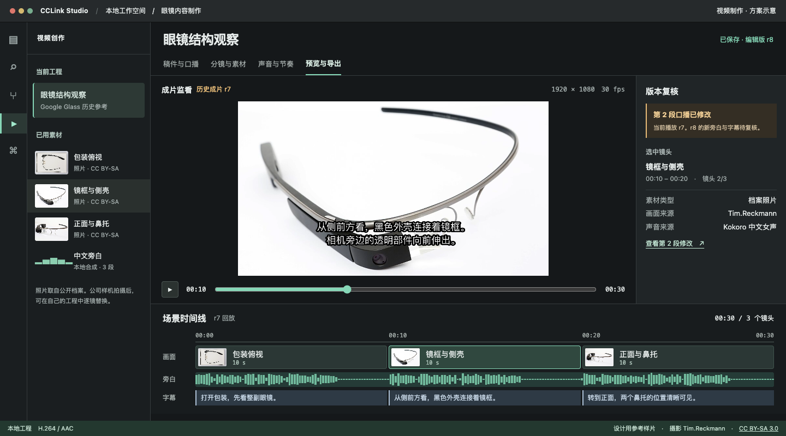

# 视频制作｜把一次真实的眼镜演示剪成短片

**交付目标**　创始人把一次样机演示的三段实拍、一条普通话录音和已核对的稿件带进 Studio，在本地完成剪点、字幕与预览，导出 30–60 秒 MP4。第二天断网重开，能播放上次成片，找到每句口播所用的镜头；修改一句时，能看清要重做哪一段。产品能力的终点是一个能独立播放、可追溯的文件。平台账号、上传、提交、审核及公开结果属于另一项任务。

**今天可直接体验**　打开[离线界面示意](./workbench.html)，点击播放、拖动进度、选镜头，在右侧查看第 2 段的修订。监看器播放的确是[30 秒 MP4](./reference-cut.mp4)，由现有渲染服务生成。三张 Google Glass 历史照片只用来演示剪辑与授权溯源，配音由本地 Kokoro 合成。画面中的 r8 是设计数据。公司样机实拍、真人录音和 Studio 新版后三步仍待实施验收。

| 本专题的材料 | 用途 |
|---|---|
| [工具与模型比较](./tooling.md) | NLE、时间线、FFmpeg、中文 ASR/TTS 与候选视频模型，逐项附官方依据与选择理由 |
| [验证记录](./validation.md) | 源码基线、实测机器与模型、识别误差、渲染/播放结果、未过的门禁 |
| [字幕](./reference-cut.srt) · [来源与授权](./reference-cut.sources.md) | 对照样片校对原句；查找原照片、修改方式与许可 |

## 1　先验收一次真实销售或售后场景

选择买家常问且能实拍的问题，例如「这副样机怎么收进盒子」。创始人负责演示与确认，兼职剪辑的同事可以接手同一工作空间。实际有铰链、盒子适配这一型号时才采用以下脚本。产品、固件、拍摄日期和适用批次由负责人填写；从一条片子推不出通用兼容性、续航或测试数据。

| 成片时间（举例 40 秒） | 镜头与口播的工作 | 剪辑师应拿到的证据 |
|---|---|---|
| 0–7 秒 | 桌面全景，说明「用今天这副样机，演示一次收纳」 | 原机、包装同框，记录样机型号；首帧就能认出本次对象 |
| 7–20 秒 | 手部近景，按实际次序收起镜腿；同期动作不可循环或跳过关键环节 | 连续原视频及源入/出点；手指、铰链和卡位完整可见 |
| 20–33 秒 | 从上方录放入与合盖，按实际录音切换字幕 | 收纳全过程，录音中的顺序与画面一致；不把快放时长解释成性能 |
| 33–40 秒 | 停在最终摆放，标注适用型号，说明何处查看这款的说明书 | 可核对的说明书版本；没有可靠购买链接时可省 CTA |

真人从 **视频 → 从工作空间的 Markdown 新建 → 确认分段口播 → 导入自有短视频与录音 → 设段落和镜头绑定、裁切与字幕 → 生成低清预览 → 导出并重开**。播放须有可听人声、可读中文、正确时长。新工程修改第 2 段后，历史成片还可播放；换台机器携带工程属于后续独立验收。公司侧「推广」当前主要承载文章发布任务；将来可增加跳到这个原生 Tab 的入口，只传本地工作空间和作品引用。[公司首页验收](../../../testing/company-home-v1.md) · [公司推广愿景](../../../features/company-marketing-product-vision.md)

## 2　仓库现状与新旧衔接

基线为 `dfaf4499ff08`。9 月完整自包含工程文档写的是目标；9 月 29 日的首步验收与现行代码给出了更窄的范围；10 月的视频/硬件分拆已经把导航独立出来；11 月新增的是全局本地朗读。以以下实际入口排工期。[架构宪法](../../../architecture.md#架构宪法) · [首步实施与历史验收](../../../features/video-creation-step-one-plan.md) · [原版功能说明](../../../features/promotional-video-workbench.md) · [完整工程旧提案](../../../features/video-creation-project-design.md) · [导航拆分](../../../features/video-hardware-navigation-separation-plan.md)

| 用户当前操作 | 已经存在的业务 | 直接缺口与如何衔接 |
|---|---|---|
| 视频侧栏从本地 Markdown 新建，同一 `media-production` Tab 打开 | 快照保存；现有创建器产生确定性场景草稿。新版首步能改段落顺序、保存/确认独立 narration、审阅 Agent 候选。Cmd/Ctrl+S、关闭保护和 Tab 恢复已接入。真实 AI 质量未在首步 smoke 验收 | 用已确认段落做镜头绑定的输入；旧分镜草稿须经用户采用。四页切换维持在同一 Tab。[侧栏](../../../../src/renderer/src/features/media-production/PromotionalVideoSidebar.tsx) · [新版页面](../../../../src/renderer/src/features/media-production/VideoCreationWorkspace.tsx) |
| 新版后三页与「旧版工作台」切换 | 新版分镜/声音/导出是禁用骨架；旧版可改场景旁白/字幕、导入实拍和整轨旁白/音乐、用外部 FFmpeg 导出、播放最近成功文件。二者处于同一工程，旧场景旁白不会持续同步新版口播 | 依次在骨架接真实动作，复用 main 服务。不能只切到旧 UI 后将旧字幕视为新稿。切换前先解决未保存草稿。[兼容入口和实现](../../../../src/renderer/src/features/media-production/MediaProductionTab.tsx) · [原界面实拍](../../video-creation-step-one/README.md) |
| 编辑、保存与重开 | `.cclink-studio/media-projects/<id>/project.json` 单写，`script/narration.md` 为可读投影。缺 narration 的工程以旧场景 ID 和旁白初始化草稿。保存校验 expectedRevision。readProject 同时核对 workspaceRef.path | 本轮先保同一工作空间恢复。不能复制整个目录到另一处就宣称便携。旧解析器严格拒绝未知键与 schema；不能随手写扩展字段期望旧 App 忽略。[工程服务](../../../../src/main/media-production/media-project-service.ts) · [解析器](../../../../src/shared/media-production/media-project-schema.ts) |
| 导入、分镜、输出 | MediaAssetService 复制工程内资产、SHA-256 去重、写 assets/manifest.json；旧引用保存绝对路径，导入上限 500 MiB。渲染器用场景总长、每场一条字幕，视频过短会循环，丢弃镜头原声，整轨旁白补静音/截断，末段附 CTA；成功写 MP4、SRT、sources.md | 动作演示需源入出点、声音来源、时长冲突提示和裁切可见。逐场导出取实际源时段。声明 CTA 的位置，防止重复叠字。当前播放走整文件 base64，视频 >300 MiB 有独立限制，需轻量代理或系统播放器回退。[资产服务](../../../../src/main/media-production/media-asset-service.ts) · [渲染器](../../../../src/main/media-production/media-render-service.ts) · [内嵌预览](../../../../src/main/fs/file-service.ts) |
| 听稿与生成素材 | LocalTtsService 为 MD、网页、消息维护临时朗读会话；按需安装 Kokoro。即梦有旧异步任务，Pexels 和图片候选有各自服务 | 播放器「已播完」不能变成作品已有 WAV。生成旁白复用已校验模型和引擎，明确写入作品资产。首片走录音，云端候选失败也能交付。[本地朗读](../../../features/local-tts.md) · [生成任务](../../../../src/main/media-production/video-generation-service.ts) |

### 对存量工程实行可回退的剪辑升级

1. **先读取。** v1 在同版本 Studio 保留原入口、读写和历史播放。展示场景数、已有素材/配音、旧字幕、独立口播是否存在、坏链和旧输出位置；仅查看不写文件。如果新旧都有稿，逐段左右对照，优先提示相同稳定 ID，只靠序号不能匹配。允许一段对多镜头，也可保留未关联的旧镜头。
2. **让用户选择沿用什么。** 可继续旧版；首次使用新版剪辑时，由「另存为新版剪辑工程」展示素材拷贝量、剩余空间和映射。每组明确选用独立口播、旧场景文本或手写；旧字幕保留为候选。已确认的新口播可成为文字输入，旧整轨录音须重新核听。无独立口播只生成待审文本；旧成片仍标「旧工程导出」。对未绑定内容给出跳过/稍后处理动作。
3. **原子产生新工程。** 继续由 MediaProjectService 在不被旧版扫描的同级目录（建议 `.cclink-studio/media-projects-v2/<id>/`）创建新 ID，记录来源工程 ID/revision 和转换快照；复用稳定资产、场景及段落关系，在新资产目录复制并核验 SHA 后重建内部引用。只承接已完成文件与来源，不复制旧任务为活动任务、不给付费任务重发。最后以同卷目录 rename 提交，空间不足可清理本次临时副本重试；旧工程一直可打开。同输入重复点击返回同一次转换结果。另存后两条作品可独立编辑，不做双写同步。
4. **逐版退役。** 新版按 v1/v2 分派解析与列表，严格校验各自字段；新建新版工程只写 v2。旧二进制对 v2 的读取兼容性不作承诺。当前旧 list 遇任一不认识的子目录或无效工程会使整个列表报错，所以 v2 与迁移 staging 都不能写入旧扫描根。新服务汇总两个根；资产、任务和渲染服务改用同一受校验的工程目录解析。回退旧安装包应只看到原工程，能照常打开。先验证旧素材、旧整轨旁白、旧任务抽屉、旧导出、无 narration、坏链与 aborted migration，再讨论隐藏兼容入口。首个新工程闭环可以先开工，存量工程继续走保留的路径。

## 3　四页的操作、状态和证据

| 页与进入条件 | 人做什么；系统做什么 | 完成的事实、异常和可继续动作 |
|---|---|---|
| 稿件与口播 · 已绑定本地工作空间 | 选择原稿、型号/批次、画幅、目标时长。人逐段改、排、确认；Agent 可根据快照生成建议，采纳前比较差异 | 显式保存后的 paragraph ID 与 confirmedRevision 可重读。无模型可手写。修改、冲突或旧候选分别显示待确认、并发修改和提案过期；保留草稿，允许重新比较 |
| 分镜与素材 · 有可用段落或已读旧稿 | 人从授权文件选择器导入、标记「公司实拍／设备视角／手机录屏／第三方资料／生成示意」，检查镜头入点、出点和裁切；把镜头拖到对应段落，可用键盘上下移和帧步进 | 实际时长、旋转、SHA、文件可读、来源类型和绑定均可核验。横素材转竖屏默认完整入画，展示留边与裁切两种结果，用户决定。缺素材可保留空槽编辑别段；源时长不足显示短缺量，提供缩短、替换、明确停帧 |
| 声音与节奏 · 有剪辑草案 | 导入整条真人录音，试听与波形拖动；给每句设时间段或从分镜边界起草。可保留指定镜头原声，旁白/同期声/音乐分别静音或调增益；人确认后配与同期的标识。首期可直接用完整授权干声、关闭音乐 | 时长来自解码采样数；字幕与同一帧尺对应。声音较画面长时列出被裁哪一句，可延长可用镜头、换录或明确裁切；音轨较短展示静音区。P2 才有逐段 TTS 和 ASR 候选。词典提示、识别分数、估算字数不能替代试听 |
| 预览与导出 · 保存版本，具备必需画面、旁白、确认的字幕和来源 | 点「生成本地预览」，播放代理，拖到任何剪点前后。检查型号字样、实际操作、声音和字幕。审核后选 16:9 或 9:16，对应裁切需重审，生成成片；到导出详情播放、打开文件夹、取 SRT 和来源表 | 显示当前编辑版、预览版、最近导出版及差异。新项目无输出时播放器为空；预检失败跳到相应镜头。导出成功须有文件探测、全程解码与稳定版本标识；人再试听/看完。单独记录「制作者已复核」及其输入版本 |
| 重开 · 既有工作空间/作品引用 | 先加载已保存工程及任务，再定位最近可播放版本。素材归属或权限出错时，可播放仍完整的历史 MP4，选择同内容文件重链、另存修改或返回草稿 | 核对输出摘要、SHA、时长、任务终态；保留失败原因和 retry target。没有网络、Agent、模型、平台账号时，作品仍可打开。作品页的「打开成片文件夹」即可交给同事，制作完成不会改变任何平台状态 |

**来源和真实性。** 每个用于说明功能的镜头须写明证据类别、型号/固件、拍摄者、授权用途与原始文件时间范围。例如手机录屏证实手机 UI；要说「眼镜视野内实际显示」应提供对应设备实录或明确标注光学拍摄布置。字幕叠层用于解释时标为后期示意。不用第三方眼镜图、AI 改过的镜框、合成 HUD 或后配提示音证明本机的外观、延迟、识别率或收音效果。客户脸、屏幕通知和路人语音需获准或裁去；首期缺遮罩工具时可替换为已脱敏素材。分配权利核对给人，Studio 保存其结论、证据引用和使用范围；文件哈希只证明字节没有换。草稿允许跳过，面向外部的成片有未清项时列到具体镜头并保留内部预览。

## 4　时间线、数据与所有者

首期锁定一条 30 fps 画面轨、一个解说音轨、字幕 cue；沿用已存在的可选背景音乐。视频源入出点用探测到的源时间基记录，剪辑落点用整数输出帧，区间左闭右开。源素材可为 VFR、含旋转元数据；归一化代理时保存源时间映射。30 秒需 900 帧，40 秒为 1200 帧。音频以实测采样数计时，导出目标 AAC 48 kHz；SRT 只在序列化时将累计帧换算到毫秒。旧版 0.1 秒时长只在导入时转换。硬切为默认，不自动重排后续口播来掩盖差异。

| 对象 | 事实归属及持久字段（新增部分为提案） | 修改与恢复规则 |
|---|---|---|
| 工作空间、Tab、选中镜头 | 基础层保存 workspace/tab 引用。最后查看页面、播放位置是可丢弃的视图状态 | App 重开后查询 main；工作空间切换不把任务绑定给新工程，重开默认暂停 |
| 作品与口播、镜头、cue | MediaProjectService 唯一写工程 JSON，保留 revision/expectedRevision、source.snapshot、narration.segments、scenes。扩展镜头绑定段 ID、asset ID、源范围、顺序、裁切、声音策略；cue 含稳定 ID、文本、入/出帧、段 ID、所据录音 hash、审核状态 | 原始录音与图像非破坏编辑；JSON 原子写。保留可回看的上次导出输入快照。合并冲突可按段比较重新应用；镜头删除仅解除引用，历史导出和来源仍能查阅 |
| 素材、来源与许可 | MediaAssetService 唯一入库并维护 manifest；工程引用 ID。记录相对工程文件、hash、实际 MIME、尺寸、源 fps/PTS、音轨、色彩、摄影/录音类别、许可证及证据。旧 project.assets 内嵌元数据仅兼容读取/投影 | 重新链接同 SHA 可复位，SHA 不同是新资产，列出受影响镜头再替换。演示出处与素材字节可一对多，去重不能抹掉授权差异；没有充足授权的条目不进入外部导出版 |
| 声音和识别候选 | WAV/录音及采用的 TTS 音频归资产服务；作品引用段文本摘要、音色、模型版本、实际采样数。识别提案带音频 hash、模型版本、词表、候选 cue 与人工改字 | 优先在现有作品域扩充有界的语音任务；只在接入 P2 时落地。LocalTtsService 管底栏播放，RuntimeResourceManager 管模型租约。不能录底栏输出冒充已采用旁白；字音改了须试听，ASR 不改正文 |
| 渲染、预览与导出 | MediaRenderService 管本地任务、不可变输入快照、渲染参数、输出 hash/路径/探测证据。预览与终片共用同一剪辑计划；预览是可重建的低分辨率缓存，终片和 sidecar 是持久产物 | 每次输出独立 ID 和目录，临时 MP4/SRT/来源共用私有 staging。解码、尺寸、音轨、时长和文件 hash 通过后原子提交整组，最后更新记录。重开遇「目录已提交、记录未写」按快照和 hash 对账；孤立 temp 不算成功 |
| 外部生成及平台 | VideoGenerationService 持有 providerTaskId/任务状态/候选文件。Agent 负责建议；渲染器只消费已采用的素材。发布若另建流程，只消费明确选择的成片 ID/hash，平台结果归发布域 | 提交需单次确认输入、目的和用量；断线若有 ID 先查原任务，无 ID 标记提交结果未知，联系提供方或经人确认新单。云服务不可用始终能用本地素材。制作域没有上传发布动作 |

**权限与生命周期。** 继续使用本地工作空间、原生文件选择器、现有受信 IPC/shared schema 和 ServiceRegistry，主进程校验 sender、workspace、作品、asset/output ID、目录归属和文件边界。预览只读当前作品文件；大文件优先生成有界代理，以后若接 Range 读取，授权按作品与资产绑定，只返回请求区段。字体、ffprobe、模型与 FFmpeg 作为明确依赖分别探测。停止/退出要释放 worker、编解码进程、模型租约、监听与临时句柄；仅关闭 Tab 时可由 main 继续该作品任务。取消需等子进程退出，再记终态。诊断列错误阶段、耗时、输入版本、媒体规格、构建指纹与脱敏错误，不携带凭证、家庭路径或未授权语音。现有 sources.md 可能写 originalPath，给同事的来源清单应只导出必要来源与署名。

## 5　版本传播、预览与失败恢复

保存冲突使用全工程 revision。判定衍生件是否可复用则比较它实际消费的内容摘要。输入键含段 ID、规范化文字/字音、源资产 SHA/范围、剪辑帧表、字幕样式、声音混合、画幅和渲染器/字体版本等，按不同产物取子集。保存标题或收到一个未采用的 AI 候选，不必耗时重编码；若标题被烧录进片尾，则它是渲染输入。相同内容重新出现可复用核验过的缓存，但历史人工审阅按用途、授权及证据另行判断。

| 事件 | 需要复核或重建 | 可以继续用什么 |
|---|---|---|
| 改第 2 段用词，文字确认失效 | 复核关联录音是否仍吻合；分段 TTS 可只重合成第 2 段。本段字幕若基于旧稿，显示逐字差异。采用新声音后刷新预览/成片 | 其余两段音频、未动实拍；r7 文件和 r7 字幕按原版本播放。整条真人录音来自一个文件时只标相关段关联待核，未切分前不得承诺可自动修补声轨 |
| 镜头换序或变长 15 帧 | 后续边界整体平移；依段落绑定的 cue 重新定位并标记受影响范围；绝对音频时间锚定的 cue 只提示冲突，需试听 | 素材、独立已确认文字和未改语音波形；对应旧成片可回看 |
| 只改字幕错别字／换画幅／换音乐 | 改字刷新 SRT、烧录字幕和成片；换画幅需重看裁切和字幕安全区；换音乐仅刷新混音与成片 | 录音与 ASR 输入未变则保留。只改可读说明时重新生成版本清单，原媒体可按相同 hash 引用 |
| 接受新资产或源文件被换字节 | 主进程重新校验，受影响镜头显示「需替换或重链」；画面、声音轨分别检查 | 内容健康的旧导出仍可播。现行 validateProjectAssets 会校验所有引用，需区分保存文字草稿与生成成片，避免一个丢失素材阻止其他编辑保存 |
| 渲染 r7 时用户又保存 r8 | r7 任务按冻结资产和快照继续或由用户取消；成功后列「历史版本 r7」；只有输入一致才显示当前版本可播 | 继续编辑 r8；重试旧任务先展示「用原快照」或「用当前版新导出」，分别有新输出 ID，不覆盖旧文件。现行 retryTask 使用当前 revision 与旧路径，须改这个行为 |
| 截断、权限、空间不足、Runtime 或字体缺失 | 报具体镜头/文件和原因。可停止、换有权限的目标目录、缩短素材、换兼容文件或配置环境。失败保留已验证版本 | MP4、SRT、来源不能各自冒充同次导出完成。宕机后在途本地任务标中断，可根据冻结输入重跑；首期恢复粒度是整次导出，无需帧级断点续算 |

技术通过的终态为「文件已生成并校验」；用户复看可以标「已审阅」。字幕反光、事实错误或人声断句仍可退回修改。设计采用三类预览：选中原素材/裁切参考、当前版本的低清整片、某次已输出的文件。每个播放器标注版本与来源；播放、暂停和结束由真实媒体事件触发。低清与高清使用同一源范围、帧序、字幕 cue 和音量曲线，分辨率/码率可以不同。过期的播放器可播，导出当前版本前明确哪些修改尚未听看。

## 6　实施顺序与真人验收

| 先后 | 用户功能进度／可当场验收 | 工程准备度、依赖与止损 |
|---|---|---|
| **P1　从新版剪出第一条实拍片** | 不登录，在同一工作空间选 Markdown、确认 3 段口播、选 3 条授权真实短视频及 1 条自录旁白，设镜头源入出点和逐句字幕；播放整片草样，另存 30–60 秒 MP4、UTF-8 SRT、来源清单。关 Studio、断网重开并播放，改一句后仍找得到上版。优先验一套 16:9，再验 9:16 裁切 | 开工只需真实素材/录音、能跑带字幕短片的外部 FFmpeg+ffprobe、现有本地工作空间。按「1 段确认 → 1 镜头+声音+字幕 → 临时低清预览 → 三镜头终片 → 重开」纵向扩展；接四页旧服务、不可变输出与证据。先跑新工程，旧版兼容入口持续可用。首个产品门禁不依赖任何 GPU、ASR、TTS、账号或正式包装。单一前置超过 60 分钟或同一阻塞两次，暂停扩张，报告实际可播节点与替代路径 |
| **P1 兼容验收　带走昨天的工作** | 在有独立口播、旧分镜、旧整轨录音和历史 MP4 的真实旧工程中，选择另存新版、比较不一致的第 2 段、保留所选字幕，导出并返回旧工程继续播。取消转换或断电后旧件完整 | 小样本先选两代 schema 和坏链；完成双读、单写新版、空间预估、原子转换、并发冲突与幂等。老 App 用原工程回退；先验证混合目录隔离。这个门禁通过前不替换旧版为默认迁移 |
| **P2　降低校对和重录成本** | ASR 生成候选，用户将错认的型号更正并调整 cue；改一句，用同一音色重新合成一段，逐段试听，重看剪点，只采用审过的候选。录音、手填字幕路径仍可用 | 先复用 Kokoro 模型租约/worker，再试 whisper.cpp base/small。测噪声、口音、英数和竖屏换行，可选原声混音、ducking、响度和峰值提示。卡在模型安装就先收人工校对用时和错误样例；不以模型数量衡量进度 |
| **P3　便携与高级交接** | 用户关闭作品，「打包工作副本」复制到另一台无网 Mac，用相对引用重新打开、校验并播放；必要时交给剪辑师。只有明确有需求才试外部 GPU 的生成转场 | 扫描所有引用及字体/许可；可携带资源和缺口逐项显示。映射新 workspace，资产及导出按 hash 验证；移除凭证、临时 URL、原始绝对路径。OTIO 剪点互通另验 adapter 实际翻译。外部 GPU 首轮只导入文件；付费异步整合需单独证据 |

**给首轮开发者的第一张工作单。** 准备 3 条本人拍摄的样机视频（每条 8–20 秒、在导入上限内）、一条 30–45 秒授权干声、一个含型号/来源的 Markdown。先在旧工作台跑一次同素材基准，记录镜头原声是否被剥离、字幕有没有挡住铰链。然后在新版第 2 页选中一个已确认段，绑定原片的中间 5 秒，保存、重开，到第 4 页生成带一句真人解说和中文字幕的可播放代理。用这一条定位裁切、导入、配音、落点或播放的第一个阻塞，再扩为三镜头完整验收。5 秒只验技术接线；第一条产品门禁是上表 P1 的 30–60 秒。

### 真人签收表（均待用公司素材执行）

| 验收动作 | 负责人可以留下的证据 |
|---|---|
| 创始人选样机、录音、三段视频，逐镜检查型号、授权、演示条件与证据引用 | 原件 SHA、机型/固件（如有关）、采用的片段范围、负责人的签收记录。公开示例照片不可用于此项 |
| 剪辑者任选一个源中间动作设入/出点，回放剪点前一帧/后一帧；检查横竖版下产品、镜腿、手指与字幕 | 原片帧与代理、终片对照；剪点误差最多 1 输出帧。检查首中末及每一剪点，听完整 30–60 秒。专有名词、数字单位、每句字幕与音频由人签收 |
| 用系统播放器独立打开导出 MP4，从头播到尾并拖到末尾；检查 SRT 与来源清单 | 文件时长与帧表相差不超过 1 帧，输出 H.264、AAC、预期画幅/像素比，SRT 单调不重叠，照片/录音能追到作者授权。对同一段动作不得重复回放冒充实测 |
| 保存后关闭并断网重启，打开同一工程和旧成片；改一句，重新确认并导出 | 新旧版本都有自己的文件及 hash；旧文件不变，新版复核能定位具体段。断网仍可编辑、导入、校对、渲染与播放 |
| 中止渲染，或在测试副本移走素材、放满目标目录；再开工程解决缺口 | 仅在测试副本操作；失败显示具体步骤和恢复动作，已有版本仍可播。重跑只产生一个完整新结果。新旧工程并行打开时过期保存被拒绝并保留草稿 |
| 平台边界复查 | 导出全过程无需网站账号；来源中没有凭证或私有路径。本页只可证明制作/校验/人工审阅。如果以后要发布，用户另选成片和账号，平台回执从发布域核验 |

## 7　方案拷问后的取舍

- **有 30 秒 MP4 就能宣布产品完成吗？** 本专题文件证明外部 FFmpeg、现有渲染类及本地语音引擎能配合；研究夹具跳过了真实工程服务、原生文件选择器与新版骨架。P1 由上表的真人操作关闭。
- **镜头跟原声一起切走，演示还真实吗？** 旧链会去掉镜头原声并循环过短视频。新版选择同期声/解说要可见；测试片段含真实操作反馈声，必须重听。如果录音本来无声，可做后配解说并标明。
- **改工程名就要重配整片吗？** 锁版本用于防覆盖，衍生件比对实际输入。整轨配音、按段合成、固定在节目时间的录音各有不同更新粒度，不能按页统一赋“已完成”。
- **小团队是否需要搭 GPU 服务？** 眼镜外观、屏显和动作只能由实拍举证；首片瓶颈是镜头与口播能否对齐。现有本机路径已能做媒体实验。先记录每条片的拍摄、校对、重录和导出用时，再决定是否引入生成的背景素材。
- **磁盘满、更新前后并发、模型下载失败时，昨天的片还在吗？** 终片按输入快照成组提交；旧工程/导出独立保留。缓存清理只处理可重建的代理与临时件。若工程里只保留外部输出绝对路径，先修复成片归档和重开对账，再做任何高级模型适配。
