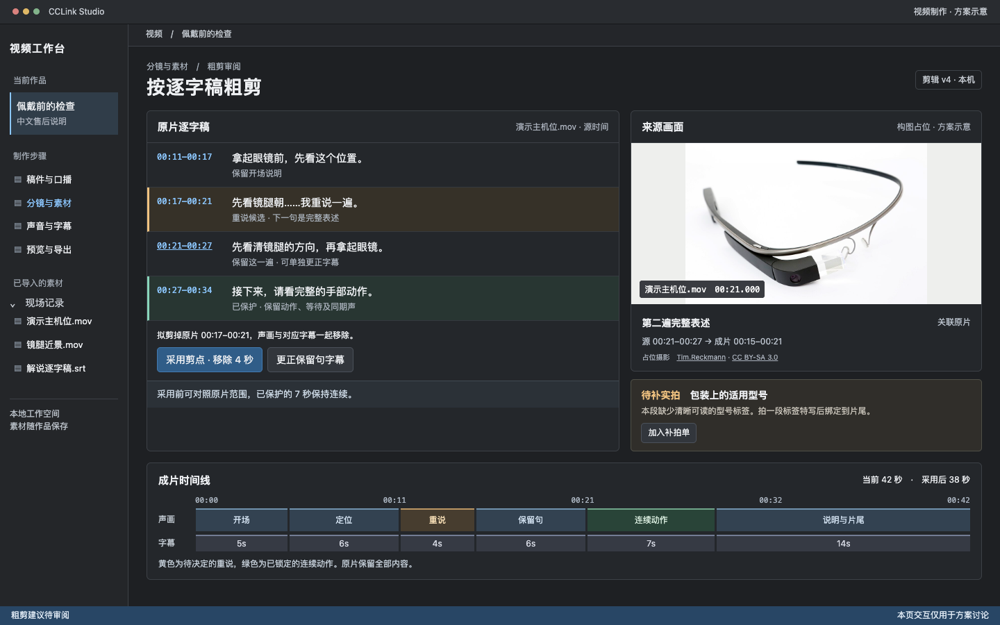

# AI 视频生成与编辑选型｜AI 眼镜小公司

**建议团队近期用剪映专业版剪中文实拍。Studio 的第一项 AI 功能做「从实拍和逐字稿生成可编辑粗剪」：点一句找到原片、删掉重说、锁住必须完整的动作、缺镜头就列补拍单。** 广告创意另开一条轻量路径，用一款云模型生成几秒品牌氛围画面，作为候选素材导入。首轮无需购置显卡或订阅多套生成产品。

首个真人验收动作是，销售同事把一段完整的眼镜演示、一个补拍特写和中文逐字稿带进 Studio，选中一次说错后重说的片段，复听并保留正确的一遍；将剩余口播匹配到真实镜头，锁定一个连续动作，纠正型号字幕，导出本地 30–60 秒成片。关闭并重开后仍可回到每段采用的原片位置。只有生成模型的输出不能完成这项验收。

核验日期为 **2026-11-27，Asia/Shanghai**。文中「官方列明」指产品页、手册、接口、许可或注册表可查。「建议」指针对这家公司的取舍。公司账号权益、国内实际接入、保密样机的上云授权、品牌发音和真人剪辑效率要在目标采购账号及公司材料上确认。本次研究没有上传公司素材、购买订阅或调用付费生成。

## 1　哪些东西真的有人在用

| 采用证据 | 能说明什么 |
|---|---|
| a16z 于 2026-10-05 发布的第七期消费 AI 榜单，将 CapCut 纳入移动端名单。移动端按 Sensor Tower 月活，网页端按 Similarweb 访问量。| 国际版 CapCut 有规模化创作者使用。中国区剪映专业版的中文能力另取其本地产品页为准，两者的订阅和模板权益分别核对。[原始研究与方法](https://a16z.com/100-gen-ai-apps-7/) · [剪映专业版中国区产品页](https://apps.apple.com/cn/app/id1529999940) |
| 快手《2025 环境、社会及管治报告》列出可灵创作者规模超过六千万。2026-10-15 正式上市 4.0，11 月 API 日志另记 Flash 能力。| 企业披露的是历史累计规模。它支持把可灵纳入试选；账号活跃程度、目标硬件产品的拍摄质量要分别验证。[原报告](https://ir.kuaishou.com/system/files-encrypted/nasdaq_kms/assets/2026/04/24/18-14-04/Eng%20Annual%20report%202025.pdf) · [正式发布](https://ir.kuaishou.com/news-releases/news-release-details/kling-ai-officially-launches-next-generation-kling-40-raising/) · [API 更新](https://kling.ai/document-api/updates/api) |
| OneLittleWeb 的 2026 年 10 月网站分类统计中，Higgsfield、HeyGen、Runway 和即梦均列入视频类榜单。Google 在 2025-11-25 已披露 Flow 自上线累计生成超过五亿条视频。| 网站访问、生成条数和创作者人数是三种口径。这里用来发现有实际分发渠道的工具；下面按公司任务选型。[10 月网站统计](https://onelittleweb.com/digital-market-intelligence/ai-tools/video/) · [Google 原始披露](https://blog.google/innovation-and-ai/models-and-research/google-labs/flow-refine-videos/) |
| 本轮从 Hugging Face 公共元数据核对权重版本、许可标记和下载活动。Wan2.2 5B、VACE 1.3B、MiniMax-H3、LTX-2.5 都有明确的发布主体与具体权重。| 下载计数会受工具链、重复下载和同系列不同仓库影响。是否能商业使用按具体模型许可判断，是否适合 Mac 按推理栈和资源判断。[Wan2.2 元数据](https://huggingface.co/api/models/Wan-AI/Wan2.2-TI2V-5B) · [H3 元数据](https://huggingface.co/api/models/MiniMaxAI/MiniMax-H3) · [LTX 元数据](https://huggingface.co/api/models/Lightricks/LTX-2.5) |

## 2　先决定每种片子怎么做

| 交付任务 | 先选哪条路 | AI 在这条片里负责什么 | 谁作最后判断 |
|---|---|---|---|
| 使用教学、售后答疑 | **剪映专业版 + 自有实拍**；Studio 内建同类粗剪交互 | 听写、标出重说、匹配镜头、辅助横转竖。将「按下按钮 → 设备反馈」锁为连续镜头 | 产品负责人核对机型、固件、操作和原声；剪辑者逐句采用 |
| 新品发布、品牌短广告 | **实拍产品主体 + 单独生成的背景/开场**；云端首试万相 3.0，时间戳局部修改再对照 Seedance 2.5 | 生成概念、背景、分镜提案；将真实眼镜与背景作为两个图层或两个独立镜头。生成片段保留标签 | 营销负责人确认观感和使用许可，产品负责人确认凡涉及功能的说法都有实拍依据 |
| 一次长直播/培训拆多条短片 | 有长素材时用 **OpusClip** 对照；保密素材走本地逐字稿选段 | 找可独立成立的一问一答，建议标题和竖屏取景。要一起审听前面的适用条件和后面的限制 | 销售确认剪出的回答仍原意完整，优先采用能独立播放的段落 |
| 已有中文成片做海外版 | 先做**人工核对的双语 SRT**。真人出镜且确需口型同步时，再评估 **HeyGen** | 翻译、外语后配；仅在出镜者授权范围内使用声音及口型功能。设备提示音保持独立 | 海外同事逐条核对型号、单位与保修措辞。HeyGen 的输入 SRT 会再翻译，逐字锁定输出需用对应校对流程。[官方指南](https://help.heygen.com/en/articles/10029081-how-to-get-started-with-video-translation) |
| 未公开工程样机或客户现场 | **本地工作空间 + 已安装的本地工具**，源片留在本机 | 允许本地听写、静音标记、镜头检索。需要创意外援时另选已获准公开的素材 | 素材负责人选具体片段和使用范围；外送前列出实际发送的图、声音、视频时段及目的地 |

## 3　剪辑工具横评

| 工具 | 它已经解决的工作 | 中文、部署与接入 | 对这家公司的决定 |
|---|---|---|---|
| **剪映专业版 / CapCut** | 剪映官网列出按文字精剪口播、识别无效词、人声分离、降噪与多轨。CapCut 桌面端可导入外部字幕 | 国内剪映有 Mac 版；海外版的教程和账户权益不能替国内版背书。商用音乐、模板和字体按素材授权项目及渠道核对 | **销售/售后今天就可使用的第一选择。** 先用自己的素材和声音试一次真实工作。Studio 借鉴「选中文字定位素材」和横竖两版，整套滤镜与模板留给成熟编辑器。[剪映](https://www.capcut.cn/) · [CapCut 字幕导入](https://www.capcut.com/help/how-to-import-subtitles) · [剪映素材许可](https://sf1-cdn-tos.douyinstatic.com/obj/ies-hotsoon-draft/vco/f72e9cd9-cc19-4db7-ba74-0794833ce854.html) |
| **Adobe Premiere 27.0 / Firefly** | AI Assistant 能根据项目素材整理片段、标记、排初剪；Generative Extend 可补画面或环境声。成熟时间线可进一步精修 | Speech to Text 列出普通话简/繁、粤语。助手有本地操作，也有需要把素材送云的操作；助手与生成动作涉及 Firefly credits | **已有订阅及剪辑师时保留**。Studio 借鉴能被逐项修改的初剪。中国区 Adobe 官方列明 Generative Extend 无法使用；开放区可延长画面最多 2 秒或环境声 10 秒，不能延长对话。产品演示按实拍原时长。[生成延长地区及内容限制](https://helpx.adobe.com/premiere/desktop/edit-projects/edit-with-generative-ai/generative-extend-faq.html) · [11 月版本说明](https://helpx.adobe.com/premiere/desktop/whats-new/release-notes.html) · [助手权限及数据说明](https://helpx.adobe.com/premiere/desktop/premiere-ai-assistant/assistant-faq.html) · [中文支持](https://helpx.adobe.com/cn/premiere/desktop/add-text-images/insert-captions/languages-supported-by-speech-to-text.html) |
| **DaVinci Resolve Studio 21** | IntelliScript 将原剧本和实拍转写匹配以组织时间线；IntelliSearch 从素材库找指定内容，另有调色、跟踪遮罩与混音 | 桌面 NLE，官方功能表标明 IntelliScript、IntelliSearch 的 Studio 许可要求。对中文品牌混读的匹配效果待核 | **有专业交付需求时选**，尤其镜片反光、复杂颜色与遮罩。剧本匹配多次拍摄的工作方式值得 Studio 采用。已有 Resolve 的剪辑师可直接接精剪。[IntelliScript 指南](https://documents.blackmagicdesign.com/SupportNotes/DaVinci_Resolve_20_New_Features_Guide.pdf) · [21 版指南](https://documents.blackmagicdesign.com/SupportNotes/DaVinci_Resolve_21_New_Features_Guide.pdf) · [版本权益表](https://documents.blackmagicdesign.com/SupportNotes/DaVinci_Resolve_Studio_21_Features.pdf) |
| **Final Cut Pro** | Apple 芯片设备端的镜头搜索、剪点检测、自动遮罩、精修及字幕功能，适合已有 Mac 剪辑流程的人 | Apple 对 Generate Captions 的功能说明明确限定美式英语；目标安装版本和语言另查。可以导入外部字幕 | **已有授权就沿用**，中文识别另走本地 ASR/SRT。中文界面与自动中文字幕是两个独立的购买依据。[Apple 功能与语言脚注](https://support.apple.com/en-asia/guide/final-cut-pro/verd6d52c4e8/12.4/mac/26.6) · [字幕交换](https://support.apple.com/guide/final-cut-pro/ver00e40835d/mac) |
| **Kdenlive / Shotcut** | Kdenlive 官方 Speech Editor 支持转写、据转写取段入时间线、自动字幕；可导入/导出 SRT。Shotcut 可做离线剪切、代理与成片复核 | 两款均为 GPL 系桌面工具。Kdenlive 的本机语音功能另装所选模型；运行环境装妥后使用。Shotcut 可运行于 Apple Silicon | **开源交付对照选 Kdenlive**，用来核验外部字幕和剪点；已有 Shotcut 的同事可继续精剪。二者都可独立使用。[Kdenlive 语音编辑](https://docs.kdenlive.org/en/effects_and_filters/speech_to_text.html) · [字幕格式](https://docs.kdenlive.org/en/effects_and_filters/subtitles.html) · [Shotcut](https://shotcut.org/FAQ/) |
| **Descript** | 直接编辑逐字稿可剪声画，单独的 Correct Text 可以只纠正字幕；适合访谈、教程、长口播 | 官方当前定价页列出 25 种转写语言，其中未列普通话。可借鉴其交互；账号最新可选语言仍应在使用时确认 | **采纳交互，不作为中文制作默认工具。** 产品必须用两个不同动作区分「改错字」与「从片中删去这句话」。[改字说明](https://help.descript.com/hc/en-us/articles/23054692507661-Unable-to-toggle-capitalization-or-punctuation-on-Windows) · [语言清单](https://www.descript.com/pricing) |
| **OpusClip / HeyGen** | 前者长转短、重构图，后者翻译、换语言声音及可选口型同步。输入分别为长素材、已经审过的成片 | 两者是托管产品。先核账户地区、上传许可、处理分钟数、导出权限和目标语言 | **按订单启用。** 连续直播回放多时试 OpusClip；已有海外客户和授权出镜人时试 HeyGen。不为一条 40 秒国内实拍同时购买两套。[OpusClip](https://www.opus.pro/) · [HeyGen](https://help.heygen.com/en/articles/10029081-how-to-get-started-with-video-translation) |

**国内替代。** 万兴喵影的官方手册明确给出中英文转写、选无声段、去水词和按文字删视频的操作；2026-09-28 发布的 V16 又增加了素材解析时间戳和批量导出。已有万兴授权的同事可直接做中文对照。小云雀更接近创意导演：创作画布组织参考资产，Seedance 2.5 提供参考生成、视频编辑和续写。在一条真实教学片上，需要的是前者的「逐句剪」，做三套广告分镜时才需要后者的「按参考生成」。[万兴文字快剪](https://miao.wondershare.cn/guide/ai-text-based-editing.html) · [万兴 V16 更新](https://miao.wondershare.cn/whats-new.html) · [小云雀官方手册](https://xyq.jianying.com/tutorials/seedance-2-5)

**能否从 Studio 直接驱动剪映？** 公开注册表内确有 `@capcut/jianying-mcp@0.8.85`（2026-11-26 发布）。本次读取了固定版本包的 README 和 LICENSE 并核对 registry 完整性，未执行包。包说明 Mac/Windows 可检索、打开草稿、编辑、预览、导出，并沿用剪映客户端的登录、权益和系统授权；包内 LICENSE 标明字节跳动及关联方保留权利。公开可下载与可随 GPL 桌面 App 转分发是两回事。**把用户自行安装的连接器列为外部精剪试接候选**：先在人手新建的副本中验证可指定作品、改字幕、导出、重开和中途取消，再决定是否支持。豆包 STDIO 的说明不能替代 Studio 宿主兼容验收。即梦企业页另列生成 CLI，与剪映的本地剪辑连接器分属不同产品。[固定版包元数据](https://registry.npmjs.org/@capcut%2fjianying-mcp/0.8.85) · [包说明](https://www.npmjs.com/package/@capcut/jianying-mcp) · [剪映服务协议](https://lf9-cdn-tos.draftstatic.com/obj/ies-hotsoon-draft/vco/a48be925-676a-49ce-9789-eaadba6bf363.html) · [即梦企业接入](https://jimeng.jianying.com/ai-tool/business)

## 4　生成新镜头与修改已有镜头，该用哪家

同一个「生成视频」按钮可能做四种不同的事。文生视频只接收创意说明。图生视频让参考帧动起来，但中间帧仍可能改变镜腿或指示灯。视频编辑以原片为条件，可以只要求改背景，但模型也可能改主体。传统剪辑只取原片给定的帧和声音。Studio 的素材栏显示具体类型，并允许一键回看生成前的原件。

| 产品 / 模型 | 经核对的能力、中文与供给方式 | 对 AI 眼镜公司的用途与取舍 |
|---|---|---|
| **阿里云百炼 · 万相 3.0 标准版** | 托管服务 `wan3.0-video`，支持中文提示、多模态参考、首末帧、音视频生成，最长 30 秒，可选 480/720/1080p。按地域等条件计价 | **首个可选云提供方。** 用于新品广告的开场、转场、已公开的创意背景。优先原因是中文接口、输入输出计价清楚、异步任务可查。已有眼镜实拍保持独立轨道，减少重新生成整条广告的成本。[能力与用法](https://help.aliyun.com/zh/model-studio/wan3-video-generation-guide) · [北京地域标准版价格](https://help.aliyun.com/zh/model-studio/wan3-0-video) · [异步 API](https://www.alibabacloud.com/help/en/model-studio/wan3-video-generation-api-reference/) |
| **即梦 / 字节 Seedance 2.5、2.5 Flash** | 中文创作产品与模型 API 分开。正式模型支持指定时间范围改画面、声音或动作，续写、参考素材生视频；标准版资料列最多 30 图、10 段视频、10 段音频，最长 30 秒。Flash 与正式版各看接口规格 | **第二候选，适合修改已选的创意镜头**，例如只重做广告开头的运镜。要保留设备表现的段落仍直接取原片。正式 API 与体验中心适用条款不同，存量 Studio 即梦 provider 也不是这个 API。[模型说明](https://seed.bytedance.com/zh/seedance2_5) · [方舟创建任务](https://docs.volcengine.com/docs/ark/create-video-generation-task-api?lang=zh) · [方舟条款 §3.7.14](https://docs.volcengine.com/docs/ark/volcengine-ark-platform-terms?lang=zh) |
| **可灵 Kling 4.0 / Omni / Flash** | 官方发布列出最多 30 秒、Omni 至多 15 份参考、至多 10 个关键帧，适合镜头走向和跨镜头参考。Flash API 的文档上限为 20 秒；采购按实际模型 ID 和账号确认 | **广告分镜和多参考的人工创作备选**。当美术需要指定起落点、过镜和连续风格时评估。中国区与国际站分开报价；国际付费 API 协议与普通会员权益分别核对。不同产品形态的最长时长不可混填。[4.0 官方发布](https://ir.kuaishou.com/news-releases/news-release-details/kling-ai-officially-launches-next-generation-kling-40-raising/) · [API 更新](https://kling.ai/document-api/updates/api) · [国际 API 价格](https://kling.ai/document-api/productBilling/prePaidResourcePackage) · [付费 API 条款](https://kling.ai/document-api/guides/protocols/paid-service) |
| **Runway Gen-4.5 / Aleph 2 / Edit Studio** | Gen-4.5 用于文/图生镜头，Aleph 2 用于已有视频按提示修改，支持最长 30 秒、1080p 工作流。网页创作工具、API 积分和账户分别计费 | **海外团队已有工作流时，选 Aleph 做视频编辑对照。** 例如把批准的广告背景从棚拍改为夜景；出片后必须回看边缘、镜片反光和双手。跨境素材由负责人决定。API 结果链接通常仅 24–48 小时有效。[模型与编辑器](https://runway.com/news/introducing-aleph-2-and-edit-studio) · [API 计价](https://docs.dev.runwayml.com/guides/pricing/) · [结果有效期](https://docs.dev.runwayml.com/assets/outputs/) · [商用说明](https://help.runwayml.com/hc/en-us/articles/21668707517587-Can-I-use-the-content-I-made-in-Runway-for-commercial-purposes) |
| **Google Flow / Gemini Omni Flash 1.2 / Veo 3.1** | Flow 是创作工具，模型能力按功能和订阅动态切换，官方表列 Omni、Veo 及 Lite 等选项；部分延长镜头功能已在 Flow 内改用 Omni。按官方地区和语言列表开户 | **有海外制作团队时用作前期创意工具。** 不把地区未列的中国大陆团队排期押在这个入口上。若要编程集成，另查模型 API 型号与可用区；网页功能不代表 API 已开放。[Flow 功能与模型矩阵](https://support.google.com/flow/answer/16352836?hl=en) · [开放地区](https://support.google.com/flow/answer/16353544?hl=en) · [Omni 1.2 官方发布](https://blog.google/innovation-and-ai/technology/developers-tools/introducing-gemini-omni-1-2-flash/) |
| **Higgsfield Marketing Studio / Cinema Studio** | 面向广告素材和镜头控制的产品，内含多种制作工具。账户内容是否用于产品改进取决于服务及协议 | **适合营销人员探索调性和版式**。只有有权使用的图片、商标和文案才交给相应账户。生成的「用户讲述」不能登记为真实客户评价。[工具选择指南](https://higgsfield.ai/creator-hub/help-center/tools/which-higgsfield-tool-should-i-use) · [官方数据说明](https://higgsfield.ai/blog/terms-of-use-privacy-policy-update) |
| **Vidu Q4 Preview / Luma Ray3 Modify** | Vidu 模型目录区分预览型号和量产 API；Ray3 Modify 提供原视频和关键帧控制，用于修改镜头 | **有具体创意缺口时再加一款。** Vidu 预览访问和企业额度不能作为 App 启动依赖；Ray3 可作为同一修改任务的候选。首轮不维护对应适配器。[Vidu 型号地图](https://platform.vidu.com/docs/model-map) · [Q4 Preview](https://platform.vidu.com/news/joint/joint-event-wavespeed-2026) · [Luma 修改指南](https://lumalabs.ai/learning-hub/ray3-modify-user-guide) |
| **一键成片平台：火山 Kickart / 阿里云 IMS 云剪辑** | 前者提供成片和分步制作 API，官方列出旗舰版权益及分步接入渠道。后者可用云时间线组织素材、字幕和批量生成，时间线为平台数据结构 | **出现同模板批量订单时，再比采购整套服务与自建成本。** 少量、涉密、需要逐帧找回设备动作的售后片，保持本地工程。评估时要求交回逐镜采用范围、音轨和独立可播的文件。[Kickart 接口说明](https://docs.volcengine.com/docs/creative-agent/api-overview?lang=zh) · [IMS 云端批量成片](https://www.alibabacloud.com/help/zh/ims/user-guide/batch-intelligent-one-click-film/) |

旧推荐应有退出条件。OpenAI 官方记录 Sora 网页/App 于 2026-04-26 停用，API 于 2026-09-24 停用，因此本次未列入可采购方案。已有历史资产应保留本地文件和来源。[官方停用说明](https://help.openai.com/en/articles/20001152-what-to-know-about-the-sora-discontinuation)

## 5　开源组件和开放权重，哪些值得装

| 组件 / 具体权重 | 能完成的动作 | 许可、算力、中文与决定 |
|---|---|---|
| **FFmpeg / libass + whisper.cpp** | 同一剪辑计划生成预览、中文硬字幕和高清 MP4。Whisper 多语模型输出口播段落和大致时间，用户点句子可听原声 | **现有 Mac 的默认路线**。FFmpeg 的许可随构建，whisper.cpp 及 Whisper 为 MIT。中文可用，型号、中英混读、风噪仍需人校字。缺模型可手写/导入字幕；解除对云账户的依赖。[FFmpeg](https://ffmpeg.org/legal.html) · [whisper.cpp](https://github.com/ggml-org/whisper.cpp) · [Whisper 模型](https://github.com/openai/whisper) |
| **Qwen3-ASR-0.6B / Qwen3-ForcedAligner-0.6B** | 听写与强制对齐是两个模型。给对齐器原录音和已核对的文字，可取得更细的字词边界，支持中文。官方对齐模型单段最长 5 分钟 | **逐字删口播确有边界误差时增加对齐器。** 改文案导致录音里没说的词要重录；对齐器不能修正口误。具体两款权重 Apache-2.0，官方推理栈与 Mac 集成单独确认。[ASR 项目](https://github.com/QwenLM/Qwen3-ASR) · [强制对齐模型卡](https://huggingface.co/Qwen/Qwen3-ForcedAligner-0.6B) |
| **PySceneDetect / auto-editor / FFmpeg silencedetect** | 前两者分别切分镜头、按响度等规则找可去除的区间；FFmpeg 可先提供静音区间。重复台词用逐字稿对照 | **FFmpeg 先行，有长实拍切镜需求再加 PySceneDetect。** PySceneDetect 为 BSD-3-Clause；auto-editor 源码为 Unlicense，成品携带的依赖各有许可。快速转头、灯光闪动可能误切；按键到提示音之间的等待即使无声也可锁住。[PySceneDetect](https://www.scenedetect.com/api/) · [auto-editor](https://github.com/WyattBlue/auto-editor) · [FFmpeg 滤镜](https://ffmpeg.org/ffmpeg-filters.html#silencedetect) |
| **Qwen3-VL-2B-Instruct / PaddleOCR / SAM 2.1** | 视觉语言模型建议镜头标签及大致时段，OCR 辅助找包装型号文字，SAM 用点/框提示跟踪遮罩。三者产物不同 | **真正出现「大量素材里找动作」才引入视觉检索。** 先用人工标记和逐字稿召回。按模型结果定位原片复核，反光镜腿、运动遮挡时遮罩要逐帧检查。所列 Qwen 权重 Apache-2.0；PaddleOCR、SAM 另核具体权重与依赖。[Qwen 视觉模型](https://huggingface.co/Qwen/Qwen3-VL-2B-Instruct) · [PP-OCRv6](https://www.paddleocr.ai/main/version3.x/algorithm/PP-OCRv6/PP-OCRv6.html) · [SAM 2](https://github.com/facebookresearch/sam2) |
| **Kokoro-82M-v1.1-zh** | 已有中文朗读资源；为某句生成声音，试听并采用后写入作品资产，可保留不同语言版 | **真人讲解优先；需要更正一两句或制作另一版时提供本地合成。** 具体 checkpoint Apache-2.0。项目所用 ONNX 转换、音色与发音词典分别登记。提示音、收音演示引用真实录音。[模型卡](https://huggingface.co/hexgrad/Kokoro-82M-v1.1-zh) · [既有能力对照](./tooling.md) |
| **Wan2.2-TI2V-5B / Wan2.1-VACE-1.3B** | 前者文字/首图生成；后者可用视频、参考图、遮罩控制编辑。二者与百炼托管的 3.0 分属不同权重和运行方式 | **有保密生成需求且已有独立 NVIDIA 机器，优先试这组。** 两个具体 checkpoint 标 Apache-2.0；5B 官方卸载配置仍需约 24 GB 及以上显存。1.3B 参数量不能直接换算 VACE 在目标配置的显存。Draw Things 的 Mac 路线可做有限的参考/扩画，再看片段规格；未在公司 Mac 运行。[Wan 5B](https://huggingface.co/Wan-AI/Wan2.2-TI2V-5B) · [VACE 权重](https://huggingface.co/Wan-AI/Wan2.1-VACE-1.3B) · [VACE 项目](https://github.com/ali-vilab/VACE) · [Draw Things 发行说明](https://drawthings.ai/downloads/) |
| **LTX-2.5 / LTX Desktop** | 开放音视频模型；桌面端提供生成、重拍或延长等工作流。官方对 Apple Silicon 列出本地资源表，推理代码与权重许可不同 | **高配 Mac 已在手、素材必须保密时才值得试。** 桌面本地生成要求 macOS 26+、至少 24 GB 统一内存；16 GB 及以下或 Intel 会转 API。官方硬件表以一台 M5 Max 的实测推算其他 Mac。权重受 LTX-2.x 自定义协议约束，年度营收达到 1,000 万美元的一类实体商业使用需有偿许可，另有纯非商业例外。不要用模型卡简介代替完整条款。[模型卡](https://huggingface.co/Lightricks/LTX-2.5) · [许可 §2](https://github.com/Lightricks/LTX-2/blob/main/LICENSE-2_x) · [桌面硬件矩阵](https://github.com/Lightricks/LTX-Desktop/blob/main/docs/hardware-compatibility.md) |
| **MiniMax-H3 / 腾讯 HunyuanVideo-1.5** | H3 有首末帧及多参考生成、音视频编辑两条权重线，开放版与托管版的分辨率不同。混元 1.5 可文/图生视频，官方列出 Linux/CUDA 卸载配置最低 14 GB 显存 | **保留为有专人维护的自部署候选。** H3 使用自定义社区许可，有地区、营收和标注条件；混元权重协议也有地域排除。团队境外销售或分发要逐份核对。H3 的社区 Apple Silicon 路线不能代表入门 Mac 普遍可用。[H3 模型卡](https://huggingface.co/MiniMaxAI/MiniMax-H3) · [H3 许可](https://huggingface.co/MiniMaxAI/MiniMax-H3/blob/main/LICENSE) · [H3 产品与 FAQ](https://design.minimax.io/h3) · [混元卡](https://huggingface.co/tencent/HunyuanVideo-1.5) · [混元许可](https://huggingface.co/tencent/HunyuanVideo-1.5/blob/main/LICENSE) |

**网页编辑器能否直接取代 Studio 时间线？** OpenCut 官方将新 Rust 核心与可用的 Classic 分开，opencut.app 当前仍运行 Classic，项目为 MIT。值得借鉴浏览器时间线交互，落地仍需核可打包版本、编解码与持久化。Remotion 用 React 适合模板式批量出片，但 V5 条款对团队总人数及自动化用途设有公司许可条件；代码可见不等于可直接整合进本项目的 GPL 发布包。两者都不解决现有作品恢复和版本归属问题，首版沿用 FFmpeg。[OpenCut 主仓](https://github.com/OpenCut-app/OpenCut) · [Classic 实现](https://github.com/OpenCut-app/opencut-classic) · [Remotion V5 条款](https://www.remotion.dev/docs/terms)

ComfyUI 可以编排模型与节点，官方桌面版支持 Apple Silicon。一个工作流能否离线运行，取决于节点、权重和具体后端；安装桌面外壳不足以证明整个链路可用。初期让经授权的操作者在专机生成，再以普通视频导入。只有多名同事反复需要同一流程，才接固定版本、固定节点与来源可查的工作流。[ComfyUI 桌面说明](https://docs.comfy.org/installation/desktop/overview)

**复查权重用的版本**（Hugging Face 公共元数据的短 SHA，2026-11-27）。Wan2.2 5B `921dbaf3f167`，VACE 1.3B `574e6a744642`，LTX-2.5 `69ecadd49325`，MiniMax-H3 `12253298adb8`，混元 1.5 `9b49404b3f5d`，Qwen3-VL 2B `89644892e4d8`，Qwen3-ASR 0.6B `5eb144179a02`，ForcedAligner `c7cbfc2048c4`，Kokoro 中文版 `01e7505bd6a7`。本轮只核发行信息、许可、官方硬件条件及本地实现，未安装或推理这些新权重。

## 6　做一个镜头到底多少钱

下表统一把「成片要一段 5 秒的装饰镜头，共生成三条成功候选，选用其中一条」作为预算单位。人民币和美元分别列示。托管模型按成功返回计费时，编辑者废弃候选也已发生费用。以下为公开标价换算，没有调用或产生实际账单。

| 条件 / 服务 | 一条成功候选 | 生成三条的费用 | 适用口径 |
|---|---:|---:|---|
| 万相 3.0 标准，北京，720p，无视频输入 | ¥3.00 | **¥9.00** | 5 秒输出 × ¥0.60。若再传 5 秒视频，则每条 ¥6.00，三条 **¥18.00**。据此每月做 12 条片、每片只用一个这种镜头，月估算为 ¥108 或 ¥216。[万相输入输出价](https://help.aliyun.com/zh/model-studio/wan3-0-video) |
| Seedance 2.5 Flash，无视频输入 | ¥4.97 | **¥14.91** | 720p、16:9、5 秒的官方估算。含视频参考时切换计价口径，以返回用量为准。[火山方舟价格示例](https://docs.volcengine.com/docs/ark/model-pricing?lang=zh&redirect=1) |
| Seedance 2.5 标准，无视频输入 | ¥7.56 | **¥22.68** | 同上。Draft 与正式任务分别计费；实际以返回的 completion_tokens 为准。服务开通的账户余额/资源包条件与单条价格另列。[计费细则](https://docs.volcengine.com/docs/ark/model-pricing?lang=zh&redirect=1) · [开通与调用条件](https://docs.volcengine.com/docs/ark/create-video-generation-task-api?lang=zh) |
| Runway Gen-4.5 | US$0.60 | **US$1.80** | 12 credits/s，每 credit US$0.01。与国内模型有不同的画面、声音和输入约束。[Runway API 价格](https://docs.dev.runwayml.com/guides/pricing/) |
| Runway Aleph 2 编辑已有视频 | US$1.40 | **US$4.20** | 28 credits/s，最低 56 credits。这里预算 5 秒输出，另核可接受的输入与账号条款。[Runway API 价格](https://docs.dev.runwayml.com/guides/pricing/) |

片内生成的**有效成本**要计入三件事：所有已收费候选的账单、制作人筛选与修补的时间、回到实拍重拍的成本。若三条都没用，账单仍记录三条，采用数填零。官网标价不能替公司核销，也不能预测产品外观一致性。付款前先由人看到所用模型、地域、输入视频秒数、输出规格、本次估价和可生成几条，按次确认。需要重复创作时重新确认范围。

**使用权要跟着素材走。** 百炼《体验功能特别说明》第三部分明确禁止将体验输出商用、提供给第三方或传播；正式《百炼服务协议》对自有或关联公司模型、用户具有合法输入权利且无另约等情形另有知识产权约定。方舟体验中心同样限体验用途。Runway 自身对商业使用的说明也不会替团队取得真人、背景音乐或外部图片的权利。Studio 将生成入口（体验/正式 API/外部导入）、模型、日期、用途、原件及标识跟随镜头保存。选了「仅体验」的素材可用于内部讨论，制作客户交付版时定位到需替换的镜头。[百炼体验条款](https://help.aliyun.com/zh/model-studio/bailian-service-notes) · [百炼服务协议](https://terms.alicdn.com/legal-agreement/terms/common_platform_service/20230728213935489/20230728213935489.html) · [百炼数据说明](https://help.aliyun.com/zh/model-studio/privacy-notice) · [方舟协议](https://docs.volcengine.com/docs/ark/volcengine-ark-platform-terms?lang=zh) · [Runway 商用说明](https://help.runwayml.com/hc/en-us/articles/21668707517587-Can-I-use-the-content-I-made-in-Runway-for-commercial-purposes)

用于国内服务的成片如含生成声音或画面，保留供应商原件和已有标识，转换时检查显式提示是否被竖裁或字幕挡住，记录隐式标识的保留与输出处理。依法需要的显式/隐式标识应由相应服务流程处理；内部来源清单不能替代文件标识。对接网络发布时，另由发布者依平台要求声明并核验标识。制作页只生成可交付文件。[《人工智能生成合成内容标识办法》第四至十条](https://www.cac.gov.cn/2025-03/14/c_1743654684782215.htm)

## 7　把调研结果落实在 Studio

[打开逐字稿粗剪交互图](./transcript-review.html) · [直接查看 PNG](./transcript-review.png)。可以点四行原片时间、采用或撤销剪点、单独改字幕、登记或撤回补拍。图用历史产品摄影占位，页面内附署名与许可。

**动作设计。** 进入「分镜与素材 → 按逐字稿粗剪」，先从本机选素材与转写。每句话显示文件名、原片起止点、匹配理由；可以回听前后文、采用、调整边界或跳过。同行比较两遍重说，标明拟删的范围与会牵动的字幕。被保护的完整演示区间不参与自动删静音。素材库未找到对应事实时，只给「换说法 / 绑定实拍 / 加入补拍」三个动作。品牌氛围段另有「生成创意镜头」入口，人工采用才进入剪辑。

| 当前用户动作 | 一次动作改变什么 | 过期、撤销和重新打开 |
|---|---|---|
| 更正听写错字 | 覆盖该句字幕文本；保留原音、逐字稿原始识别文本、源起止和剪点 | 回听本人确实这样说即可标记已校。已烧录字幕的预览和交付版提示要生成新版，旧文件可播 |
| 删一遍重说 | 逐句显示即将删去的源区间；确认后在剪辑计划排除相应声画，同期声一起裁，成片字幕按新时间重算 | 撤销恢复同一源区间，不改原文件；独立旁白/音乐遇到时长变化标记复听。误碰保护段时只允许人工重新决定剪点 |
| 修改原口播主张 | 建立新的段落文本修订，列出关联的录音、字幕和证据镜头 | 录音内容和文案不符就重录/重配；替换后听整句。模型不得把新文字伪装为原现场录音 |
| 选择生成的装饰镜头 | 候选带生成来源、权利、模型、任务编号与原件摘要。只有对指定段按「采用」才建立素材引用 | 生成期间改稿，结果挂回原修订，供人对比后重新采用；试生成的垃圾候选与撤回时间线引用分别处理 |
| 收回外部精剪 | 先交无烧字的参考 MP4、经过授权的素材、时间线 SRT 和含源范围的剪点清单。外部版作为一个独立成片登记 | 交付清单写明哪些字幕样式、声音和效果需要外部重建。要继续在 Studio 逐镜改，用原版或明确支持的交换工程；避免用外部成片反推剪点 |

**代码里的具体衔接。** 新版 `VideoCreationWorkspace` 已有可保存/确认的独立口播，分镜、声音及导出需接真实操作。既有分镜建议给出画面描述、搜索词和生成提示；下一步给每条已匹配建议加已存在的 assetId、原片范围、逐字稿或人工标记依据及输入版本。服务端查证该素材属于本工程，范围在实际文件内。候选与正式剪辑计划分别保存，由既有 MediaProjectService 承担最终采用的写入。图片、声音及视频的实际文件继续由 MediaAssetService 管理。[现有分镜服务](../../../../src/main/media-production/storyboard-proposal-service.ts) · [新版工作台](../../../../src/renderer/src/features/media-production/VideoCreationWorkspace.tsx) · [项目衔接说明](./integration.md)

**云生成要处理两个现实故障。** 现有即梦走视觉开放平台 AK/SK、`jimeng-video-3.0-pro`，仅文生视频；方舟 Seedance 2.5 的 API Key、鉴权、参考素材、状态和请求体是另一套。现有 createTask 先向上游提交后才写本地 ID；retryTask 会再次提交，listTasks 对已存队列/运行任务续查。引入付费新供应方时先落下本次操作意图与请求摘要，有上游 ID 就用原 ID 查询。若提交后断网且未知是否扣费，显示「提交结果待核对」和对账入口，确认未受理或用户明示再次付费才新建尝试。成功但下载失败优先恢复下载；供应商 URL 到期时保留任务、计费记录与原因。下载按各提供方各自的可信域校验，结果校验后落入本地资产，界面只用本地文件播放。[旧视频 provider](../../../../src/main/media-production/providers/jimeng-video-provider.ts) · [现有生成服务](../../../../src/main/media-production/video-generation-service.ts) · [万相任务说明](https://www.alibabacloud.com/help/en/model-studio/wan3-video-generation-api-reference/) · [方舟查询说明](https://docs.volcengine.com/docs/ark/get-video-generation-task-api?lang=zh)

**生成修改的实操约束。** 方舟 2.5「视频编辑」只支持自动时长，要求源片 4–30 秒，结果可能比输入短最多 0.4 秒。即使编辑者只要求换背景，也要对回片重新读取真实帧数、构图和声音，提示原定转场或字幕是否越过尾帧。真人脸参考另受供应商接入流程限制；不能把普通原片上传当作通用编辑路径。[方舟 2.5 教程](https://console.volcengine.com/ark/region%3Acn-beijing/docs/seedance-2-5)

### 开发与真人签收顺序

| 顺序 | 实施切口、依赖和负责方 | 真人验收动作及继续投资条件 |
|---|---|---|
| 1 · 保存剪点，能交片 | 桌面工程师复用已有导入、工程版本和渲染快照，接通新后三页。先做手工绑定、剪裁、同步声、手动/导入字幕、预览导出。原料是自己的原片和已核的口播 | 售后同事在无云账号的 Mac 上完成一条 30–60 秒教学片，重开改一句并保留两版。旧工程按既有迁移方案另存。签收后才叠加 AI。[主方案步骤 1–5](./README.md) |
| 2 · 用一句话找到并剪掉一次重说 | 先导入绑定到指定源文件的 SRT 或本地 Whisper 输出，再按源时间召回片段；时间线版 SRT 须绑定其导出快照。候选含输入指纹和区间，用户逐条采用。先做整句，再加精细对齐 | 复听两遍、删错的一遍、更正型号字幕、锁住一段安静但有意义的设备响应；撤销后原音画完整返回。对照剪映完成同一工作，记录真人查找和校对时间、误删及找回次数 |
| 3 · 让素材不足变成补拍任务 | 复用分镜建议服务，先做文件名/逐字稿/人工标签匹配；补拍记录关联段落、需要看到的起止动作和负责人。素材确实难找再引入图像标签或 OCR | 故意缺一镜。剪辑者从缺镜段生成补拍项，导入真实补拍后直接绑定并清除缺口，原稿与其余剪点保留 |
| 4 · 单独制作广告镜头 | 营销拿公开且有权使用的素材先走外部工具文件导入。确有重复订单再接万相正式 API，把授权、费用、回传和旧修订结果落在已有生成服务 | 逐条看候选，选一条背景入片，拒绝另两条。断网重开查原任务，能看账单和人选的那一条；业务演示仍可只用实拍完成。首版不依赖购买 GPU |
| 5 · 精剪或批量交接 | 有实际剪辑师先用清单包和 SRT；若常态化交接才选择目标工具支持的 OTIO/XML 或独立试接剪映连接器。Final Cut Pro X 的 FCPXML 和旧 FCP 7 XML 在 Premiere 的支持不同 | 剪辑师选一个真实目标 App，重开各核三处剪点、字幕轴和分轨声音，记录丢失项。达到业务要求再承诺可编辑工程交接。[Adobe 交换限制](https://helpx.adobe.com/premiere/desktop/organize-media/import-files/migrate-from-final-cut-pro-x.html) |

**不用跑分决定采购。** 第一次让负责售后的人做教学、负责市场的人做广告，各自带一条真实待交工作。教学按「看懂 → 剪掉重说 → 改产品名 → 回到源片 → 次日改版」逐项签收；广告按「候选中可直接采用几条、用了多少人工修补、哪处实物被改坏、交付是否有权使用」记录。若手工字幕或剪映已比新功能省时，保留外部交接并修正 Studio 卡住的动作。若外景补拍和一条生成背景总成本相近，负责人可直接选择最能传达意图的一条。当前完成的是方案和界面设计；客户素材剪辑、付费接口与外部工程往返属于后续真人验收。
