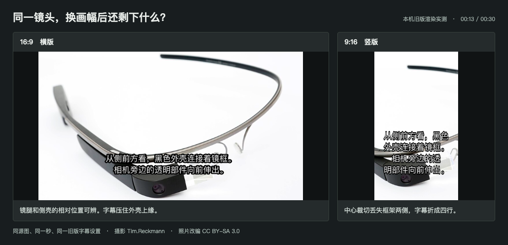

# 验证记录｜研究夹具、成片文件与设计图

核验日为 **2026-11-26，Asia/Shanghai（UTC+08:00）**。工作从 **10:15:14** 开始。审查结束于 **10:32:51**，实际用时 **17 分 37 秒**。源码检查基线 `dfaf4499ff08`。系统为 macOS 26.5.1（25F80），Apple M1，16 GiB 统一内存。没有调用外部收费模型或公司的账号。样片的可重复播放属于本专题设计验证；产品验收另用公司自有素材、真实 Studio 页面和人声完成。

## 样片的实际来源与链路

1. 读取现行 `MediaProductionTab`、`VideoCreationWorkspace`、工程/资产/渲染/生成服务，核对首步真实截图、本地朗读验收及打包证据。侧栏可创建工程、新版可确认文字，后三页仍是骨架。旧服务的资产绑定、渲染和播放分别可复用。[9 月首步证据](../../video-creation-step-one/README.md) · [11 月朗读证据](../../../testing/local-tts.md)
2. 从摄影者在 Commons 发布的三张照片取得缩小版。核对每张原页的作者和 CC BY-SA 3.0，保留每张 SHA-256。用照片能测试裁切、字幕和编码；它们不能检验眼镜录制的 VFR 视频、现场噪声、真人试戴或光学显示。[来源清单](./reference-cut.sources.md)
3. 从 Studio 的固定来源获取 `kokoro-multi-lang-v1_1.tar.bz2`，对照内置 catalog 的 SHA-256 `b78e1ac42b852e839cceaafbe88f66806bf5860992d1d7b9a3f2ad1198427aed`。首轮下载超时，续传后完整摘要匹配。只在本专题临时探针中解包，未改日常 Studio 的资源安装状态。调用仓库原版 `tts-worker.cjs`、sherpa-onnx-node 2.0.1、CPU 两线程、固定中文女声 3。每段实际输出 WAV 24 kHz，再按各 10 秒补尾部静音。三段文稿见 SRT。[引擎入口](../../../../src/main/local-tts/tts-worker.cjs) · [模型卡](https://huggingface.co/hexgrad/Kokoro-82M-v1.1-zh)
4. 在临时工作目录内向**实际 MediaRenderService** 提供受控的三场景工程读取夹具，使用其 `createTask → listTasks`，真实执行探测到的 `/opt/homebrew/bin/ffmpeg`。没有经过工程服务的真实建档、导入、迁移或保存，采用的工程号/版本号仅作研究快照。输出视频、字幕、来源表后为样片补写 MP4 署名与许可元数据（仅重新封装）。重建竖版作裁切对照。浏览器界面只读实际横版 MP4。[渲染服务](../../../../src/main/media-production/media-render-service.ts)
5. 使用 `ffprobe -show_entries stream=codec_name,width,height,pix_fmt,color_space,color_range,r_frame_rate,nb_frames,sample_rate,channels:format=duration,size` 检查两个文件，并以 `ffmpeg -v error -i <成片> -f null -` 全量解码。用第 13 秒的真实输出帧对比字幕与裁切；最后用 Chrome 原生 video 的播放事件核实界面。

| 本机实测 | 结果 | 该结果能回答的问题 |
|---|---|---|
| Kokoro，三条中文句子 | 声音分别 7.450、6.969、7.786 秒；推理 3.643、3.421、3.750 秒。未计下载时间。历史仓库另有打包 App 真实播放器 ended 及独立进程取消记录 | 当前固定 worker 能离线产出可编码的人声字节。没有做真人音质盲评或作品内一键配音验收 |
| FFmpeg/ffprobe 9.0.2，libx264/AAC/libass | 横版 1920×1080，30 fps，900 帧，30.000 秒，单声道 AAC 24 kHz；渲染约 13.31 秒。竖版 1080×1920，900 帧，30.000 秒；约 12.81 秒。都能全程解码 | 在这一台机器的三张照片上，旧版可实际编码。2026-08 文档所述当时缺运行时，与今天机器的探测不同。只有单样本，未测持续负载、HEVC/HDR/VFR 真机视频、GPU 硬编或正式包 |
| 真实参数与输出的差异 | 横版 ffprobe 报 yuvj420p、full range、bt470bg、primaries/transfer 未知；音轨为 24 kHz。代码虽请求 yuv420p，旧链仍保留了这里的源特征 | 正式预设应明确 SDR 色彩转换、目标范围和 48 kHz 重采样，再探测结果。HDR 素材缺可靠 tone-map 时先显式转出 SDR 工作副本或提示替换 |
| 样片完整性 | 最终带署名的 MP4 SHA-256 为 `ae415305ede97e5c4fcac1561bcc422c5afc71861e338641d89f8cc2359cce18`；SRT 为 `7868b7ec54334a547fb3dd1e03a5486d93609c35d4af8d47062ae9e5253909e0`；三条 cue 从 0、10、20 秒开始，30 秒结束 | 文件身份可以核对，旧版是场景级字幕，尾部停顿时字幕仍持续。精确逐句轴与逐词校对是后续功能 |
| whisper.cpp 本机 1.9.4，官方 base 多语版，Metal | 从合成整轨转 16 kHz 单声道，`-l zh` 无词表生成 3 条 cue，末点分别为 7.5、17、28 秒。引擎报告 2.152 秒。第一句「鼻梁」写成「鼻涼」，第二句「相机」写成「像雞」。实际模型摘要匹配上游的 `60ed5bc3dd14eea856493d334349b405782ddcaf0028d4b5df4088345fba2efe` | Mac 上可转写并输出时间戳。此输入是干净合成音频，速度与错误率不可外推至真实眼镜。上游发布已到 v1.9.6，此处只报告本机 1.9.4。[权重记录](https://huggingface.co/ggerganov/whisper.cpp/blob/main/ggml-base.bin) · [上游发布](https://github.com/ggml-org/whisper.cpp/releases/tag/v1.9.6) |

**再对比一轮。** 在相同音频、模型、硬件和语言上只增加“眼镜、镜框、镜腿、相机、鼻梁、鼻托。”提示。第二次生成简体字，“鼻梁”正确，“相机”变成“向机”；整段仅剩一条 0–30 秒 cue，引擎报告 1.368 秒（第二次运行，包含缓存差异）。因此术语提示不能直接替换字幕，也不能作为自动对齐的完成证据。用户需要看到原录音、改字并拆 cue。无提示时的三段也只是这个样本的结果。

**画幅决定。** 两个输出均用了旧版居中铺满裁切。第 13 秒竖版的字幕遮住关键器件、结构两端离开画面。即使帧数与音轨均正确，这种输出仍应在用户验收中退回。新版默认完整入画、可选裁切锚点、在实际目标尺寸检查字幕安全区；预览/终片共用坐标与换行设置。

## 界面与文件验收

- `workbench.html` 通过 `file://` 打开。Chrome 无头实例真实解码同目录的样片，检查播放、暂停、切换镜头到 20 秒、修订弹窗与 Escape 返回；对交付版从 0 秒连续播到 30 秒，读取到 ended=true、currentTime=duration=30、videoWidth=1920、videoHeight=1080。使用真实 WAV 振幅绘制旁白波形。网页未调用 Studio IPC、摄像头、网络模型或平台服务。
- 桌面视口 1440×800，页面宽度实测 1440；窄窗 760×820，页面宽度实测 760，检查器移到下方。逐图查看 [界面 PNG](./workbench.png) 和[裁切对照 PNG](./aspect-check.png)，核对中文、署名、选中镜头、旧版标注和字幕折行。
- 当前专题未改业务代码。未启动真实用户工作空间、未运行项目级 smoke 或 verify、未执行公司真人签收、未验付费云服务。以上结果可以支持实施优先级，尚不能关闭 P1/P2 的产品门禁。
