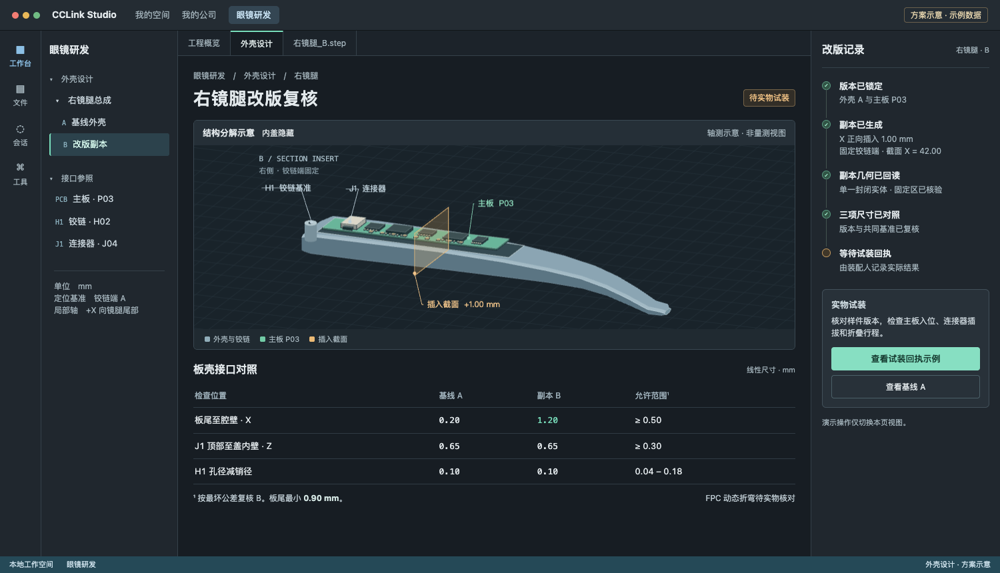

# 外壳设计：右镜腿改版与试装

Studio 已经能对符合条件的 STEP 做一次截面插入、核验并打开新副本。小公司接下来需要在同一工程里回答三个问题：这次为哪一版板改壳，铰链和连接器的关键尺寸是否仍在允许范围，装配人拿到这批样件后实际遇到了什么。现有验收覆盖左镜框改版；板壳对照、整壳装配与试装回执均为待开发能力。[已有 STEP 功能与验收](../../../features/eyewear-step-ai-editing-development-plan.md)

**第一轮产品验收**　研发负责人在 Mac 上打开本地眼镜工程，选原件 A 与板 P03；确认一次受限改版，拿到独立 STEP B；核对三项有来源、有公差的接口尺寸；装配人对着 B 样件记录通过或退回；关掉 Studio 重开，能找回同一份尺寸和回执，能返回 A 而不丢 B。公司页通过已有「关联已有工程」进入，电子开发工程也能直接开始。[与其他专题的接口](../README.md) · [工具、模型、许可证及本机实验](research.md)

## 工作台

[打开离线交互示意](workbench.html) · [查看「试装退回」状态图](fit-receipt.png)

图中隐藏内盖以显示镜腿、铰链 H1、主板与连接器 J1。所有图形与装配记录均为方案示意；几何插入的独立实验见研究记录。离线页可切换 A/B、打开试装退回示例、返回尺寸对照。正式界面沿用工程工作台、文件 Tab 和右侧 Agent；图中右栏展示工程记录，执行授权仍在原 Agent 确认卡中。仅获供应商视图或缺件时，应显示实际可用的资料与缺项，不绘制猜测的零件。

## 首轮由谁做什么

| 顺序与执行者 | 在应用中做的动作 | 进入条件、完成证据与失败出口 |
| --- | --- | --- |
| 1　负责人选资料 | 从工程打开镜腿 STEP，指定左/右、壳 A、板版本、H1/J1 料号和图纸修订，填写装配问题。整壳 STEP 作为只读参照。 | 文件在当前授权本地空间内；保存所选相对路径与内容哈希。重名取版本与哈希，不取时间最近的文件。只有整壳多实体时提示供应商另导出带定位基准的单件，并保留装配实例位置。 |
| 2　结构与板负责人对基准 | 指定安装平面、铰链端参考点和指向尾部的轴；注明板面 TOP、连接器插拔方向、对应定位孔。记录板在壳内的定位方式。 | 将尺寸统一为 mm，记录原单位、坐标系、板壳刚体变换或共基准的有尺寸图纸、至少一个独立对点校核值及允许偏差。左/右件、镜像、原点或基准不明时只可看各自尺寸。 |
| 3　Agent 规划，用户批准 | 指令示例「铰链端固定，在已核准的壳体直段沿 +X 加长 1 mm，为板尾留空间」。只编辑拆下的壳件；板是对照件。工程师明确截面避开的固定柱、扣位和配合面，以及移动侧允许随动的接口。 | 将当前单实体送原工具规划；原确认卡展示文件、哈希、轴、方向、距离、截面、固定端、新文件、预期三轴尺寸。否决、换截面、参数或源文件变动需回到规划。移孔、压低连接器、改铰链轴或增加壁厚需另行设计。 |
| 4　Studio 写 B | 按原授权生成新 STEP，重导入并显示结果卡；将此结果连到当前改版。 | 原件未变、独占创建目标、完整 B-Rep/BOP 与固定区门禁成功才发布。源基线警告显示类型、数量及专业复核要求。核验失败保留 A，显示原失败原因，换输入或重新规划。 |
| 5　结构工程师核对三项接口 | 打开 A/B 和板图，依次填板尾净空、J1 顶部净空、H1 孔销直径差。每个读数绑定图纸页/位置、样件或 STEP 哈希、基准、量测方法和公差。 | 首版允许人在 FreeCAD 或量具上读数后录入并复核，标明“人工量测”。Studio 计算上下界，逐项展示名义值、最坏值与阈值。侧壁、盖内壁、孔径要分别取证，包围盒不能代填。缺关键数据时可保存草稿。 |
| 6　装配人登记样件 | 几何与关键尺寸可复核后，选择对应打印/加工批次、板和实体配件。手动对版本；记录装板、盖合、插拔、铰链开合及 FPC 挤压。 | 照片或有位置和量具的记录、装配人、日期、实际行程与结论落到该样件。当场发现干涉，停在发生位置，记录失败项与下一步。缺样件、错板、缺盖或缺连接器显示“待试装／待补件”。 |
| 7　负责人回看或退回 | 打开「查看基线 A」，再回到 B 与回执。退回时从选定基线起新一轮，失败样件仍可追溯。 | 原文件、B、板版次和那次回执均可重开。通过只覆盖所列样件与动作；更换板、盖、铰链、连接器、材料或工艺需要新适用性判断。 |

整壳可用于查上下盖、左右镜腿、转轴与镜框的位置。连成一个 solid 的整壳也要先由工程师证明切割仅作用于允许移动的几何；跨左右侧、光机基准、结合扣或铰链的切割不作为首个样本。多实体装配优先由设计方导出单件与变换；强制合并整个装配会丢失配合信息。

## 第一份可复核的板壳对照

下面是样表，阈值供解释流程，各产品的允许值由图纸或负责人给出。A 为原壳，B 固定铰链端，在局部 X=42.00 处插入 1.00 mm。板依靠固定端的定位点入位。P03 从同一基准到板尾为 62.00 mm。B 的外长增加只说明改版沿指定轴生效；内腔止壁在规定截线上另量。图纸名、修订号和输入哈希都应能从表格打开。

| 接口及取证位置 | A → B 名义值（mm） | 最坏公差与验收条件（示例） | 联系到实物的动作 |
| --- | --- | --- | --- |
| 板尾净空；同一板边截线、同侧止壁 X 减已定位的板尾 X | 62.20−62.00 = 0.20 → 63.20−62.00 = 1.20 | 壳止壁 ±0.15、板长 ±0.10、定位 ±0.05。A 最小 −0.10，B 最小 0.90；下限 0.50。负值表示尺寸链允许重叠。 | 在固定定位点装上板，测板尾余量并检查沿板宽的局部肋条。单一截线仅说明该位置。 |
| J1 顶部至盖内壁；板安装面到盖内壁高度减装配件顶高 | 0.65 → 0.65 | 盖和安装堆叠各 ±0.10，B 最小 0.45；下限 0.30。需要盖图、板厚、安装高度与所装配对件，只有裸板时该项为空。 | 合盖，检查压痕；按料号规定方向插拔并确认锁扣可操作。净高通过仍可能挡住操作路径。 |
| H1 孔销的直径差；同一转轴站位 | Ø1.60−Ø1.50 = 0.10 → 0.10 | 孔、销各 ±0.02，最小 0.06、最大 0.14；允许 0.04–0.18。表内是**直径差**。轴向游隙、各节同轴度另列观测，不能由这行推出。 | 用配套销和铰链试装，记录从哪一端插入、有无卡滞、实到角度与 FPC 接触位置。 |

第一轮只比较有明确来源的标量；在同一单位内先计算再显示舍入值。单边公差按各自上下限传播，表中示例采用最坏情况叠加。定位误差只计一次。若 P03 与 B 分别来自 ECAD/MCAD，不得拿两套世界坐标直接相减。用量具做的是实测，公称图纸、三维实体、供应商包络和预览网格的读数需分别标识。允许“实测与图纸不符”并列保留。

**试装回执示例**　样件 T02／B、P03、H02、J04。板与 J1 在本次安装姿态能入位；盖合后到 80° 出现排线挤压，装配人停止并退回。下轮先核对线束走向、铰链扫掠区和 FPC 余量。图中使用此虚构示例验证“静态尺寸满足但实物退回”的展示。每个实测点需能追到检查人和样件。真实记录可附照片、卡尺位置、测试姿态、重现条件及替换件信息。

## 对象、归属与恢复

| 数据对象 | 唯一事实源与字段 | 读写及恢复 |
| --- | --- | --- |
| 业务与工程入口 | 公司服务持有业务与工程关联；现有 Workspace、Tab Store 持有工作空间和标签。 | 公司仅引用工程与可打开的改版资料。切换公司或工程解绑订阅，重开经原入口校验路径。 |
| 外壳、PCB/H1/J1 来源 | 各自设计方的原文件、图纸与实物。工程文件经 FileService 授权。PCB 可直接来自已授权的图纸或量测，已有 HardwareService 可提供可选外形候选。 | 每次比对锁定相对路径、完整 SHA-256、部件版本、单位和来源。改名经人重定位并核对同哈希；内容变动保留旧证据，显示“需重新核对”。 |
| 修改快照、产物 | 已有 CadModificationService 持有一次输入快照和核验；ToolHost / Agent 授权链持有单次确认与运行。B 是独立文件。 | 复用现有返回值和取消；主进程为新引用独立获取输出哈希（当前结果带源哈希与输出大小）。旧消息重放不能重新执行或自动开 Tab。 |
| 改版记录（新增） | 当前工程 CAD 域维护一份版本化工作空间记录/改版，含 A/B 引用、板参考版本、来源、基准、核验摘要与 Run/工具调用引用、公差表和样件回执。 | 以工程相对路径持久化，引用文件实际字节。以修订号比较并串行、原子写入，保留上个完整版本。并发窗口用旧修订时显示差异再提交。导出的 Markdown 仅为人读副本。 |
| 接口尺寸（新增） | 每项由录入人签认，或未来由固定几何测量生成；记录对象对、基准、方向/区域、输入哈希、名义/公差、阈值批准人、读数出处与证据附件。 | 禁止用聊天补证、按文件名匹配或复用失效面号。打开时换版须重新核对。数值结果按当前有效证据计算。 |
| 样件回执（新增） | 装配人保存批次、实物标识、对应壳/板/接口件版本、检查项、通过/退回/未做、观察、照片或量测、时间和署名。 | 每次试装独立追加；更正保留原回执与修订原因。退回后只切换当前查看/后续起点，不删除已有文件或历史。 |

**阶段由证据驱动。** 待资料 → 可规划 → 等待原授权 → 生成/核验中 → 待尺寸对照 → 待试装 → 本样件通过／退回。运行期间状态取自原 CAD 调用；尺寸和试装阶段由持久记录投影，前端不另起任务队列。放弃确认、几何失败、尺寸超限、证据过期、试装缺件各有原因字段与下一动作。已知超限可留档或退回；不自动升级为“可打样”。历史回执对应的旧样件结论不随新文件改写。

**崩溃与改名。** 临时输出由 CAD 服务清理；重启未完成 Run 不自动重放。若 B 已独占写成而记录未提交，先标记“待核对副本”：核对已存规划、源哈希、目标路径、完整核验结果及输出内容身份，一致才显式接回。同名文件或缺核验关联时只可作外部参考，可换唯一文件名重新生成。重复回执用样件与提交标识幂等，允许同一样件另起一次复试。外部改写 A 后，旧哈希只能识别失配；可从已授权的同哈希基线备份重新定位。首轮开始时通过 FileService 独占留存 A 的按哈希校验副本，再接受其为可回退基线。

**权限与生命周期。** 首版限本地工程，原文件只读，新副本须单次确认，原脚本不接受模型生成的 Python。附件显式选入，主进程校验 sender、工作空间、真实路径、文件类型与大小；缓存只经绑定当前 renderer/根/哈希的 previewRef 读取。仅用户确认的必要参数可进入所配置的 Agent，模型是否联网取决于后端；默认不上传 STEP、板图或试装照片。本地浏览、人工填表、留回执与查看历史不依赖 CCLink 登录、模型、PCB 服务或 CAD 后端在线。CAD 设置或子进程故障仅使对应转换/编辑不可用。用同一 CAD 能力注册和销毁，诊断显示哪一步、原因、可重试性、核验版本、耗时与脱敏 ID。[架构宪法](../../../architecture.md#架构宪法) · [统一上下文操作](../../../features/context-action-system.md)

## 开发顺序与工程准备度

| 先后 | 用户可见的交付和进入条件 | 实现、停止条件与验收 |
| --- | --- | --- |
| ① 一件镜腿、一次试装 | 从已有电子开发工程直接开始；本地有可改的单实体 A、适配 FreeCADCmd、板/铰链/连接器图纸或来源明确的人工量测，有到手的配件与样件批次。公司页可复用原工程关联。 | 先用真实零件完成一次原规划与可行截面检查，再连“保留基线 → B 结果 → 三行人工录入 → 真实试装回执 → 重开”。共享 schema 只覆盖当前文件和证据。能独立起步，不等 PCB 专题、模型训练、选面、自动配准或全套装配求解。如无样机，可做到待试装并明确停点。 |
| ② 减少重复读数 | ① 得到真实回执，记录至少一项经常需要重测的接口；取得双方带基准、单位及修订的三维数据。 | 增加受限固定算法，如已确认截线的止壁距离、指定圆柱孔销或已授权元件包络。结果附取证位置、误差和失败原因；用人工点测交叉核对。歧义回到人工。保留首轮入口。 |
| ③ 检查整壳与运动 | 工程师可提供上下盖、左右镜腿、铰链轴、转角范围、安装变换、真实板组件与配对件。 | 用 XDE 按实例和变换只读装配，选定零件对与姿态，报告相交体积、接触、最小间距。角度抽样注明步长和未覆盖区段；FPC 的实际弯曲与走线仍要实装。只有再现至少一个已知干涉、一个间隙及一个接触，且实物核对后才扩大覆盖。 |
| ④ 参数化自研零件 | 重复需求集中在自有支架或可变孔距；有负责人维护尺寸表、原生参数源与许可。 | 选单一手审模板试制，参数版本和导出 STEP 一起存。候选为 FreeCAD 原生模型或 CadQuery/build123d 的其中一种。用设计变体的真实样件验证节省的工时，再决定是否扩展。 |

可复用的具体入口（相对于仓库）：

- [ModelViewer](../../../../src/renderer/src/components/workbench/ModelViewer.tsx)、[CAD 转换与作用域缓存](../../../../src/main/cad/cad-conversion-service.ts)、[CAD IPC](../../../../src/shared/ipc/cad.ts) 已能区分单位来源与预览网格。新增的尺寸表作为同一工程的工作台视图打开。
- [CAD 规划与修改](../../../../src/main/cad/cad-modification-service.ts)、[固定截面算法](../../../../src/main/cad/freecad-section-insert-script.ts)、[MCP 工具](../../../../src/main/mcp/modules/cad/index.ts)、[本次运行自动开 Tab](../../../../src/renderer/src/features/cad/cad-modification-auto-open.ts) 维持现有单次授权、固定端门禁和独占写入。新增持久记录只引用已发生的结果。
- [HardwareService](../../../../src/main/hardware/hardware-service.ts) 的 prepareFpcShapeContext 可返回 Gerber 外形候选、置信度、告警和待对齐状态。板厚、元件包络、弯曲半径或壳内定位不能从 Gerber 候选推出。[既有 FPC 边界](../../../features/fpc-shape-change-assistant.md)
- [公司工作台](../../../../src/renderer/src/features/company-workspace/CompanyWorkbench.tsx) 已有业务到关联工程入口；[CAD 生命周期](../../../../src/main/runtime/optional-main-services.ts) 和 [专业视图组合回归](../../../testing/typed-workspaces-main-integration-2026-11-19.md) 给出新增功能的接入位置与回退路径。

## 真人验收与反例

1. 在 Mac 上运行 Studio，不开 CCLink 远程服务，从本地工程打开壳 A。核对板、盖、H1/J1 的实物标识。复查批准截面与固定端，拒绝一次生成，确认没有 B；重新规划并批准，B 自动打开，A 的路径与哈希可复查。
2. 录入有页号/图号或实测位置的三个接口。故意去掉 J1 的盖内高度，J1 应为“缺盖内基准”；补回后查看上下界。将板替换为同名不同版，再打开旧记录，应能看到旧事实及失配提示，不能借用旧签认。
3. 对着 B 对应的样件实装，记录板是否顶壁、锁扣能否访问、打开/折叠时 FPC 是否夹住。三项尺寸均合格但实物失配时，记录必须能退回，并写出第一处受阻的位置与实际行程。真实通过时也逐项记结果和未测试工况。
4. 退回后查看 A，重启 Studio，从同一工程回到 B 与样件回执。删除测试副本或断开后端时，历史记录标明缺件，仍能读回执；同名无关 STEP 不可无提示接替。
5. 负向样本采用多实体整壳、全平面离散化连接件、镜像板、缺模型、取消、输出占名与旧修订并发保存。当两个零件最小距离都为零时测试相交与刚好接触两案。结果应能区分失败、待补、过期与真实通过。

**本轮结果。** 研究中实测了两个本地 STEP 的读取、现有固定适配器对合成槽壳的改版及对连接件的拒绝、净距与相交的反例，离线示意已渲染并切换状态。尚无对应右镜腿真实样件、P03 生产板、盖和配件的实装结果，以上新工作流的 Studio 真人验收待实施。功能实现合入前按项目要求通过受影响 smoke/verify 并执行上述真人动作；本专题仅交设计。

**审查后保留的取舍。** 单一实体也可能由成千平面构成；接口计量要识别表示来源。截面插入会移动截面后的所有接口；若可行截面切在铰链、螺柱或连接器定位区域，退回设计人换件或改原生模型。取不到原 PCB 三维仍可开始有出处的人工尺寸链。没有配对件、没有公差或没有样机时，记录具体还差哪一项，绝不把几何复核抬升为批量可制造。若实施单项前置超过 60 分钟或同一阻塞连续失败两次，先把真实输入和失败码呈给用户，转单件导出或人工尺寸途径。

研究、方案审查与示意图校验时段为 2026-11-26 10:15:14–10:27:44（Asia/Shanghai，UTC+8），实际 12 分 30 秒。
