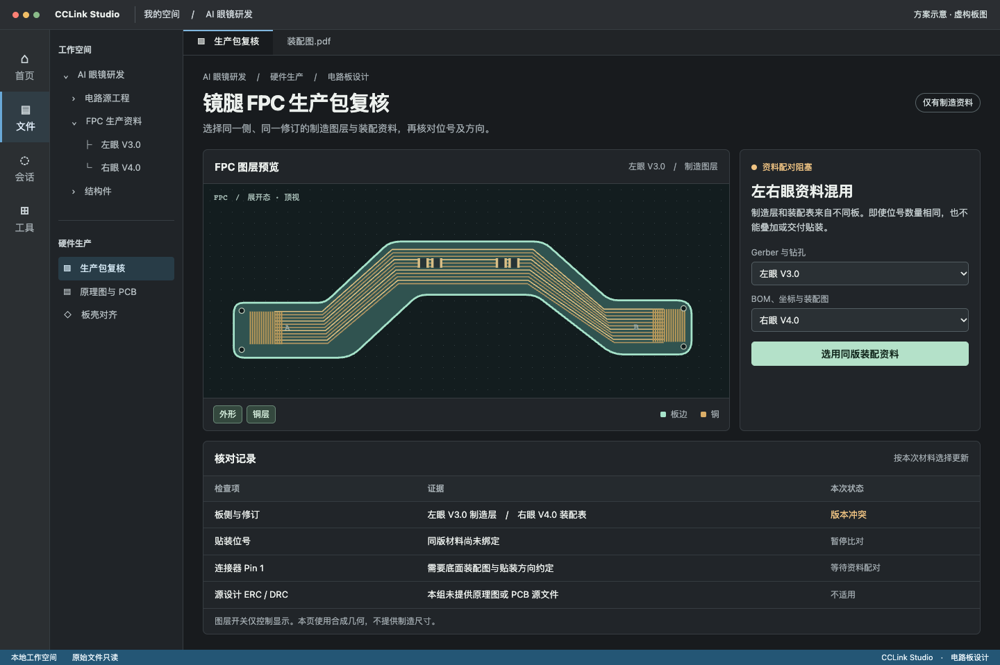

# 电路板设计｜AI 眼镜 PCB、FPC 与生产包

**先交付能阻止左右眼混料的工作台。** 用户打开生产目录，选右眼 V4.0，从同版 Gerber、钻孔、BOM、贴片坐标和装配图追到具体文件，生成可交给硬件同事复核的报告。本机真实目录中，现有检查会把左眼 ZIP 与右眼两张表放在同一份报告里。两侧各有 17 个贴装位号，按数量比对发现不了这个错误。

本次交付研究设计与交互原型。Studio 已有 Altium 只读图纸、单 Gerber 层基础几何和生产检查入口；按侧别及修订配包、KiCad 检查、生产导出和板壳对齐仍待开发。建议设计源选 KiCad，外协 Altium 保留原生签核，只有制造包的 FPC 从生产复核开始。

[打开交互原型](workbench.html) · [工具与模型选型表](selection.md) · [本机实测和真人验收手册](acceptance.md)

工作时钟记录为 2026-11-26 10:15:16 至 10:31:02（Asia/Shanghai，UTC+08:00），共 15 分 46 秒，包含源码与官方资料对照、真实样本解析、独立 CAM 验证及界面渲染核对。

点“选用同版装配资料”，可以看到冲突消除、17 个位号匹配、Pin 1 仍待人工核对。原型可切左右眼和图层。板形、镜像和走线为合成示意，不提供制造尺寸。

## 用户动作与成立条件

| 使用者和动作 | 用户拿到什么 | 前置条件和未决项 |
| --- | --- | --- |
| 创始人或采购在两眼同存的目录选择板号、侧别、修订及贴装变体 | 同一版的材料清单、错配定位、可交接的本地问题报告 | 侧别/版本有文件、目录或工程师指定的依据。公共 BOM 要有跨侧适用范围 |
| 硬件工程师在 KiCad 副本修改连接器附近丝印，返回 Studio | 修改前后图层差异，ERC、DRC 和新制造包能追溯到同一份修改 | 保存的板与图、规则、库和可用的匹配版 CLI。外部 EDA 拥有编辑中的设计 |
| 外协交付 Altium 工程，团队从工程浏览图纸并挂入原生 OutJob 输出 | 原始图纸、引用、板层与制造文件可并排复核 | 导出时的工程修订和变体需要外协提供；不把预览解析警告算作规则结果 |
| 结构工程师拿镜腿壳、FPC 和连接器装配基准核对定位与避让 | 带姿态、配准残差和误差来源的测量，干涉候选可交回改源 | 可信板边、原点、板面、元件高度和壳体版本。折叠态需要独立资料 |
| 生产负责人拿复核材料给厂方，回收 DFM 和首件结果 | 对应批次的厂方审查、首件电测和装机记录 | 报价、制造可行性、装配方向和佩戴验证分别签认；本设计不自动发送或下单 |

本专题的“有源”指具有可用的**电路设计源文件**。主控板、充电板、左眼和右眼 FPC 各有板号及修订。一个目录里有 Altium 工程，不代表同目录的外协 FPC 也有源。

| 收到的资料 | 开启什么 | 需补什么 |
| --- | --- | --- |
| PDF、照片或截图 | 逐页查看、证据标注和 OCR 候选 | 网络表、规则或精确几何要回到源文件 |
| Gerber 或 NC 钻孔，含单层、散目录、ZIP | 层识别、单层预览、裸板资料检查、轮廓候选 | 设计 ERC/DRC 不适用；缺层、叠构、单位、外形分别列未决 |
| 制造资料加 BOM、坐标、装配图 | 贴装核对、变体筛选、位号与方向复核 | 裸板打样可无 BOM；贴装用途缺坐标须阻塞相应交付 |
| 只有 KiCad 板或原理图 | 对应的板 DRC 或图 ERC，显示实际覆盖 | 图板一致性及整板交付需要配对设计；目录中只有 .kicad_pro 属工程线索 |
| 可用的完整 KiCad 工程 | 原生编辑副本、Studio 检查、从已审修订导出 | 缺规则/封装/符号库、关联子图或 3D 模型，分别影响对应项 |
| Altium SchDoc、PcbDoc、PrjPcb | 既有只读预览、隐藏文字、层与工程跳转 | 原生报告可作为附证；另建 KiCad 迁移副本须独立核对网络和输出 |
| LibrePCB 原生、IPC-2581、ODB++ 等 | 标记来源和外部打开，首期接收其配套标准制造输出 | 专用解析待真实团队样本，未知格式保留原件及原因 |

## 从选材到交付

1. **选择资料。** 现有工作空间“文件 → 硬件生产”打开复核 Tab。选择目标用途（裸板、贴装、板壳）、板号、侧别、修订和变体。ZIP 看包内相对路径；散目录也可组成包。冲突标红并定位两份输入；允许浏览单份或导出问题报告。界面同时显示选择依据和待确认项。
2. **还原制造层。** 读 Gerber Job、FileFunction、单位/坐标格式、极性与制板说明，文件名只推荐候选。核顶/内/底铜、阻焊、钢网、丝印、外形、内槽、镀孔/非镀孔、孔跨层、覆盖膜和补强。TXT 看 M48、单位、刀具定义和钻孔体，DRR 统计与 NC 钻孔分列。遇到宏、负极性、区域、步进重复、坐标格式不明或数据截断，必须校验覆盖后才能用于尺寸或间距判断。开放轮廓可人工选其他机械层或索取厂方认可的板边。
3. **核贴装。** 保留编码、工作表、列、原始行及每次出现的位号。BOM 核数量、制造商料号、封装、变体、DNP；坐标核 X/Y、单位、面别、角度、器件基准和旋转约定。按位号多重集比对，区分漏项、重复、冲突、DNP、手插件、测试点和拼板重复单元。区间须按认可语法展开并核数量；无法展开时列出原值。分别显示 Center/Ref/Pad，不静默采用第一个 X。用两个分散标记和第三个非共线校验点核镜像、原点及单位，以非对称连接器 Pin 1 核零角度。位号一致并不决定装配方向。
4. **审源再导出。** 复制整个可解析工程，保留相对库引用，用户在 KiCad 原生编辑器改布件/走线或执行审定的单项草案。Studio 显示网络、层、孔、板边和固定接口的变动，分别运行 ERC、DRC、图板一致性检查；按规则 ID、严重性及豁免定位。保存固定输入及工具版本，重新生成全部受影响的制造文件，再走前面三步。旧版本继续可复核。
5. **板壳对齐。** 选择 ECAD 视角、装配面法向、坐标单位和 MCAD 坐标系，记录 4×4 变换、手性和独立校验点残差。平面已知单位和装配面的情况下以两点定位，再用第三个非共线点检验；三维需至少三个非共线对应点或等效面/轴约束及额外校验特征。核连接器插拔方向、摄像头/显示排线、麦克风声孔、铰链包络、电池位置及天线净空。展开态、装机态和铰链开合单独记录。FPC 的叠构、铜厚、覆盖膜开窗、补强边界、弯折半径/方向与动态循环要求取自该厂工艺单；缺 3D 高度或折弯模型时，列出未检查区域。
6. **交接。** 报告包括用途、板号/侧别/修订/变体、输入摘要、逐项结论、人工判读、证据定位、责任人。阻塞仍可导出“问题报告”。“可交给厂方复核”需同版资料和工程师确认；DFM、报价、首件和装机通过单列。材料变化后，历史报告保留，当前状态转为“已过期”。

**只有制造资料时如何改 FPC。** 用户圈选“铰链处向内避让”，锁定连接器、焊盘、走线、孔位、补强和弯折区。记录目标尺寸、基准和工厂限制。在独立草案目录输出带标注的轮廓叠图或 DXF、受影响图层和距离；缺少尺寸或固定区时保留待补件。原设计方或本方工程师更新铜、覆盖膜、补强及钻孔并交回整包。需从 CAM 重建设计源时单列人工重建、网络/引脚对照和样件电测。该路线能推进改形讨论；批量量产还需新版完整资料和工厂签核。

## 所有者、状态与恢复

| 对象 | 谁拥有事实及范围 | 失败及下一步 |
| --- | --- | --- |
| 工作空间、文件与图纸 Tab | 现有 Workspace / Tab 和 FileService 权限边界。原文件内容由本地文件系统/原生 EDA 拥有 | 切工作空间后解绑旧监听；恢复 Tab 重新核路径、权限和文件版本 |
| 选择及复核记录 | 扩展 HardwareService 的现有硬件报告。材料身份含工作空间、相对路径/包内条目、摘要、板号与用途；保存用户明确的版本、字段和工艺映射 | 扫描只给候选。文件内容、变体或映射更换后标旧结果过期；改名同摘要可以请人重新定位 |
| 运行与证据 | HardwareService 负责本地检查；长任务记录稳定 ID、工作空间、输入快照、工具/规则版本、起止和退出分类。每项指向页/行/层、坐标/单位或规则 ID | 待选材 → 可检查 → 运行中 → 有结果/需补件/失败。取消、超时、重启中断分列；同参重试关联旧 ID。工具运行成功与规则发现违规并存 |
| 人工处置 | 绑定复核记录、签认人、依据和适用版本；限制性结论关联具体用途 | 新修订需复核。跨侧错配、未解析或过期结果不能靠“忽略”标通过 |
| MCAD 模型与变换 | CAD 服务负责模型派生与元数据；硬件复核记录只拥有两份明确模型间的配准、姿态和检查点 | 任一模型指纹、基准或姿态变化令对齐过期。FreeCAD 缺失仍可做表格和二维工作 |
| 报告与生产导出 | 当前冻结的复核记录导出到工作空间新版本，暂存、校验再原子提交；保存报告不可重新选“主要文件” | 取消、磁盘满、权限撤回保持未完成批次不可交接。重开查看旧版本或重试完整导出 |
| 选层、缩放、Agent 总结 | Renderer 仅投影视图状态；Agent Thread 拥有会话，收到用户允许的摘要和证据引用 | Agent 离线仍可使用本地链。建议不能更改源规则结果或代替人工签认 |

源码基线 **dfaf4499ff08**。复用 [HardwareService](../../../../src/main/hardware/hardware-service.ts)、[硬件共享契约](../../../../src/shared/ipc/hardware.ts)、[生产侧栏](../../../../src/renderer/src/components/sidebar/HardwareProductionSection.tsx)、[异步快照 Store](../../../../src/renderer/src/stores/hardware-store.ts)、[Gerber 预览](../../../../src/renderer/src/components/workbench/GerberLayerPreview.tsx)和[Altium 只读链](../../../features/altium-readonly-preview.md)。现有“改形状”入口继续准备 FPC 上下文，CAD 服务保留模型元数据，MCP 消费同一域结果；工具栏与菜单复用统一 command。既有工程工作空间内增加内容视图，不增一级导航。[架构宪法](../../../architecture.md#架构宪法) · [FPC 改形原始场景](../../../features/fpc-shape-change-assistant.md)

**权限及诊断。** 增量共享契约先于 handler，主进程核 sender、活动本地工作空间、realpath/链接、包内入口及读写后权限，renderer 无 Node 和任意可执行路径。限制展开字节、条目、时间和内存，排除系统元数据。CLI 用探测过的可信安装、固定子命令/参数列表、隔离暂存及限定输出；默认不运行项目内自带脚本、插件或未审 jobset。运行按工作空间和选择代次绑定，晚到结果不替换新材料。关闭、取消和退出释放进程、监听与临时输出；日志只记摘要和错误分类。

## 开发顺序

| 顺序与用户增量 | 必要实现与依赖 | 真人可执行的出口 |
| --- | --- | --- |
| **1 · 同版生产包复核** | 从现有侧栏到材料选择、目录/ZIP 读取、表格/钻孔、再到冻结报告做一条纵向切片。先支持本机左右眼资料 | 选右眼散目录，找到同版材料，故意混左眼立即阻塞，导出问题报告、重开核对。无需 KiCad、厂商账号、CAD 或模型。见验收 A/B |
| **2 · 装配层与方向复核** | 以独立 CAM 工具建立基准，再支持可信层叠及坐标变换 | 各选一侧，从非对称连接器跳装配图核 Pin 1；未知基准时只看分层，不画可信叠层。见 C |
| **3 · 可编辑源的改版闭环** | 可用的原生 KiCad 工程、规则、库、故障副本与固定 CLI。Altium 复用只读；原生 OutJob 可作为对照 | 改源副本、定位违规、修复、导出新包，返回阶段 1/2。原件指纹一致。见 D/E |
| **4 · 板壳协作** | 可信板边、真实壳体 STEP、对齐特征、弯折工艺及装配姿态 | 核静态位置，记录干涉候选、返修版和实物装机结论。见 F |
| **有需求再接仿真、OCR** | 可信模型及许可、测量条件、人工标注集；与主链可独立失败 | 小电路和台架对照；图片建议可点回原页。见 G |

**grill-me 审查。** 为何第一期不先装 EDA？真实阻塞发生在选材料时，两个板恰好都有 17 个位号。为何不能自动认 GKO 为最终板边？现有几何解析器在两个真实文件上分别给出 34 和 36 段，两者均为零个闭合候选。为何先保留外协 Altium？已有图纸能读，迁移的网络、层叠、规则和制造输出尚无等价证据。若完整 CAM 或第二个 EDA 适配拖住首期，先交资料选择与可核对报告，保留几何未决。单项前置超过 60 分钟、同一阻塞失败两次或 60 分钟无用户可见增量时，按仓库规则止损复审。
