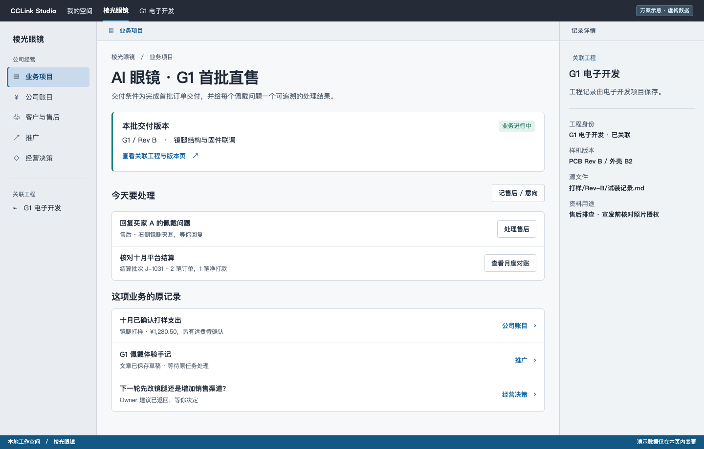
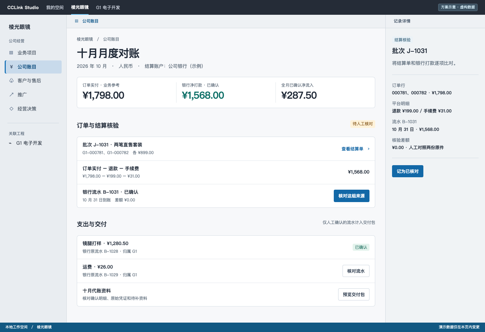

# AI 眼镜小公司的日常经营

2026-11-26 · 研究设计 / 待开发与真人验收 · 仓库基线 `dfaf4499`

**先用现有 Studio 跑两件真事。** 今天把一条真实咨询或售后挂到「AI 眼镜」业务，回复后从首页待办消失，重启还能查回。选一个代账已做完的月份，把实际流水和凭证整理给同一个代账，核对差额，拿回能否直接使用的答复。第一件无需等待账单、网店接口或模型；第二件会告诉我们究竟该适配哪张表。第一项建议新增的用户能力，是在业务详情按当前业务直接登记和处理售后。

业务按**直接销售、售后跟进**设计。产品备忘已记载招募试戴者的方案被取代。示例公司「棱光眼镜」、G1、客户、金额和日期均为虚构。用户在本专题能核对界面与实施选择，尚待真实公司验证订单来源、月度差额与代账回执。[项目备忘](../../../project-memo.md) · [工具、模型与本机实测](research.md)

## 从工作台看见什么

业务页回答「这批眼镜对应哪个工程、谁在等我、下一步点哪里」。右栏来源可回查；身份失联时保留引用，提示重选原工程。月度页同时呈现订单实付、银行净打款和已确认净流入，让负责人看清每个数的来源。

[离线交互稿](preview.html)可切换五个视图。点「处理售后 → 已回复，等对方」，返回业务项目看待办变化。点「公司账目 → 记为已核对」，净流入保持原值；再点「核对流水 → 人工确认入账」看运费如何改变净额。交付包按钮预览所含材料。刷新重置演示；真实 Studio 的存储、平台读回、代账打开交付包另行验收。效果稿为择要展示的业务详情，正式入口沿用「项目首页」及现有经营决策卡。

## 现状与复用点

| 用户今天可尝试的生产入口 | 已有证据 | 仍需验证或新增 |
|---|---|---|
| 公司项目 → 业务项目 → 创建 AI 眼镜，填目标、截止日、交付条件；关联已有工程或新建电子开发工程；绑定一个账目归属 | Electron 走查了原工程身份、打开/重启及引用，另有主线整合记录。[类型项目验收](../../../testing/typed-workspaces-2026-11-19.md) · [整合验收](../../../testing/typed-workspaces-main-integration-2026-11-19.md) | 业务内聚合售后、定位具体版本页属于本方案。工程链接本身只提供原项目身份及目录。 |
| 客户与售后 → 记一条，关联业务，填写昵称、来源、问题、外部订单号、下一步；首页看谁等最久 | customer_cases 已有 businessId、orderRef、waitingSince、版本号。真实 Electron 验证回复后离开待办。[公司首页验收](../../../testing/company-home-v1.md) | 当前订单号是文本。尚无网店订单同步、消息发送、入库或出库；业务级快捷跟进需补。 |
| 公司账目 → 导入银行/支付 CSV 与凭证 → 逐笔确认 → 月报/项目支出 → 导出与备份 | 样例通过去重、导出、备份恢复。导出有明细、核对历史、汇总、说明和关联原件。[账目验收](../../../testing/company-accounts-v1-acceptance.md) | 真实平台表头、跨月净结算、代账字段和回执尚缺。核验分组、缺件列表与可对照的交付批次是拟增能力。 |
| 推广 → 打开稿件或原发布任务，检查账号和平台结果 | 公司页为原事务投影。另有 CSDN 特定作品走过提交结果未知后仅做只读核验的实证。[恢复验收](../../../testing/article-publishing-recovery-2026-09-28.md) | 特定作品的证据只属于该作品。此专题未执行 G1 发帖。稿件与真实询单的来源关联可手记，自动归因无数据支持。 |
| 公司首页 → 帮我想清楚一个问题 → 勾选范围 → Owner 追问/建议 → 用户采纳 | 经营决策已在旧的首页说明之后实现。真实 Electron 与本机 Codex 跑过正常路径和采纳后重启。[决策验收](../../../testing/company-decision-card.md) · [ADR 0025](../../../decisions/0025-company-decision-records.md) | 用负责人自己的报价和售后情况判断是否值得采纳。思考过程中退出、Agent 不可用仍需真人补验。 |

## 一天和一个月怎么用

| 场景 | 操作者、入口和动作 | 写入与完成证据 | 异常与下一步 |
|---|---|---|---|
| 建业务，关联工程 | 负责人在公司项目建「AI 眼镜 · G1 首批直售」，填「首批订单交付，每个佩戴问题能查回处理结果」。选择现有工程；尚无工程才用「新建工程并关联」。在工程里打开具体试装记录。 | 公司保存业务和链接，工程保存 PCB/FPC 版号、壳版、固件、样机批次、照片许可及测得条件。验收时从公司打开同一工程，再返回原业务。 | 创建成功而关联失败，给出已创建位置并选择它重试。工程移位按身份重连；两个同名工程不自动替换。业务归档保留查阅与重新打开。 |
| 处理咨询和售后 | 工作人员查重后手记买家昵称、渠道/店铺、订单号、问题、受影响版本和下一步。意向咨询可无订单。外部回复后点「已回复，等对方」；对方补充后重新进入待办。 | 公司案例记录等待方、等待起点与最后处理时间。处理人与买家核实解决后点「已解决」。真人从首页打开同一条，核对回复前后变化和重启。 | 未核实是否回复时保留等我。错单解除引用；同一订单可有多个问题；重新出现从原单重开。退款、换货、物流执行仍由商家原渠道处理。 |
| 推广一篇真实工程进展 | 负责人从工程选择允许公开的本版照片与测试条件，编辑 Markdown，在推广进入原任务，选定平台、账号、原稿版本、图片与授权范围。 | 复用 WebAffair 的准备、账号/原稿核验、正文/图片、平台字段、保存、提交、结果核验。公司页仅展示其状态、时间及回查入口；公开需平台读回对应账号的原作品和内容。 | 错版图片回工程重选。扫码/验证码由人接管。审核中、拒绝、保存草稿和提交未知各按原事务恢复；已派发的未知提交先只读核验。授权具体到此账号与此篇。 |
| 回看推广是否带来咨询 | 在客户案例的来源写「客户提到文章标题」或经用户核对的作品引用；来源不详保留未知。按业务筛选仍等回复的咨询。 | 来源为客户自述或可回查链接，分别显示。有依据的联系数可报给决策卡，样本量随摘要给出。 | 浏览量未取得显示资料缺失；没有平台订单或一致的归因窗口时只展示原始计数。 |
| 决定先改镜腿还是先扩销售渠道 | 负责人补交期和报价，选择已确认项目支出、匿名售后摘要、业务目标；工程资料需另选允许传入的摘要。Owner 最多追问两轮，给出选项、来源、估算和重想条件。 | 用户可修改后采纳、暂缓或重新提问。公司保存当时的建议和最终决定；采纳后手动前往业务处理。依据保留来源日期，后来的数据变化可另开复盘。 | 缺报价标估算，未核实事实单列；运行失联按原 runId 对账，用户再决定重试。采纳不会改变价格、支付、发消息或建立新发布任务。 |
| 月末交付 | 负责人按渠道收集原流水、平台结算单、订单明细、发票/凭证，选已结月份，逐笔确认，列差额原因，导出给现有代账。 | 代账打开实际交付副本，任选一笔回查明细/原件并核对汇总，返回接收或退补、字段与原因。负责人按反馈关联该次副本。 | 缺渠道显示未覆盖。代账有调整分录时保留其日期、科目与口径解释，按现金口径对账。导出成功和代账接收有各自的时间和证据。 |

## 哪些数据归谁

| 对象和作用域 | 唯一写入方 / 最小数据 | 指向它的对象与状态 |
|---|---|---|
| 公司、工作空间、电子工程 | 基础层保存 workspace 身份、绑定、导航与授权目录；工程项目保存设计、版次及测试结果原件 | CompanyWorkspaceService 保存业务 ID、名称、目标、交付条件、截止日、归档、ledgerProjectId 和资源引用。账目归属与工程身份是不同的 ID。路径变化重新选取；跨公司读取必须拒绝。 |
| 客户案例 / 销售订单 | 公司服务拥有本地跟进、等待状态和 orderRef。原店铺或 ERP 拥有订单、履约和退款事实。人工直售若确无原系统，可用负责人保存的订单文件作为来源并标「手记」。 | 首批沿用文本号。取得真实结算样本后需要匹配时，引入最小订单行投影，按公司、渠道、店铺、外部单号和行号区分，保留原件定位、SKU、数量、成交额与币种。相同人名、金额、不同店铺同号都不能自动合并。 |
| 流水、记账归属、原件与修改记录 | CompanyAccountsService 的 SQLite 与凭证目录独占；金额以最小货币单位保存，沿用两个流水状态 pending/confirmed。导入流水原件与辅助凭证各有角色。 | 金额、日期、方向、账户、默认币种及交易来源校验后由人确认。修改已确认流水退回待核对。订单截图、发票或 OCR 不生成第二笔现金收入。 |
| 拟增的结算核验记录 | 归公司账目领域。保存批次、账期、币种、结算原件哈希及行定位、所选订单与流水 ID/版本、各扣项、人工结论/理由与时间。供核验读回；与记账命令各自独立。 | 原件齐备 → 待核对 → 已核对或有差额；源变化、银行记录退回、人工替换原件 → 需复核。缺原件或多候选 → 待补证。不得把金额相同直接视为同一笔。 |
| 样机实测与宣传依据 | 在电子工程的版本记录中保存测试条件、原数据、测量人/日期、适用批次、可公开范围；公司引用原记录。客户陈述起初只属于案例。 | 研发核验决定技术结论；渠道可公开的素材需对应授权；换壳或换板后重新检查适用性。旧工程只读、证据缺失时仍可做客户回访。 |
| 发布、账号、研究取证、决策 | WebResourceService 拥有站点账号；WebAffair 拥有提交进度与结果；Agent 服务拥有 run/session；独立 Owner 取证事务保留其原证据。公司 decisions 保存决策草稿、用户选择与必要运行引用。 | 首页计数、详情和报表都是可重算投影。OCR 候选和 Owner 自述只作为输入。工程核验、平台公开核验、财务核验分别回各自的原记录。 |
| 代账回执 / 共享副本 | 拟由账目领域保存导出批次、生成时间、月份、记录版本、文件摘要及用户收到的反馈；正式总账、结账、申报归外部代账。 | 本地生成 → 用户已交付 → 代账接收或退补。旧副本保留原状态，补资料生成新批次并引用上次。项目同步的逐行文件是交换副本。 |

## 一笔平台打款怎样核，月报怎样交

1. **选口径和账期。** 示意用人民币、公司银行作为唯一实际收款渠道。订单成交日、平台结算日、银行到账日分别保留，月度现金汇总按流水日期。若已把支付平台余额当作独立现金账户，提现到银行应按内部转账配对，必须先选定账户边界。两种收款口径混用会让同一销售收入出现两次。
2. **还原平台打款。** 两个订单各实付 899.00，结算内退款 199.00，手续费 31.00，预计到账为 1,568.00。银行 B-1031 实收 1,568.00，差额 0。两笔订单、两条扣项共同解释这一次净结算；在此样例中，订单总额和两项扣款都没有另一笔独立银行流水。CSV 按来源角色选择，具备金额、方向的订单表也只能进「订单/结算附件」，不得送入现有通用流水解析器。
3. **处理部分、跨月和异常。** 同单多次打款或多单合并时按结算明细分配到原流水，多对多分配的金额不能超过各自可分配额。余款列未结。十月成交十一月到账，十月保留应核项，十一月引用原单；月内原始流水不改日期。无结算号、跨币种、尾差、手续费不明或金额相同的多候选必须人工分辨。显示原额、预计额、实收额与差额；已解释差异保留解释及凭据，未解释的差额保留在异常表。不得四舍五入抹平。
4. **核对全月。** 示例另有打样支出 1,280.50 已确认、运费 26.00 待确认。此时净流入 287.50。人工点「记为已核对」只保存对账结论。确认有真实银行来源的运费后，已确认收入 1,568.00，已确认支出 1,306.50，净流入 261.50。退货给客户且另有现金流出，与结算内扣减分别处理；购货退款实际流入依现有 refund 口径回冲项目支出。库存、税额、折旧和权责发生制利润留给代账。
5. **给代账。** 沿用已确认账目 CSV、确认与修改记录 CSV、月度汇总 JSON、交付说明、关联凭证；按代账真实反馈再追加「结算核验及差异」「渠道覆盖与缺件」清单。新增的明细/索引提供稳定流水标识，使同日同额也能回查；现有已确认账目 CSV 没有单列流水 ID，修改记录有。用户先预览所附原流水文件可能包含的其他明细，并选交付位置；通过自己的约定渠道传递。交付包与含业务库的恢复备份分开。受限路径、磁盘满或原件缺失时列出失败项，临时目录不登记已生成，重试产生完整副本。
6. **拿回对照。** 代账核对覆盖期、币种、退款、提现与实际对照数字，差额为零或能逐笔解释；人工记录退补/接收与实际反馈。对方没有提供对照数字时，能记录「已收到材料」，月度正确性保持待验。负责人在隔离目录从完整备份恢复并抽查一笔及原件，不覆盖在用公司的账本。

## 实施顺序与真人放行条件

| 顺序与本批用户验收动作 | 现有复用点 / 最小实施 | 需要谁提供什么 | 通过证据与停手条件 |
|---|---|---|---|
| **先开始 · 今天跟进一条真实记录。** 在公司项目新建或选 AI 眼镜业务，链接原电子工程。用现有客户表单登记一条真实咨询或售后，回首页打开，实际回复后改变等待方，重启再查。 | 直接用现有 UI。随后只补「业务详情 → 记售后/意向」和该业务的等待列表；表单预选 businessId，复用创建、修改与版本冲突入口，打开同一条原记录。旧的未关联案例可人工补归属。 | 有可用本地目录和一个原工程即可关联。还无真实咨询时先完成关联，并用隔离样例开发快捷入口；实际跟进待第一条真实咨询验收。独立于其他四个专题。 | 负责人能从前述入口来回、重启可见；第二家公司搜不到这条记录；「等对方」从本业务待办消失。一个具体业务走通即可，不先搭订单中心。 |
| **并行取资料 · 交一个已结月份给代账。** 先用原账目入口跑完整月，代账抽查一笔原件、退补一项再接收。 | 用原导入/导出、备份/恢复和 projectId。按真实阻塞只补一种表头、一个缺字段或缺件清单，再用同月复跑；可先手写差额表和代账回执。 | 负责人提供渠道清单、原始银行/支付流水与凭证；代账提供模板、计量口径和同月对照数字。挑不自动同步的测试公司处理隔离材料；要同步真实材料时先检查现有共享范围。 | 所有渠道有覆盖结论，重复导入不增收支，逐笔解释差额，代账用自己的工具打开并确认能接手。无法取得资料不阻碍首个跟进闭环；缺对照数单列。 |
| **拿真实净结算样本后 · 核一批订单打款。** 负责人从业务打开该月账目，选择一种实际平台的原始结算文件，指定来源角色，核对一对多或多对一，再打开原流水。 | 在原账目域增受限的结算资料导入和分组核验，定位原行、版本和金额；原有银行流水导入继续使用原命令。先仅支持一种已确认格式。批次唯一性与半次失败回滚随此路径完成。 | 至少有真实订单行、平台费用/退款明细、一笔银行入款及人工对照。若公司均为单笔直售转账，优先用「订单引用 + 原流水」解决，延后分组开发。 | 对账差额与人工答案一致，记核验不改现金数。重导同文件新增 0；改已确认流水、原件不匹配后提示复核。出现双算立即停止扩展平台。 |
| **经营复盘 · 处理一次真实取舍。** 将一篇已审稿件挂在业务下，核对对应硬件版本；有授权时回原任务发布并读回结果。再基于真实售后与已确认支出请 Owner 比较两项选择。 | 推广原页、文章发布任务和原决策卡直接可用。先手工选择当前范围，后补按业务过滤或带来源时间的摘要。草稿照常在编辑器审阅；发帖与采纳各走各的入口。 | 稿件 + 授权照片 + 账号与单篇范围；决策可先用真实报价，不依赖发帖成功。 | 推广验证为原平台回执和公开结果；负责人采纳、修改或暂缓并解释依据，重启不重派。缺公开授权只验草稿及可观测性。缺 Agent 时仍能做账、看业务、回访。 |
| **有重复人工成本时 · 识别一张疑难凭证。** 负责人对照右侧原件，接受或修改字段候选；返回账目继续原人工确认。 | 原文件选择和预览，原流水编辑/确认，按需本地 OCR。先复用结构化内容或 PDF 文字层；解析器/权重只为可复现的资料类型引入。 | 脱敏扫描件、人工真值及手工核对耗时；目标机配置、可离线安装的运行时与模型许可清单。 | 逐字段有来源页和位置，改正/撤销可行，断网及缺模型仍能完成交付。候选比人工费时就移除快捷推荐。 |

**建议开始开发的具体位置。** 在 CompanyWorkbench 的选中业务详情增加「记一条」和按 businessId 筛选的案例区，从 CompanyCustomers 抽取已有受控表单/动作，在现有命令传当前 scope；不新增表和服务。保存成功后按同一 scope 重新读业务快照，失败保留草稿。首个回归是在两家公司分别用相同业务名和客户昵称：从 A 发起、切 B 后 A 的迟到结果不能出现在 B。待这一纵向路径可由人操作，再碰月账导入。[业务工作台](../../../../src/renderer/src/features/company-workspace/CompanyWorkbench.tsx) · [现有客户表单](../../../../src/renderer/src/features/company-workspace/CompanyCustomers.tsx) · [公司服务](../../../../src/main/company-workspace/company-workspace-service.ts)

**工程准备度。** 原服务已有受限 IPC、稳定 ID、expectedVersion 和恢复路径。以后新增结算核验时，把唯一性校验、文件哈希、原子写入、版本冲突与原服务读取放在同一纵向增量。不要预建通用审批、订单/库存/CRM 平台或调度器。新增表之前先更新现有账目产品设计的边界并做 schema/退回测试。旧库可读、迁移失败保留原库；恢复用独立副本。将新表是否进入账户备份和项目同步写入该批验收。同步启用时检查实际允许的表、原件和历史，存两台并发修改的真实恢复结果；当前同源流水双端修改已有「保留修改次数多的一份」限制。在差异处理完成前，安排单机确认同月账目，不承诺多人同时结账。[架构宪法](../../../architecture.md) · [账目服务及现有导出](../../../../src/main/company-accounts/company-accounts-service.ts) · [同步表清单](../../../../src/main/company-sync/company-sync.ts) · [同步验收与限制](../../../testing/project-sync.md)

**权限、生命周期与诊断。** 界面只取选中公司和月份的读投影；主进程校验 sender、scope、选择器授权、输入尺寸、类型和版本。公司项目的普通文件与单独电子工程的授权各自有效，链接不赋予遍历另一目录的权限。公开、付款、平台退款、向代账传包和采纳决策是不同动作；此设计只授权研究。可选 OCR 经注册生命周期按需启动，有超时、取消、清临时页、释放模型和关闭工作区路径；旧 workspaceId 的结果丢弃。解析时隔离不可信文本、限制页数/大小，不在带 preload 的视图执行文档内容。诊断只写脱敏批次 ID、文件类型、行数、耗时、冲突类别与缺失字段；不含姓名、单号全文、银行账号或原始图片。建议跟进用户命令复用现有定义和 Context Action 入口。已有项目同步可把客户及原始资料写入私有 Git 历史，需按真实项目的设置展示会共享的对象；旧验收写的「只留本机」不能外推到已开启同步的项目。[稳定基线](../../../stabilization.md) · [同步设计](../../../decisions/0026-project-sync.md)

## 再审一遍最容易被误判的结果

| 追问 | 现场故障与预期 |
|---|---|
| 手工录入一条售后，就证明订单真实成交了吗？ | orderRef 只提供线索。买家称「退 199」先写客户陈述；平台结算记录证明已扣款，银行记录证明实际进出，三方日期可不同。 |
| 工程核验与经营验收是否会多一套任务状态？ | 工程在对应版本留原始试装记录。负责人对「首批交付」的经营验收可先以公司业务下的 Markdown 保留交付条件、核对人、日期、来源及版次、通过/退回和补件要求。重新验证引用新版本，记录旧判断。公司页打开这些原件，需要时按来源查证，不把经营验收回写工程/平台状态。 |
| 有两笔同日同额到账或重复的导出文件怎么办？ | 依据渠道账户、交易号、原件哈希和结算行编号；源单无唯一号时，人工选择，重复/多候选分别可见。既有流水 source_key 去重不能替代订单行匹配。相同原件重复导入、同一行被两个分组占用，均须实测。 |
| 业务改名、归档、核验后撤回、重启或切换公司会怎样？ | 核验引用稳定 ID/版本，归档仅隐藏常用入口，修订账目后先回待确认，旧核验变待复查；同名项目或手机号不触发自动迁移。恢复后先按源重读，服务不可用显示具体缺哪个来源和重试入口。 |
| 公司没有代账模板、没有网店 API、没有 OCR 时能先做什么？ | 今天的工程关联和人工跟进照常；按当前格式交付可验证「对方能打开」；缺真实账目或对照就记录缺哪一项。每项产品验收独立，不因接口或模型延期而推迟本地工作。 |
| 首版何时值得扩大？ | 先观察首批直接销售中重复发生的痛点，记录每月人工耗时和退补项。没有真实分组结算，不做通用匹配引擎；没有多人管线，不部署 CRM；没有可公开的样机证据，推广稿明确保留待核实表述。 |

## 本次核验

用户功能进度采用上方列出的仓库验收记录与具体限制。本次没有登录店铺、操作真实公司库、公开发帖或交付真实账单。工程与设计核验仅覆盖代码/验收阅读、官方来源核对、合成单据本机识别和 HTML 示意的真实浏览器走查。实际代账能否直接使用、模型在公司原件上的效果、真实买家跟进是否省时，均留给表中的真人验收。

示意图经本机 Chrome 158.0.8127.88 渲染。五个视图在宽度 1440、1024、768、390 像素下均无整页水平溢出；验证了回复/再回复、核验不改金额、运费确认后净流入变化、导出预览、决策不改变账目、刷新重置。走查无外部 HTTP 请求、无页面脚本错误。PNG 为整页截图，可打开查看中文、金额与来源栏。[业务视图](business.png) · [对账视图](reconciliation.png) · [识别实测](ocr-check.json)

新增售后入口也已在交互稿验证：从业务内登记买家 B，切至客户与售后回复，返回业务后该待办消失。它仍是拟开发的生产入口。格式化 HTML 时 pnpm 自动运行了已有 postinstall，重建本机 node-pty 依赖；Git 状态检查未见跟踪文件变化，未创建提交或改动业务源码。

本专题工作时间为 2026-11-26 10:15:15 至 10:29:31（Asia/Shanghai，UTC+08:00），共 14 分 16 秒。
