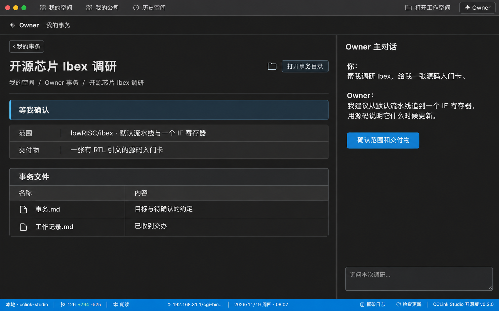
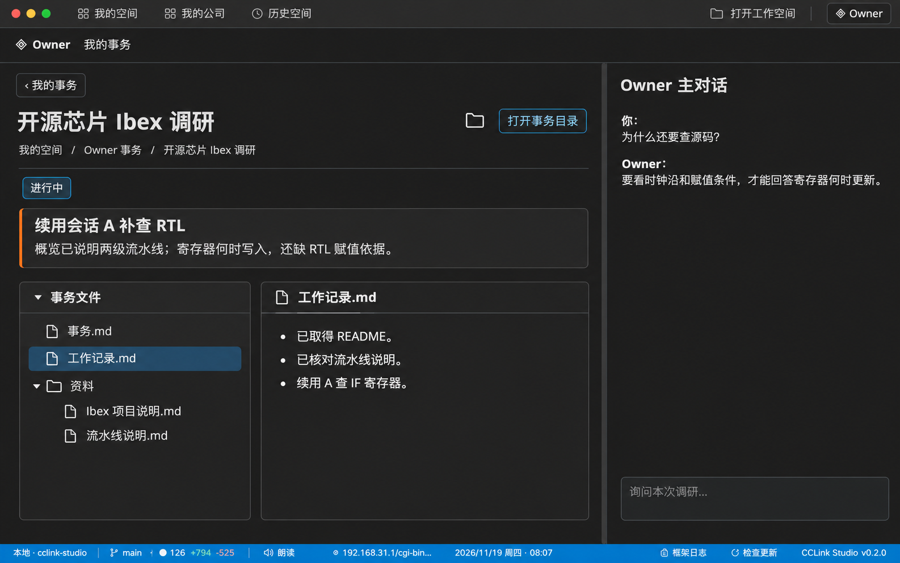
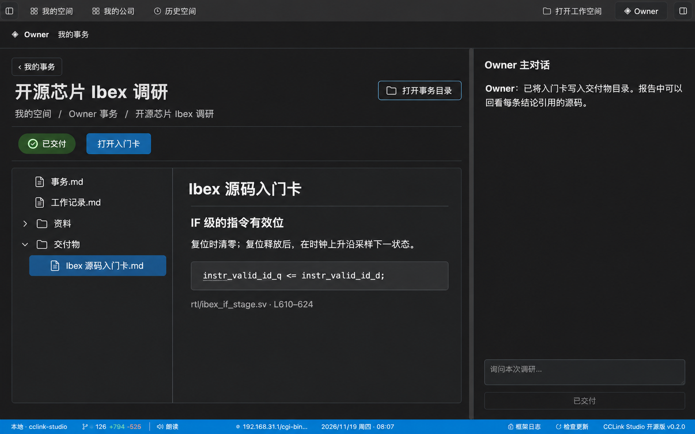

# Owner 0.1 事务目录设计稿

开发版首个切片覆盖个人空间中的新调研事务。交办后建立独立目录，保存确认、委托、回执、补查理由和带提交版本的来源片段。交付时保存并核验 Markdown，支持从看板打开目录和预览磁盘文件。旧事务沿用原有存储。下文中的自选父目录、移动后重新关联、旧事务转档以及冲突文件另存新版仍属设计。当前文件冲突会保留原件，支持手动移开后重试保存。

## 用户验收

在 Studio 顶栏进入 Owner，交办「帮我调研 Ibex，给我一张有源码依据的入门卡」。确认前就能打开这件事的目录，看到自己的目标。确认后离开看板再回来，能从工作记录说明为什么续用会话 A、从资料文件找到已经读过的原文。交付时直接打开入门卡，顺着它的引用回到当时的源码片段。在文件管理器中单独打开这件事的目录，也能读懂进展和成果。

## 目录在哪里

- 新事务默认保存在个人空间实际目录下的 `Owner 事务/<事务名>/`。进入 Owner 与是否打开工作空间无关。若用户已在 Owner 设置选过默认父目录，则使用该位置。详情页标题旁常驻「打开事务目录」，在系统文件管理器中定位这一件事。
- 用户可以在列表的交办框下展开「保存位置」，为本次选择其他本地父目录。即使该目录属于某个项目，也只在新建的事务子目录内写文件。选父目录不授权读取项目其他文件，也不需要切换当前工作空间。
- 第一次发出目标时创建事务子目录。名字取自短标题，遇到同名自动追加序号。后续修改显示标题不自动改磁盘路径。默认位置变更仅影响以后新建的事务。零状态不预建样例文件夹。
- 默认位置不可写时保留交办草稿，提示「重试」或「另选位置」。创建成功才显示「打开事务目录」，等待确认范围期间不派 A 取证。

## 三个时刻

### 1　交办与确认

中央显示实际位置、待确认约定和已写入的文件。第一次落盘只有两份可读文件。`事务.md` 包含目标、当前状态和下一步，`工作记录.md` 记下交办。右侧确认后，事务页和两份文件更新为已确认的范围、交付标准、当前动作和确认时间。

### 2　补查与留证

同一执行会话 A 查到 README 与流水线说明后，Studio 在 `资料/` 保存对应证据文件。每份注明来源仓库、文件路径、固定提交、实际读取时间、原文片段及可用行号。每条回执关联委托和证据文件；取证返回空或失败时，只记录原因。Owner 判断还缺寄存器的时钟与赋值条件，追加补查理由和本轮问题，续用 A。用户可以从中央看板选中文件预览，右侧仍能继续问 Owner。

### 3　核对与交付

A 取得 RTL 后新增 `资料/IF 寄存器取证.md`。Owner 判断证据是否满足交付目标，Studio 核对引文与来源，写入并核验 `交付物/Ibex 源码入门卡.md`，登记对应交付记录后显示「已交付」。报告内的相对链接指向本地证据文件，证据里保留固定版本的官方链接。点「打开入门卡」在 Studio 查看实际文件，点「打开事务目录」可从文件管理器取走成果。发送给他人时，单份报告保留官方出处；连同资料目录一起复制则能离线核对片段。

## 谁决定，谁写入

| 情况 | 决定与实际写入 |
| --- | --- |
| 新目标、已确认的范围和交付物 | 用户交办和确认。Owner 更新事务摘要，追加确认记录。 |
| 读取哪些已授权的公开资料、是否续用 A | Owner 决定，Studio 按回执保存。右侧普通问答留在会话；改变约定的决定才写入工作记录。 |
| 扩大范围、降低验收标准、改写到其他位置 | Owner 说明影响，等用户明确选择。首版默认目录设置不搬动存量事务。 |
| 已有文件有用户改动 | 保留用户版本。写入前发现内容与上次写入版本不同，显示准确路径，允许另存新版。用户可在同目录自行放笔记，Owner 默认不读取或覆盖这些文件。 |
| 交付文件写入或核验失败 | 列表、中央看板和右侧 Owner 主对话同步显示「待保存」。Studio 保留本次核对过的报告与引文。排除文件冲突后点「重试保存文件」，即使期间重启，也从原报告续写。文件全部核验成功才显示「已交付」。 |

## 一份状态与恢复规则

Owner 的事务记录由 Studio 主进程持有和写入，目录中保留稳定的事务标识和有版本的内部记录；列表只索引标识和位置。看板和可读 Markdown 都来自同一次事务更新。改 Markdown 的状态文字不会触发派工或确认。原生会话继续由 Studio 会话系统管理，事务记录保留会话关联和已核对的业务回执，普通聊天全文不自动写入读者可见的目录。

写入已有事务前，Studio 在自己的数据目录暂存本次内容及其所依据的事务版本。重试先检查原目录身份和版本，再补写文件并核验。核验成功后清掉暂存内容，整个保存流程不调用会话 A。

逐步记录交办、确认、委托、回执、判断、阻塞和交付，每次写明发生了什么、依据与下一步。对同一回执重复恢复只登记一次。写入中断时恢复缺少的文件、重新校验，然后推进对应状态；文件未就绪时，列表不能先显示已交付。

外部移动目录后，列表保留原事务并提示「定位原目录」，选中后核对事务标识再关联。打开同名目录或复制品不自动恢复执行。旧版本已存在的事务在列表中显示「仅保存在 Studio」及「建立事务目录」；从现有记录写出并核验后绑定，同一件事沿用原会话和证据。新版本不批量移动历史数据。跨设备恢复运行、协同编辑和会话全文导出留待后续设计。

在事务看板打开入门卡，点出处下的「本地证据」，直接在中央预览对应的本地快照。有固定行号的引文会滚动到原始行并高亮，保留周围代码。点「返回报告」继续阅读。
