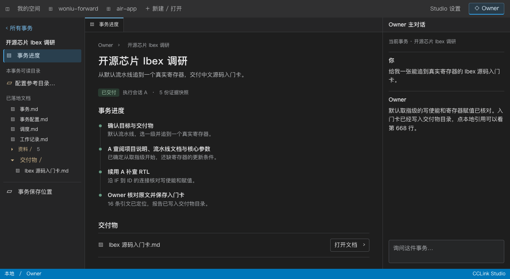
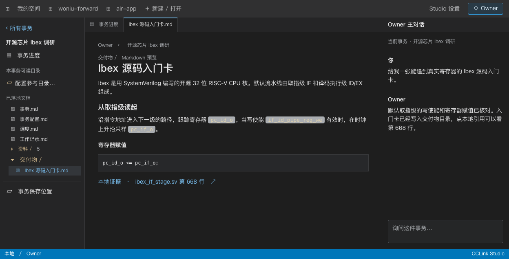

# Owner 工作模式 · 目录、进度与确认

2026-11-21 更新。开发版已落地固定侧栏工作台：事务内左侧 208 px 固定侧栏（事务进度、本事务只读参考目录、已落地文档、保存位置），中间「事务进度」看板与文档标签，右侧本事务 Owner 主对话；参考目录可经系统选择器授权、浏览、预览和撤销。2026-11-22 起，Owner 拟定约定时可把已授权目录列入 `plan.folders`；确认后 A 经同一授权服务检索、读取片段，证据记录相对路径与读取时整个文件的 SHA-256，交付核对与 GitHub 引文一致，`事务配置.md` 只列目录名称。尚未真人验收；下文其余存储扩展、步骤与待决事项仍是下一版方案。真人验收步骤见 [owner-workbench-sidebar.md](../../testing/owner-workbench-sidebar.md)。

## 用户怎样验收

没打开项目也能从 Studio 顶栏进 Owner。交办「调研 Ibex，给我一张有源码依据的入门卡」，在右侧确认范围与成品。离开再回来，点事务就能知道 A 在查什么、为什么补查、已经存了哪些文件。点入门卡里的本地引用，中间定位到 RTL 原文，右侧仍能继续问同一个 Owner。若只想查公开资料，全程只需确认一次调研约定。

[打开可交互设计稿](workbench-mode.html)。可以切换进度、选择本事务的参考目录、打开入门卡，再点到第 668 行。图中的目录勾选仅用于体验交互。





## 工作台如何复用

桌面布局中，Owner 左侧栏常驻、固定宽度，稿中为 208 px，无折叠或拖动手柄。顶栏保留独立入口，列表层用于选事务或交办。进入事务后，左侧依次显示事务进度、本事务可读目录、已落地文档和保存位置。中间复用 Studio 的标签、Markdown 和源码预览；右侧用事务 ID 绑定 Owner 主会话。切标签、切工作空间、返回列表都只改变视图。退出 Owner 后恢复原工作台及标签选择。

Workbench 拥有视图、焦点和标签恢复。事务标签使用事务 ID 与文件相对路径定位，主进程按事务文件清单读盘。同名入门卡可以分别打开。只读参考目录通过事务授权接口访问，打开项目文件树的权限不会自动传给 A。即使预览不可用，事务目录、保存状态和原有工作空间仍可访问。一个 Owner 负责一件事务，可以关联多个执行会话，不派生 Owner。

## 默认事务目录

```text
我的空间 / Owner 事务 / 开源芯片 Ibex 调研 /
├── 事务.md              # 从这里开始：目标、当前进度、待我决定
├── 事务配置.md          # 本次生效的约定、边界、时间和保存位置
├── 调度.md              # 当前派给谁、等待什么、满足什么条件后继续
├── 工作记录.md          # 已发生的派工、回执、判断和变更
├── 资料/                # 取证后出现，存实际引用的快照
├── 交付物/              # 成品写入核验后在侧栏可见
└── .owner.json          # Studio 恢复执行所用的版本化事务记录
```

新建事务采用 v2 目录记录，首次建档就写出四份 Markdown。约定仍在讨论时，`事务配置.md` 区分「已生效」和「待确认草案」，`调度.md` 显示「等待确认，尚未派工」。看板和文件树读同一修订的保存回执。开发版已实现四份文档与按版本确认；从固定侧栏「已落地文档」在中间标签打开。旧目录下次保存时补齐，也可点「补齐配置与调度文档」，保留同名个人文件。参考目录的授权当前保存在 `userData/owner-directories/<事务 UUID>.sources.json`（只读、仅本事务）；全局目录登记和定时触发仍属于后续设计；交给 A 使用已授权目录的本地资料已实现，待真人验收。

| 文件        | 固定栏目                                                                                         | Ibex 补查时读到的内容（示例）                                                                                                           |
| ----------- | ------------------------------------------------------------------------------------------------ | --------------------------------------------------------------------------------------------------------------------------------------- |
| 事务配置.md | 约定版本及确认情况；目标、范围、交付标准；可用来源和只读目录；截止时间、投入上限；实际输出位置   | 已确认 v1。调研 lowRISC/ibex，只做静态源码分析；交付一张带 RTL 引文的入门卡。允许公开仓库，本地参考目录为空，无硬截止。                 |
| 调度.md     | 当前步骤与执行者；委托问题和理由；关联会话与运行；继续条件、下一步；有定时安排时列触发时间和时区 | 续用会话 A。流水线文档说明了各级职责，还缺寄存器的写入条件。等 A 交回 RTL 片段后，由 Owner 核对使能、赋值与行号；满足交付标准才写卡片。 |

配置发生变化时，先将提议列为待确认，获批后才更新生效版本，并在工作记录保留变更理由。调度随真实委托、回执和阻塞更新；等人补材料时写缺什么，已交付时写「无后续派工」。一次性调研默认按事件推进。若以后接入周期执行，事务仅引用 Studio 定时任务 ID 和已确认的触发规则，实际触发与下次运行时间由既有定时任务服务提供。

两份文件与摘要使用同一事务 ID 和修订号。用户在侧栏打开即可阅读，要改约定、增加目录授权或调整执行安排，仍从看板或 Owner 主对话提交。手改文档不会扩大权限、创建定时器或重派 A。本机默认值与有效授权的保存位置见下表。

## 文件放哪里，谁可以改

| 数据                 | 位置与唯一写入者                                                                    | 作用和生效范围                                                                                                                               |
| -------------------- | ----------------------------------------------------------------------------------- | -------------------------------------------------------------------------------------------------------------------------------------------- |
| 全局偏好，拟新增     | 现有 `userData/settings.json` 的 `owner` 小节，由 `SettingsService` 校验后保存      | `defaultParentId` 为空时取个人空间的「Owner 事务」。更改仅影响新建，并在交办前回显实际落点。                                                 |
| 本机目录登记，拟新增 | `userData/owner-directories/roots.json`，由主进程目录服务持有                       | 存目录 ID、用途、显示名、规范路径和文件系统身份。用途区分参考资料和交付父目录。系统目录选择器返回才登记；偏好只能引用可用 ID。               |
| 每件事务的本机绑定   | 已有 `userData/owner-directories/<事务 UUID>`，由同一目录服务持有                   | 已有事务目录的路径、设备号和 inode。拟在此扩展用户确认的只读目录 ID 和授权版本。登记目录只让它出现在候选列表；勾选并应用到此事务才允许读取。 |
| 事务业务状态         | 已有 `<事务目录>/.owner.json`，由 `AffairDirectoryService` 串行提交                 | 保存调研约定、阶段、判断、证据、报告与历史。拟补步骤引用和待确认事项，详见下节。                                                             |
| 尚未写完的一次更新   | 已有 `userData/owner-directories/<UUID>.pending.json`，由同一服务维护               | 保留本次原稿和基准版本，重试同一次保存。核验完成后清理。                                                                                     |
| 人可读文件           | 事务目录内的 `事务.md`、`事务配置.md`、`调度.md`、`工作记录.md`、`资料/`、`交付物/` | 主进程按事务记录生成。用户另写的笔记独立保留，默认不扫描或覆盖。                                                                             |
| 会话与运行           | Studio 已有 Agent 会话和 Run 服务                                                   | 保存消息、运行和终态；Owner 只引用会话、Run 和收到的业务回执。重试保存无需调用 Agent。                                                       |

例如，仅把 `{"owner":{"defaultParentId":"root-research-out"}}` 合并进现有设置。新交办可单次另选父目录。选择输入资料时展示准确子路径、只读范围、当前事务，以及选中的片段是否会交给本次使用的模型处理。授权可撤销；选择输出父目录只允许在新建的专属子目录内写入。文件读取逐次核对本机绑定、当前有效授权和相对路径，拒绝越界、链接逃逸或身份已变化的目录。撤销先禁止后续读取，此前已保存的本地证据快照继续供原报告回查。若原路径被替换，只让受影响的资料暂停使用，由人选择并确认重新关联。

配置写坏或新默认目录不可写时，保留原文件和交办草稿，提示具体位置，允许重试或另选。已有事务始终按已绑定的真实目录打开。工作空间里的 Markdown、事务文件里的路径和普通聊天消息都不能签发目录权限。

## 如何保存进度与流程

**事务记录保存可恢复的事实，Markdown 按这些事实排版。** 现行事务记录已有 `version / revision / pending / record / history / hashes`，调研状态已有 `record.research.plan / phase / decisions / docs / report`。其中 `phase=done` 可以与尚未刷完的磁盘更新同时存在；界面必须优先展示「待保存」。当前由 renderer 的 `research-work` 推进取证，由主进程按修订号接受明确的确认、校验取证范围和写入文件。普通保存不能将草案确认为生效，也不能静默改写已确认的约定。调度文档使用原生 Run ID 和实际回执。后续步骤及待决卡的完整结构仍属设计。

下一版沿用该记录，做**有版本的扩展**。下表是字段设计，字段名尚未发布。步骤是本次约定下的具体问题，可以追加或修订。

| 在现有记录上扩展 | 建议字段                                                                                  | 解答的问题                                                                                   |
| ---------------- | ----------------------------------------------------------------------------------------- | -------------------------------------------------------------------------------------------- |
| 调研约定         | `planVersion, goal, scope, output, acceptance, deadline?, timeBudget?`                    | 要做什么、交什么、怎样算够、有什么时限。截止时间与最多投入时长分别保存。                     |
| 调研步骤         | `stepId, question, actor, state, reason, conversationId?, runId?, ticket?, evidenceIds[]` | 谁负责、等什么、哪次委托或哪份证据推动了变化。步骤状态取待执行、执行中、核对中、完成或受阻。 |
| 待确认事项       | `requestId, planVersion, kind, question, options, impact, status, choice?, decidedAt?`    | 为什么要问、哪一版约定、谁还需行动。0.1 同时只展示一个影响下一步的待决事项。                 |
| 已有历史与证据   | 在历史项上补 `eventId, kind, stepId?, requestId?, evidenceIds[]`；快照补稳定 `evidenceId` | 同一回执只登记一次。点击判断可回到同一次委托和固定版本的原文。沿用一份历史生成工作记录。     |

例如，补查 Ibex 时，一条**示意**步骤是：

```json
{
  "stepId": "if-register",
  "question": "默认取指级何时把 pc_if_o 写入 pc_id_o？",
  "actor": "A",
  "state": "核对中",
  "reason": "流水线文档能解释职责；写使能和赋值需要 RTL 原文。",
  "conversationId": "owner-<affairId>-a",
  "runId": "<已收到的原生运行 ID>",
  "evidenceIds": ["if-stage-rtl"]
}
```

**转换依据。** 用户确认一版约定后才允许创建委托；派工前保存委托标识，收到原生 Run 回执后显示「A 执行中」。运行成功且回执匹配本次委托才进入「核对中」。缺证时 Owner 记录缺哪条证据及补查问题，同一目标、权限和上下文可用时续 A；需要独立上下文或 A 确实不可恢复时才新开会话并记录交接。证据通过后步骤完成。最后一次交付还要等报告及引用文件写入、核验和事务提交成功。看板分别展示事务状态、Owner 当前动作和 A 的运行状态。

**写入与恢复。** 每次改变约定、委托、回执或证据都带上预期 `revision`。主进程检查版本，保留待写内容，逐文件写临时文件再替换，核验后提交该版记录。跨文件更新可能中断，因此列表、看板、主对话和文件树使用同一提交结果。待写路径可以展示失败原因，已落地文档只列已确认的文件。用户已改过同名文件时保留原件，移开冲突后「重试保存文件」写回原稿。若本机暂存也失败，明确提示保留当前运行、释放空间再试，不能承诺跨重启恢复。

重启时先核对未完成保存，再按会话和 Run 身份恢复原运行；已有终态则消费一次匹配回执。若进程退出恰在派发与收到 Run ID 之间，且无法唯一认领该次运行，显示「待恢复」并说明未知之处，禁止自动重派。返回列表或关闭一个预览标签不创建新 Run。窗口监听随视图释放，事务服务跟随 Studio 既有运行时注册表启动和清理。

旧版 v1 继续可读。遇到尚未写完的旧修订，先用原格式续写；补齐新文档时才升级到 v2，用户同名文件受到现有冲突保护。新字段经校验和版本迁移后再写入；旧历史只显示已有文字，缺失的授权、Run 与证据关联保持未知。未知未来版本只读并提示升级。诊断按事务 ID、修订号、步骤／请求／运行 ID、失败阶段和相对路径关联，避免输出完整本地资料或聊天内容。

## Markdown 要结构化到什么程度

**使用固定章节的 Markdown。** 只给需要识别身份的生成文档加简短 YAML 文件头；机器执行依据仍是受校验的事务记录。这样可以在 Finder 或普通编辑器里读懂工作，也能避免手改一句「已完成」触发派工或交付。

以下是拟定的 `事务.md` 节选。文件头的 `revision` 表示这份文档来自哪次更新，跨文件是否全部写成由保存回执判定。

```markdown
---
kind: owner-affair
format: 1
affair_id: '示例事务-ID'
revision: 12
---

# 开源芯片 Ibex 调研

## 目标与已确认约定

交付一张中文入门卡。根据默认流水线和 RTL 解释一个真实寄存器的写入条件。

## 当前进度

Owner 正在核对取指级的使能和赋值。会话 A 已交回源码片段。

## 待我决定

无。

## 证据与交付物

- [取指级证据](资料/05-ibex_if_stage.sv.md#L668)
```

- **工作记录.md** 按时间和步骤写实际发生的动作、原因、回执及证据链接。普通答疑留在主对话，改变约定的决定进入工作记录。
- **资料/\*.md** 保存来源身份、版本、获取时间、片段起始行与逐字原文。本地资料在拟议设计中记录授权目录引用、相对路径和内容摘要哈希，避免把可变源文件当成固定证据。
- **交付物/\*.md** 保留用户要求的成品结构；结论链接到本地证据与可用的上游原文。证据有行号时在 Studio 高亮对应原始行。Markdown 里的任务框、YAML 或自然语言修改均只视为文件内容。

## 哪些环节需要人，在哪儿交互

中间看板展示原因、现有依据和选项的影响；右侧主对话讨论并执行决定。列表「等我确认」显示同一个待决问题。确认绑定 `affairId + requestId + planVersion`，事务修订用于并发校验。重复点击返回既有结果；另一窗口已修订方案时展示差异，旧按钮失效。普通提问不消费待决事项。

| 时刻                           | 人看到并可做什么                                                                                                                                       | 何时继续                                                                                                                 |
| ------------------------------ | ------------------------------------------------------------------------------------------------------------------------------------------------------ | ------------------------------------------------------------------------------------------------------------------------ |
| 初次交办                       | 右侧说目标，交办框回显落盘位置。发出后立即建事务目录；Owner 回一张约定卡，列范围、交付物、验收依据和已有时间限制。可继续谈，或点「确认范围和交付物」。 | 发出目标允许建档与拟案。确认的约定落盘后，Owner 才派 A。                                                                 |
| 选用本地目录                   | 在固定侧栏选择具体子目录。提议中的首次约定可以一并列出目录；执行中新增目录用「允许本事务只读此目录」，显示准确范围。可取消或撤销。                     | 用户的明确选择与本机授权均已保存后才可读。配置默认输出目录不附带输入读取权限。                                           |
| 取证与补查                     | 中间看具体问题和证据差距。可在右侧问「为什么继续 A？」。                                                                                               | 已确认范围内由 Owner 继续。常规查文档、续用 A、核对引用、写约定的入门卡均无需另签一次。                                  |
| 范围、时限、交付标准有实质变化 | Owner 提供变更前后差异、原因、工作量影响。可「采用新约定」或「保留原要求，我来提供材料」。                                                             | 采用后产生新版约定。保留原要求则列出缺什么，列表显示「等我提供资料」。补上后先核对来源与内容，再决定是否续 A。           |
| 故障或中断                     | 保存失败三处显示「待保存」及冲突位置，看板提供「重试保存文件」；运行身份无法核实则显示「待恢复」。                                                     | 重试保存只写原稿；恢复执行先查原 Run。两种按钮各自处理对应的问题。                                                       |
| 交付                           | 右侧告知证据和成品已保存，中间可打开入门卡并点引用。                                                                                                   | 写入核验成功即为已交付。若约定把人工签收列为完成条件，文件保存后显示「等我验收」，人签收后才结束事务；文件回执始终可查。 |

约定给了硬截止或投入上限时，到点先保存已核对的部分，停止派新任务。看板列缺口，右侧让人选择延长、调整交付或停止。没有时间限制就不设默认倒计时。

确认目录、改变约定和问答是三种不同交互。用户可以在右侧提出「再看看我的验证笔记」；这会产生选目录的入口，单凭一句话无法确定磁盘路径。对话中的模糊同意也不会批准一张已经变更的约定卡。

## 开发边界与验证

本轮已接入配置与调度文档，完整工作模式仍按以下路径验收：无项目进入 → 确认约定 → 可选一处只读子目录 → A 取证 → 固定文件树出现已写成的快照 → 入门卡定位原文。手动验收还须覆盖：

1. 切工作空间和文档标签，Owner 仍绑定原事务；另一个事务不能读取前一件事选的目录。
2. A 运行中撤销目录或替换同名目录，下一次读被拒绝，Owner 说明哪一步受影响；历史证据仍可打开。
3. 两个窗口讨论同一约定，旧确认不能批准新版，重复确认只有一份决定和一次派工。
4. 在报告写入前制造可恢复冲突，重启后重试，原稿字节一致、额外派工为零，文件树不提前列出成品。
5. 修改生成的 Markdown 或取消待决卡，均不能改变授权或自动完成步骤。配置损坏、遇到较新文件版本时，其他工作台能力仍可使用。

实现对照：[现有目录服务](../../../src/main/owner/affair-directory.ts)、[Markdown 生成](../../../src/main/owner/directory-files.ts)、[调研状态及引用核对](../../../src/shared/owner/research.ts)、[当前执行路径](../../../src/renderer/src/features/owner/research-work.ts)、[Studio 设置服务](../../../src/main/settings/settings-service.ts)。
