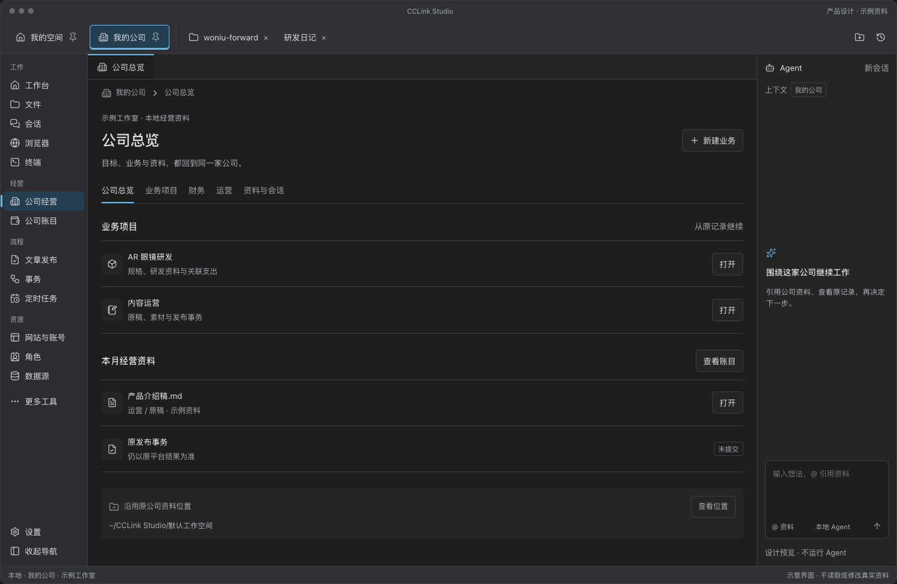
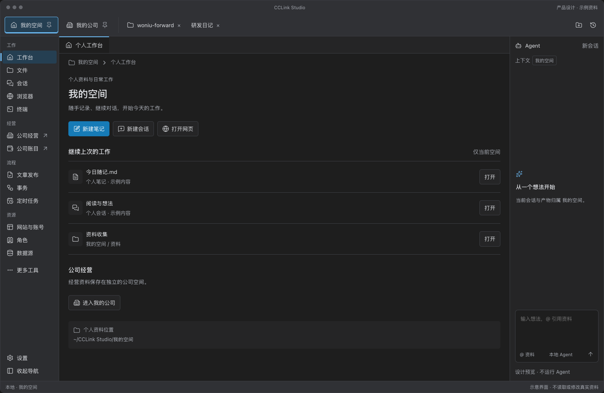
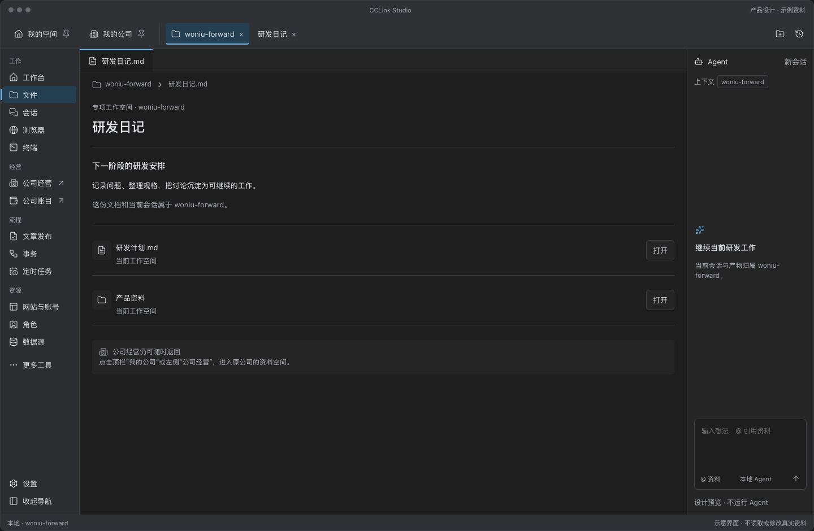
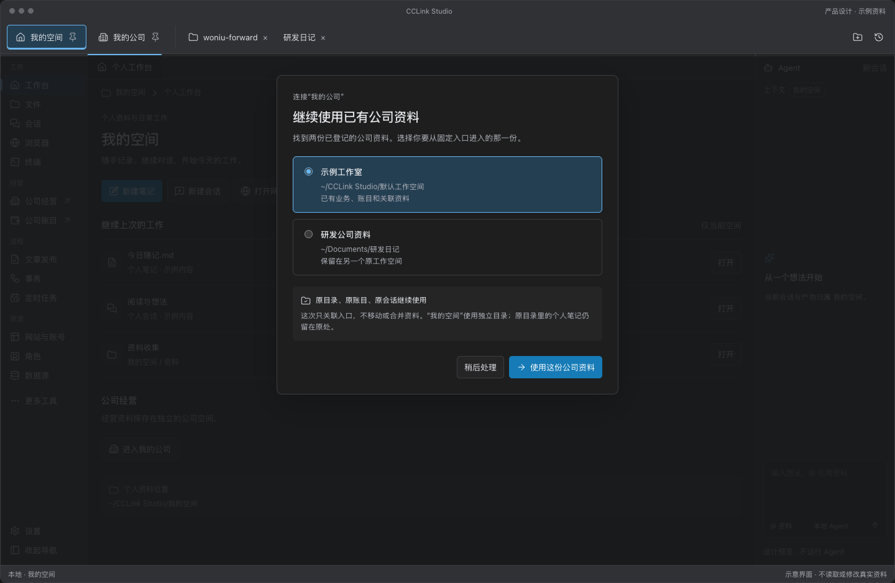
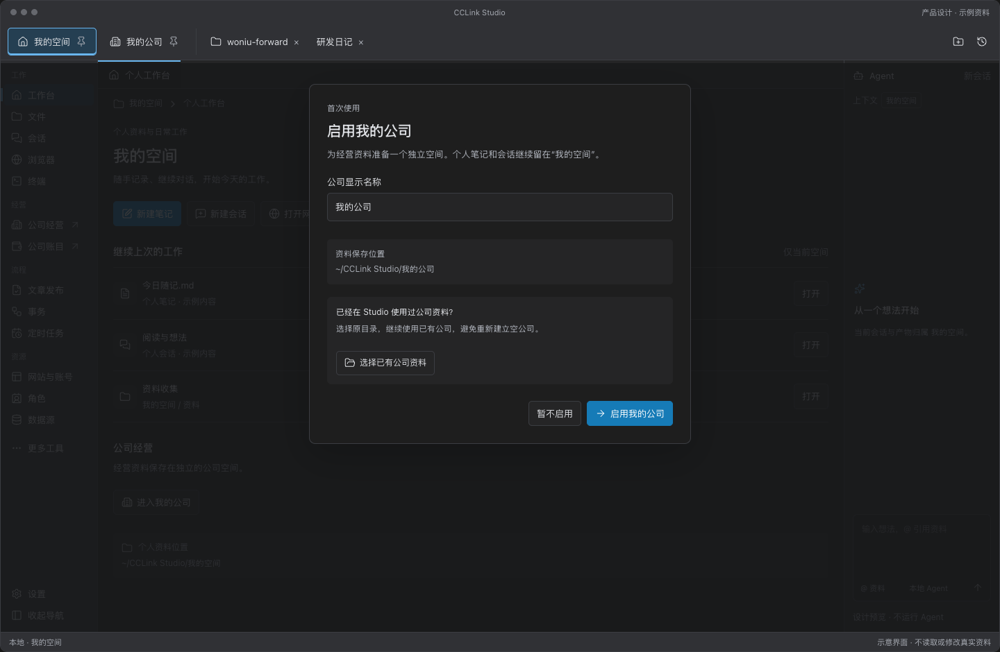
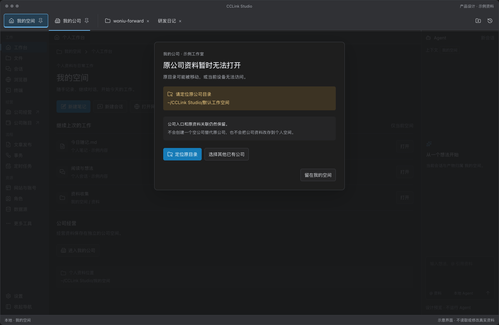

# 我的空间 / 我的公司效果图

日期：2026-11-12。状态：产品设计稿，应用尚未实现；所有公司、业务、文件与状态均为示例，不读取或修改真实资料。

- [产品设计](../../features/personal-company-spaces-product-design.md)
- [实施计划与兼容提交](../../features/personal-company-spaces-development-plan.md)
- [可交互预览](preview.html)
- [效果图源稿](personal-company-spaces.fragment.html)

预览可切换六个场景。顶栏两个固定入口、公司页内导航、侧栏收放及已有公司选择可以点击；Agent 仅展示归属，不执行任务。

## 我的公司

两个入口固定在顶栏；左侧“经营”分组提供公司与账目快捷入口，公司业务导航放在主工作区。旧公司资料保持原目录。

## 我的空间

个人笔记、会话与日常资料拥有独立落点；公司经营随时可返回。

## 专项工作空间

普通目录仍是独立空间；研发会话和文件保持原归属，固定公司入口不会随目录切换。

## 接回已有公司

只关联入口，原目录、原账目与原会话保持原位。多份候选由用户选择；混合目录不自动拆分。

## 首次启用与原目录不可用

首次启用保留“选择已有公司资料”；故障路径保留原引用，不能创建空公司冒充恢复。

效果图验证只覆盖布局与本地示意交互。真实 Electron 的存储、权限、Browser View 与重启恢复需按实施计划另行验收。

预览检查记录：[preview-check.json](preview-check.json)。检查深浅主题、六个场景在 1440 / 1024 / 736 / 320px 预览宽度下的布局，以及固定入口、公司页内导航、收放、接回公司、首次空公司和故障返回。320px 是对话中预览的适配检查，不代表新增手机端产品。

从源稿重新生成独立预览可使用 visualize 技能自带的 `scripts/render.py`；对话内展示使用同一源稿的副本。当前文件均为设计资源，未改动应用源码。
