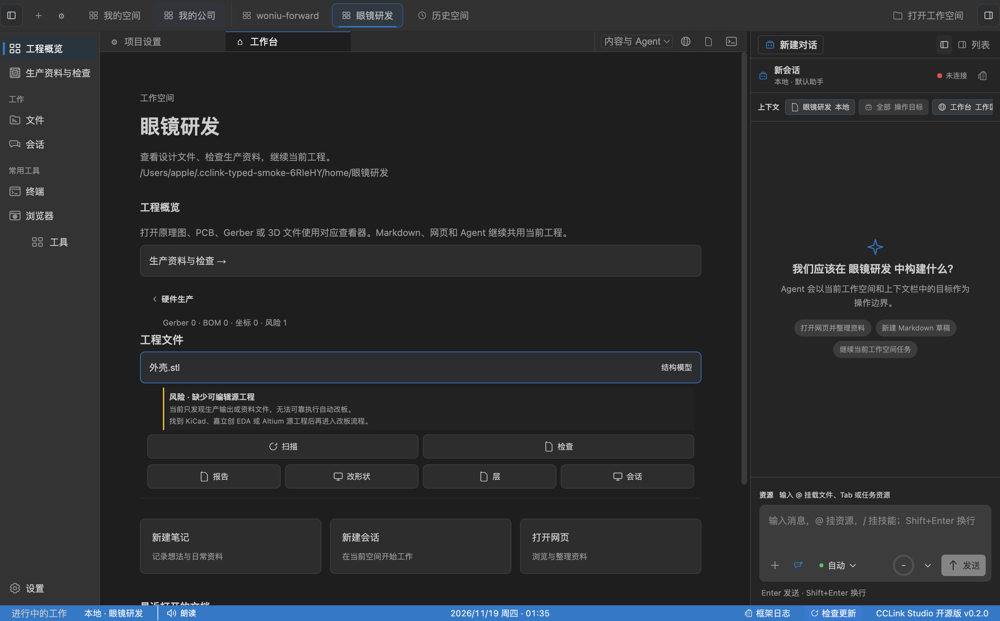
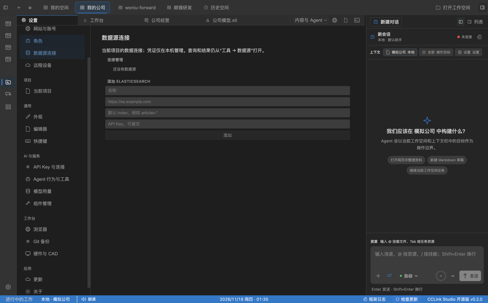
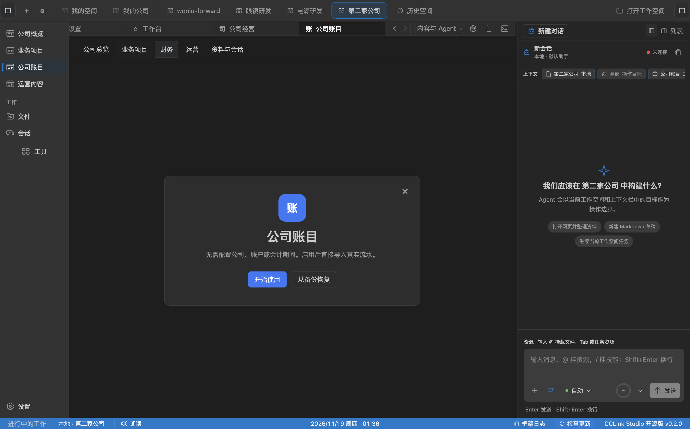

# 收口方案逐项复核与整改评估

复核日期：2026-11-19。基准：设计 `product-design.md` 第 7 节全部 **51 项**、`code-surface-inventory.md` 的 17 类面板 / 24 类标签 / 12 类原设置 / 12 个 MCP 模块、项目设置补充、八项生命周期规则及三条用户流程。实现基准提交 `8d45629e`；本轮继续在 `codex/typed-workspaces` 独立工作区整改。

## 结论

上一轮证明了三条模拟资料的主流程可用，没有证明整个产品收口方案全部完成。逐项复核发现实际代码缺口，并继续整改；仍有专业版面统一、部分配置归位与外部依赖验收未完成。不能合并这些不同证据为一个“全部完成”的结论。

本报告的“原链保留”表示核对过原入口、组件/服务与本次 diff，**不表示业务已端到端重新验收**。“已验收”只覆盖行内说明的动作。工程门禁和真实应用结果在文末分别记录。

## 本轮发现并整改的具体问题

| 编号 | 原问题                                       | 整改与用户可验收结果                                                          | 关键代码                                                  |
| ---- | -------------------------------------------- | ----------------------------------------------------------------------------- | --------------------------------------------------------- |
| R01  | 公司命令始终先进入固定公司，多实例会串对象   | 在第二家公司执行“打开财务”留在第二家公司；非公司项目仍可去固定公司            | company-workspace-commands.ts                             |
| R02  | 设置中的相对日记目录绕过原任务交接检查       | 关联任务启用/运行期间改目录、时区或移除任务引用，主进程拒绝；单改显示名称允许 | workspace-state-ipc.ts                                    |
| R03  | 同目录下取消勾选启用任务可绕过解除关联保护   | taskIds 移除也经过同一交接检查，不让后台任务消失在首页关联中                  | workspace-state-ipc.ts                                    |
| R04  | 数据源配置表单仍挤在工作侧栏                 | 连接管理进设置；集合、保存查询与结果仍在工具；可定向进入配置                  | DataSourcesPanel.tsx / SettingsPage.tsx                   |
| R05  | 缺少设置中的远程设备入口                     | 复用原登录/设备组件，新增项目仍保留远程来源；缺服务不阻挡本地                 | SettingsPage.tsx                                          |
| R06  | 电子开发首页只有文案和跳转                   | 首页显示原服务扫描出的文件、风险与检查动作；文件进入原查看器                  | WorkspaceHome.tsx / HardwareProductionSection.tsx         |
| R07  | 原硬件异步扫描可能在切项目后覆盖新项目投影   | 旧请求结果和视图清理后的晚到结果被丢弃，原硬件服务仍是事实源                  | hardware-store.ts                                         |
| R08  | 收口要求的侧栏固定、顺序、展开状态没有保存   | 当前项目设置可固定工具、上移/下移、恢复默认；本机 layout 保存，不进入 Git     | ui-store.ts / ActivityBar.tsx / WorkspaceSettingsForm.tsx |
| R09  | 公司类型侧栏没有当前页面高亮                 | 概览、业务、财务、运营根据实际标签/section 显示激活状态                       | ActivityBar.tsx                                           |
| R10  | 日记/公司首页提前 return，隐藏了损坏配置提示 | 这两类首页也显示配置读取错误，原文件功能继续可用                              | WorkspaceHome.tsx                                         |
| R11  | 公司/电子类型入口与工具目录重复              | 工具区去重，其他类型仍可发现原能力；财务只显示一个激活入口                    | ActivityBar.tsx                                           |

整改项的证据强度分别记录：R01/R03/R04/R05/R06/R08/R09/R11 通过新增真实 Electron 场景检查（外部依赖仅验证可达/降级）；R02 相对配置变更由主进程拦截测试验证，R07 由两个项目的异步乱序与视图清理测试验证；R10 已检查首页代码分支与类型门禁，未单独制造配置损坏做 UI 截图。不能把后三项写成全部经过真人界面验收。

R08 使用按钮排序，尚未提供拖拽排序。R06 复用现有生产视图，不是完整电路编辑器。两者的完成范围明确限于已实现动作。

附：[17 类面板、24 类标签、12 类原设置、12 个 MCP 模块逐项代码检查](./audit-entry-matrix-2026-11-19.md)。

## 51 项现有能力逐项对照

| #   | 原清单改动点                                 | 复核判定                 | 证据与剩余边界                                                                                             |
| --- | -------------------------------------------- | ------------------------ | ---------------------------------------------------------------------------------------------------------- |
| 01  | 我的空间、我的公司、普通空间、历史列表       | 已验收主流程             | ProjectStrip、fixed-spaces-store、WorkspaceOpenSurface；固定引用和重启已实测；失联重定位沿用旧入口。       |
| 02  | 打开本地目录、恢复最近目录                   | 已验收主流程             | 新建/已有/Git 各入口及原身份恢复；重复目标拒绝。                                                           |
| 03  | 资料位置、关联目录                           | 本轮整改                 | 项目设置的相对日记目录也执行任务交接检查；原外部目录保持原位。                                             |
| 04  | 日记正文预览、今日日记、空白模板             | 已验收主流程             | PersonalDiaryHome + diaryDocument；原文预览、已有打开、缺失独占创建。                                      |
| 05  | 计划、周计划、项目记录                       | 已验收主流程             | 原一日计划、周计划文件接回；项目记录仍按原文件进入。                                                       |
| 06  | 每日简报、每周计划和总结                     | 已验收接回               | 两个原 ID、原定义、导入幂等、新机默认停用；真实 AI 日报执行未验收。                                        |
| 07  | 公司总览、业务项目、经营资料                 | 本轮整改                 | 多公司命令优先当前公司；公司侧栏激活状态跟随对象页，两实例真实复验通过。                                   |
| 08  | 公司账目、关联支出                           | 原链保留＋本轮整改       | CompanyAccountsView 与原服务未替换；修复财务命令串到固定公司的路径。实际财务计算不在本轮全量复验。         |
| 09  | 公司运营                                     | 原链保留                 | CompanyWorkbench operations、原发布关联继续存在，不新增发布 owner。                                        |
| 10  | 文件树、搜索/定位、创建/重命名/删除          | 原链保留＋局部实测       | FileTree、文件命令和 fs 服务保留；打开 Markdown/STL 实测，其余文件操作按旧回归。                           |
| 11  | 文件复制、剪贴板、链接目录、ZIP/资源包       | 原链保留                 | file-context-actions、fs 与资源包链路未删除；未逐项重新操作 ZIP/剪贴板。                                   |
| 12  | Markdown 编辑、自动保存、日期时间、图片附件  | 原链保留＋局部实测       | 原 Tiptap/editor-store 保留；编辑、切换版面、返回正文实测；图片粘贴未逐项复验。                            |
| 13  | Markdown 配图与图像生成                      | 原链保留／外部待验       | image-generation 模块和文档动作未改；未调用付费或外部生成服务。                                            |
| 14  | 微信排版预览、相关发布辅助                   | 原链保留                 | WeChatPreview 与原文档动作未改，无新增发布能力声明。                                                       |
| 15  | 文本/代码、HTML 源码、CSV/TSV                | 原链保留                 | getTabTypeForFile、HTML 两种打开方式与原编辑器保留；没有另建文档缓冲区。                                   |
| 16  | 图片、PDF、音视频预览                        | 原链保留                 | FilePreview/ModelViewer 格式路由保留；本轮实测 STL，不冒充媒体各格式全验收。                               |
| 17  | DOCX/PPTX 只读、其他格式系统打开             | 原链保留                 | Office 预览、系统打开及原降级未改。                                                                        |
| 18  | 本地 TTS、播放控制                           | 原链保留                 | StatusBar 原播放器、TTS 命令和选区动作保留；未合成真实音频复验。                                           |
| 19  | 普通浏览器、历史、书签、缩放、设备视口       | 原链保留＋局部实测       | 原生浏览器实际网页在两种版面中可见且 100%；历史/书签/设备视口原链保留。                                    |
| 20  | 浏览器自动化、认证窗口、网络与下载工具       | 原链保留／外部待验       | BrowserManager/MCP/认证/下载没有替换；未运行外部站点自动化。                                               |
| 21  | 本地 Agent、会话列表、资源挂载、队列、恢复   | 原链保留／集成待验       | 原会话/队列/runtime 仍负责；主工作区另有 Agent 改动尚未合并，不能宣称集成无回归。                          |
| 22  | 角色详情、角色编辑、Skill 挂载               | 已验收入口               | 设置复用 AgentRolesSidebar；角色详情和会话资源选择原链保留。                                               |
| 23  | Agent 后端、模型、权限、工具/MCP             | 原链保留                 | 模型连接、Agent 能力、权限及组件设置仍在原 SettingsPage；未改变运行授权。                                  |
| 24  | Terminal、命令运行、确认、历史记录、远程 PTY | 原链保留／外部待验       | 工具/新标签/原 Terminal 及远程 PTY 链路未删；远程设备不可用时需降级。                                      |
| 25  | 定时任务管理、运行、共享定义                 | 已验收接回与启停         | 任务详情、原 scheduler、共享定义保留；去掉启用任务关联本轮补主进程拒绝。                                   |
| 26  | 网页事务、步骤编辑、证据、恢复               | 原链保留                 | 事务工具与 WebAffairTab/服务保留；汇总只读取状态。真实恢复执行待业务复验。                                 |
| 27  | 文章发布、账号核验、正文图片、提交与结果     | 原链保留／外部待验       | ArticlePublishing 对象及原执行计划未替换；没有真实提交授权或平台结果验收。                                 |
| 28  | 图片调研                                     | 原链保留                 | 图片调研原 WebAffair/MCP 路径保留，未执行实际素材调研。                                                    |
| 29  | 网站与账号、Profile 管理                     | 已验收入口               | 网站账号管理进入设置，业务选择与浏览器账号入口仍保留。真实登录待外部账号。                                 |
| 30  | 数据源连接、凭证、默认超时                   | 本轮整改                 | DataSourcesPanel configuration 视图进入设置；本机/当前项目及凭证边界提示补齐。                             |
| 31  | 数据集合、查询、保存查询、结果/记录挂载      | 本轮整改                 | 工具保留集合/保存查询/结果入口；增加定向管理连接按钮，配置表单不再占查询侧栏。真实 ES 查询待数据源。       |
| 32  | Git 变更、Diff、提交、Push                   | 原链保留＋局部实测       | Git 工作区/状态栏和 Diff 链路保持；精确配置暂存及本地远端验证，不代表托管账号 Push 已验收。                |
| 33  | 日记 Git clone/fetch/更新副本与确认关联      | 已验收主流程             | 真实 local bare remote clone/fetch/diff/update-copy，脏工作树拒绝、来源交接、重启恢复通过。                |
| 34  | 旧 Git 备份、GitHub 建仓与绑定               | 原链保留                 | git-backup 设置与旧命令继续存在，没有偷换成 update-copy。GitHub 建仓外部待验。                             |
| 35  | 视频工程、口播候选、确认与保存               | 原链保留                 | VideoCreationWorkspace/MediaProductionTab/原侧栏仍在，未重写工程格式。                                     |
| 36  | 新版视频后三页、旧版素材/声音/导出链路       | 原链保留且保持未完成标识 | 新版骨架不新增交付声明；旧素材/声音/导出链未删除。                                                         |
| 37  | Meshy、素材服务、图像服务                    | 原链保留／外部待验       | Meshy 与图像 Provider 设置/MCP 未改，未调用生成服务。                                                      |
| 38  | 硬件扫描、Gerber/BOM/坐标、生产检查报告      | 本轮整改                 | 电子开发首页复用 HardwareProductionSection 显示实际扫描/风险和工程文件；检查报告仍由原服务。               |
| 39  | Gerber 层、外形、Altium 图纸与工程预览       | 原链保留＋本轮整改       | 文件树的 Gerber/Altium 预览保留；工程首页文件列表使用原标签类型，没有声称 Altium 可编辑。                  |
| 40  | FPC 形状上下文/交给 Agent                    | 原链保留                 | 原 FPC 上下文与交给 Agent 按钮在生产视图保留，不新增自动改板能力。                                         |
| 41  | 3D 模型查看、STEP 转换、CAD 检查             | 原链保留＋局部实测       | 电子与公司项目均打开原 STL 画布；CAD 检查/转换保留，需真实后端再验收。                                     |
| 42  | STEP 受限修改与自动打开结果                  | 原链保留／外部待验       | cad_plan_modification/cad_modify_step 与自动打开结果未删；未运行真实 STEP 受限修改。                       |
| 43  | Android 真机、镜像、设备语义操作             | 原链保留／设备待验       | AndroidDisplay、ADB 组件设置和 MCP 未改，缺实体设备不虚报真机验收。                                        |
| 44  | CCLink 登录、设备状态、配对                  | 本轮整改／外部待验       | 增加设置“远程设备”，复用原登录/设备组件；真实配对/认证未做。                                               |
| 45  | 远程项目选择、文件、会话、终端               | 原链保留／设备待验       | 新增项目选择器保留远程源，RemoteProvider/远程会话/PTY 未替换。                                             |
| 46  | 模型用量                                     | 原链保留                 | 模型用量设置组保持原 owner。                                                                               |
| 47  | 组件安装、修复、CAD/Agent 环境               | 原链保留                 | 组件安装/修复后启用、CAD/Agent 环境设置链路保持；未重新下载安装。                                          |
| 48  | 命令面板、快捷键、右键菜单                   | 原链保留＋本轮整改       | 旧命令/统一上下文菜单继续；公司命令修正当前实例，新增偏好不自建右键系统。                                  |
| 49  | 标签、独立窗口、布局恢复                     | 已验收部分／仍有设计差距 | 两种标准版面与原标签持久化；新增本机侧栏固定/顺序/展开保存；没有新增统一专业版面或所有格式打开方式选择器。 |
| 50  | 框架日志、诊断导出、能力健康                 | 部分归位                 | 框架日志/诊断命令/运行错误保留；尚未把所有诊断统一成设置中的单独健康总页。                                 |
| 51  | 更新、关于、许可、主题、字体、默认视口       | 原链保留                 | 原设置中的更新/关于/许可/主题/字体/视口未删除；未发版。                                                    |

## 项目配置、新建与八项生命周期规则

| 项  | 检查内容                       | 判定与边界                                                                                                   |
| --- | ------------------------------ | ------------------------------------------------------------------------------------------------------------ |
| P01 | 隐藏配置与唯一身份             | 配置只含 version/name/type/diary，相对资料与任务引用；原 project.json 身份继续保留。没有第二身份。           |
| P02 | 读写失败与兼容                 | 损坏、未来版本、符号链接、旧 revision 拒绝覆盖；只读可显示未保存原因。新增首页错误提示。                     |
| P03 | 新建四种类型                   | 同一表单选类型/名称/父目录，目录存在即拒绝；没有隐式重建日记/公司账本。                                      |
| P04 | 打开已有/Git                   | 读取原配置，不强迫重选类型；本机原日记、附件、计划和定义不移位。                                             |
| P05 | 只读远程项目设置               | 远程本轮不能保存本地型配置，明确提示，原文件/会话/终端保留。不能列作远程类型已支持。                         |
| L01 | 固定入口与多实例               | 固定是本机快捷引用；多个公司/日记可并存；当前公司命令本轮修复。                                              |
| L02 | 公司业务与实际工程             | 已有/新建工程均通过原身份关联；保留原业务对象和工程目录。                                                    |
| L03 | 关闭、移除历史、解除关联、删除 | 关闭只影响视图；历史原入口保留；解除资料关联有任务保护。并非所有任务资源都完成专门关闭依赖检查，见缺口 G03。 |
| L04 | 原资料与原任务归属             | 外部资料返回原项目操作；定义保留 ID；导入不复制本机启用与历史。                                              |
| L05 | 运行与视图区分                 | 进行中的工作为原服务投影；公司/文件/版面切换不重建任务。跨设备真实运行及退出中断仍需专项验收。               |
| L06 | 换机                           | 配置和相对路径可随 Git；缺任务如实显示；导入默认停用、重复不重复建；另一台物理 Mac 未测。                    |
| L07 | 更新副本交接                   | clone/fetch/diff/update-copy 原链真实通过；脏工作树阻断，启用任务阻断关联切换，原目录保留。                  |
| L08 | 用户偏好归属                   | 类型配置与本机 layout 分开；本轮补固定/顺序/展开恢复；自定义图标、拖拽排序和全部专业版面偏好仍有缺口。       |

## 尚未完成项与保留的原能力边界

| 编号 | 缺口                                       | 影响 / 下一步                                                                                                                                                                        |
| ---- | ------------------------------------------ | ------------------------------------------------------------------------------------------------------------------------------------------------------------------------------------ |
| G01  | 专业工作版面尚未形成统一“适用打开方式”交互 | 现有 MD、网页、STL/Gerber/Altium 仍按原格式路由；新增版面主要是内容与 Agent / 专注内容。需继续统一支持格式的打开方式，复用原文档 owner；不能把两个布局选项称为整套专业版面设计完成。 |
| G02  | 部分设置仍沿用旧聚合页                     | 远程设备复用原登录/项目选择组件；用量与诊断未合成新的独立健康页。核心入口可达，视觉/作用域归位仍需收尾。                                                                             |
| G03  | 关闭时的全部执行依赖没有逐领域完成验收     | 当前检查会话与定时任务；WebAffair 等仍依赖原领域生命周期。需要实际长运行、等待人工、资源关闭与恢复验证，不能以静态快照证明全部后台行为。                                             |
| G04  | 完整专业编辑能力并不存在于原产品           | 原 Altium 只读、STEP 受限修改、FPC 上下文边界继续保持；不在本轮扩建 CAD/EDA 后端。                                                                                                   |
| G05  | 外部凭证、设备与生产执行待验               | 托管 Git 认证、真实 AI 日报、发布提交、远程 Agent、Android、CAD 后端等需要对应资源/操作授权。此次没有以模拟结果替代。                                                                |
| G06  | 合并后集成与物理另一台 Mac 待验            | main 有活跃的另一批 Agent/布局改动，本分支尚未合并。独立分支通过不等于合并后的产品通过，也不等于另一台 Mac 已更新。                                                                  |

## 工程与真实应用验证

### 用户功能验证

最终构建在真实 Electron 上顺序跑完两份脚本：首次使用/Git 更新 22 项、日常/换机与新增检查 26 项，共 48 项断言通过。使用隔离模拟资料、本地 bare Git 和第二套全新用户配置；原日记、附件、计划和任务定义字节保持一致。

- [首次使用与 Git 原始结果](../../testing/evidence/typed-workspaces-audit-2026-11-19/first-results.json)
- [日常、换机及新增检查原始结果](../../testing/evidence/typed-workspaces-audit-2026-11-19/journeys-results.json)
- [上轮验收步骤](../../testing/typed-workspaces-2026-11-19.md) 保留作基线；本轮结果优先。

可手动重现本轮关键整改：

1. 建立两家公司，在第一家新增业务记录，然后进入第二家；命令面板执行“打开财务”。状态栏和账目仍属于第二家，其业务页不出现第一家的记录。
2. 在工程项目的“项目设置 → 本机侧栏”固定终端、浏览器并排序；切到另一项目，再返回。顺序恢复、另一项目不继承；恢复默认只影响当前本机侧栏。
3. 工程放入模拟 STL 后回首页，查看实际扫描列表并点击打开。进入原 3D 画布；源模型不被修改。
4. 在设置打开“数据源连接”，能添加/管理连接；从“工具 → 数据源”进入查询侧栏，该处没有连接配置表单，可定向返回设置。
5. 接回两条模拟定时任务，显式启用其中一条。取消该任务关联或解除资料来源会被拒绝，暂停后再处理。原任务与文件保持原位。

本轮中间复跑先发现公司类型页和工具区重复高亮，修复后完整重跑通过。另一次脚本错误地从不含路径的 diagnostics 输出推断当前公司，已改为核对真实状态栏的项目路径。没有删掉两公司隔离断言或降低原文件保护条件。

### 工程准备度

- 38 个受影响测试文件、354 项测试通过：[摘要](../../testing/evidence/typed-workspaces-audit-2026-11-19/test-summary.txt)。新增覆盖相对日记设置交接、任务引用移除、侧栏偏好隔离、硬件扫描晚到结果。
- Web/Node TypeScript、变更文件 ESLint、Electron 构建、上下文操作边界、应用凭证边界及 diff 空白检查通过。
- 测试曾因 layout 新增持久化字段与旧快照期望不符而失败；补齐新字段的严格期望后重跑全部通过。类型检查发现新工程文件入口缺少必填图标，补齐后通过。
- 代码和证据继续留在本地独立分支；未合并 main、未推送、未发布。主工作区并行 Agent/布局代码未纳入本轮验收。

## 本轮实际界面

工程首页、固定工具与真实扫描文件：

数据连接管理归入设置：

第二家公司自己的财务页与激活入口：

## 最终评估与下一步

**当前适合作为继续集成和验收的候选分支，不适合宣称全部收口完成。** 51 项能力逐条查过入口与实现变化，但只有明确列出的动作有本轮真实应用证据。没有发现此次重组删除原内容渲染路由或 12 个 MCP 模块的实现；这不能推导为全部外部业务无回归。

下一步优先完成 G01 的专业版面/打开方式交互与 G03 的长运行关闭/返回场景，再协调主工作区改动进行合并验证。G02 配置页收尾随后完成。G04 为既有能力边界；G05、G06 的外部资源与物理机器验收需在具备条件时执行，不以页面可达代替业务成功。
