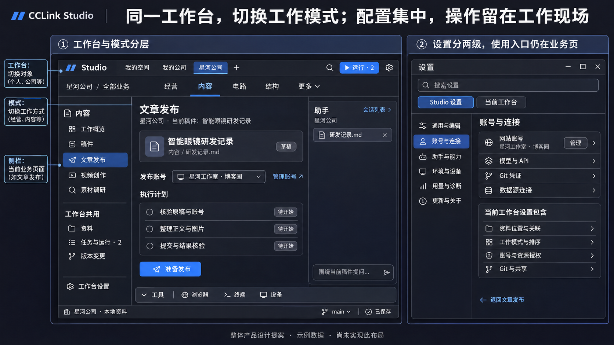

# Studio 整体产品重组：工作台、工作模式与设置

日期：2026-11-18。状态：讨论稿，未开始实现，不代表现有版本已经具备这些界面。

本稿纠正上一轮方案把工作模式隐藏掉、把不同工作用途都做成顶层入口的问题。工作模式应当可以在同一个工作台中切换；要消除的是切换造成的断裂，不是取消模式本身。本次仅修改设计文档，不改应用代码、用户资料、任务或发布状态。



图中为示例数据，供讨论外壳层级；发布计划的三行仅表示布局分区，不替代现有完整执行计划。实际发布页面必须保留准备、账号与原稿核验、正文与图片、平台字段、保存、提交发布、结果核验的真实细步骤、执行者、条件、状态、证据和失败/等待原因。绘图不构成简化该业务闭环的决定。

## 1. 先定义用户能验收的结果

1. 打开“我的空间”，直接进入日常模式，继续原日记、查看计划和两个原定时任务；不用重新打开原目录。
2. 在“星河公司”工作台里，从经营切到内容，再切到电路；公司身份、资料来源和正在执行的任务保持不变，各模式恢复各自的页面与布局。
3. 电路模式里可以同时打开结构文件和说明文档。打开另一种文件只选择合适的查看器，不强迫切换模式。
4. 新增第二家公司，使用同样的经营模式；账目、任务、会话和账号授权不会串到第一家公司。
5. 在设置中维护账号、角色、MCP、数据连接、CAD 环境；工作页面直接选择已授权资源并开始工作，不必反复进入设置。
6. 原侧栏的每个功能，都能通过新入口、搜索或兼容跳转到达；移动入口不能造成数据、任务历史或旧视频工程丢失。
7. 同一个原目录被多个入口引用时仍只有一份文件和一个执行事实来源，定时任务不重复运行。接入不移动、不覆盖原文件。
8. 切换模式时，未保存内容、Agent 流式回复、浏览器任务、终端命令和等待用户处理的步骤都不消失；需要处理的状态始终可见。

这些是将来实现的产品验收条件。本次完成的是入口盘点和目标产品设计，不是上述能力已经交付。

## 2. 本次盘点范围与证据

对照当前代码盘点：ActivityBar 全部入口、ActivityPanel/TabType 全部类型、SettingsPage 全部导航分组、WorkbenchContent 的实际视图、主要业务组件、主进程能力目录与 MCP 模块；同时核对当前功能文档的完成边界。

主要依据：

- `src/renderer/src/components/activity-bar/ActivityBar.tsx`
- `src/renderer/src/types/index.ts`
- `src/renderer/src/components/workbench/WorkbenchContent.tsx`
- `src/renderer/src/components/settings/SettingsPage.tsx`
- `src/main/runtime/agent-capabilities.ts`
- `docs/architecture.md`
- `docs/features/file-type-support.md`
- `docs/features/promotional-video-workbench.md`

机器提取的原入口及归属对照见同目录 `code-surface-inventory.md`。这是产品入口和能力级盘点，不冒充逐函数正确性审计或各功能的重新真人验收。只在文档中提出、没有对应实现证据的能力单列，不混入已实现功能。

## 3. 五个层次，不再把所有东西堆在侧栏

| 层次 | 回答的问题 | 拥有的内容 | 不负责的事情 |
| --- | --- | --- | --- |
| Studio 应用 | 我有哪些环境和通用资源？ | 工作台列表、本机环境、账号与连接、可用工具、通用偏好 | 不拥有某公司的业务账目，不因登录失败阻断本地工作 |
| 工作台（用户说的超级项目） | 我正在为哪个长期对象工作？ | 稳定身份、资料关联、业务归属、会话与任务索引、已启用模式、资源授权引用 | 不复制文件服务、Git 仓库、任务调度器 |
| 工作模式 | 我此刻在这个对象上做哪类工作？ | 首页、领域导航、默认工具、流程入口、布局、推荐助手配置 | 不创建另一家公司，不搬资料，不复制执行状态，不自动扩大权限 |
| 工作对象与页面 | 我在处理哪一笔、哪一篇、哪一次？ | 一份日记、一笔账、一篇稿件、一个视频工程、一张电路图、一次发布 | 不因页面多就升级为工作台或模式 |
| 工具与查看器 | 怎么操作这个对象？ | 文本编辑、专业预览、浏览器、终端、设备控制、查询、朗读 | 不独占资料，不要求用户为打开文件先切换模式 |

“工作台”是现有工作空间的产品表达，代码仍以 Workspace/WorkspaceRef 为唯一工作空间身份。本方案不新增平行的 SuperProject 状态对象，也不把现有 renderer Workbench 布局组件误当成新领域所有者。若实现涉及超出已有契约的数据关联，需要先形成 ADR。

### 判定规则

- 新建它是否需要独立身份、资料归属、任务与权限？是：工作台。
- 在相同身份下，是否需要一套持续使用的导航、工具组合与流程？是：模式。
- 是否只是处理某个对象的一步？是：页面或工具。
- 是否在回答“连接谁、装什么、默认如何、允许什么”？是：设置。
- 是否在回答“查资料、做修改、运行一次、看结果”？是：工作界面，不能全部塞进设置。

公司账目是经营模式里的业务页面。定时任务是工作台共用能力。角色是可复用配置和会话选择项。Git 是资料的版本能力。它们都不应凭当前侧栏位置就被定义为一种模式。

## 4. 工作台与目录如何解耦

工作台具有稳定身份，目录是它关联的资料位置，模式是它启用的工作环境，三者不能互相冒充。

- 同一工作台可以启用日常、经营、内容、结构等多个模式；一个模式也能用于多个工作台。
- 第一阶段保持一个主资料目录，复用现有资料关联机制连接其他原目录。多目录是具名来源，必须显示路径、可用性和访问边界，不把它们拼成一个无边界虚拟文件系统。
- 原日记可以继续在 `woniu-forward/000-个人计划`。公司资料也可在其他已有位置；建立关联不意味着复制或导入。
- 如果用户再次打开同一个主目录，默认返回已存在的工作台；“固定到入口”可以指向该工作台的某个模式，不另造工作台身份。
- 不同工作台可以显式引用同一份资料，但必须说明共用关系。原文件编辑、Git 状态与原任务的 owner 仍由已有领域服务决定，不能因为引用两次就复制定义或运行两次。
- 两家独立公司不应通过对同一公司资料改两个入口名来伪造隔离。新建公司要明确选择独立资料位置；复用原位置时显示“关联已有公司”，不能暗示生成了独立副本。
- Git 仓库可以覆盖整个主目录，也可能是资料来源的上层仓库。版本操作要显示真实仓库范围，不能让用户以为只提交当前模式看到的文件。
- 打开文件不强制初始化脚手架；创建模板、配置和示例是独立且可预览的动作。

“我的空间”“我的公司”是默认固定入口，不是系统里只能各有一个的特殊单例。我的空间默认启用日常；我的公司默认启用经营。新增“星河公司”同样可以启用经营和内容。

### 新建工作台：用途模板不是永久类型

| 用户选择的起步模板 | 默认模式组合 | 初次进入 |
| --- | --- | --- |
| 个人日常 | 日常、通用 | 关联已有日记或创建空白日记，不强制复制示例 |
| 公司 | 经营、内容、通用 | 关联已有公司资料，或明确新建独立公司资料 |
| 硬件研发 | 电路与制造、结构与 3D、通用 | 先呈现实际已有预览/检查，缺失编辑能力标明边界 |
| 通用资料 | 通用 | 直接浏览文件和继续会话 |

创建过程为“命名 → 选择起步模板 → 接入本地/Git/受支持远程资料 → 确认资料与初始化动作”。已有资料允许跳过模板直接打开；根据文件建议可用模式，不自动开模式、安装依赖或重写目录。模板只是初始配置，日后可以在同一工作台添加内容或经营模式。启用经营模式时如果没有公司资料，显示关联/初始化页面，不在后台凭空新建账本。

“智能眼镜”可能是独立研发工作台，也可能只是某公司内的业务项目；判定取决于是否需要独立资料与生命周期，而不是名称。公司内查看智能眼镜电路时，身份仍显示“星河公司 / 智能眼镜”，不自动跳成另一个工作台。

## 5. 产品外壳与每个区域的职责

```text
┌ Studio  [我的空间] [我的公司] [星河公司]  ＋        搜索   运行·2   设置 ┐
│ 星河公司  /  全部业务         经营  内容  电路  结构  …                 │
├─────────────────┬──────────────────────────────────┬────────────────┤
│ 当前模式的导航  │ 当前模式首页 / 对象标签 / 编辑区 │ 助手与会话     │
│                 │                                  │ 当前工作台     │
│ 经营概览        │                                  │ 明确挂载的对象 │
│ 业务项目        │                                  │                │
│ 账目            │                                  │                │
│ ……              │                                  │                │
│ ─────────────── │                                  │                │
│ 资料            │                                  │                │
│ 任务与运行 · 2  │                                  │                │
│ 版本变更        ├──────────────────────────────────┤                │
│ 工作台设置      │ 按需展开：终端 / 输出 / 设备      │                │
└ 来源与保存状态 · Git · 当前操作状态；有朗读时出现播放器 ──────────────┘
```

- 顶部工作台栏切换长期工作对象，恢复对应对象的最后模式与布局；不把每种模式都变成顶层项目标签。
- 第二行是明确、可切换的模式导航。常用 3～5 个，其余收进“更多模式”；只展示本工作台已启用的模式。单一模式时弱化导航，不强塞多行空壳。
- 工作对象范围在工作台名旁明确显示。例如“星河公司 / 智能眼镜”，模式切换保留该选择；目标模式不适用时明确提示并让用户选择，不静默切换到别的对象。
- 侧栏上段随模式变化，下段的资料、任务与运行、版本变更、工作台设置位置稳定。
- 助手右栏提供当前会话、历史列表与新会话；保留会话作为主标签、独立窗口的现有能力，不重复放一套全局会话导航。
- 浏览器是可打开的工作标签，终端是可停靠工具或标签；浏览器历史/书签留在浏览器内。用户仍能固定常用工具，默认不占所有工作台的业务导航。
- 左侧不再列出十几项跨业务 Activity。全局设置从窗口固定位置进入，当前工作台设置从侧栏底部进入。
- 窄窗口保留工作台名称和当前模式，将其他模式收进菜单；助手和工具抽屉可以折叠，不能挤没正文。

## 6. 建议的模式集合和内部页面

这些是目标分类，不是宣布所有模式已完整实现。只为现有可操作能力提供入口；未来能力不做可误点的成功演示。

| 模式 | 首页核心对象 | 模式内导航 | 复用的工具与能力 | 当前证据边界 |
| --- | --- | --- | --- | --- |
| 日常 | 今天、原日记正文、待继续计划 | 今天、日记、计划、回顾 | 编辑器、朗读、原定时任务、Git | 日记接入和准备已有实现，真实原资料仍待另一台电脑接入 |
| 经营 | 公司总览、需处理事项、业务项目 | 总览、业务项目、账目、经营资料 | 公司账目、会话、资料、内容入口 | 复用现有公司业务，不推断已具备 ERP、成员协作或审批系统 |
| 内容 | 选中的稿件/视频工程、发布进度 | 稿件、文章发布、视频创作、素材调研 | Markdown、配图、微信排版预览、浏览器事务、媒体工具 | 新版视频只有首步口播形成业务，后三页为骨架；旧版兼容入口保留 |
| 电路与制造 | 工程文件、板层与生产资料 | 工程文件、层与外形、BOM/坐标、生产检查、报告 | Altium 只读、Gerber、硬件扫描、FPC 上下文 | 现有预览和检查不等于完整 EDA 编辑、仿真或生产认证 |
| 结构与 3D | 模型、转换结果和相关文档 | 模型文件、转换、生成记录、检查结果 | 模型查看器、CAD 转换、Meshy | 不把当前预览包装成完整参数化 CAD；具体检查入口以已接入动作限定 |
| 通用 | 最近文件与会话 | 文件、最近工作 | 编辑器、浏览器、终端、设备、查询 | 始终可用的退路，不依赖其他模式、远程登录或安装专业工具 |

数据查询先作为跨模式工具，若以后形成稳定的查询、分析、报告长工作流，再单独定义数据分析模式。文章发布先作为内容模式的流程页面，不再加一层“文章发布模式”。硬件生产先归电路与制造，不再和电路重复占顶层。

公司内的“业务项目”是业务记录，可以关联目录或另一个工作台。只有确实需要独立资料和生命周期时才打开独立工作台，不因点击一张项目卡就隐式新建工作台。

## 7. 切换模式的完整交互规则

| 事项 | 切换后行为 |
| --- | --- |
| 公司/个人身份和资料 | 保持同一工作台；不重新选择目录、不修改资料关联 |
| 页面与布局 | 保存当前模式的导航位置、选中对象和布局，恢复目标模式的上次位置；首次进入显示实用首页 |
| 已打开文档 | 同一文件共享同一编辑事实；可以出现在不同模式的视图中，不生成两个相互覆盖的缓冲区 |
| 未保存内容 | 不因模式隐藏而丢弃；保存失败/冲突仍有跨模式可见提示；只有关闭/丢弃等破坏动作才需要确认 |
| 混合文件类型 | 电路模式中可以开 3D、Markdown、网页，不自动把用户赶到另一个模式 |
| Agent | 正在执行的 Run 保持原上下文、权限和对象；切模式不改写已有会话提示词或暗中切角色。新会话可使用目标模式推荐配置 |
| 任务与终端 | 原运行继续由原服务管理；模式不触发重启、重跑、迁移或自动取消 |
| 账号与权限 | 保持工作台的显式资源授权；模式只能推荐/收窄，不能因新增模式就获得全部全局账号和 MCP |
| 缺少工具 | 显示具体缺失项和“配置/安装”入口；文件与其他模式仍可用，不自动下载大型运行环境 |
| 关闭模式 | 隐藏入口与布局，不删除业务数据，不停止后台任务；关闭前展示仍在运行/待处理的项目 |
| 切换工作台 | 才切换业务作用域，既有任务保持原归属；不能把后台公司的确认请求套到当前公司 |
| 重启 | 恢复工作台、模式、布局和原运行记录；运行状态以各服务恢复结果为准，不按 UI 猜测成功 |

运行中心是现有 ScheduledTask、WebAffair、Agent、媒体和 Terminal 状态的汇总视图，不引入第二个执行账本或统一调度器。只对现有领域支持的动作提供暂停/取消/重试，不能做假的全局暂停按钮。

## 8. 设置重组：应用与当前工作台分开

设置页顶部明确“Studio 设置”或“当前工作台：星河公司”。配置搜索结果显示作用范围；从任务里的错误进入设置，修复后能回到原对象。

### Studio 设置

| 分组 | 收纳内容 |
| --- | --- |
| 通用与编辑 | 外观、字体、快捷键、默认保存与换行、隐藏文件、浏览器默认缩放/视口、朗读偏好 |
| 账号与连接 | 网站与账号/Profile、API 与模型连接、图像/素材/3D 服务、Git 凭证、数据源连接、本地凭证状态 |
| 助手与能力 | Agent 后端、角色模板、Skills、内置工具与 MCP、权限默认策略 |
| 环境与设备 | 组件安装/修复、CAD 后端、可执行文件与转换环境、Android 连接、远程设备配对 |
| 用量与诊断 | 模型用量、能力健康、日志导出与故障诊断 |
| 更新与关于 | 更新通道、版本、许可证和应用信息 |

已有设置 scope 不因移动页面被静默改成全局。全局管理页可以列出不同作用域，但每条记录必须标注归属。

### 当前工作台设置

| 分组 | 收纳内容 |
| --- | --- |
| 基本信息 | 名称、图标、默认入口、默认模式、归档；归档不删除原目录 |
| 资料位置 | 主目录、关联目录、日记/计划映射、默认新建位置、失联来源修复 |
| 工作模式 | 启用、排序、默认模式、各模式必要配置；只配置环境，不存业务进度 |
| 账号与资源授权 | 本工作台允许使用的网站账号、数据连接、设备、工具范围；全局定义只被引用 |
| Git 与共享 | 仓库绑定、同步策略、非敏感共享定义；凭证回到应用设置或单次认证 |
| 自动整理默认值 | 时区、默认输出目录、模板关联等；具体定时任务的时间/历史/执行仍在任务页面 |

配置保存不隐式运行任务，不初始化旧仓库，不启用已复制的共享定时任务。

## 9. 现有功能逐项重新归位

| 现有能力 | 产品归属 | 目标入口/处理方式 |
| --- | --- | --- |
| 我的空间、我的公司、普通空间、历史列表 | 工作台 | 顶部工作台栏与选择器；默认入口是固定项，不保留硬编码单例心智 |
| 打开本地目录、恢复最近目录 | 工作台接入 | 新增/打开工作台；已有目录优先识别并返回现有身份 |
| 资料位置、关联目录 | 工作台配置 + 资料使用 | 设置管理关联，资料页浏览；保留原路径和授权 |
| 日记正文预览、今日日记、空白模板 | 日常模式 | 今天与日记；区分已有原文、空白模板、真实 AI 结果 |
| 计划、周计划、项目记录 | 日常模式/共享资料 | 计划与回顾，直接引用原文件 |
| 每日简报、每周计划和总结 | 工作台任务 | 日常页快捷入口，完整定义/时间/历史在任务与运行；不复制旧任务 |
| 公司总览、业务项目、经营资料 | 经营模式 | 原公司首页拆为经营概览和对象页面 |
| 公司账目、关联支出 | 经营模式 | 账目页，不进入设置，不另外创建账目工作台 |
| 公司运营 | 内容模式的跨入口 | 从公司业务项目进入对应内容对象，保留公司与业务范围 |
| 文件树、搜索/定位、创建/重命名/删除 | 工作台通用资料 | 稳定“资料”入口、文件菜单与命令；不制造尚未存在的全文搜索承诺 |
| 文件复制、剪贴板、链接目录、ZIP/资源包 | 文件操作 | 原文件上下文操作/导出路径，维持范围校验与原安全降级 |
| Markdown 编辑、自动保存、日期时间、图片附件 | 文件工具 | 对象编辑区与工具栏；默认设置去设置，保存和格式操作留原位 |
| Markdown 配图与图像生成 | 内容工具 | 文档操作/助手；Provider 配置进设置，产物仍属于原文档资源 |
| 微信排版预览、相关发布辅助 | 内容工具 | 稿件内预览/导出或现有受支持动作，不升级为独立微信模式 |
| 文本/代码、HTML 源码、CSV/TSV | 文件工具 | 通用编辑器；不声称提供完整 IDE 或电子表格 |
| 图片、PDF、音视频预览 | 文件工具 | 按格式打开；保留分页/缩放/播放和大文件降级 |
| DOCX/PPTX 只读、其他格式系统打开 | 文件工具 | 明确只读/外部打开，不因新 UI 声称支持编辑 |
| 本地 TTS、播放控制 | 跨模式文件工具 | 正文朗读按钮和播放时浮现的控制条；语音偏好进设置 |
| 普通浏览器、历史、书签、缩放、设备视口 | 跨模式工具 | 新标签/工具入口、浏览器工具栏与浏览器内部列表 |
| 浏览器自动化、认证窗口、网络与下载工具 | 执行能力 | 任务/助手按授权使用；Profile 管理在设置，执行中的页面仍可见和接管 |
| 本地 Agent、会话列表、资源挂载、队列、恢复 | 工作台助手 | 右栏和会话标签；会话对象不归模式独占，持续执行不受模式切换影响 |
| 角色详情、角色编辑、Skill 挂载 | 配置 + 使用 | 角色/Skill 管理进设置，当前会话选择与资源挂载留输入区 |
| Agent 后端、模型、权限、工具/MCP | 配置 + 使用 | 安装/凭证/默认策略进设置；当前模型与实际授权状态在助手可见 |
| Terminal、命令运行、确认、历史记录、远程 PTY | 跨模式工具 | 工具抽屉/标签/独立窗口；命令记录保留，CWD/远端目标明确显示 |
| 定时任务管理、运行、共享定义 | 工作台执行 | 任务与运行页面，日常/经营页可呈现同一任务的快捷投影 |
| 网页事务、步骤编辑、证据、恢复 | 工作台执行/模式流程 | 任务与运行可发现，内容模式可进入业务页面；WebAffair 保持状态唯一所有者 |
| 文章发布、账号核验、正文图片、提交与结果 | 内容模式 | 文章发布对象及真实执行计划；不能把页面重组当公开发布闭环验收 |
| 图片调研 | 内容模式/网页事务 | 素材调研页面；保留来源、等待人工保存等实际边界 |
| 网站与账号、Profile 管理 | 应用配置 + 工作台授权 | 定义/登录管理进设置；任务里选择账号、处理失效，浏览器新页保留网站快捷入口 |
| 数据源连接、凭证、默认超时 | 配置 | 连接管理进设置，标明本机/工作台归属与授权 |
| 数据集合、查询、保存查询、结果/记录挂载 | 工作内容 | “资料 → 数据查询”，主区域查询/结果标签；绝不随连接设置一起藏起来 |
| Git 变更、Diff、提交、Push | 工作台资料版本 | 稳定“版本变更”入口与状态栏；行为以现有实现为准，权限提示不因换入口减少 |
| 日记 Git clone/fetch/更新副本与确认关联 | 资料接入/版本 | 克隆在新增资料，检查更新与 Diff 在版本页；保留新副本方案，不覆盖旧目录 |
| 旧 Git 备份、GitHub 建仓与绑定 | 兼容操作/设置 | 在版本页保留明确“旧版备份”入口，配置去设置；新旧语义未统一前不偷偷合并按钮 |
| 视频工程、口播候选、确认与保存 | 内容模式 | 视频创作对象；已有新版/旧版工程继续能打开 |
| 新版视频后三页、旧版素材/声音/导出链路 | 内容模式 | 新版标明待实现，旧版兼容入口显式保留；不宣称二者数据已同步 |
| Meshy、素材服务、图像服务 | 工具提供者 | 能力配置进设置；生成/查询结果在内容或结构模式使用 |
| 硬件扫描、Gerber/BOM/坐标、生产检查报告 | 电路与制造模式 | 工程文件、生产检查、报告页面 |
| Gerber 层、外形、Altium 图纸与工程预览 | 专业文件工具 | 电路模式优先展示，其他模式也能打开；Altium 保持只读声明 |
| FPC 形状上下文/交给 Agent | 电路与制造工具 | 选中对象的动作；不能画成已可靠实现自动改板并制造 |
| 3D 模型查看、STEP 转换、CAD 检查 | 结构与 3D/专业工具 | 模型对象页面；后端状态与路径进设置，操作/结果留工作页 |
| Android 真机、镜像、设备语义操作 | 工具 + 配置 | 配对/ADB 环境进设置；打开设备画面和执行操作在工具区，不增加模拟器承诺 |
| CCLink 登录、设备状态、配对 | 应用连接配置 | 设置中的远程设备；新增工作台时也可直接连接与登录 |
| 远程项目选择、文件、会话、终端 | 工作台/工具 | 新增工作台选择远程来源；进入后复用壳层，能力缺失按远端实际状态降级 |
| 模型用量 | 应用管理 | 用量与诊断；进行中的任务可保留用量提示，不给所有模式增加用量业务页 |
| 组件安装、修复、CAD/Agent 环境 | 应用环境 | 设置；缺依赖时从具体功能定向跳转，配置后返回原对象 |
| 命令面板、快捷键、右键菜单 | 全应用操作层 | 保留统一命令来源；搜索可找到迁移后的旧名称和新位置 |
| 标签、独立窗口、布局恢复 | 工作台外壳 | 保留，模式布局引用已有 Tab，不能制造第二份文档或浏览器实例 |
| 框架日志、诊断导出、能力健康 | 应用管理 | 设置 → 用量与诊断；运行错误仍在原任务里显示，不只留下日志 |
| 更新、关于、许可、主题、字体、默认视口 | 应用设置 | 从固定设置入口访问，状态栏只保留当前必要状态 |

## 10. 不混淆当前实现、旧能力和未来方案

- 电路、3D 相关旧效果图是概念图。现有 Altium 是只读；完整原理图编辑、自动布板、跨电路与外壳自动检查不能直接作为已有按钮交付。
- 视频有新版口播与旧版工作台两条用户路径，重组时必须保持各自原始数据和能力边界，不能只保留漂亮的新页面。
- 仿生大脑、AI 芯片、机器人远程仿真等方案文档可以成为将来模式候选；本次没有因文档存在就宣布对应运行能力已实现。
- AI 员工仍遵循当前架构暂停范围。角色页面迁移不等于引入员工系统。
- 隐藏旧入口不删除旧服务、数据或 URL/command 兼容。需要替换旧能力时单独做数据与用户操作验收。

## 11. 迁移顺序与验收，避免重画外壳后留下半成品

### 第一段：原功能可找到，配置与工作分开

交付：账号/连接/角色等管理入口进入有 scope 的设置，使用入口留在任务、资料和助手。旧名称可通过命令搜索跳转。侧栏暂保持兼容，直到每条旧入口都有可用新路径。

验收：用户添加一个网站账号，在文章发布中选用；配置一个数据源，在资料中查询并挂到会话；编辑角色后在原会话选择。历史记录和授权范围不变。

### 第二段：一个工作台内实际切换两种模式

先用“日常 + 通用”跑通，复用现有日记和编辑器，避免靠未完成的 CAD 模式证明壳层。然后“经营 + 内容”承接已有公司与文章发布。

验收：编辑日记保持未保存修改，切模式再返回不丢；启动一个受控任务后切模式，运行状态仍可见且只执行一次；关闭重开恢复模式与文件。任何破坏性操作仍有原确认边界。

### 第三段：多个工作台与旧资料接回

交付：默认个人、默认公司和第二家公司并存，模式可以复用，身份和资源不混。原资料/原任务只做绑定。

验收：两家公司分别创建业务记录、选择不同账号、运行可控任务；交叉切换后归属准确。原日记、附件、账目、任务定义与已有历史逐项核对，原文件接入前后哈希不变。

### 第四段：覆盖全部现有专业能力

按矩阵把硬件、3D、媒体、设备、远程、Git 等已有能力接到对应模式/工具，逐一验证原操作仍可达。每项记清“可用、部分可用、兼容入口、待实现”，不把统一导航算作专业功能完成。

### 发布要求

真实 Electron 逐项验收与源代码检查完成后，还要正式发布并在另一台 Mac 更新验证；开发机看到了新页面不等于用户已收到。文档、构建、自动测试不替代这些产品步骤。

## 12. 拷问与尚需通过原型验证的取舍

1. 工作台会不会变成任何概念都能往里塞的大容器？用资料身份、权限与生命周期三项判断；一笔账或一条视频不单独建工作台。
2. 模式会不会只是换皮的 Activity？要求它有首页、对象范围、领域导航和持续流程；只有一个按钮的能力留作工具。
3. 配置是否全被藏起来导致任务无法继续？业务选择器与错误页必须能定向进入设置并返回，不要求用户凭记忆找路径。
4. 同一文件在两处编辑会不会覆盖？模式只保存视图；文档的编辑与冲突状态复用现有 owner。若现有实现不能满足，作为直接阻塞先解决，不能创建平行缓冲区掩盖。
5. 通用能力会不会被模式封锁？所有模式都能从资料/工具/命令打开现有文件和工具；模式仅影响默认导航，不扩大或剥夺已授权能力。
6. 关闭某模式后任务是否失联？任务与运行是稳定入口，跨工作台也能定位原归属，不按当前 UI 选择改变运行事实。
7. 是先做几十种模式还是先证明切换？先用现有日常/通用和经营/内容验证；专业新能力按独立产品闭环推进。
8. 两层导航是否太多？在真实尺寸分别验证单模式、四模式、窄窗和多工作台；不依靠大幅概念图宣称可用。

本稿建议保留“工作台”和“工作模式”两个清晰概念，不再引入“超级模式”。“超级项目”可以用于讨论长期工作容器，但用户界面只需一个稳定名称。
