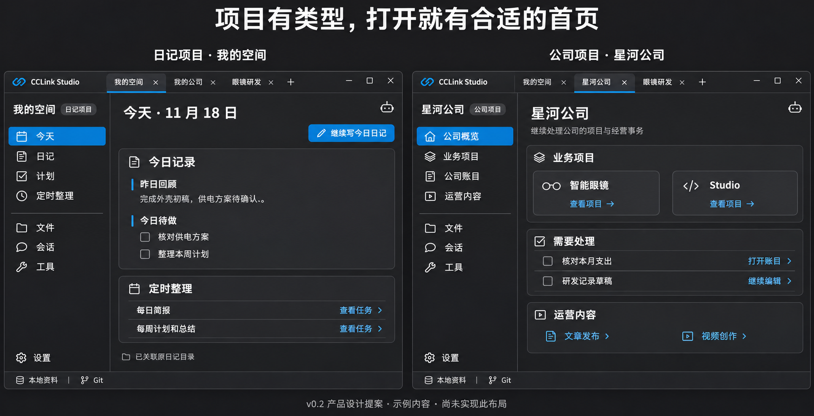
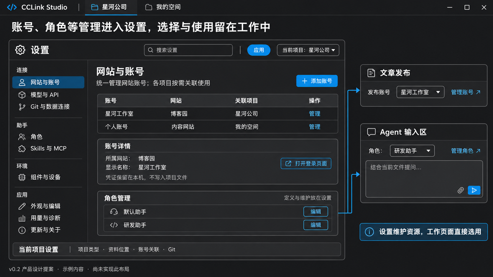
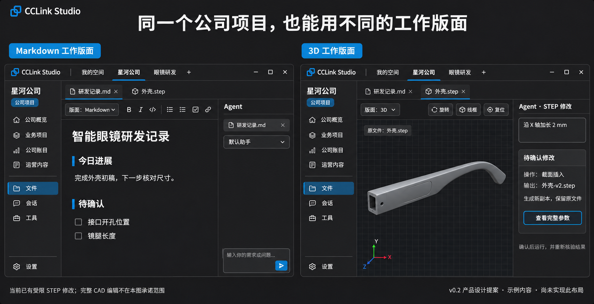

# v0.2 项目类型与工作版面：现有功能重组汇报

日期：2026-11-18。复核基线：`7c54acaa`。状态：产品设计提案；图片为示例内容，不是新版应用截图。本轮只更新设计资料。

2026-11-19：新增 [项目设置文件、新建与打开流程](./project-settings-and-creation.md)，补齐本汇报图片未展开的项目配置与创建交互。

2026-11-19 设计收口：八项生命周期规则已写入 [产品方案第 9 节](./product-design.md#9-八项生命周期规则)；新增 [首次使用、日常使用、换电脑三条完整流程与效果图](./user-journeys.md)。最新流程图是本轮交互依据，下方三组图继续说明类型首页、设置归位与工作版面的形态。全部图片均为设计示意，不表示已实施。

## 1. 产品结论与盘点范围

工作台就是带类型的项目。类型预置首页和业务功能；工作模式是独立于项目类型的内容版面。账号、角色等管理移入设置，选择账号、使用角色、查数据、执行任务仍在工作页面。

本轮复核 17 个 ActivityPanel 类型（其中 projects 为兼容类型，当前主要导航列出 16 项）、24 个 TabType、12 个设置分组、12 个 MCP 模块，以及项目条、状态栏、编辑工具栏和已有专业能力。逐项对照见 [代码入口盘点](./code-surface-inventory.md)，全部业务能力矩阵见 [产品设计](./product-design.md)。这是产品入口与能力归位审查，不是所有功能重新运行的质量验收。

补正前次清单中的遗漏：STEP 已有受限副本修改链路；朗读覆盖 MD、网页、消息和选区，MD/网页统一从底栏进入；当前项目最近会话快捷切换、Claude 组件安装后启用流程均需保留。

## 2. 效果图一：项目类型决定首页和侧栏

| 项目类型 | 默认业务入口 | 共用入口 |
| --- | --- | --- |
| 通用 | 项目首页 | 文件、会话、工具 |
| 日记 | 今天、日记、计划、定时整理 | 文件、会话、工具 |
| 公司 | 公司概览、业务项目、公司账目、运营内容 | 文件、会话、工具 |
| 电子开发 | 工程概览、设计文件、生产资料、检查报告 | 文件、会话、工具 |

底部保留设置，项目名菜单可直达当前项目设置。顶部只切换具体项目，不再出现“经营/内容/电路/结构”的第二行业务模式栏。类型可有多个实例，默认固定入口不因示意图中的通用窗口按钮而改变生命周期规则。

公司的运营内容包含稿件、文章发布、视频创作和素材调研；电子开发的生产资料包含 Gerber、BOM 与坐标，检查报告保留真实结果与原操作。类型预置入口，但不封锁其他已有能力。

“工具”是确定的现有动作列表：网页与终端、数据查询与设备、事务与定时任务、内容创作、硬件/CAD、版本变更。每项直达现有页面/命令，可固定常用入口；不引入插件市场或第二套执行系统。运行中或等待用户处理的任务必须保持可见入口，不能藏到设置里。

## 3. 效果图二：设置管理，工作现场使用

此图把账号页和角色页的局部合并展示以解释管理/使用关系；实际选择“角色”会进入自己的设置页面，不把角色列表塞进账号详情。

| 现有能力 | 新管理位置 | 工作现场的入口 | 迁移要求 |
| --- | --- | --- | --- |
| 网站与账号/Profile | 设置 → 网站与账号 | 发布账号选择、浏览器网站入口 | 引用原账号/Profile，不重建全部登录环境 |
| 角色定义/详情/编辑 | 设置 → 角色 | Agent 当前角色选择、管理角色链接 | 保留原角色及会话引用，不引入 AI 员工系统 |
| Skills | 设置 → Skills 与 MCP | 会话挂载与已挂载列表 | 管理与此次使用分开，不自动授予权限 |
| 内置工具/外部 MCP | 设置 → Skills 与 MCP | 工具执行与授权提示 | 项目类型只推荐必要能力，不能扩大授权 |
| 模型/API/后端连接 | 设置 → 模型与 API | 会话模型/后端状态 | 保留 Claude、Codex、自定义连接的既有配置 |
| Meshy/即梦/Pexels | 设置 → 模型与 API 对应服务 | 模型生成、文档配图、素材选择 | Provider 不占顶层业务导航 |
| Git 凭证 | 设置 → Git 与数据连接 | Git 操作时的有界认证 | 与资料仓库绑定分开，凭证不进项目模板/Git |
| 数据源连接/凭证 | 设置 → Git 与数据连接 | 查询页面、Agent 挂载 | 保持原全局/项目 scope，不把实际查询页搬进设置 |
| CAD 后端/缓存/路径 | 设置 → 组件与设备 → CAD | 查看、转换、STEP 修改 | 预览和修改后端分别显示实际状态 |
| Runtime/组件管理 | 设置 → 组件与设备 | 缺依赖时配置后返回 | 保留检查、安装并启用、修复、卸载 |
| Android/CCLink 连接 | 设置 → 组件与设备 | 设备画面、打开远程项目 | 配置与使用分开，本地能力保持免登录 |
| 编辑器/浏览器默认值 | 设置 → 外观与编辑 | 当前文档/网页工具栏 | 保存、查找、缩放与编辑操作仍在内容旁 |
| 模型用量/日志/诊断 | 设置 → 用量与诊断 | 当前运行显示必要用量和错误 | 不用日志页代替任务失败提示 |
| 更新/版本/许可 | 设置 → 更新与关于 | 有更新时保留提示 | 文档变更不代表安装包已经更新 |

设置顶部区分“应用”和“当前项目”，在同一个设置窗口完成。当前项目设置收纳类型、首页与入口偏好、资料位置/映射、账号资源关联、Git 关联等项目配置。账号和角色定义进入管理页，条目仍标注实际归属；不能把旧项目级资源静默改成全局。

图中“关联项目”等汇总展示属于目标 UI，不是当前已具备授权管理能力的证明。业务页面只列出当前项目允许使用的资源，新增关联不能暗中复制权限。设置内维护资源后，可以回到原稿件/任务继续操作。

## 4. 效果图三：同一项目使用不同工作版面

两边都是星河公司项目，侧栏保持公司功能；左边处理 Markdown，右边处理 STEP。项目身份不变，当前内容的画布、工具与辅助面板改变。

| 版面/工具 | 保留的现有能力 | 新呈现及边界 |
| --- | --- | --- |
| 默认 | 文件、标签、右侧 Agent、布局恢复、独立窗口 | 继续作为通用版面，不强迫每项功能设计专用界面 |
| Markdown | 格式、表格、图片附件、日期时间、自动保存、冲突提示、配图、资源导出 | 操作靠近正文；同一文件换版面不复制缓冲区 |
| 网页 | 导航、历史/书签、查找、缩放、视口、下载、弹窗和自动化 | 页面工具围绕浏览器；账号管理去设置，浏览留工作区 |
| 3D | 模型旋转/缩放/线框、STEP 转换、缓存、Meshy 结果 | 模型画布和上下文工具，保留真实格式支持与降级 |
| STEP 修改 | 参数计划、强制确认、新副本、重新导入核验、结果自动打开 | 图中按钮进入完整参数确认；小卡片不替代原批准快照 |
| 电路 | Altium 原理图/PCB 只读、Gerber 图层/外形/钻孔 | 专业预览版面，不假装具备完整电路编辑器 |
| 生产检查/FPC | 扫描、BOM/坐标、风险报告、FPC 形状上下文 | 属电子开发项目功能/工具，完整自动改板仍非已交付能力 |
| 普通文件 | 文本/代码、HTML、图片、PDF、音视频、Office 只读与格式降级 | 按格式选择实际查看器；CSV 文本编辑不等于电子表格 |
| 朗读 | MD、网页、消息、选区、暂停/跳段/速度/音色 | 保持底栏统一入口，图中未展开播放器不代表移除 |
| 数据查询 | 集合、保存查询、只读搜索、结果/记录挂载 | 从资料/工具打开查询页；连接配置在设置 |
| 终端/设备 | 本地/远程终端、命令记录、真机镜像与语义操作 | 工具标签/抽屉/设备版面，明确所属项目和目标 |

版面选择属于当前内容工具栏，只列适用选项。可保留默认版面，也可启用专用版面；打开文件可以采用合适默认值，但不能暗中改变项目类型。编辑和运行状态仍由原服务拥有。

## 5. 业务流程和基础功能逐项去向

| 功能组 | 新入口 | 必须保留的行为 |
| --- | --- | --- |
| 日记与计划 | 日记项目首页/日记/计划 | 原文预览、继续写、已有今日识别、独占创建空白模板、关联原计划 |
| 每日/每周整理 | 定时整理；工具 → 定时任务 | 原 ID、时间、启用状态、历史、输出路径和失败，不复制任务 |
| 公司业务 | 公司概览/业务项目/账目 | 原记录、资料、关联文件/会话/支出，多家公司各自归属 |
| 文章发布 | 运营内容；工具 → 内容创作 | 完整执行阶段、真实细步骤/证据、人工处理与恢复，WebAffair 唯一 owner |
| 网页事务/图片调研 | 工具 → 事务；运营内容 → 素材调研 | 流程编辑、候选、人工保存/跳过、实际运行、恢复和来源失效 |
| 视频创作 | 运营内容 → 视频创作；工具 → 内容创作 | 新版口播/候选/采用/保存；旧版素材/声音/预览/导出入口单独保留 |
| 会话 | 共用会话入口/右侧 Agent | 当前项目列表、搜索、最近切换、新建、改名、关闭/恢复/删除、队列和资源 |
| Git | 状态栏/工具 → 版本变更 | 文件状态、Diff、提交、Push、旧备份入口，明确各自操作语义 |
| Git 获取/更新 | 打开项目/资料关联；版本页 | 新目录 clone、fetch/差异、新副本更新、显式关联，原目录不覆盖 |
| 本地/远程项目 | 顶部列表/打开项目 | 来源选择、固定入口、历史和恢复，远程离线不阻断本地 |
| 文件管理 | 文件与资料 | 树、创建/重命名/删除、复制粘贴、附件、链接目录、ZIP 和范围校验 |
| 标签与窗口 | 标签/窗口操作 | 持续状态、分离窗口、恢复与布局，不产生第二份文档事实 |
| 操作发现 | 命令面板/快捷键/统一右键 | 保留原 command ID，旧名称能找到新入口，不复制执行逻辑 |
| 状态/诊断/更新 | 状态栏与设置 | 项目、保存/Git、朗读、运行错误、日志导出和更新提示 |

视频新版后三页仍为骨架，Altium 仍为只读，STEP 则已有受限编辑；必须按各自实际状态呈现，不能统一声称“支持全部设计编辑”。本次没有随导航重组删除任何原有业务能力。

## 6. 设计拷问与后续验收

1. 账号移走后能否继续发布？从账号选择器进入设置，配置后回原任务；原账号/Profile/任务引用不变。
2. 角色移走后是否难找？输入区保留选择与管理链接；切版面不更换正在运行会话的角色或上下文。
3. 类型会否锁死能力？公司项目打开 STEP，电子项目编辑 Markdown，验证同一工作版面跨类型可用。
4. 导航变少是否藏功能？原侧栏全部可见入口和所有内容类型逐一走到新位置；工具目录是确定列表。
5. 旧资料会否覆盖？接入前后检查原日记、附件、账目、任务定义；类型和布局写配置，原文件原地保留。
6. 运行会否失联？切标签、版面、项目后，定时任务、发布、Agent、终端保持原作用域和真实状态，不重复执行。
7. 专业能力会否丢失？实际回归 STEP 计划/确认/新副本/核验/自动打开，旧视频与旧 Git 备份单独回归。
8. 是否再次把效果图当产品完成？本轮仅交付设计与归位清单；实现后仍须真实 Electron 验收、正式发布和另一台 Mac 更新验证。

## 7. 本轮交付物

- `product-design.md`：产品定义、边界与全部能力矩阵。
- `code-surface-inventory.md`：原面板、标签、设置、MCP 声明对照。
- 本文：三组效果图、每项管理/使用入口和迁移验收。
- `image-prompts-v3.json`：本轮内置 image_gen 的生成提示词。图片是产品概念，不是应用执行证据。
