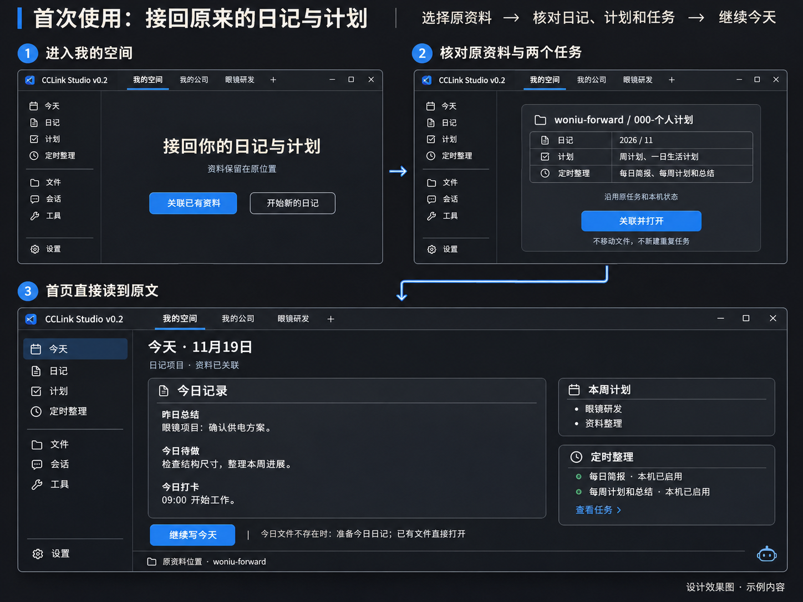
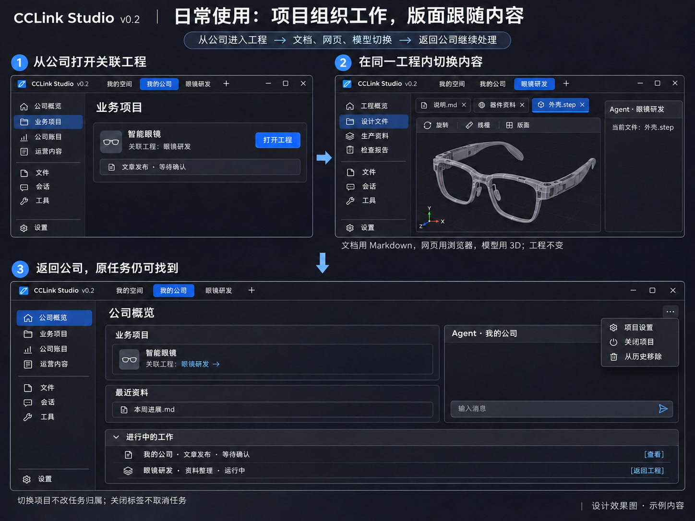
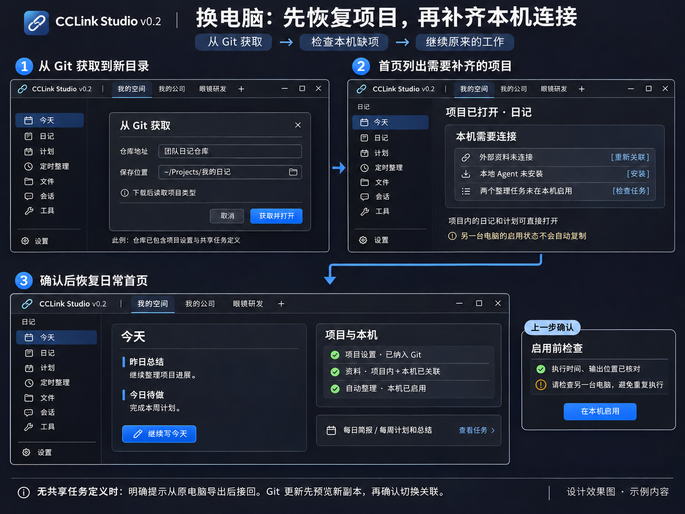

# 三条完整使用流程：首次使用、日常使用、换电脑

日期：2026-11-19。状态：本轮设计定稿；三条流程已在独立分支使用模拟资料和真实 Electron 验收，见 [实际验收报告](../../testing/typed-workspaces-2026-11-19.md)。本页效果图仍是设计示意，实际截图另存验收报告，未合并或发布。

本稿和 [产品方案](./product-design.md)、[项目设置与新建](./project-settings-and-creation.md) 配套阅读。规则以产品方案第 9 节为准；本稿用三条完整流程说明用户具体点击什么、看到什么、在哪里完成。没有新增业务模式层或第二套项目系统。

## 1. 首次使用：接回原来的日记、计划和两个任务

**目标结果：**点击“我的空间”就能看到原日记正文、计划和两个真实任务；继续写已有文件，或只在不存在时准备今日文件。关联动作不移动、不覆盖旧文件。

主路径：进入我的空间 → 关联已有资料 → 核对日记/计划/原任务 → 首页继续今天。

| 步骤        | 用户操作                                                | 界面与完成条件                                                                                                               |
| ----------- | ------------------------------------------------------- | ---------------------------------------------------------------------------------------------------------------------------- |
| 1. 打开     | 启动 Studio，点击固定入口“我的空间”                     | 有原绑定直接恢复；首次无绑定显示“关联已有资料”和“开始新的日记”。左侧已有今天、日记、计划、定时整理和共用入口，不是空白工作区 |
| 2. 选择来源 | 点“关联已有资料”，选择本机原目录                        | 显示真实目录及候选日记/计划位置，用户可调整；例如 `woniu-forward/000-个人计划/2026/11`。没有命中就让用户选择，不虚构识别结果 |
| 3. 核对     | 确认日记、周计划/一日生活计划、每日简报、每周计划和总结 | 展示每项真实路径和任务来源、时间、状态；这是关联预览，未保存前不显示已完成。本机可访问的原任务沿用原条目，不根据名称复制任务 |
| 4. 完成关联 | 点“关联并打开”                                          | 记录关联后进入今天首页，展示原文、计划和原任务入口；未接回项保留明确状态，不以部分成功冒充全部成功                           |
| 5. 开始记录 | 已有今天点“继续写今天”；否则点“准备今日日记”            | 前者打开原文件，后者显示目标和模板并独占创建；创建时若文件已出现，打开现有文件。准备模板不冒充 AI 已完成总结                 |
| 6. 查看整理 | 点击每日简报/每周计划和总结                             | 回原任务详情，看到原时间、启用状态、历史与输出目标；是否立即执行由用户动作和任务原权限决定                                   |

**两个分支必须在首次使用中可达：**

- 从零开始：点“开始新的日记”，复用新建项目表单，预选日记类型，填写名称和位置；明确模板清单，再创建并将固定入口关联到新项目。今天页显示可准备的日记与计划，不塞入示例日记。默认任务建议不自动启用。
- 原任务不在本机：仍可以关联文件、开始写日记；任务区显示“未接回”，提供接回任务定义的入口。原电脑私有任务不能只凭目录存在或同名文件判为已接回。此分支与换电脑流程共用处理方式。

**异常与恢复：**目录只读时允许原文预览，创建按钮说明只读；路径失联显示原来源和重新关联；取消关联预览保留原配置；同名日记已有时直接打开；旧项目配置损坏不覆盖修复。修改目录关联不会清理原附件或旧月份。

**真人验收脚本（待实现后执行）：**

1. 用包含日记、附件、计划、两个任务的隔离模拟资料启动，记录原文件校验值及原任务身份/启用情况。
2. 完成步骤 1–4，首页原文与原文件一致，两个入口指向原任务；再次关联不会多出任务。
3. 先测试今日文件已有，再测试不存在与创建竞态；已有文件不改动，仅在明确创建时新增一个目标文件。
4. 关闭并重开 Studio，仍回到该类型首页和原资料；原文件校验值不因关联变化。

## 2. 日常使用：公司组织工作，版面跟随内容

**目标结果：**从公司业务记录进入原工程，在文档、网页、模型之间工作，再回公司处理任务。切项目与切版面都不改变正在运行工作的归属。

主路径：我的公司 → 智能眼镜业务记录 → 打开关联工程 → 文档/网页/模型 → 回公司 → 查看原任务。

| 步骤        | 用户操作                                           | 界面与完成条件                                                                                                                |
| ----------- | -------------------------------------------------- | ----------------------------------------------------------------------------------------------------------------------------- |
| 1. 找业务   | 我的公司 → 业务项目 → 智能眼镜                     | 看到业务记录、资料及“关联工程：眼镜研发”；公司账目仍在公司，不把工程当另一个公司                                              |
| 2. 打开工程 | 点“打开工程”                                       | 打开或切回原电子开发项目；顶部激活眼镜研发，侧栏为工程概览、设计文件、生产资料、检查报告与共用入口。原公司项目仍可返回        |
| 3. 处理内容 | 打开说明.md、器件资料网页、外壳.step，切换内容标签 | 分别用 Markdown、浏览器、3D 版面，工程身份与侧栏保持；当前标签可选择适用版面。Agent 显示当前项目/文件，既有运行不被替换上下文 |
| 4. 返回公司 | 点击“我的公司”                                     | 恢复公司现场；底栏运行入口仍可找到公司发布的等待项和工程里的进行项，点击各自回原对象                                          |
| 5. 收起现场 | 从项目名菜单关闭工程，或关闭某内容标签             | 有运行时说明哪些继续、哪些必须先处理；不会把“关闭”当“删除”或自动停止。未保存内容和资源依赖必须先按原规则处理                  |

**设置和功能入口：**公司侧栏保留业务；账号、角色、连接进入底部设置。发布仍在稿件里选账号，Agent 仍在现场选角色。从工作页进入设置后能返回原任务。其他原功能全部按既有功能归位清单保留，不因图中省略就删除。

**新建和关联分支：**业务记录没有工程时，提供“关联已有项目”或“新建并关联”；后者复用同一新建表单，预选电子开发，成功后才写关联，失败保留业务记录。公司类型也能直接打开 STEP，不强制必须另建电子开发项目。

**能力边界：**图中 3D 视口表示现有查看能力；STEP 受限修改仍须进入已有参数确认、新副本、重新导入核验链路。Altium 保持只读。切版面不代表新增 CAD/EDA 编辑功能。

**真人验收脚本（待实现后执行）：**

1. 公司内关联一个已存在工程，连续两次打开，只出现同一项目与同一资料；失联时保留业务记录并允许重新定位。
2. 在工程中编辑 Markdown 未保存内容，切网页/模型再返回；正文、保存状态、Agent 运行归属保持。
3. 从公司打开同一受支持模型，能够使用相同 3D 版面；公司侧栏不被改成电子开发侧栏。
4. 在隔离任务中验证切项目、关闭标签和返回运行入口，不重复执行、不串用账号/输出目录；不支持脱离资源的操作明确阻止关闭该依赖。
5. 分别执行关闭、移除历史、解除关联；原文件与原业务对象保留，运行依赖未处理时不允许静默解除。

## 3. 换电脑：恢复项目，再补齐本机连接

**目标结果：**新电脑从仓库读出相同项目类型和项目内资料；缺失的本机目录、组件和任务启用状态明确可见。补齐后继续原工作，不能只打开一个同名空目录。

效果图主路径的前提是：仓库已经包含兼容项目设置、日记/计划文件和用户明确共享的两个任务定义。下面同时覆盖未共享的分支；图中不能代表任何仓库都具备这些内容。

主路径：原电脑确认共享范围 → 新电脑从 Git 获取 → 自动读类型 → 首页接回本机缺项 → 核对并启用任务 → 继续今天。

| 步骤          | 用户操作                                                                | 界面与完成条件                                                                                               |
| ------------- | ----------------------------------------------------------------------- | ------------------------------------------------------------------------------------------------------------ |
| 0. 原电脑准备 | 项目设置检查“项目设置：已纳入 Git”，查看变更并按正常 Git 流程提交、推送 | 显示未提交/未推送状态；只共享已验证的非敏感项目配置和明确选择的资料/任务定义。凭证、身份、本机现场不进入共享 |
| 1. 获取       | 新电脑“＋ → 从 Git 获取”，填地址和新位置                                | 下载成功后读配置，不先要求选择类型覆盖仓库设置；失败给出具体错误，重试不覆盖已有目录                         |
| 2. 进入       | 打开拉取的项目；如需常驻“我的空间”，使用入口菜单关联它                  | 有设置直接显示日记首页和项目内资料。固定入口绑定是本机选择，不因仓库名字叫“我的空间”就替换已关联项目         |
| 3. 补齐资料   | 首页点外部资料“重新关联”                                                | 仅补本机路径，显示找到的内容；找不到时可继续使用仓库已有文件，不生成同名空目录代替旧资料                     |
| 4. 补齐能力   | 对确实缺少的 Agent/组件点配置或安装，配置后返回                         | 文件阅读与普通编辑继续可用；只影响依赖该能力的整理/专业操作，不要求先登录 CCLink                             |
| 5. 接回任务   | 查看两个定义，核对时间、时区、资料范围、输出位置和依赖                  | 共享定义可读取，但本机仍未启用；历史不伪造。检查其他电脑执行情况的提示明确可见，不声称已自动检查或关闭旧机   |
| 6. 启用并继续 | 明确点“在本机启用”，回今天页继续写                                      | 启用成功才显示本机已启用；依赖缺失或保存失败保持未启用并给出原因。按原调度时间工作，不把启用当立即运行       |

**没有共享完整资料时：**

- 仓库没有项目配置：通用打开，项目设置中选择日记类型并关联资料，不根据仓库名称冒充已恢复原设置。
- 原任务只存原电脑：在原电脑明确导出可共享定义，再在新电脑“定时整理 → 接回任务”核对来源、冲突和输出路径。此导出/接回交互是本次设计要求，仍待实现验收；不是宣称现有 Git 已支持复制本地私有任务。
- 没有任务定义、账号或原历史：如实显示缺少的项。不能按“每日简报”这个名称自行编一个新任务并称为接回成功。
- 新电脑应用版本不支持配置：提示需要的版本或不支持的字段，保留原配置，普通文件仍能打开；配置升级不直接覆盖原格式。

**后续更新，单独把最后一步做完：**

检查更新 → 看差异 → 预览新副本 → 核对日记/计划/附件/任务路径 → 确认切换来源。

首页与任务输出必须指向用户核对过的来源；有运行或未保存编辑先保留原关联。任务中的绝对路径不能静默改写，缺少任务接回条件时提示“副本已准备，关联尚未切换”。无论接受还是取消，新旧原文件都不因更新操作被覆盖/移动。完整项目副本遵循原身份规则，不能为了保留界面标签伪造相同身份。

**真人验收脚本（待实现后执行）：**

1. 在独立系统用户或第二台 Mac 以全新本机配置 clone：类型和项目内正文恢复，本机账号、组件和启用状态不伪造为已恢复。
2. 同时测试有共享任务和仅原机私有任务两种情况；前者可核对启用，后者明确要求接回定义。重复接回不出现两个启用副本。
3. 外部资料失联时首页可读仓库已有文件，重新关联后内容来自所选原目录；同名目录不自动替代。
4. 创建 Git 更新副本，分别取消和确认关联；确认前检查运行、未保存内容和任务路径，未满足条件保持旧关联。原目录文件校验值保持。
5. 完全退出应用，验证不承诺系统唤醒或自动补跑；重开呈现真实任务状态。

## 4. 本轮设计收口检查

| 检查项                 | 本轮结论                                                                             |
| ---------------------- | ------------------------------------------------------------------------------------ |
| 用户需要理解的主要概念 | 只有项目、项目类型、当前内容的工作版面；首页与工具用普通业务名称                     |
| 固定入口与多个实例     | 默认快捷入口引用普通项目；允许多本日记、多家公司，不复制同一目录                     |
| 配置与创建             | 复用隐藏目录；新建选类型，打开/Git 先读配置；只读/损坏不覆写                         |
| 资料与旧任务           | 关联与接回保留原文件/原对象；缺失如实呈现，换机不自动启用                            |
| Git 更新               | 副本准备和关联交接分别可核验，不以下载结束当用户工作恢复                             |
| 既有功能               | 继续依照原功能矩阵；仅移动入口不删能力；新旧视频、旧 Git 备份、STEP 受限修改继续保留 |
| 失败与退出             | 失联、未保存、配置冲突、缺组件、缺任务定义和退出运行均有明确出口                     |
| 本轮交付边界           | 只交付文档与三张概念图。应用功能增量为零；不宣称真实应用/换机已验收，不发布版本      |

实施前的工程约束仍是原 Workspace、Tab、文档、Agent、WebAffair 与定时任务领域各自负责状态和生命周期。本稿用用户熟悉的“项目”描述工作空间，不要求新增另一种持久化身份；新的调用与保存必须按原架构契约实现。图片用于确认产品形态，不是另起一套 UI 或执行框架的授权。

图片由内置 image_gen 生成，完整提示词见 [journey-image-prompts-v1.json](./journey-image-prompts-v1.json)。
