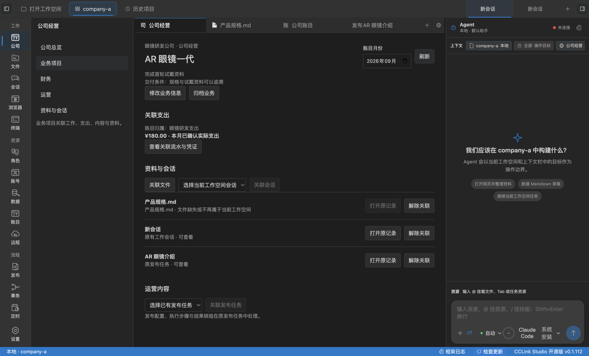

# 公司工作空间第一批验收

> 日期：2026-10-14。
> 状态：代码与工程门禁通过，真实 Electron 自动化操作通过；真人业务验收待完成。
> 产品事实源：[公司工作空间产品设计](../features/company-workspace-product-design.md)。

## 用户功能进度

用户现在可以在普通本地工作空间启用公司视图，组织业务、关联文件与已有会话、绑定既有账目归属并查看原流水，以及打开原发布事务。业务归档和重新打开、A/B 工作空间切换、完整重启均保留关联；缺失或变化的文件有明确提示。

用户还不能在公司项目内接受受控 AI 计划、生成并验收产物、创建新的运营发布链路或确认经营决策。这些属于第二至第四批。关联原发布事务不代表公开发布已经完成；当前总览财务依赖进入页面、窗口聚焦或手动刷新，主动失效通知尚待补齐。

## 真人可执行步骤

请使用可写的本地资料目录，保留一份用于变更及移除测试的文件副本。已有账目和发布事务继续使用原功能创建。

1. 打开本地工作空间，点击左侧“公司”，填写公司显示名称，点击“开始使用”。预期：无须登录即可进入“公司总览”；未初始化账目显示实际提示。
2. 点击“创建业务项目”，填写名称、目标和交付条件，打开业务详情。修改业务信息后重新打开，检查字段保留。
3. 点击“关联文件”，选择当前工作空间内的文件。点击“打开原记录”，检查原编辑器或预览可用；回到“公司 → 业务项目”，侧栏仍可操作，月份保留。
4. 选择当前工作空间已有会话并关联，打开原记录。预期：打开同一会话；其他工作空间的会话不可选。
5. 在原“公司账目”导入一个实际月份的流水，核对并人工确认，将流水归入一个账目项目。回到公司业务，在“修改业务信息”绑定该归属，选择同一月份并刷新。预期：显示原服务的已确认实际支出；点击“查看关联流水与凭证”进入原财务页并过滤到该归属。未确认流水不计入已确认支出。
6. 选择已有发布任务并关联，点击原记录。预期：打开同一发布事务，显示原状态与原执行计划；关联操作不启动执行，不改变发布结果。
7. 归档业务，再重新打开。预期：文件、会话、发布和财务绑定都保留；无删除原记录的副作用。
8. 修改已关联测试文件，刷新后检查变化提示；移除副本后检查缺失提示。预期：不伪造可查看或完成状态。
9. 切换到另一个本地目录。预期：不存在前一公司的业务和关联。切回并完整重启 Studio，检查原业务、名称、月份、财务绑定和资料仍在。
10. 关闭公司视图，再打开文件、会话及原账目。预期：其余本地能力正常；再次启用可查看保留的公司数据。

真人结果：尚未由使用者执行以上步骤，因此第一批产品验收保持待确认，完整首版也未关闭。

## 工程准备度与实际证据

- `pnpm verify` 通过：边界检查、格式、lint、类型检查、构建及测试；411 个测试文件通过，3334 项通过，10 项跳过。
- `node scripts/company-workspace-smoke.mjs` 在实际 Electron 中通过 11 条路径，覆盖启用、创建、原文件／会话／发布关联、原账目下钻、归档恢复、文件变化／缺失、A/B 隔离、重启与停用。
- 主进程测试覆盖三表与延迟启用、稳定归属、真实账目投影、旧版本冲突与重复绑定、越界／符号链接／跨工作空间拒绝、数据库损坏保留及原服务故障降级。
- 导航回归检查覆盖反复切换页面仍显示侧栏、月份保留与原财务 Tab 复用，以及活动栏上下文入口一致。

真实 Electron smoke 使用隔离的用户数据、工作空间、真实文件与 SQLite；文件选择框返回值受控，其后走生产 IPC、服务和 UI。原账目导入、修改和确认通过实际 preload；原发布事务由原服务创建并保持“尚未开始”。没有模型请求、真实账号登录或公开发布。自动化结束后删除测试工作空间，不向用户经营目录写入示例业务。

结果：[11 条操作记录](company-workspace-first-loop/result.json)。截图是实际 App 中的测试业务，数据仅用于验收。

## 拷问与剩余边界

结论：当前增量是公司业务组织与原记录下钻，尚不能证明 AI 能持续推进经营。

- 真人是否能用自己的资料完成上述步骤，减少找资料与重复说明？仍需实际使用验收，不能由脚本代替。
- 连续停留总览时，账目更新是否立即可见？当前需刷新；第三批增加原 owner 的失效通知，不保存另一套账目状态。
- 原发布事务未开始、结果未知或等待审核时，公司是否保留事实？本批核验了未开始与原页跳转；真实提交和平台核验属于后续专项验收。
- 只读工作目录是否清楚降级且不影响其他能力？代码返回有界保存错误并保留原库，实际只读目录的 App 操作仍待真人补验。
- 下一步能增加什么用户能力？第二批应优先交付“选定资料 → 接受计划 → 真实 Markdown 产物 → 打开并验收”，同时证明原生工具与 MCP 无法越界；不继续增加空页面或通用调度框架。
