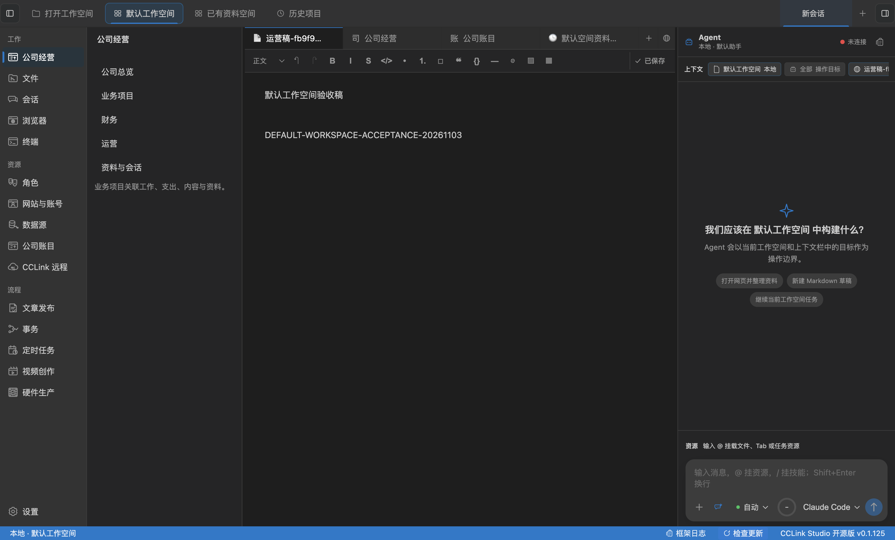
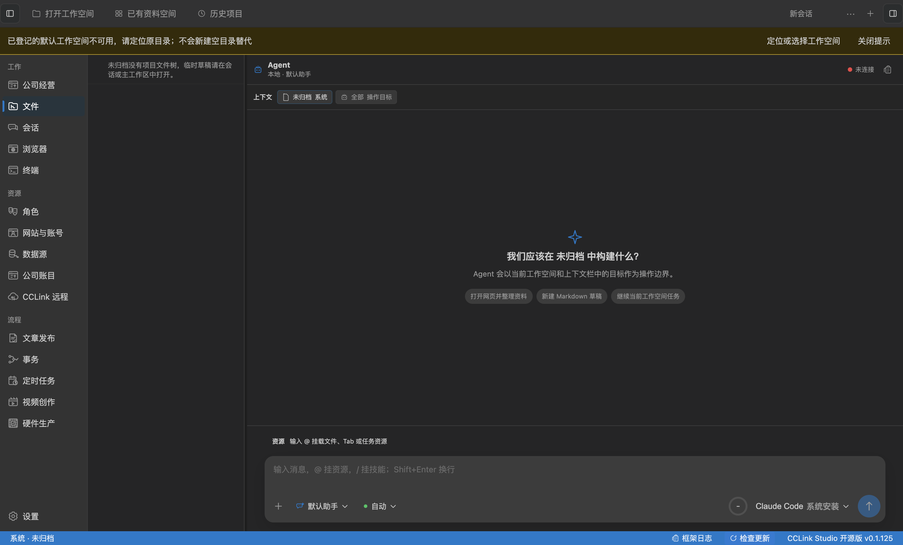

# 默认工作空间第一批实现与验收

> 更新日期：2026-11-04，Asia/Shanghai。
> 状态：第一批功能已实现，工程门禁及真实 Electron 自动验收通过；真人使用签收待执行。
> 范围：[默认工作空间实施计划](../features/default-workspace-data-development-plan.md)第一批。

## 用户功能进度

用户现在可以首次启动即进入默认本地工作空间，创建并保存运营稿，启用公司并关联业务与原账目，创建定时任务；切换其他目录和完整重启后继续打开原资料。已有安装优先恢复原选择，未归档草稿保持原归属，默认目录丢失时不会用空目录替代。

用户还不能依靠复制目录完成事务迁移或整体资料恢复；事务目录化、移动副本的身份重绑和跨域备份属于第二、第三批。网站账号仍为本机全局资源，任务启用与去重账本仍在本机。没有执行或验收公开发文，也没有发布新版本。

## 已实现的入口和保护

- 默认候选是主目录下的 `CCLink Studio/默认工作空间/`，登记在原 WorkspaceState 索引与设置中，复用现有稳定身份。
- “打开工作空间”增加默认入口、设置当前空间为默认和进入未归档；与命令面板复用稳定 command。更改默认选择不移动数据。
- 首次无选择、恢复原空间、主动未归档和启动失败分别处理。恢复失败不会清除原路径或冒充用户主动未归档；远程切换保留原生命周期。
- “文章发布 → 新建运营稿”通过原文件服务排他创建 `运营/原稿/运营稿-<随机标识>.md`，由原编辑器保存，不创建账号或触发发布。
- 公司、稿件和任务继续由原服务保存并显示工作空间归属；网站账号标明本机全局。
- 默认初始化纳入原 WorkspaceState 的退出 flush；设置提交失败保留已登记目录供重试。占用、符号链接、身份冲突或登记目录丢失均不覆盖原件。
- 启动失败在工作台顶部提供恢复提示和选择入口，global 不显示文件树时也能看到原因。

## 真实 App 自动验收

使用 Electron 43.1.1、macOS arm64 和生产构建，操作真实窗口、preload、IPC、SQLite、文件及编辑器。Electron home、documents、userData 和 Claude 配置目录分别隔离，所有经营资料均为验收样本，没有向用户既有经营目录写入测试数据。

| 用例     | 实际结果                                                                                                   |
| -------- | ---------------------------------------------------------------------------------------------------------- |
| A01      | 不登录、不选目录建立默认空间；编辑器保存稿件，重启后原身份及内容保留                                       |
| A02      | 缺少新增字段的旧配置仍恢复旧空间；明确选择 B 后重启继续 B，旧文件摘要不变                                  |
| A03      | 主动未归档跨重启保留；默认初始化不会认领或修改原 global 草稿                                               |
| A04      | 占用目录保留原件，真实 App 显示冲突及恢复入口                                                              |
| A05      | 实际只读父目录创建失败、登记目录被移走均明确降级，不生成替代空目录                                         |
| A06      | 真实 IPC 并发初始化同一目标，旧草稿不变；设置失败重试及退出 flush 另有单测                                 |
| B01      | 真实编辑器保存运营稿，公司业务关联并能打开同一原文件                                                       |
| B02      | 原账目服务导入并人工确认测试流水，UI 绑定业务后下钻原流水                                                  |
| B03      | UI 保存并启用任务；本地 Claude Code SDK 使用已配置真实模型，立即运行和到点运行均完成，产物保留输入稿件标记 |
| B04      | B 不显示 A 的公司和任务；A 后台任务结果仍回 A，完整重启恢复公司、原稿及任务定义                            |
| 用户配置 | 原设置和凭证文件验收前后摘要一致；测试凭证只经专用接口进入隔离 userData，结束后清理                        |

未执行的运营发布草稿及公司关联也经过 A/B 切换与完整重启：恢复后仍为同一事务 ID，账号及配置保留，发布状态为 `not-started`，Attempt 数量为 0；可以从公司业务打开原发布页。

主流程：[result.json](default-workspace-first-batch/result.json)。边界流程：[edge-result.json](default-workspace-first-batch/edge-result.json)。源码与构建指纹：[verification.json](default-workspace-first-batch/verification.json)。主流程没有 mock 执行器或模型响应。以上为真实 App 自动验收，不能直接写成使用者真人签收。

## 工程准备度

- `pnpm verify` 通过：边界、格式、lint、421 个测试文件、3543 项通过和 10 项跳过，以及类型检查和构建。
- 定向回归覆盖初始化幂等、占用、符号链接、身份替换、设置提交失败、启动意图、旧配置兼容、过期切换和退出 flush。
- 自动化入口：`node scripts/default-workspace-edge-smoke.mjs`；真实模型主流程使用 `CCLINK_DEFAULT_WORKSPACE_LIVE_MODEL=1 node scripts/default-workspace-smoke.mjs`。
- 主流程不带上述变量时只验收存储恢复，模型生成和到点运行标为未执行。真实模型模式读取本机固定 userData 中的既有 API 连接配置，产生正常模型请求；未配置时不能声称这项通过。
- 初轮脚本的重复文本、组合状态文案和异步切换定位问题已修正，最终结果以两份完整成功运行的记录为准。没有执行签名、打包发布或云端部署。

## 真人可执行步骤

1. 启动当前源码版本。已有安装应恢复上次空间；从“打开工作空间 → 默认工作空间”进入日常目录，新环境则自动进入。通过选择器查看实际路径。
2. 点击“文章发布 → 新建运营稿”，输入自己的内容并按 `Cmd/Ctrl+S`。确认稿件在“运营/原稿”，原有 `docs` 等文件不移动。
3. 进入“公司经营”，按需启用公司，创建业务并关联稿件，点击“打开原记录”查看原编辑器文件。
4. 从“公司账目”导入选定月份资料，核对并人工确认，再回公司业务绑定原归属，检查原流水、原件及金额口径。
5. 创建定时任务并绑定稿件，结果选择“另存为工作空间 Markdown”，目录例如“产物”，文件名使用 `{runId}.md`。显式保存启用，立即运行并安排近期到点时间，检查实际产物及历史。
6. 执行时切换另一个已有空间，确认资料和列表不串入；完成后回原空间查看结果。完整退出重启，检查先恢复上次选择，仍可回默认空间打开原公司、稿件与任务。
7. 进入未归档后重启，确认仍在未归档，原未归档草稿保留。再打开默认空间。
8. 将一个已打开的本地空间设为默认，确认只改变默认选择，原目录和资料保留。目录移动、复制恢复属于后续批次。

真人结果：尚未由使用者执行并签收以上步骤，第一批产品验收保持待确认。

## 拷问与剩余边界

第一批增加了默认入口和保存恢复闭环，尚未完成资料可携带的全部目标。下一步应进行第二批事务分区迁移，保留真实证据和唯一写入位置，不能把关联发布事务当成实际发布成功。

故障验收覆盖占用、只读创建、目录丢失及合成旧资料，没有对用户经营原件做破坏试验，也不声称验证过全部历史版本。跨设备、整体备份、实际在线远程 Agent、公开发布和真人签收均保留各自待验收状态。
