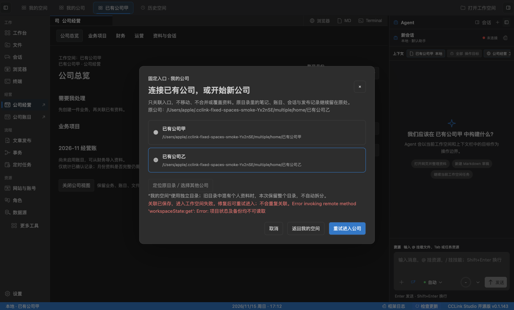
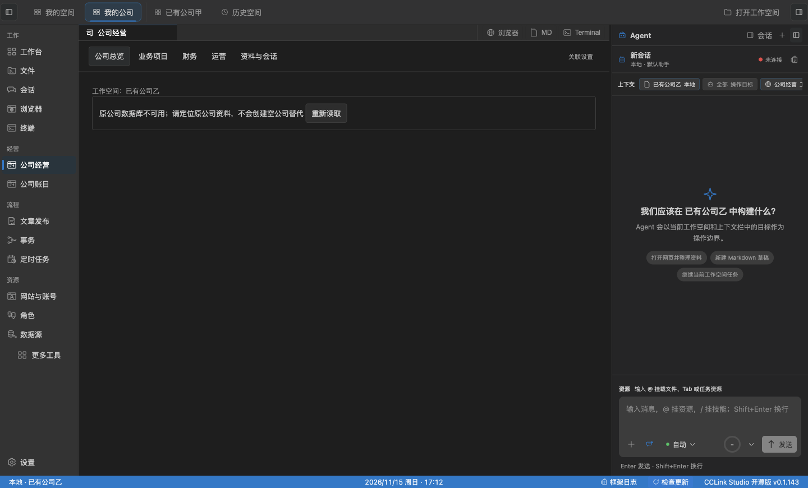
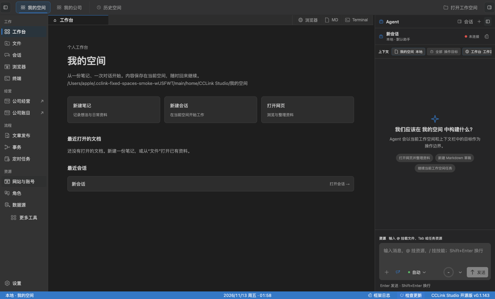
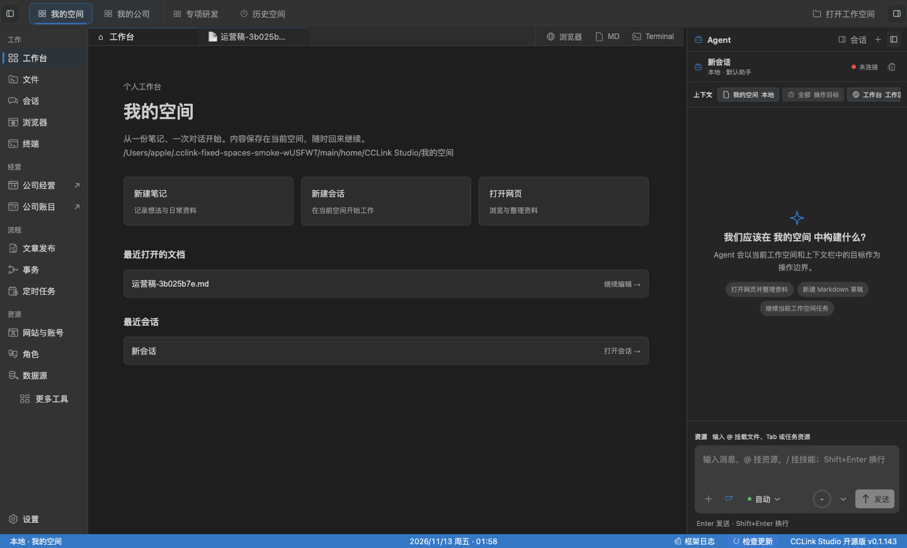
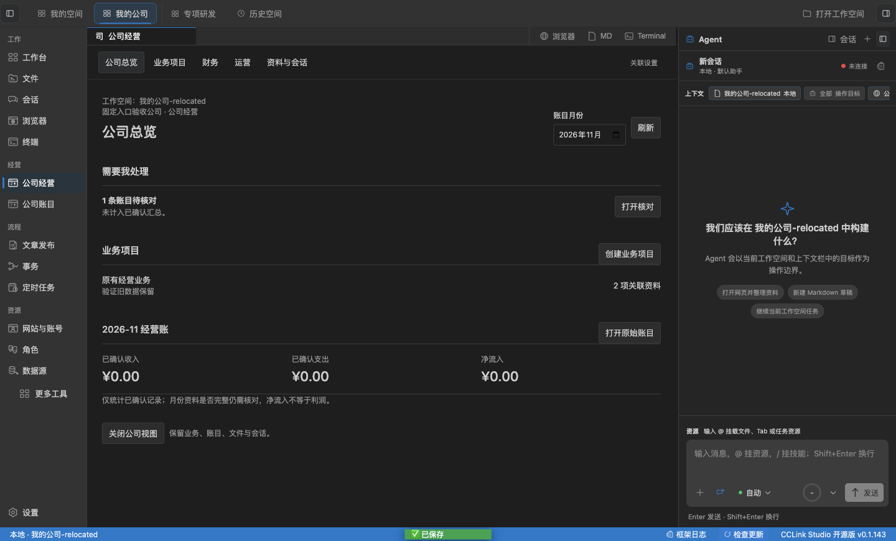
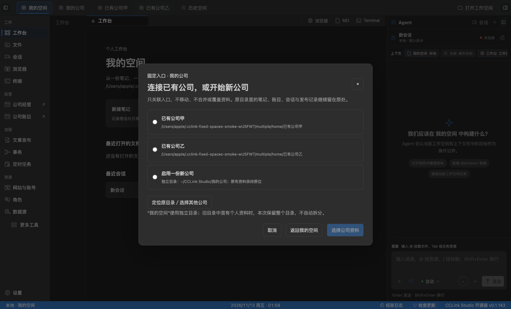
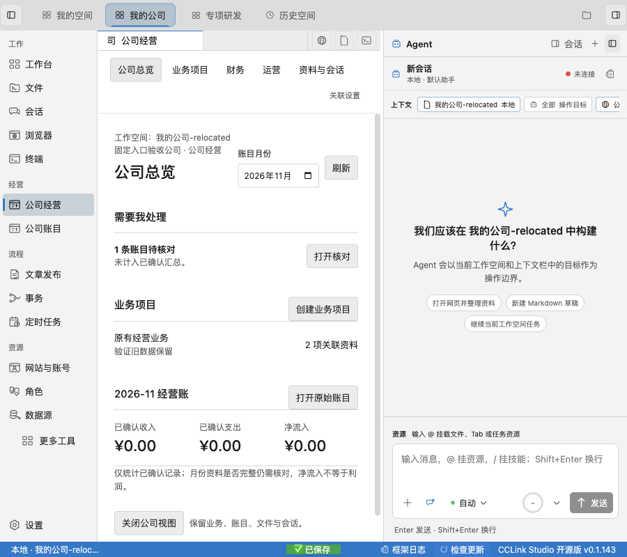

# 双固定入口与旧公司资料接回验收

> 首次验收：2026-11-13；复查：2026-11-15，Asia/Shanghai。范围：用户授权的双固定入口、旧公司原位接回、侧栏调整。源码已实现并通过真实 Electron 自动验收；未签名、未打包发布，使用者真人签收待执行。
> 产品：[产品设计](../features/personal-company-spaces-product-design.md)。实施：[实施计划](../features/personal-company-spaces-development-plan.md)。边界：[ADR 0024](../decisions/0024-personal-company-space-bindings.md)。

## 用户现在能做什么

首次免登录启动直接使用“我的空间”，从个人工作台新建笔记、会话或网页。两个入口固定在顶栏；公司首次使用可以明确选择已有资料或启用独立新公司。公司经营和公司账目快捷入口前往固定公司，文章发布、事务、定时任务保持当前空间归属。

旧公司接回只保存导航关联，保留原目录与稳定身份。原业务、流水、会话、原发布事务可以继续下钻；混合目录中的个人笔记留在原处。多个公司不猜选，换绑要求明确确认。关闭最后一个普通空间回到个人空间；原公司目录失效时保留关联，定位原目录后恢复。

左栏现在分为工作、经营、流程、资源和更多工具；展开 140px、收起 48px。公司内导航进入主区，个人工作台和公司页不再占用重复的第二侧栏。文件树等原有侧栏继续使用原状态与尺寸偏好。

当前不包含公开安装包、公司数据拆分合并、多公司固定栏、多人权限、公司 AI 自动经营或实际公开发布。

## 真实应用验收结果

执行 `scripts/fixed-spaces-smoke.mjs`，生产构建运行在真实 Electron 窗口中，使用实际 renderer、preload、主进程、SQLite、文件保存与工作空间切换。首次 11 项通过；2026-11-15 复查补充两个失败路径后，共 13 项通过，无页面未捕获异常。

所有资料写入均在独立的 home、documents、userData 内。系统文件选择器只替换测试目录返回值；其后的授权、校验、状态提交、编辑器和业务读写均为真实实现。未移动、覆盖用户的生产经营目录，未运行 Agent、登录真实账号或提交公开发布。

| 用户动作               | 结果与证据                                                                                                                     |
| ---------------------- | ------------------------------------------------------------------------------------------------------------------------------ |
| 首次启动               | 个人空间自动初始化并显示工作台；空 resume 回到个人空间；两个固定入口可见，公司库尚未创建                                       |
| 保存个人内容           | 实际编辑器保存运营稿，新增个人工作台也实际创建并保存 `笔记/*.md`                                                               |
| 启用新公司             | 独立公司目录，真实创建业务、流水与关联会话；个人资料不转入公司                                                                 |
| 升级旧默认含公司的安装 | 取消新绑定模拟旧版设置后重新启动；选择原公司，身份文件和公司 SQLite 字节保持不变，混合笔记原位保留                             |
| 原记录下钻             | 原会话、原流水与原发布事务可打开；流水 ID 和账目 SQLite 字节不变；发布仍为 `not-started`                                       |
| 切换与重启             | 专项空间点击公司快捷入口回固定公司；完整退出后原公司业务与个人笔记恢复                                                         |
| 原目录失效             | 在隔离样本中移走原目录；显示恢复面板，无法新建空公司替代；定位后接回同一身份                                                   |
| 导航与布局             | 1440、1200、900px × 深浅主题共六组；固定标签不越界，只有一个实际选中；更多工具仍可达；140/48px 收放通过                        |
| 关闭普通空间           | 通过实际右键菜单关闭最后一个普通空间，回到我的空间，两个固定入口保留                                                           |
| 真实内嵌网页           | 新页、页内导航、侧栏打开、pane 变宽、page zoom 30% 恢复、visual scale 30% 恢复、重启恢复均通过；保留诊断及无 reload 的表单证据 |
| 多公司与旧页面         | 两份候选不默认选择；换主公司需确认；回到另一公司历史 Tab 后，页内导航仍使用原空间，固定公司关联不变                            |
| 关联成功但进入失败     | 在隔离样本中损坏目标空间的现场文件；关联已保存、原页面保留，恢复原文件后点击“重试进入公司”成功，不重复绑定                     |
| 重启后公司库缺失       | 隔离样本中暂存原数据库；恢复 Tab 显示错误，直接配置与重新关联均拒绝创建空库，个人空间仍可用；恢复原库后可继续，原库字节不变    |

[结果清单](evidence/personal-company-spaces-2026-11-13/results.json)、[窗口几何](evidence/personal-company-spaces-2026-11-13/layout.json)、[来源文件校验](evidence/personal-company-spaces-2026-11-13/source-hashes.json)。Browser 证据位于同目录的 `browser-*.json`，包含 native/renderer bounds、三个测量样本、raw/applied factor、page zoom 和 visual scale；不是只检查工具栏百分比。

复查的 [13 项结果](evidence/personal-company-spaces-review-2026-11-15/results.json)、[来源文件校验](evidence/personal-company-spaces-review-2026-11-15/source-hashes.json) 及 Browser 诊断独立归档，保留首次证据。

### 2026-11-15 自查结论

上一轮验收漏掉两个实际失败路径，本轮已修复：

1. **原公司数据库缺失会被重启恢复页面当成未启用。** 原实现只有固定入口检查数据库，恢复 Tab 和直接公司 IPC 会显示“开始使用”；关联接口也接受在同一身份下重新初始化。新增回归先复现 `unavailable` 实际得到 `empty`，再将保护补到公司读取／配置入口和固定关联检查。文件访问不随公司故障一起失效，页面不再一边报错一边显示“正在读取”。
2. **关联落盘后进入失败，原按钮无法直接重试。** 进入过程已更新切换代次，原弹窗重走绑定会被过期代次拒绝。现在显示“关联已保存”和“重试进入公司”，后续只重试导航，不重复改写绑定。真实应用通过损坏并恢复隔离现场文件验证。

本轮 6 个测试文件、92 项定向测试通过；Node／renderer 类型、修改文件 ESLint、生产构建及 diff 检查通过。真实应用重新执行全部 13 项；不把首次的 262 项写成这次全部重跑。





### 真实应用截图

首次启动直接进入个人工作台：



个人工作台：



公司页与新侧栏：



多公司必须选择：



窄窗口浅色主题：



截图公司、金额和业务均为隔离验收样本，不是用户实际经营信息。

## 兼容与失败保护

- 固定关联进入现有 `WorkspaceStateService`，使用版本、原 `projectId` 和路径；renderer 只是投影。旧默认设置保留作兼容来源，后续默认入口读固定 personal 关联。
- 只检查已登记／明确选择的目录。公司探测用只读 SQLite，不建库、迁移、修复或改写身份。只有账目或原稿的目录单独展示，需用户明确在原目录启用公司，不能据此自动判定主公司。
- 两入口不能拥有同一身份、实际目录或相互包含的根目录。个人目录整目录改作公司需明确确认，先准备独立个人目录，再一次保存两个关联；不会自动拆分文件。
- 主进程串行提交关联，写失败保留旧关联；已初始化并登记的目录可复用。公司绑定提交后若切换失败，保留设置面板及错误，不能以按钮已高亮冒充成功。
- 历史记录和公司页内导航继续使用原 scope；只有顶层公司快捷入口解析固定公司。原后台任务、发布事实与权限没有转移、重放或复制。
- 身份冲突、坏库、失效目录显式报错；不改写身份或新建空公司替代。个人初始化失败不阻挡可用公司和普通空间。

## 工程准备度与验证边界

- 受影响定向回归共 262 项通过，包含 Workspace、bootstrap、Tab、UI 布局、公司命令与 IPC contract 库存检查。
- 新增资料保护用例覆盖并发初始化、只读识别、混合目录、坏库、个人整目录用途调整、复制身份／符号链接／嵌套目录、目录定位、原子写失败。
- Node 与 renderer TypeScript 检查、修改文件 ESLint、格式与 diff 检查通过；隔离 electron-vite 生产构建通过。
- 以上真实 Electron 为自动化执行，使用者生产资料上的真人签收尚未执行。真实在线远程 Agent 的往返及实际旧版本二进制回退未在本次跑通，不作完成声明。未修改云服务或独立 Agent runtime。
- 个人主页显示当前空间最近打开的文档与已有会话；不把全盘扫描、全文搜索或已关闭文件的完整历史包装成已交付。

复跑：

```bash
pnpm exec electron-vite build --outDir .cache/fixed-spaces-build
node scripts/fixed-spaces-smoke.mjs
```

脚本会输出新的独立证据目录；可以用 `CCLINK_FIXED_SPACES_BUILD_ROOT` 指定构建。原单默认入口 smoke 属于旧入口基线，本能力使用上述脚本验收。

## 真人可执行验收

1. 运行本轮源码版，点击“我的空间 → 工作台 → 新建笔记”，输入一行内容并保存。
2. 点击“我的公司”，核对原公司名称和完整路径，选择“使用这份公司资料”。多个候选必须选定；混合资料保持原目录整体。
3. 打开一个原业务、一笔原流水、一个关联会话和一个原发布任务；核对原记录，确认没有变成空公司或触发发布。
4. 打开专项空间，从左栏公司经营返回固定公司，再回专项空间确认现场；关闭最后一个普通空间应回我的空间。
5. 完整退出、重启，确认个人笔记、公司原记录与选中空间恢复。收放侧栏，打开实际网页，确认比例及工具可达。
6. 故障场景仅在隔离副本中执行，不通过移动生产目录验收。需要更换固定公司时使用公司页“关联设置”，旧公司继续从普通／历史空间访问。

## 拷问结论

主线已由实际资料动作和重启闭环验证，侧栏随后调整。仍须区分本次入口交付与完整公司经营、实际发布、用户真人签收：本次没有把这些未执行事项写成完成，也没有用空目录、数据复制或降低身份保护完成接回。
