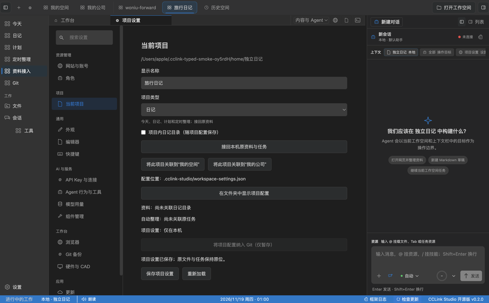
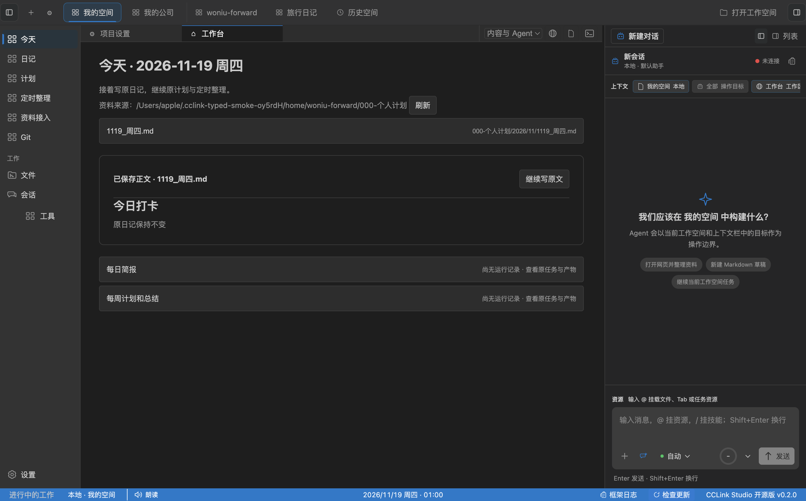
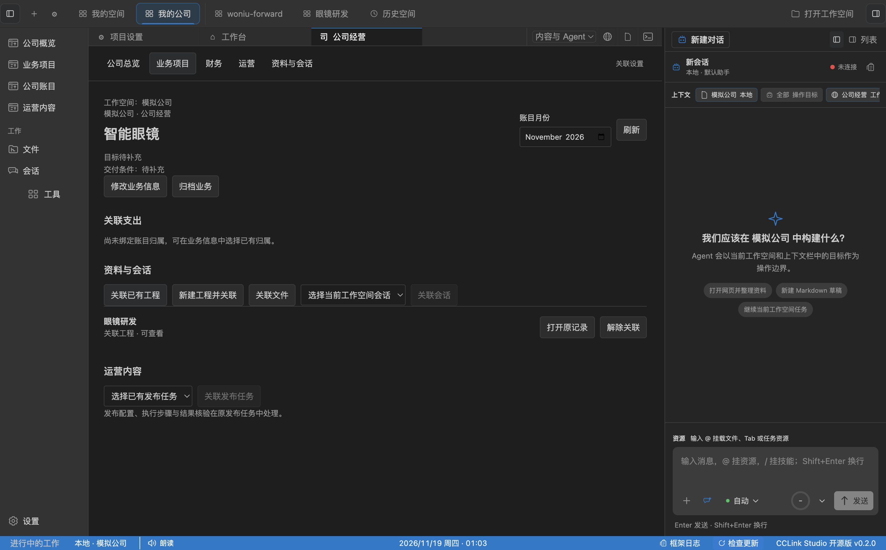
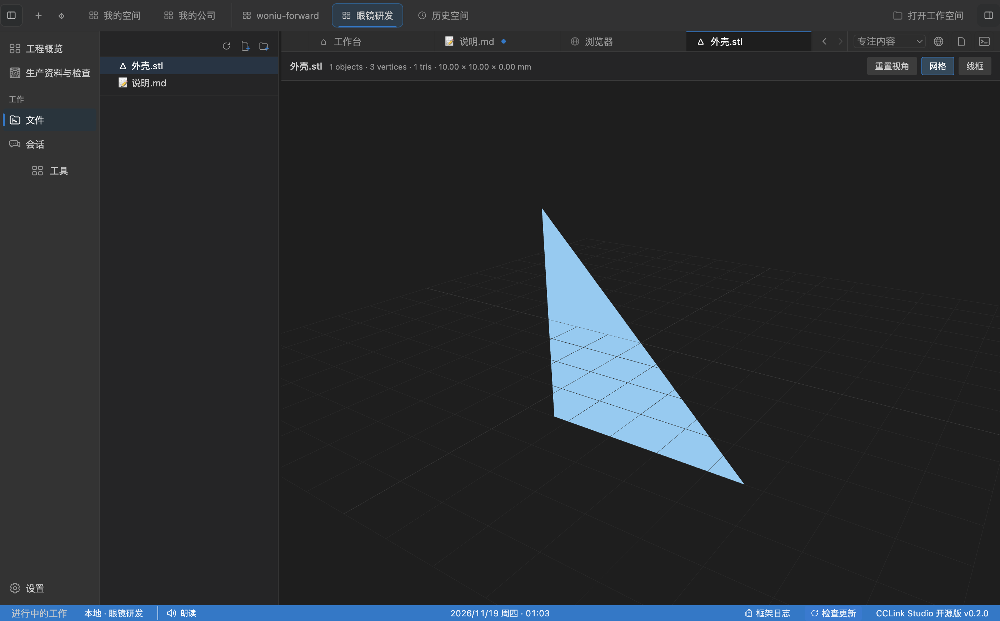
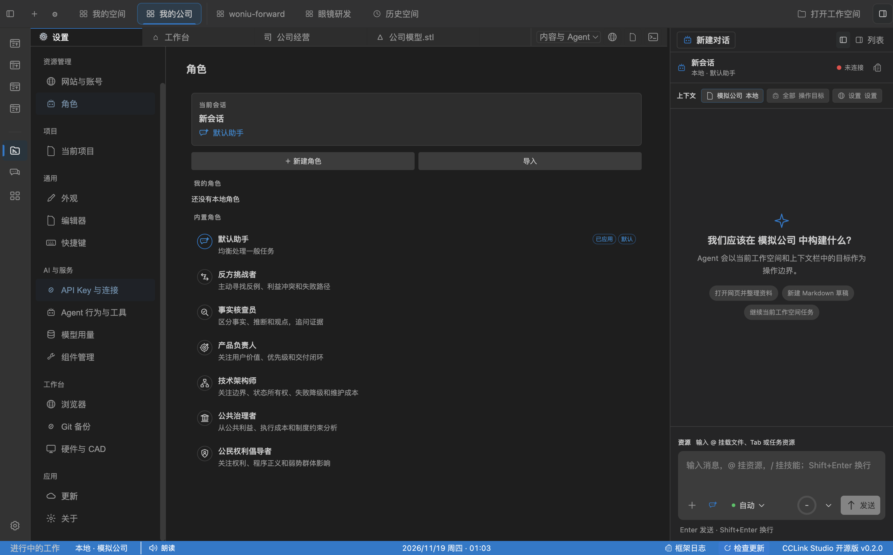
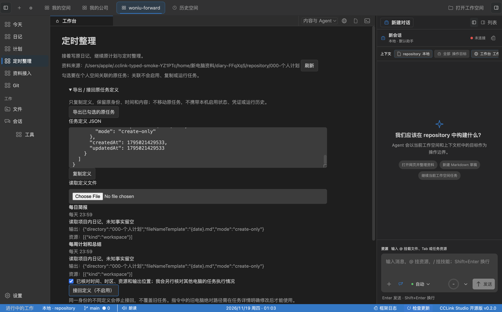
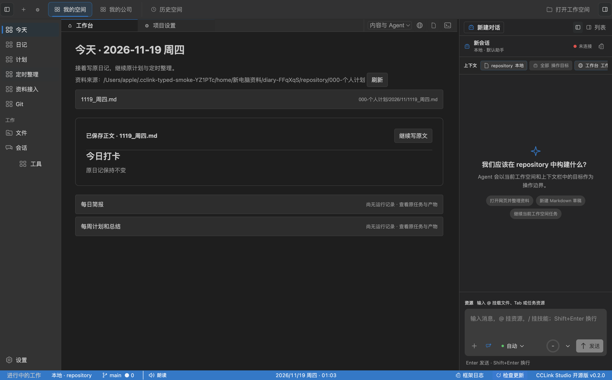
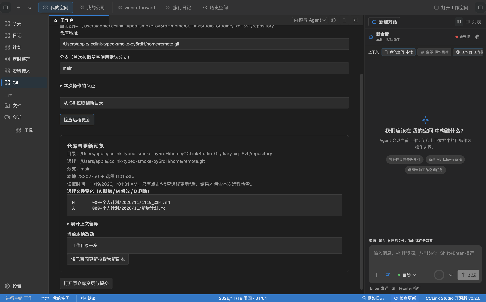

# 项目类型、资料接回与工作版面：真实应用验收

日期：2026-11-19。分支：`codex/typed-workspaces`，独立 worktree `../cclink-studio-typed-workspaces`。

结论：用户可以新建带类型的项目、保存项目设置、原位接回日记/计划/两个任务，并在全新本机配置中从 Git 取回资料。真实 Electron 的首次使用、日常使用和换机模拟三条主流程通过。尚未合并或发布，主工作区另一批重叠的 Agent/布局改动未包含在本次验收中。

## 验收环境与证据边界

- macOS 上运行本分支实际构建的 Electron，Playwright 操作真实 renderer 和主进程。目录选择器仅被替换为确定的隔离测试目录；没有模拟项目、文件、Git、任务服务的业务结果。
- 模拟原资料包括按年/月组织的 Markdown 日记、附件、一日生活计划、周计划，以及原“每日简报”“每周计划和总结”定义。
- Git 使用本地 bare remote，确实执行 clone/fetch/diff/生成更新副本；未使用托管账号或真实用户远端。
- 换机使用第二套全新 userData，项目目录重新 clone。它验证未继承本机绑定/任务启用状态的情况，不能代替在物理另一台 Mac 上安装和认证。
- 原日记、附件、计划和本机任务定义在验收前后逐字节比较一致。创建今日日记和工程只发生在隔离模拟目录中，未访问用户另一台电脑的数据。

原始结果：[首次使用与 Git（22 项）](./evidence/typed-workspaces-2026-11-19/first-results.json)、[日常使用与换机（19 项）](./evidence/typed-workspaces-2026-11-19/journeys-results.json)。截图来自应用运行，区别于设计稿效果图。

## 1. 首次使用：项目设置、新建与原资料接回

| 用户可执行动作                                                   | 本轮观察结果                                                                      |
| ---------------------------------------------------------------- | --------------------------------------------------------------------------------- |
| 项目栏“＋ → 新建项目”，填写名称、选择日记类型及父目录，创建      | 新目录与隐藏设置文件建立；名称/类型可读回                                         |
| 再次使用相同目标目录创建                                         | 拒绝创建，已有设置及目录内容不变                                                  |
| 打开项目设置，设置项目内日记相对目录，保存                       | 首页读取日记类型和相对目录，重启保留                                              |
| 在资料接入中选择模拟原 woniu-forward，核对日记、计划及两个原任务 | 首页预览原正文，计划可打开；任务链接指向原 ID 和原详情                            |
| 点击原日记，再返回首页；重启应用                                 | 原编辑器显示原文件，首页继续显示原来源                                            |
| 在没有今日日记的模拟目录点击“准备今日日记”，重复点击             | 第一次只新建空白模板，第二次打开同一文件；不改写原任务、不运行 AI、不编造昨日总结 |





## 2. 日常使用：公司关联工程、旧入口与内容版面

| 用户可执行动作                                                     | 本轮观察结果                                                |
| ------------------------------------------------------------------ | ----------------------------------------------------------- |
| 公司业务记录“关联已有工程”，选择已有电子开发项目；打开原记录       | 引用原项目身份与目录，没有复制业务对象或工程资料            |
| 从同一业务记录“新建工程并关联”                                     | 使用同一项目创建表单，工程创建后关联到原业务                |
| 将固定“我的公司”关联的项目改为通用，重新从固定入口打开，再改回公司 | 固定入口遵循实际类型；改回后原业务记录仍可见                |
| 在工程编辑 Markdown，选择“专注内容”，切网页再返回                  | 编辑内容保持，版面跟随原标签；未改变项目类型                |
| 打开真实本地网页，在两个版面间切换                                 | 原生 WebContentsView 内容可见，缩放保持 100%                |
| 在电子开发与公司项目分别打开同一 STL                               | 现有 3D 画布显示，无错误；无需修改项目类型                  |
| 打开设置中的账号、角色                                             | 原管理组件可用；其他工作能力继续由类型入口/工具及原命令进入 |
| 从“进行中的工作”返回已启用的定时任务                               | 返回原任务详情，不生成新的任务或调度器                      |







## 3. 换电脑模拟：Git 获取、接回任务与更新

| 用户可执行动作                                            | 本轮观察结果                                                    |
| --------------------------------------------------------- | --------------------------------------------------------------- |
| 原项目设置点击“将项目配置纳入 Git”，查看暂存文件          | 只暂存精确配置路径，不包含身份和本机状态；此动作不等于提交/推送 |
| 原电脑导出两个任务定义，原项目通过正常 Git 提交到模拟远端 | 导出前后原定义字节一致；导出不携带启用和运行历史                |
| 全新用户配置“＋ → 从 Git 获取”，选择新父目录              | 实际 clone；读取原日记类型、相对目录和正文                      |
| 仓库缺少私有任务时查看首页                                | 明确显示定义尚未接回，不按名称生成替代任务                      |
| 导入导出的任务包，核对时间、路径与资源，再重复导入        | 保留两个原 ID；默认未启用，无重复条目；未伪造历史               |
| 在任务详情明确启用，再暂停                                | 本机启用状态确实变化；启用不是立即运行                          |
| 任务启用期间尝试解除原资料关联                            | 主进程拒绝，原关联保持                                          |
| 将新项目绑定“我的空间”，重启                              | 固定入口、资料与任务关联恢复                                    |
| 检查远端更新、查看差异，本地有修改时尝试更新              | fetch 不改变原工作树；未提交修改阻断更新                        |
| 处理模拟本地修改后生成更新副本，核对路径再切换            | 新旧目录分开，旧内容保持；新正文与关联重启后可恢复              |
| 使用无效 Git 地址获取                                     | 错误可见，原资料关联和内容保持                                  |







## 工程门禁与复跑

Web/Node TypeScript、变更文件 ESLint、`git diff --check`、上下文操作边界、凭证边界、Electron 构建通过。受影响 Vitest 36 个文件 / 298 个测试通过，覆盖配置冲突、损坏/未来版本/符号链接、原文件保护、固定入口、Git 精确配置共享策略、任务导入冲突与导航。

在独立 worktree、依赖准备就绪的情况下复跑：

```sh
node node_modules/electron-vite/bin/electron-vite.js build
node scripts/typed-workspaces-smoke.mjs
node scripts/typed-workspaces-journeys-smoke.mjs
```

两份桌面脚本依次运行，每次生成新的 `~/.cclink-typed-smoke-*` 隔离目录，结束关闭 Electron，保留结果与截图供核对。不要同时运行多个需要前台键盘焦点的桌面验收。

本轮一次浏览器地址导航的桌面复跑未通过；脚本补充输入地址断言并改用定位元素填写编辑内容后，完整复跑通过。未调整浏览器缩放逻辑或放宽内容验证来规避失败。

## 保留项与集成要求

1. 未调用外部模型执行真实日报，未验证真实发布、托管 Git 认证、物理另一台 Mac 或完整电路编辑链路。本轮验证任务定义接回/启停与原内容视图，不能扩大为这些能力的完成声明。
2. 首版侧栏按类型整理，账号/角色归设置；自定义图标、侧栏固定/拖拽排序未新增。旧功能保留原组件、服务及命令，但本轮不代表全部旧功能均已真人逐项验收。
3. 主工作区有活跃的未提交修改，并与 `App.tsx`、`core-services.ts` 等重叠。本分支先独立提交，未覆盖、暂存或合并那批修改。协调后需对合并结果验证项目切换、Agent 归属及版面恢复。
4. 未发布；版本线保持 v0.2.x 约定。用户另一台 Mac 只有在安装包含本分支的正式版本并接回资料后，才会出现新界面。
