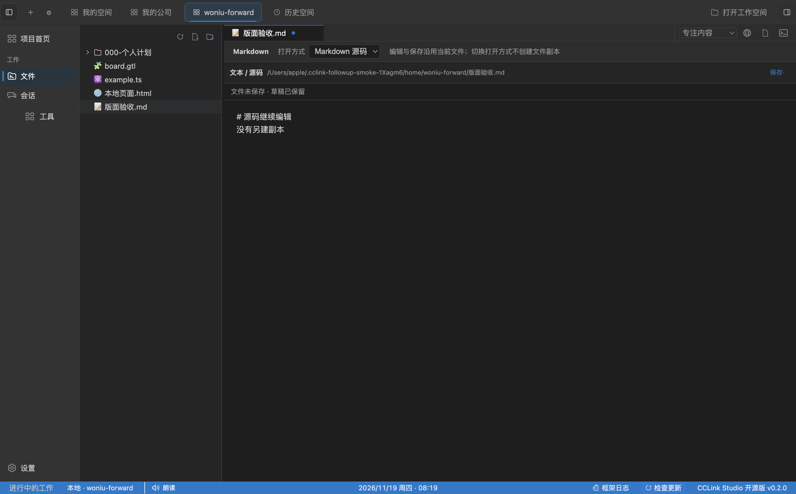
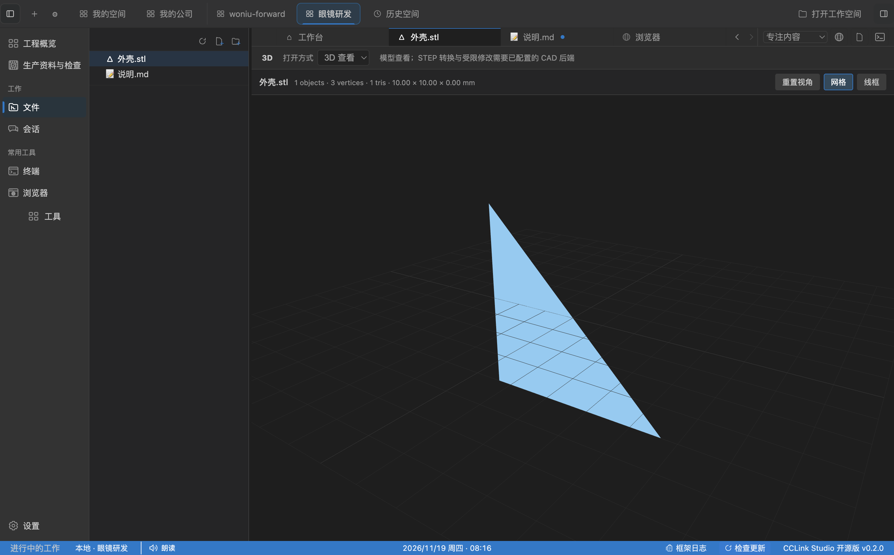
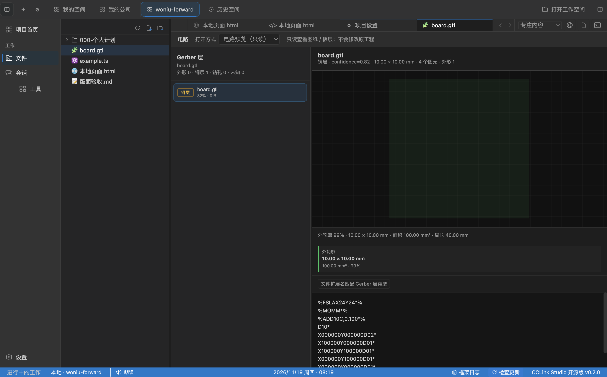
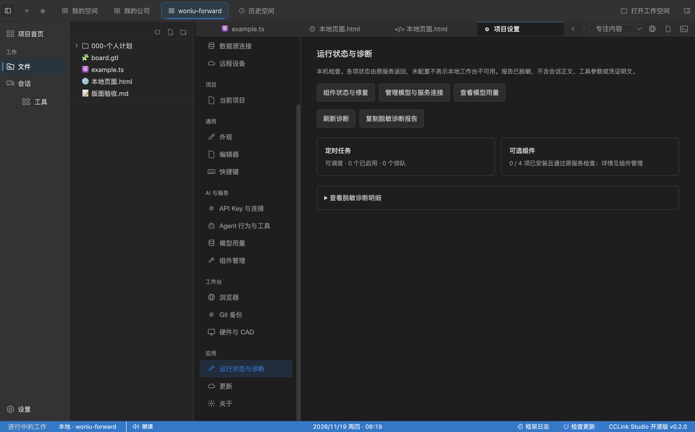
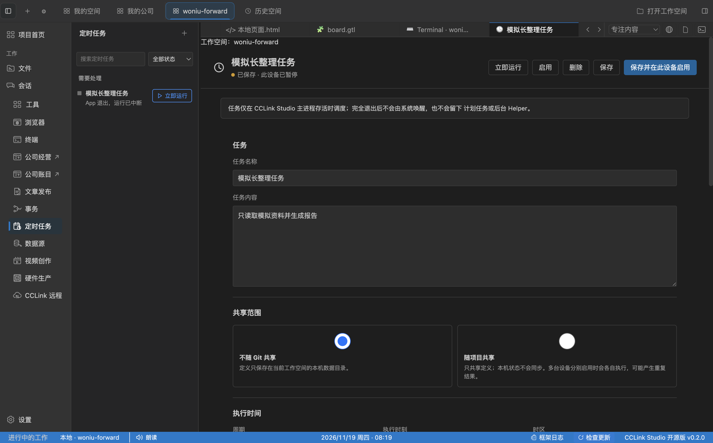

# 专业版面、配置与长任务专项验收

本轮仍在 `codex/typed-workspaces`，不合并、不发布。所有验收资料在隔离目录；原文件及原任务定义作逐字节对照。

## 用户验收动作与完成标准

1. 公司/日记/电子项目打开同一类 Markdown，可在正文与源码间切换，未保存内容、标签身份、项目归属不变；保存失败、外部冲突仍由原 EditorStore 处理。HTML 在原浏览器/源码入口间切换；3D、电路明确只读并使用实际工具，不提供不存在的编辑选项。
2. 内容工具条按内容显示实际版面与适用打开方式；内容与 Agent / 专注内容偏好在原标签中恢复。普通文本代码默认源码。未知/二进制类型不新增源码转换入口。
3. 设置中区分当前项目、本机配置；账号/角色/数据连接/远程设备不占工作导航。远程设备管理不直接切换项目，打开远程项目继续走原选择入口。新增诊断入口读取原状态、显示失败原因和导出原脱敏报告，不新增健康状态 owner。
4. 运行/等待中的原任务，关闭标签与项目后仍能通过“进行中的工作”找到原 ID 并回到原项目；关闭不取消或复制。状态读取失败不能静默视为无任务。退出/重启后已中断任务如实显示，必须明确重试，不假装自动续跑。
5. 使用真实 Electron 与本地确定性模拟执行器验收生命周期。模拟器只替代外部 AI/平台执行，不替代任务服务、持久化、IPC、视图或关闭/恢复行为。单列模拟边界，未经真实账号授权不发布。

## 实现约束与失败降级

Tab 保存版面/打开方式偏好，EditorStore 保存原文和冲突，BrowserManager 仍独占原生视图；不新增 IPC 或能力权限。设置仅复用现有服务查询。任务状态由原 Agent / ScheduledTask / WebAffair / Terminal 服务拥有，汇总只读。组件卸载解除订阅，异步操作校验目标仍存在；错误可见，不覆盖原文件、不移动原资料。专业编辑后端与跨设备认证不在本轮扩建。

结果与截图在验收后补齐；未执行的动作不标记通过。

## 用户功能结果

专项 15 项真实 Electron 检查通过；旧首次使用/Git 22 项、日常/新配置模拟换机 26 项回归通过，共 63 项。新建、项目设置、日记/计划/两个旧任务接回、Git 更新副本、多公司隔离未发现回归。原日记、计划、附件、源码、HTML、Gerber 和原定时任务定义逐字节不变。

| 用户动作                           | 结果与事实边界                                                                                        |
| ---------------------------------- | ----------------------------------------------------------------------------------------------------- |
| 未保存 Markdown 正文 → 源码 → 正文 | 同一标签、同一 EditorStore 内容，源码继续输入能返回正文；不写磁盘原文                                 |
| 选择专注、重启并打开原文           | 原源码打开方式、专注版面、未保存正文恢复；原文件不变                                                  |
| 打开 TypeScript / HTML             | 代码默认源码；HTML 进入真实原生浏览器，可返回原源码标签；HTML 原文未修改                              |
| 打开 STL / Gerber                  | 原 3D 画布与 Gerber 层列表、图形、外轮廓解析可见；适用打开方式明确查看/只读，不提供不存在的编辑器     |
| 设置 → 远程设备 / 运行状态与诊断   | 配置与项目选择分开；状态摘要取原 scheduler/组件服务，详细报告复用原脱敏采集；原连接/用量/修复入口保留 |
| 关闭正在执行的定时任务标签         | 原运行 ID 仍为 running，通过汇总返回原详情                                                            |
| 事务等待人工，关闭标签再返回       | 同一 affair/node ID，仍为 waiting-human；不隐式继续、不提交外部网站                                   |
| 关闭整个项目                       | 确认说明原会话/任务/事务/终端；原任务继续，汇总返回原项目，原路径未变                                 |
| 完全退出并重新启动                 | 原 run ID 标为 interrupted；没有假成功或自动重跑                                                      |
| 明确点击立即运行重试               | 新 run ID 执行完成，旧中断记录保留；模拟结果只以 wx 新建独立产物                                      |
| 重启后返回等待事务                 | 原节点仍等待人工，原账号/目标归属不变                                                                 |
| 本地终端运行 sleep，关闭再返回     | 真实 Shell 进程保留，重新附着同一 session；显式终止成功，没有创建第二个 Shell                         |

### 模拟边界

专项脚本使用最终 Electron 构建的临时副本，只替换 `ScheduledTaskAgentRunner` 的外部生成器构造点为确定性、可等待/取消的生成器。原 `ScheduledTaskService`、调度/账本/重启恢复、IPC、Workspace、Tab、React 界面均运行真实实现；不向这些 owner 填入假运行结果。模拟生成器返回独占新建报告的真实路径、字节数和 SHA256，再由原服务记录完成。脚本在 finally 删除临时构建副本；产品源码没有加入测试开关。

WebAffair 的模拟资料通过真实创建与节点转换 API 准备；没有登录或提交平台。终端使用真实本机 Shell。首次/Git 与日常/换机脚本使用正常构建，无生成器替换。

这证明本机生命周期与界面闭环，不证明真实 AI 生成质量、模型网络失败恢复、实际平台发布、远程 PTY 租约或另一台物理 Mac 安装。

## 可手动验收步骤

1. 打开一个已有本地项目。点击文件应显示原侧栏；打开 Markdown，关闭自动保存后输入文字，选“打开方式 → Markdown 源码”，继续输入，再选正文。检查文字和原标签仍在；不保存即可验证原文件内容不变。
2. 选择专注内容，重启后打开原标签。检查打开方式与未保存正文恢复。新建草稿没有文件转换选项。
3. 同一项目打开 HTML、STL、Gerber：使用适用打开方式及原工具；在公司和电子类型项目也应可打开。只读标识不能理解为完整电路编辑。
4. 设置进入远程设备，不在此处直接浏览目录；打开远程项目继续使用项目打开入口。进入运行状态与诊断，刷新状态并展开脱敏明细；组件管理、连接、用量可原路进入。
5. 使用隔离模拟资料执行 `node scripts/typed-workspaces-followup-smoke.mjs`（需先有 Electron 构建），观察原任务开始执行后关闭标签/项目，点状态栏“进行中的工作”返回。退出重启看到中断，点击立即运行才开始新运行。没有外部账号操作。

## 工程准备度与失败复核

- 42 个受影响 Vitest 文件 / 374 项通过；末次补充“未命名草稿不提供文件转换”后，该文件 12 项通过，合计新增 1 项，不把重复的 11 项计入增量。
- Web/Node TypeScript、变更代码 ESLint、Electron 构建、上下文操作边界、凭证边界、diff 空白检查通过。
- 单测验证领域状态查询失败可见、等待/中断任务不会被当成无任务、终端按项目过滤。失败/中断 Agent 会话的可发现性为单测证据，真实模型长会话尚未专项执行。
- 中途发现并修复真实产品问题：空项目的居中 Agent 遮住文件侧栏；关闭检查漏掉事务/终端与查询失败。不是靠测试绕过它们。
- 脚本修正：已激活文件按钮再次点击会折叠侧栏，改为先判断可见；工具入口实际是 summary；返回原项目要等待异步导航完成；Electron evaluate 无 require，将模拟产物写入交回测试进程；原完成状态是 completed，修正错误的 succeeded 断言。最终保留原 ID、历史、项目路径、文件不变等断言重跑通过。
- 未移动/覆盖真实用户资料；未合并 main、未推送、未发版。v0.2.x 版本约定保持。

## 最终评估

G01（既有专业能力版面/打开方式）与 G02（设置归位）本轮范围完成。G03 本机定时任务/等待人工事务/PTY 主链通过，外部模型长会话与远程执行仍需相应资源验收。没有把原产品不具备的全功能 CAD/EDA 编辑器或真实平台发布列为已交付。

## 原始结果与真实界面

- [专项 15 项与运行 ID](./evidence/typed-workspaces-followup-2026-11-19/results.json)
- [首次/Git 22 项](./evidence/typed-workspaces-followup-2026-11-19/first-results.json)
- [日常/换机 26 项](./evidence/typed-workspaces-followup-2026-11-19/journeys-results.json)
- [工程测试摘要](./evidence/typed-workspaces-followup-2026-11-19/test-summary.txt)

Markdown 原文与源码，共用原文件：

原 3D 画布与内容版面入口：

电路的原图层、闭合外轮廓与只读标识：

配置归位后的运行状态与诊断：

退出重启后原运行如实显示中断：

