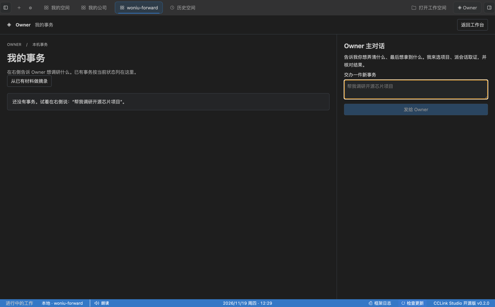

# 项目类型分支与 main 组合回归

日期：2026-11-19。整合对象：`codex/typed-workspaces` 的 `f0510b39` 与 main 的 `9c70c44e`（包含 `36cc8d5d`）。本轮不推送、不发布、不改版本号。

## 用户功能结论

项目设置、新建、旧日记/计划/两个任务接回、Git 副本更新、专业内容版面和关闭恢复，在包含新版 Owner / Agent 的同一 Electron 构建中通过组合回归。主线已提交的新功能与本分支功能可以共同使用。本轮合并门禁通过；使用 Git 快进让 main 接收这份已验收内容，不把主仓库其他未提交工作纳入本次提交。

## 冲突处理

- `ui-store.ts`：沿用 main 的 Agent 单页列表/聊天切换和固定宽度，保留本分支的工具固定顺序、展开状态及持久化。不恢复旧 split 模式，不复制状态所有者。
- 四份设计文档：保留共同产品规则和本分支实际配置示例、实施/验收记录，不回退到 main 中较早的“尚未实现”状态。
- App、preload、核心服务的自动合并经类型、受影响单测和真实应用验证。Owner 继续使用原浮层登记隐藏原生浏览器，未新增浏览器状态 owner。

## 真实应用验收结果

全部在隔离 home / profile 与模拟用户资料中运行，未操作真实日记、计划或账号。三个项目脚本合计 **66 项**：首次/Git 22 项、日常/模拟换机 26 项、专项/组合 18 项。另通过原 main 的 Agent 和 Owner 场景脚本。

| 场景              | 实际动作与结果                                                                                                                      |
| ----------------- | ----------------------------------------------------------------------------------------------------------------------------------- |
| 首次使用          | 新建日记类型、修改项目设置、接回原资料与两个旧任务；原文件和定义不变。Git clone、检查更新、创建更新副本与重启恢复通过；不覆盖旧目录 |
| 日常/换机         | 日记正文、准备今日模板、计划、任务、公司多实例、侧栏设置和原专业查看器通过；新 profile / 本地 Git 模拟换机，共享定义不自动启用      |
| Agent 与 Markdown | 未保存 Markdown 切源码，Agent 列表/对话切换宽度不变；Owner 往返后仍是同一标签、原未保存正文                                         |
| Owner 与网页      | 打开真实原生 HTML 浏览器；Owner 展开时原生 View 从窗口分离，关闭后同一 WebContents 重新附着                                         |
| Owner 与长任务    | 原定时任务 running 时进入/返回 Owner，原 run ID 和状态不变；关闭标签、项目可返回原任务                                              |
| 完全退出/恢复     | 原任务重启标 interrupted，无自动重跑；明确重试才新建运行，旧历史保留；等待人工事务保留原节点；真实本地 PTY 关闭再附着同一 session   |
| 新版 Agent 原行为 | 列表/聊天同宽、草稿、搜索、后台更新、运行/待确认保护、编辑、归档/恢复/删除通过；删除/归档/恢复失败保留原会话及草稿                  |
| Owner 原行为      | 界面创建交办、确认本机汇编、部分补料、退出重启、继续补料、生成摘录、导出 Markdown 完整通过                                          |

### 模拟边界

- 专项只在临时构建副本替换外部定时生成器；调度服务、IPC、账本、重启恢复和 UI 都是真实实现，产物按 create-only 新建。最终删除临时构建副本。
- Agent 场景脚本用模拟运行事件、确认请求和失败响应检查界面及操作保护，不将它计为真实外部模型执行通过。
- Owner 使用真实本机汇编路径，不调用外部模型或研究网站。真实模型长会话/网络恢复、公开平台提交、远程 PTY、托管 Git 凭证和另一台物理 Mac 仍未验收。
- 原专业能力边界不变：本轮没有新增完整 CAD/EDA 编辑器。

## 工程准备度

- 43 个受影响 Vitest 文件：580 项通过、1 项既有跳过。未执行全量 verify，不将受影响门禁写成全仓全量通过。
- Web/Node 类型检查、Electron 构建、变更代码 ESLint、上下文操作与凭证边界、diff 空白检查通过。
- 验收使用独立分支构建；主仓库未提交修改不是本次已验收提交的一部分。

## 主仓库保护与合并方式

保留主仓库原未提交文件、删除标记、未跟踪资料和暂存状态；不 stash、不 reset、不将它们带入提交。合并前核对 main 仍是已整合的 `9c70c44e`、没有发布锁、未提交路径与本次更新路径不重叠；仅执行 `git merge --ff-only codex/typed-workspaces`。合并前后逐文件 SHA256、Git diff / status 与 index 状态检查。发生并行修改或路径重叠时停止合并，不覆盖。

## 可手动复验

1. 打开模拟日记项目，进入项目设置选择类型、固定工具，再打开 Markdown 写入未保存内容；在源码/正文、Agent 列表/对话、Owner 间往返，核对原内容和标签。
2. 打开本地 HTML，进入 Owner 再返回；检查网页没有遮挡 Owner、返回后原网页仍在。
3. 执行 `node scripts/typed-workspaces-followup-smoke.mjs`，观察运行任务进入 Owner、关闭项目、返回、完全退出、重启中断与明确重试；全部使用独立模拟目录。
4. 执行 `node scripts/owner-panel-smoke.mjs`，在模拟资料中观察 Owner 本机汇编的中断续做与导出。

## 证据

- [首次/Git 22 项](./evidence/typed-workspaces-main-integration-2026-11-19/first-results.json)
- [日常/模拟换机 26 项](./evidence/typed-workspaces-main-integration-2026-11-19/journeys-results.json)
- [专项/组合 18 项与原运行 ID](./evidence/typed-workspaces-main-integration-2026-11-19/followup-results.json)
- [Agent 结果](./evidence/typed-workspaces-main-integration-2026-11-19/agent-result.txt)、[Owner 结果](./evidence/typed-workspaces-main-integration-2026-11-19/owner-result.txt)、[工程结果](./evidence/typed-workspaces-main-integration-2026-11-19/engineering-summary.txt)

