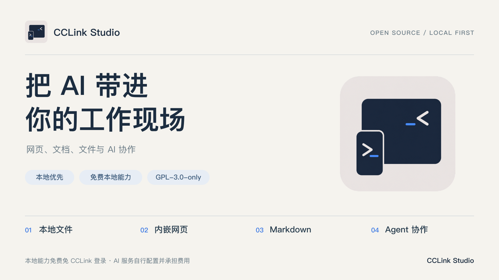
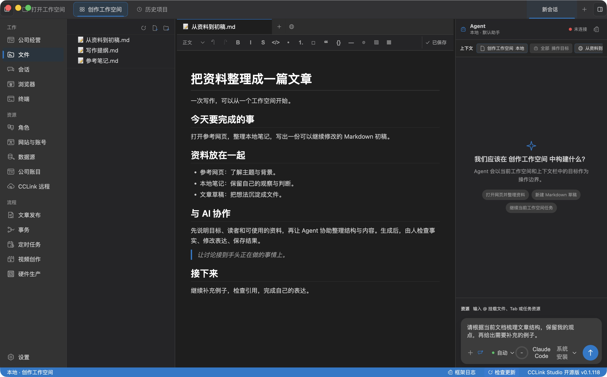
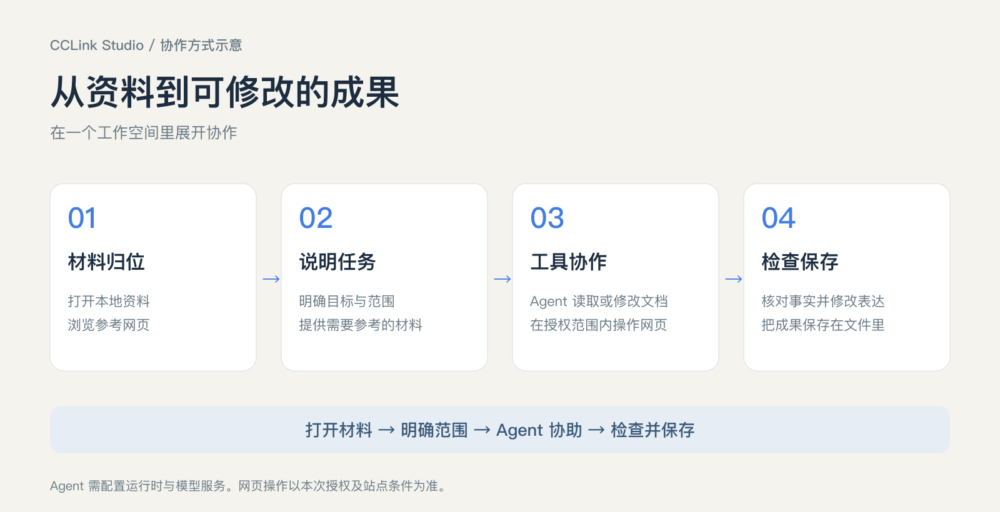
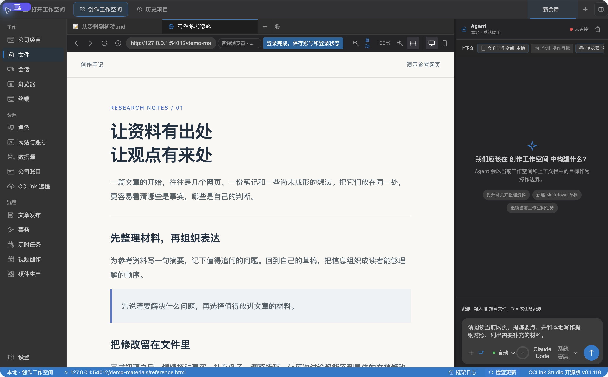

# CCLink Studio 开源 AI 桌面工作台

做一件事情，我们经常需要打开很多工具。

浏览器里查资料，编辑器里写内容，文件夹里找素材，终端里运行命令，再把相关内容复制给 AI。任务推进的过程中，我们也在不断切换窗口、搬运信息、重新解释背景。

我们开发 CCLink Studio，起点就是这些日常工作里的具体麻烦。

我们希望为一件事情准备一个共同的工作空间：资料放在这里，操作发生在这里，讨论产生的结果也能保留下来。

**CCLink Studio 是一款开源、本地优先的 AI 桌面工作台，把网页、文档、文件、终端和 AI 协作放在一起。**

## 从本地文件夹开始工作

打开电脑上的一个文件夹，就可以开始组织工作。在同一个应用中浏览本地文件、编辑 Markdown、打开参考网页，也可以使用终端运行命令。

例如准备一篇文章时，你可以把笔记和草稿放进工作空间，在浏览器中查看参考资料，回到编辑器中继续组织自己的表达。

*真实开发版界面，使用原创演示材料。右侧是一条待发送的任务指令。*

工作空间让这些材料有了共同的归属。文件保存在本地，相应的标签页、草稿和会话状态也可以保存，方便之后继续工作。

## 让 Agent 结合材料参与操作

Agent 是可以调用工具执行操作的 AI 助手。配置运行时与模型服务后，你可以通过自然语言向它说明目标，并提供需要参考的文件、网页和材料。

在 CCLink Studio 中，Agent 可以通过工具读取和修改指定文档，也可以在授权范围内操作内嵌网页。你可以与它推敲文章结构，让它协助整理内容，再把结果写入 Markdown 文件，继续检查和修改。

这让一次讨论能够接到具体的文档工作上：补充一个例子，调整一段内容，或者整理一份后续可以继续使用的草稿。

*协作方式示意。具体执行取决于已配置的 Agent、可用工具和本次任务授权。*

## 在可见的网页中协作

浏览器是 CCLink Studio 的核心组成部分。

你可以自己打开和使用网页，也可以让 Agent 在授权范围内执行页面读取、点击、填写等操作。网页直接呈现在应用窗口中，你能够查看页面变化，必要时中断任务并接管。

*真实内嵌浏览器，展示的是本机原创演示网页；Agent 指令尚未发送。*

遇到登录、验证码等需要人工参与的环节，由人继续处理。我们希望 AI 帮忙执行的同时，用户始终清楚自己正在处理哪份材料、哪个页面和什么任务。

## 为创作和开发提供共同的工作现场

内容创作者可以在这里查阅资料、整理笔记、修改文章。开发者可以围绕同一个工作空间查看文件、阅读文档、使用终端，并与 Agent 协作。

工作台还提供只读数据源查询和面向用户自有 Android 真机的连接入口，为有相应环境的用户提供更多资料与设备操作场景。

这些能力围绕具体工作组合起来，让材料、操作和结果更容易保持联系。

## 本地能力免费 按需配置 AI

CCLink Studio 的本地能力免费，使用本地工作台无需注册或登录 CCLink。

你可以从打开文件、浏览网页、编辑文档开始，再根据需要配置 Agent。当前完整工具 Agent 以 Claude Code 后端为基础，可以使用本机运行时及相应认证，或配置受支持的模型服务。

Studio 本身不提供模型服务。AI 所需的账号、API 和相关费用由用户自行配置和承担。CCLink 远程服务通过独立入口按需登录使用。

## 参与这个开源项目

CCLink Studio 采用 **GPL-3.0-only** 许可证开放源码，当前桌面目标平台为 **macOS**。

你可以查看实现、从源码运行、反馈遇到的问题，也可以参与文档和代码改进。我们希望从真实使用中的需求出发，持续把资料组织、工具协作和工作恢复做好。

欢迎带着一个具体任务来试试：打开自己的文件夹，整理一份笔记，或者围绕一篇文章开始工作。

**让 AI 走进你的工作现场，让每次讨论都能接到手头正在做的事情上。**

项目地址：[GitHub CCLink Studio](https://github.com/AwsomeName/cclink-studio)
