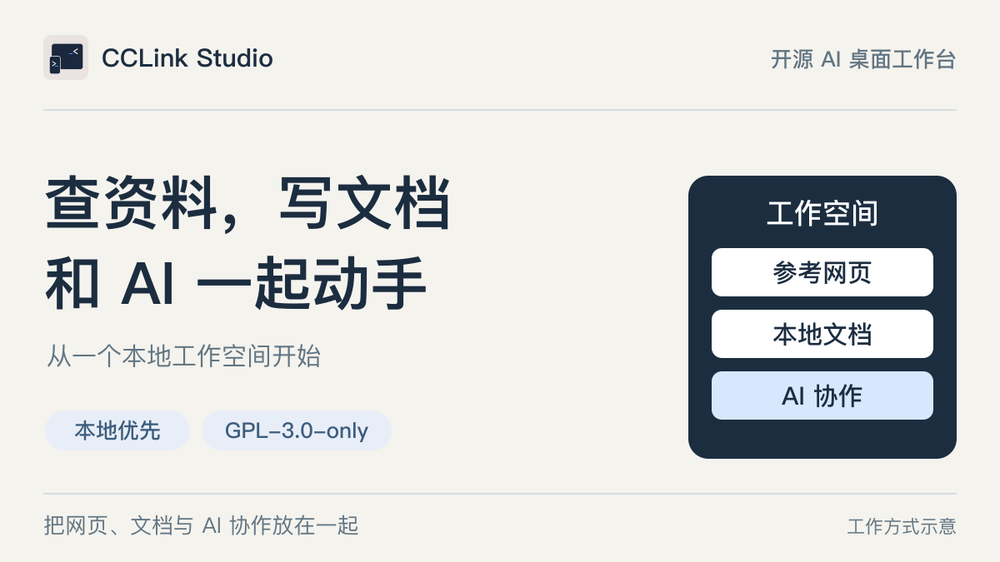
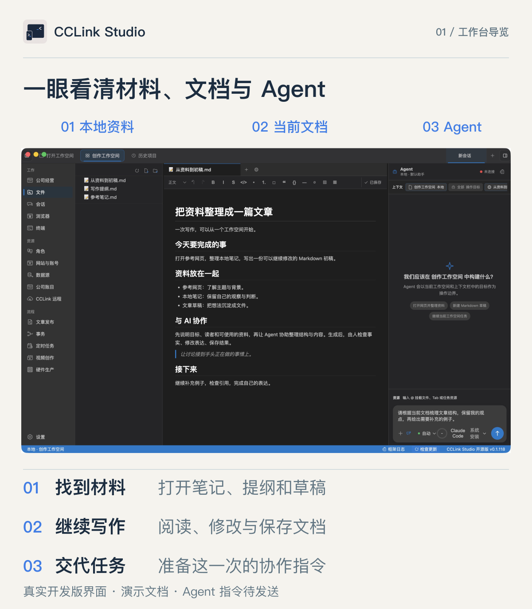
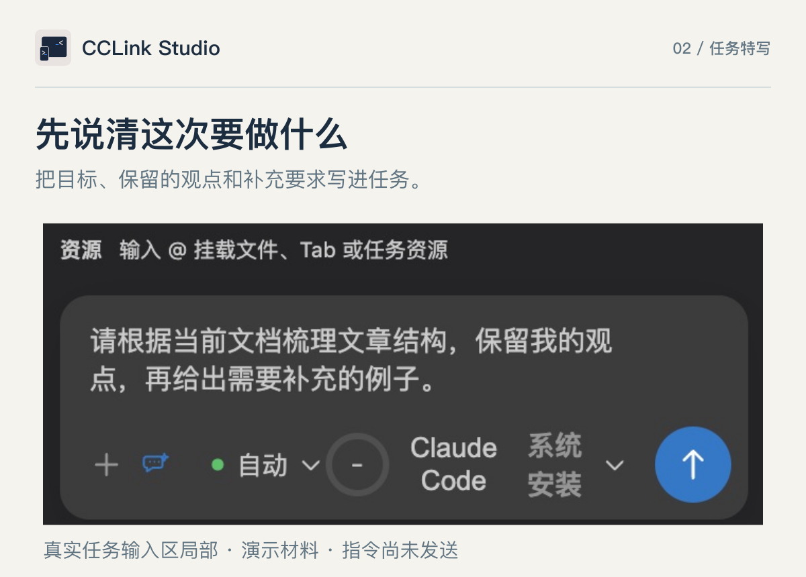
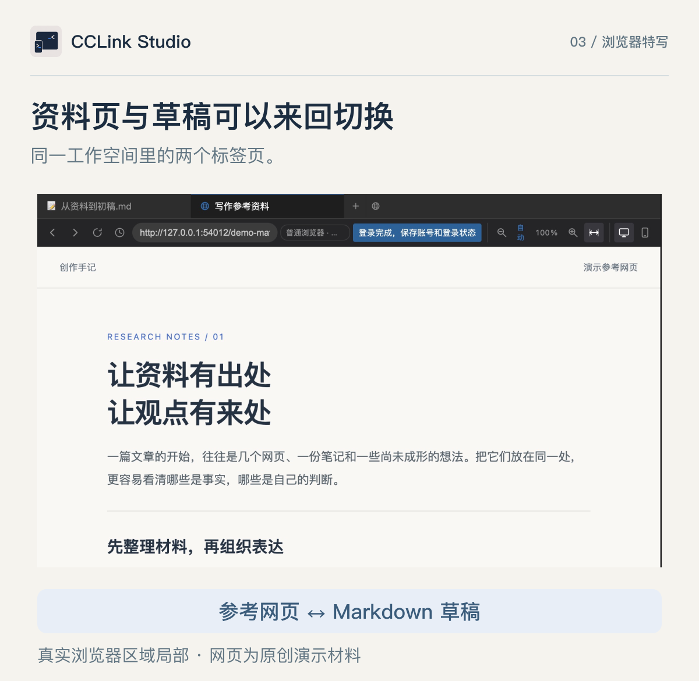
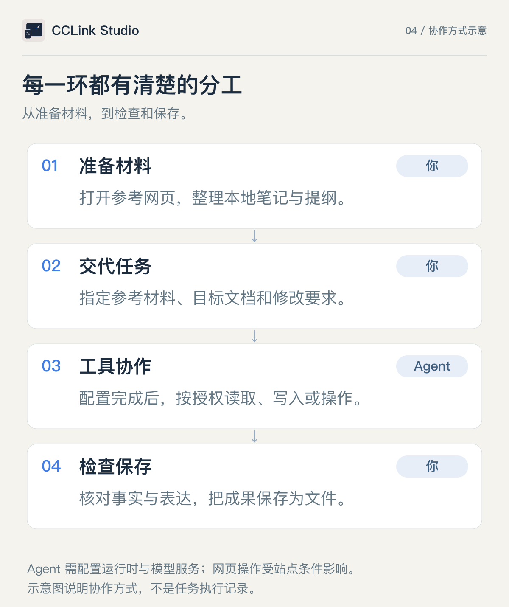

# CCLink Studio 查资料写文档的开源 AI 工作台

准备一篇文章时，你可能会同时打开几个参考网页、一份本地笔记、一篇草稿和一个 AI 对话框。

资料分散在不同窗口里。改到一半，还要回头确认：参考的是哪个页面，改的是哪份草稿，刚才讨论的结果保存在哪里。

我们正在做的 **CCLink Studio**，希望让这段过程更连贯。它是一款**开源、本地优先的 AI 桌面工作台**，把网页、文档、本地文件、终端和 AI 助手组织在同一个工作空间里。

## 先把资料和草稿放在手边

假设你要写一篇产品介绍。先在 Studio 中打开存放素材的本地文件夹，把笔记、提纲和草稿放在里面，再打开需要参考的网页。

工作台里，左侧是文件树，中间是正在处理的文档或网页，右侧是 AI 助手。你可以找到一份笔记，切回草稿继续写，也可以围绕指定材料发起一次协作。

*真实开发版界面，使用演示文档；编号用于说明三个工作区域。*

稿件仍然是一份保存在本地的 Markdown 文件。你可以手动修改和保存，也可以用其他支持 Markdown 的工具继续编辑。工作空间还会保存相应的标签页、草稿和会话状态，方便之后接着做。

## 让 AI 对着这份材料动手

Studio 中的 AI 助手称为 **Agent**，可以通过工具执行文档和网页操作。配置好 Agent 后，你可以提供指定文件或网页，再说明这次要处理什么。

例如，先从一条具体的任务开始：

> 请根据当前文档梳理文章结构，保留我的观点，再给出需要补充的例子。

*真实任务输入区的局部截图，展示的是待发送指令。*

Agent 可以通过工具读取指定内容，协助整理结构、补充段落，并在授权范围内把内容写入文档。你再回到编辑器中检查事实、调整表达，决定最终采用哪些内容。

这样，一次讨论可以落到一份具体草稿上。修改后的文件留在工作空间里，后续还能接着读、接着改。

## 网页就在旁边 需要时可以接手

查资料时，可以直接在 Studio 的内嵌浏览器中打开参考页面。网页和草稿各占一个标签页，阅读材料与修改文档可以来回切换。

*真实浏览器区域的局部截图，网页内容为原创演示材料。*

需要 AI 参与时，Agent 可以在授权范围内读取页面、点击和填写。网页操作呈现在应用窗口中，你可以查看变化，中断任务，或者接管操作。

遇到登录、验证码等环节，由人继续处理。页面是否可访问、账号是否已登录、站点是否允许当前操作，都会影响任务能否推进。

## 从准备材料到检查保存

围绕一篇文章，可以把协作分成几个清楚的环节：先准备材料，交代任务和范围，再让 Agent 使用工具协助处理，最后由人检查并保存。

*协作方式示意，用于说明分工，不是本次任务的执行记录。*

文章只是一个入口。如果你做开发，也可以在同一个工作空间中查看文件、阅读文档、使用终端运行命令，再结合具体材料与 Agent 讨论。

## 本地能力免费 按自己的需要配置 AI

CCLink Studio 的本地能力免费，使用本地工作台无需注册或登录 CCLink。可以先打开文件、浏览网页、编辑文档、使用终端，再根据需要配置 AI。

当前完整工具 Agent 以 **Claude Code** 后端为基础，可以使用本机运行时及相应认证，或配置受支持的模型服务。**模型账号、API 和调用费用由用户自行配置和承担。**

## 从一个具体任务开始试用

CCLink Studio 当前面向 **macOS**，采用 **GPL-3.0-only** 许可证开放源码。你可以查看实现、从源码运行，也可以参与文档和代码改进。

如果你也经常在网页、文件和 AI 对话之间搬运材料，欢迎从一个小任务开始：整理一份笔记，准备一篇文章，或者修改一份文档。

试用后，把具体的操作步骤、遇到的卡点和你希望怎样改告诉我们。我们希望沿着这些真实需求，把这个工作台继续做好。

查看项目与上手说明：[GitHub CCLink Studio](https://github.com/AwsomeName/cclink-studio)
