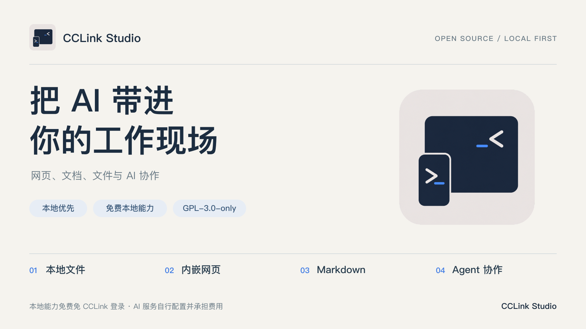
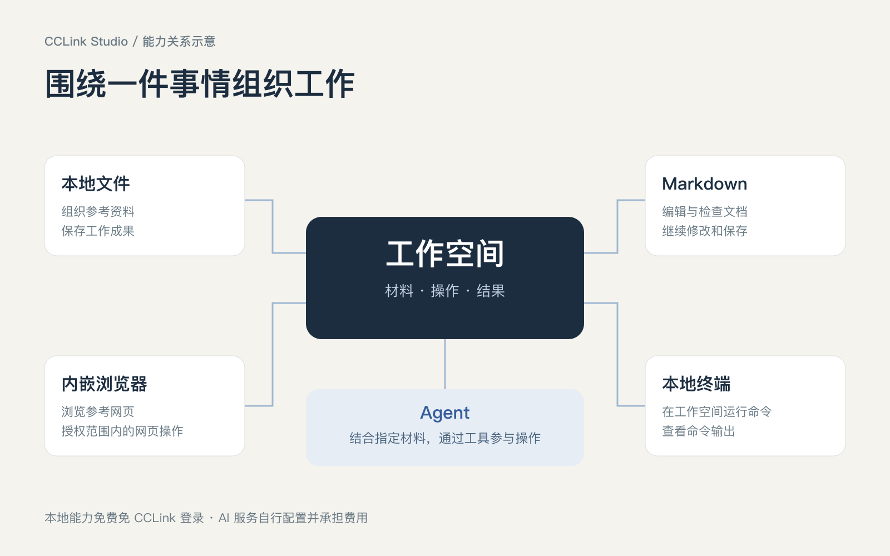
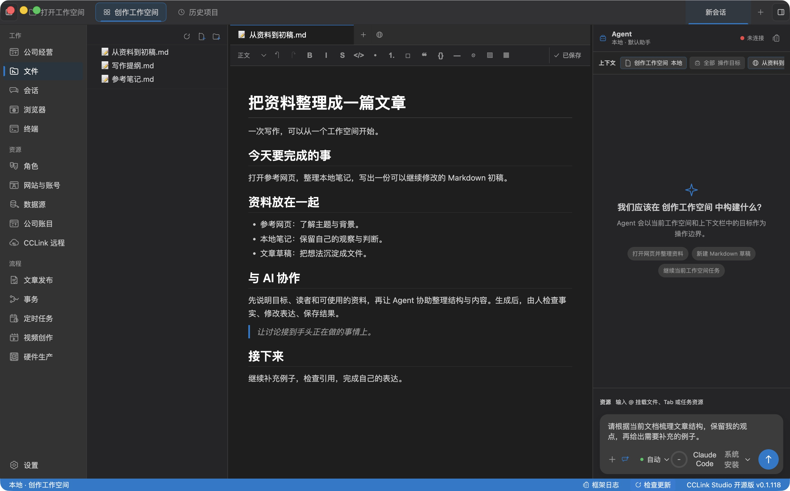

# CCLink Studio 开源桌面工作台介绍



大家好，我们正在开发 CCLink Studio，一款采用 GPL-3.0-only 许可证的本地优先 AI 桌面工作台。

使用 AI 完成实际工作时，参考网页、本地资料、讨论过程和最终文件经常分散在不同工具中。我们希望以工作空间为中心，把这些环节连接起来，让 Agent 可以结合指定材料，通过工具参与实际操作。

## 当前本地能力

| 能力 | 用途 |
| --- | --- |
| 工作空间与文件 | 打开本地目录，管理文件，保存标签页、草稿和会话状态 |
| 内嵌浏览器 | 查看网页，让 Agent 在授权范围内通过 Playwright 操作可见页面 |
| Markdown 编辑 | 可视化编辑和本地保存，通过 Agent 工具读取、写入和追加内容 |
| 本地 Agent | 使用 Claude Code 后端，提供流式输出、工具调用、权限确认和会话管理 |
| 本地终端 | 在工作台内运行命令、查看输出 |
| 数据与设备入口 | Elasticsearch 只读查询，用户自有 Android 真机连接 |



*能力关系示意，展示工作组织方式。*

本地能力免费，免 CCLink 账号登录；模型服务需要用户自行配置并承担相关费用。当前完整工具 Agent 以 Claude Code 后端为基础。远程服务通过独立入口按需登录使用。

## 一个容易上手的场景

打开一个本地工作空间，放入笔记和 Markdown 草稿。在内嵌浏览器里查阅资料，再回到文档中继续编辑。配置 Agent 后，可以围绕指定文件提出整理、补充和修改任务。



*真实开发版界面，使用演示文档；本图展示任务准备状态。*

## 技术栈与启动方式

项目主要使用 Electron、React、TypeScript、Zustand、Tiptap 和 Playwright。文件读写统一经主进程 IPC，浏览器、编辑器、Agent 和终端按各自能力边界接入工作台。

当前桌面目标平台为 macOS。源码启动需要 Node.js 与 pnpm，具体环境要求以仓库 README 为准。

```bash
git clone https://github.com/AwsomeName/cclink-studio.git
cd cclink-studio
pnpm install
pnpm dev
```

使用 Agent 还需安装和认证对应运行时，或在设置中配置受支持的运行时与模型服务。

## 欢迎带着具体问题参与

我们尤其欢迎资料整理、Markdown 写作、开发辅助和网页操作中的实际反馈。提交问题时，附上操作步骤、预期结果、实际现象和脱敏诊断，更容易帮助项目定位问题。

使用反馈、文档完善、问题复现和代码贡献都欢迎。

项目地址：[GitHub CCLink Studio](https://github.com/AwsomeName/cclink-studio)
