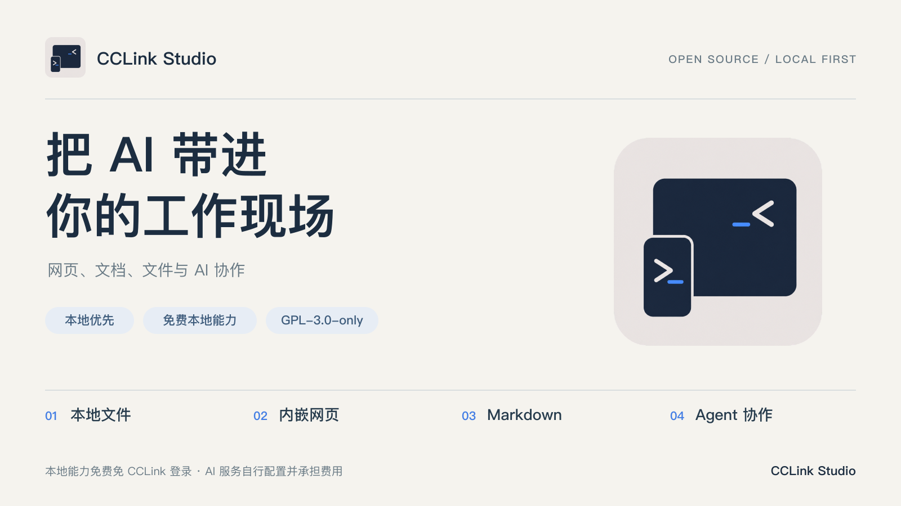
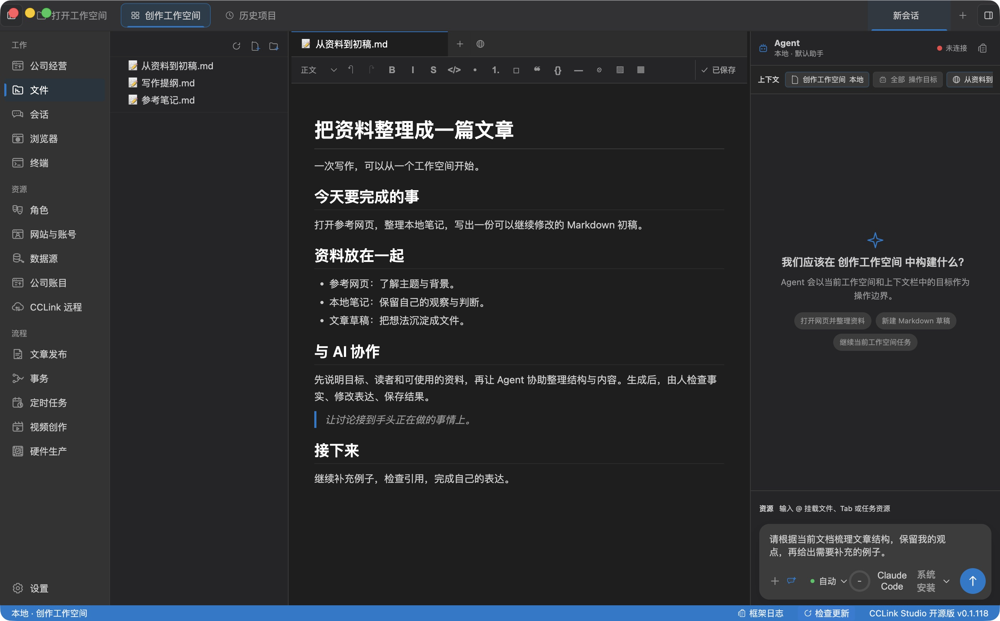
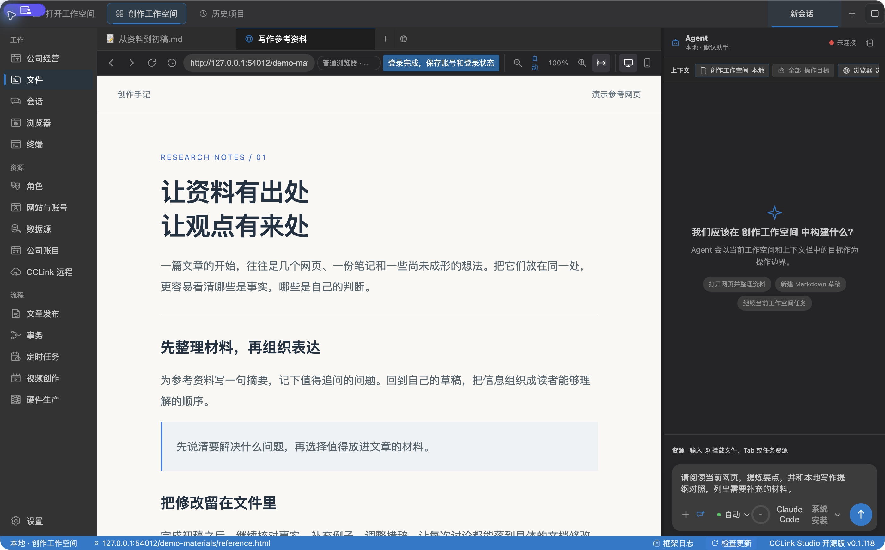

# CCLink Studio 官网首页文案

## 首屏

**把 AI、网页和文档，放进同一个工作空间。**

CCLink Studio 是一款开源、本地优先的 AI 桌面工作台。打开本地文件夹，浏览资料、编辑 Markdown、运行命令，与 AI 一起推进手头的工作。

[查看源码](https://github.com/AwsomeName/cclink-studio) · [开始使用](https://github.com/AwsomeName/cclink-studio#快速开始)

本地能力免费 · 免 CCLink 登录 · GPL-3.0-only · 当前支持 macOS

## 工作空间

**围绕一件事情组织资料。**

把本地文件、网页、草稿和 AI 会话放进同一个工作空间。保存工作状态，之后回来继续。

*真实开发版界面，文档为演示材料，Agent 指令处于待发送状态。*

## Agent 协作

**让讨论接到实际操作上。**

配置 Agent 后，通过工具读取和修改指定文档、操作授权网页，把讨论逐步变成可以检查和保存的成果。

## 浏览器

**网页就在眼前，需要时由你接手。**

在内嵌浏览器中查阅资料，也可以让 Agent 在授权范围内执行网页操作。查看页面变化，中断任务，在需要时接管。

*真实内嵌浏览器与原创演示网页，展示浏览和任务准备位置。*

## 本地使用与 AI 配置

**从本地开始，按自己的需要配置。**

本地工作台免费，免 CCLink 账号登录。当前完整工具 Agent 以 Claude Code 后端为基础；模型账号、API 和调用费用由用户自行配置和承担。远程服务通过独立入口按需登录。

## 开源参与

**一起把日常工作中的麻烦解决好。**

查看源码，从一个具体任务开始体验。欢迎提交反馈、完善文档和参与开发。

[了解 CCLink Studio](https://github.com/AwsomeName/cclink-studio)
