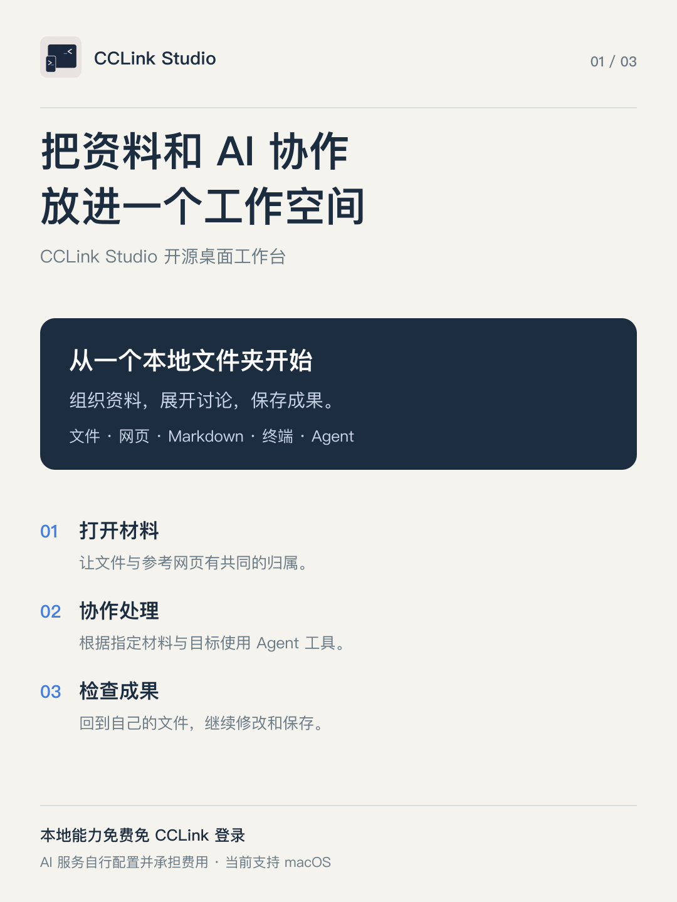
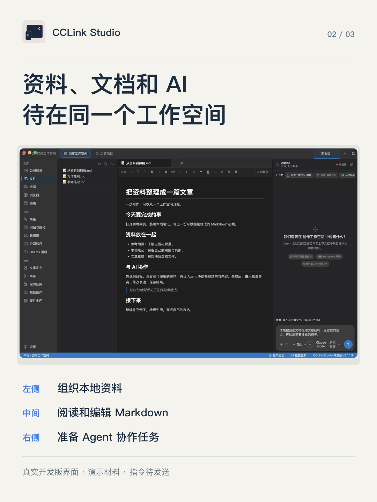
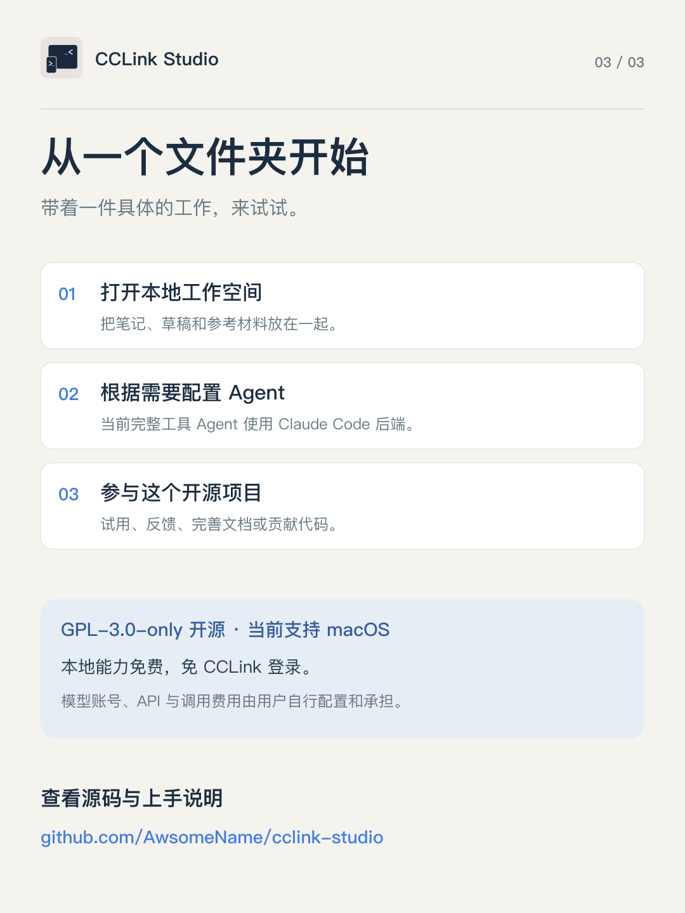

# CCLink Studio 社交媒体宣传文案

## 朋友圈与社群版

最近在做一个开源项目：CCLink Studio。

想解决的，是工作时反复切换工具、复制资料、给 AI 解释背景这些麻烦。

我们把本地文件、浏览器、Markdown 编辑器、终端和 AI Agent 放进同一个桌面工作台。围绕一个工作空间查资料、写内容、运行命令，也让 AI 通过工具参与文档和网页操作。

本地功能免费，免 CCLink 登录；AI 服务自行配置并承担相关费用。项目采用 GPL-3.0-only 开源，当前支持 macOS。

欢迎试用、提建议，也欢迎一起参与。

[GitHub CCLink Studio](https://github.com/AwsomeName/cclink-studio)

## 简短转发版

我们正在做 CCLink Studio：一个开源的 AI 桌面工作台，把网页、文档、本地文件、终端和 AI 协作放在一起。

希望让每一次与 AI 的讨论，都更容易接到手头正在做的事情上。

本地功能免费免 CCLink 登录，AI 服务自行配置并承担费用，当前支持 macOS。欢迎体验：[项目地址](https://github.com/AwsomeName/cclink-studio)。

## 三图介绍版

正文：

工作时，我们常常在网页、文件夹、编辑器和 AI 对话之间来回切换。

CCLink Studio 想把这些放进同一个工作空间：打开自己的资料，边看、边写、边与 AI 协作，最后留下可以继续修改的文件。

项目已开源，本地功能免费免 CCLink 登录。当前支持 macOS，AI 服务自行配置并承担费用。欢迎从一个具体任务开始试用。

[了解项目](https://github.com/AwsomeName/cclink-studio)

按以下顺序配图：

第二张为真实开发版界面配图，使用演示文档，Agent 指令尚未发送。其余为编辑制作的介绍图卡。
